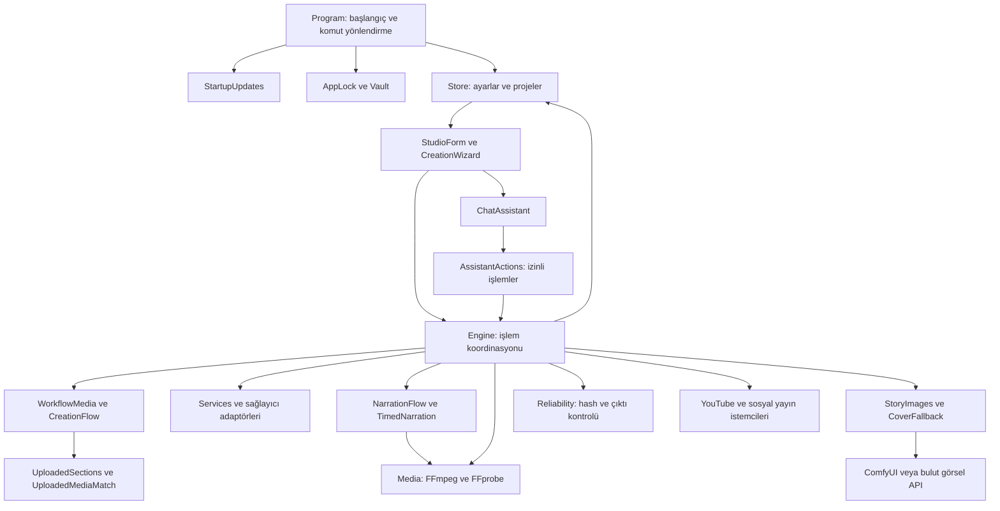

# TubeFlow 0.4.28

**Windows üzerinde metinden, hazır sesten ve görsel arşivden video hazırlama, inceleme ve yayınlama uygulaması.**

Bu README; son yayımlanan **0.4.28** kaynak kodunun kullanım kılavuzu, çalışma mekanikleri ve geliştirici başvurusudur. Belgeleme tarihi **19 Ekim 2026**. Uygulamanın mevcut davranışları anlatılır; bölümleme sonrası erken zaman çizelgesi, Cortex maskotu ve ücretsiz yerel görsel analizi bu sürümde uygulanmıştır. Model adları ve ayarların başlangıç değerleri kaynak kodundan alınır; ilgili hizmette her zaman kullanılabileceklerine veya ücretsiz olduklarına ilişkin bir taahhüt değildir.

Ana çalıştırılabilir dosya **TubeFlow.exe**, proje dosyası **src/AnkaStudio.csproj**, C# ad alanı **AnkaStudio** olarak kalmıştır. Eski kurulumların veri ve güncelleme uyumluluğu için bazı dizin, dosya ve protokol adları hâlâ `AnkaStudio` / `anka` içerir. Bunlar ikinci bir ürün veya ilave dil desteği anlamına gelmez.

## İçindekiler

1. [Ürün ve özelliklerin tamamı](#ozellikler)
2. [Sistem gereksinimleri ve kurulum](#kurulum)
3. [Ekranlar ve temel kullanım](#ekranlar)
4. [Beş adımlı üretim](#bes-adim)
5. [Metin, kaynak ve süre mekanikleri](#metin)
6. [Bölümleme ve yüklenen görüntüleri eşleştirme](#eslestirme)
7. [AI sahne görselleri ve sabit karakterler](#ai-gorseller)
8. [Yerel motor, kalite ve donanım seçimi](#motor)
9. [Kapak, açılış/kapanış kartları ve logo](#kapak)
10. [Seslendirme, hazır ses ve önbellek](#ses)
11. [Altyazı ve gerçek ses zamanlaması](#altyazi)
12. [Kurgu, zaman çizelgesi ve manuel düzenleme](#kurgu)
13. [Müzik arşivi ve müzik klibi](#muzik)
14. [Stok kaynakları ve medya havuzu](#stok)
15. [Sohbet AI / uygulama asistanı](#asistan)
16. [Projeler, kuyruk, takvim ve otomasyon](#kuyruk)
17. [YouTube bağlantısı, yayın ve istatistikler](#youtube)
18. [Diğer sosyal platformlar ve bağlantı hizmeti](#sosyal)
19. [GitHub ve uzaktan işler](#github)
20. [Otomatik güncelleme ve paket çeşitleri](#guncelleme)
21. [Mimari ve bileşen ilişkileri](#mimari)
22. [Veri modeli ve ayar önceliği](#veri-modeli)
23. [Disk düzeni, yedek, taşıma ve bakım](#depolama)
24. [Durum, ilerleme, iptal ve hata kurtarma](#hatalar)
25. [Güvenlik, gizlilik ve hizmet izinleri](#guvenlik)
26. [Derleme, paketleme ve test](#gelistirme)
27. [Komut satırı ve önizleme araçları](#komutlar)
28. [Sorun giderme](#sorun-giderme)
29. [Gerçek sınırlar ve önerilen geliştirme](#sinirlar)
30. [0.4.28 doğrulama ve değişiklik özeti](#dogrulama)
31. [Ek A — Kaynak dosyalarının tamamı](#kaynak-katalogu)
32. [Ek B — Alanlar, türler ve başlangıç değerleri](#alan-katalogu)
33. [Ek C — Tür ve metot imzaları](#metot-katalogu)
34. [Ek D — Önceki sürüm notları](#surum-gecmisi)

<a id="ozellikler"></a>
## 1. Ürün ve özelliklerin tamamı

TubeFlow bir masaüstü üretim koordinatörüdür. Metin servisleri, seslendirme servisleri, yerel görsel motorları, görsel analiz, stok kütüphaneleri, FFmpeg ve yayın API’lerini aynı proje durumuna bağlar. Dosya uzantısını değiştirerek video üretmez: ses, altyazı, görseller ve kartlar işlenerek yeni medya çıktısı oluşturulur.

| Alan | Mevcut özellikler | Koşul / önemli ayrım |
|---|---|---|
| İçerik girişi | Hazır metin, AI ile metin, konu ve talimat, hedef süre, normal video, Shorts, ek Shorts | Onaylı kullanıcı metni kendiliğinden yeniden yazılmaz. |
| Araştırma | Kaynak URL’leri, araştırma servisi, kaynak listesi, açıklamaya kaynak ekleme | Otomatik araştırma yolunda kaynak doğrulama vardır; doğruluk için insan incelemesi yine gerekir. |
| Metin denetimi | Süre/kelime bütçesi, Türkçe yazım denetimi, eksik metni tamamlama, sahne başlıkları, seri başlıkları | Kullanıcı anlatımı yolunda otomatik tamamlama/yazım müdahalesi kısıtlanır. |
| Sahneleme | AI görsellerinde 5–10 sahne, diğer bölümleme yolunda en fazla 50 grup, cümle temelli kurtarma | Bunlar farklı akışlardır; bütün videoların aynı sahne sayısı yoktur. |
| Yüklenen medya | Fotoğraf/video içeriğini analiz etme, anlatıma göre dosya seçme, açıklama önbelleği | 0.4.28 anlamsal yol: otomatik mod + yalnız kendi görselleri. Karma kaynak akışının tümü bu davranışa dönüştürülmüş değildir. |
| AI görsel | Ayrı sahne görselleri, karakter tarifi, referans, yerel/bulut seçenekleri, kalite seçimi, tek sahne yenileme | Kurulu model ve izinli sağlayıcı gerekir. |
| Kapak | Şablon, hazır PNG, AI arka plan, referans kapak, başlık/font/renk/logo, arşiv, kart editörü | Kapak değiştirmek mevcut MP4’ü anında yeniden kodlamaz; geçerlilik ve yeniden üretim akışı vardır. |
| Ses | Windows, Piper, XTTS, Google Cloud TTS, ElevenLabs, hazır ses dosyası, ses örneği, telaffuz sözlüğü | Seçili sesin gerçekten bulunması gerekir; servis bazında yetenek değişir. |
| Altyazı | Beş hazır görünüm, ASS/SRT üretimi, gerçek konuşma zamanları, yerel ses eşleme, izinli Gemini ses analizi | Tahmini eşit süre dağılımı gerçek ses eşlemesinin yerine geçirilmez. |
| Kurgu | Fotoğrafa yavaş hareket, video kesme/döngü, oran uyarlama, yazı yerleşimi, geçiş, önizleme, sahne düzenleme | Video içindeki her nesnenin kare kare aranması bu sürümün genel garantisi değildir. |
| Müzik | Yerel arşiv, tarama, uygulama içi önizleme, seçim, ses seviyesi, lisans/atıf, ducking, müzik klibi | Seçim ve önizleme farklı işlemlerdir; rastgele müzik atanmaz. |
| Proje yönetimi | Arşiv/gruplar, kopya/yeni sürüm, proje silme, video yedeği, taşınabilir paket, kaynak yeniden bağlama | Yayınlanmış projenin üstüne değişiklik yerine kopya gerekebilir. |
| Otomasyon | İş sırası, takvim, planlı yayın, otomatik araştırma/üretim/yayın tercihleri, yeniden deneme | Otomatik çalışma ilgili onay ve koşulları kaldırmaz. |
| YouTube | OAuth, kanal doğrulama, devam edebilen yükleme, kapak, açıklama, görünürlük/tarih, durum tarama, istatistik/öneri | Hesap izinleri, platform işleme süreleri ve API kotaları geçerlidir. |
| Sosyal yayın | Instagram, Facebook Sayfası ve TikTok bağlantı/yayın kodları; yayın durumu takibi | Ek OAuth hizmeti, geliştirici kaydı ve platform onayı gerekir; hazır canlı kurulum sayılmaz. |
| Sohbet AI | Rehber tabanlı yanıt, durum inceleme, ayar uygulama, bilinen hata onarımı, motor kontrolü, istek üzerine üretim tekrarı, geri alma | Kod, komut, parola, dosya silme ve video yayınlama aracı yoktur. |
| Bağlantılar | Yerel/bulut modeller, model keşfi ve kontrolü, anahtar kaydı, Android/Firebase anahtar aktarımı | Anahtarın kayıtlı olması hizmetin çalıştığının kanıtı değildir. |
| Bakım | Motor kontrolü, alan tahmini, sınırlı önbellek temizliği, yedek, eski program dosyalarını ayırma | Gerçek proje ve çıktı dosyalarıyla önbellek ayrılır. |
| Arayüz | Koyu görünüm, dar/geniş sol menü, son projeler, alt sohbet, açılır gruplar, bilgi düğmeleri, gömülü oynatıcılar, yükleme göstergeleri | Tamamlanmış adım, aktif adım ve arka plan işi ayrı durumlardır. |
| Dağıtım | Windows x64 paket, başlangıçta güncelleme, manifest ve SHA-256 kontrolü, eski adlarla uyumluluk | Program güncellemesi ile model/FFmpeg kurulumunun kapsamı aynı değildir. |

<a id="kurulum"></a>
## 2. Sistem gereksinimleri ve kurulum

### 2.1 Çalışma ortamı

- Hedef: Windows masaüstü, `net10.0-windows`, WinForms; yayımlanan otomatik paket `win-x64` içindir.
- Tam bağımsız (`--self-contained true`) dağıtım .NET çalışma zamanını içerir. Kaynaktan çalıştırmak için .NET 10 SDK gerekir.
- Video işleme için **FFmpeg ve FFprobe birlikte** gereklidir. FFprobe, seçilen FFmpeg ile aynı dizinde aranır.
- Görsel üretim için GPU zorunluluğu her modda aynı değildir. Stok/hazır medya ve CPU kodlama kullanılabilir; büyük yerel AI modellerinin bellek ve model dosyası ihtiyacı ayrıdır.
- Yerel ses eşleme, Piper, XTTS, Ollama ve ComfyUI bileşenleri ayrı çalışma ortamlarına sahiptir. Birinin kurulması diğerlerini kurmuş sayılmaz.
- Bulut modelleri, stok arama, hesap bağlantıları, yayınlama ve güncelleme internet ister. Kurulu yerel bileşenlerle bazı üretim yolları çevrimdışı çalışabilir; bütün özellikler çevrimdışı değildir.

Kaynak kod tek bir evrensel RAM/VRAM alt sınırı belirlemez. Bu nedenle burada “her bilgisayarda şu RAM yeterli” gibi doğrulanmamış bir donanım vaadi verilmez. `DeviceMemory`, `EngineHardware` ve yerel motor kontrolleri mevcut donanımı değerlendirir.

### 2.1.1 Hazır üretim kalıpları ve ilk kullanım sihirbazı

İlk kurulum sihirbazı üç adımda kanal adı, ilk içerik kalıbı ve Stüdyo’ya geçişi sunar; YouTube hesabını kendiliğinden bağlamaz. `ProductionPresets` dört kalıp içerir:

| Kalıp ID | Ad | Amaç |
|---|---|---|
| `story` | Kıssa ve Hikâye • 9:16 | Karakter referanslı AI görselleri, sinematik hareket ve altın altyazı. |
| `documentary` | Belgesel • 16:9 | Yatay anlatım, konuya göre stok görüntü, sade altyazı. |
| `package` | Normal video + 2 Shorts | Yatay ana video ve iki bağımsız kısa video. |
| `music` | Müzik / Fotoğraf Klibi | Seçilen ana müzikle fotoğraf akışı; parça/hak bilgisi ayrıca gerekir. |

Kalıp bir başlangıç ayar grubudur; hazır metni veya mevcut planı otomatik değiştirmek için kullanılmaz. Oluşmuş plan/çıktı varsa başka kalıp için yeni proje gerekir. Kalıpların genel modelde bulunması, beş adımlı ekranda her seçeneğin aynı biçimde sunulacağı anlamına gelmez.

### 2.2 Paket seçimi

Güncel sürüm: [TubeFlow GitHub Releases](https://github.com/aayurtseven02/nur-kapisi-otomasyon/releases).

**Güncelleme ZIP’i** program ve .NET çalışma zamanı dosyaları için hazırlanır. Kişisel verileri, API anahtarlarını ve proje klasörlerini taşımaz. Ağır model dosyalarını ve bütün yardımcı motorları içerdiği varsayılmamalıdır. `Publish-Update.ps1` seçili iş akışı JSON’larını ve ses eşleme betiğini ekler; mevcut FFmpeg, Python runtime ve model kurulumlarının yerine tam model kurucusu geçmez.

**GitHub Actions Windows derleme artefaktı** farklıdır: derleme iş akışı FFmpeg/FFprobe indirir ve kaynak kopyasını `repository/` altında ekler. Artefaktın saklama süresi iş akışında 14 gün olarak tanımlıdır. Otomatik güncelleme ZIP’i ile bu artefakt aynı içerik değildir.

Yerel çalışma alanındaki eski `Windows/` klasörü güncel yayımlanan paketle karıştırılmamalıdır; sürümü proje dosyası ve güncel Release belirler.

### 2.3 İlk açılış

1. Güncel paketi tüm yardımcı dosyalarıyla çıkar; yalnız EXE’yi başka yere kopyalamak çalışma zamanını veya araç yollarını bozabilir.
2. `TubeFlow.exe` ile aç. Normal başlangıçta güncelleme kontrolü yapılır.
3. Uygulama kilidi etkinse giriş yap; ilk kurulum/giriş adımları `AppLock` ve `WelcomeSetup` tarafından yönetilir.
4. Merkez ekranında video motorunu ve kullanacağın yerel/bulut bağlantıları kontrol et.
5. Ses listesinden sesi seçip uygulama içinde dinle.
6. YouTube’a göndereceksen OAuth bağlantısını tamamla ve doğru kanalı doğrula.
7. Önce kısa bir proje üret, sesi ve altyazıyı izleyerek kontrol et; sonra uzun üretime geç.

Normal veri kökü `%LOCALAPPDATA%\AnkaStudio` konumudur. `--data` ile ayrı kök seçilebilir. `CLEAN_DISTRIBUTION` derlemesinde varsayılan, uygulama yanındaki `Data` klasörüdür. Bu iki dağıtım davranışı birbirine karıştırılmamalıdır.

`de`, `fr`, `ru`, `ko` gibi çalışma zamanı alt klasörleri .NET/Windows bileşenlerinin kaynak derlemelerini içerebilir. Klasörlerin varlığı TubeFlow’nun tüm ekranlarının bu dillere çevrildiğini göstermez; mevcut arayüz Türkçedir.

<a id="ekranlar"></a>
## 3. Ekranlar ve temel kullanım

### 3.1 Sol menü ve çalışma alanı

Dar simge şeridi ve açılıp kapanabilen sol menü ana gezinmeyi sağlar. Çalışma alanında Stüdyo • Üret, Projelerim, Merkez • Ayarlar ve Yüklenmesi gerekenler bulunur. Sonuncunun simgesi sarı üçgen içinde siyah ünlemdir. Rehber uygulama içi açıklamalara eriştirir. Son proje bağlantıları seçili projeye dönmeyi kolaylaştırır. Cortex düğmesi sol menünün altındadır; menü daralınca simge üzerinden erişilir. Dar pencerede sohbet çalışma alanının yerine açılır ve alttaki alan gizlenir; kapanınca geri gelir. Geniş pencerede sohbet için ayrı alan ayrılır. Sol menüden başka bölüme geçiş dar sohbeti kapatır.

Üst bilgi satırı kanal adını, çalışma alanını ve üretim durumunu gösterir. Bağlı kanal başlığı kayıtlı kanal kimliği/bilgisiyle ilişkilidir; yalnız elle yazılmış kanal metni OAuth doğrulaması değildir.

### 3.2 Merkez

Hesaplar/AI, medya havuzu ve kanal/program alanları farklı işleri bir araya getirir. YouTube/Google OAuth ve sağlayıcılar açılır gruplar altında sunulur. Yerel metin/görsel motorları, bulut AI, ses servisleri ve araştırma/stok kaynaklarının bağlantıları ayrı değerlendirilir. `i` düğmeleri alanın görevini veya bağlantı gereksinimini anlatır.

### 3.3 Projelerim ve arşiv

Proje ve video listeleri taslak/sırada, hazır, planlı ve yayındaki duruma göre ayrılabilir. Tamamlanan yerel proje, planlanan proje ve yayına alınan proje aynı durum değildir. Arama, güncelleme, yeni proje, proje kopyalama, çıktı açma, önizleme ve kanal durumlarını yenileme işlemleri bulunur. YouTube listesinde başlıktan video açma ve tür/durum/izlenme/tarih bilgileri kullanılır.

### 3.4 Görsel dil

Ortak `Theme` ve özel çizilen denetimler koyu yüzeyleri, mavi seçimi, başarı durumunu, yuvarlak çerçeveleri ve kaydırma çubuklarını yönetir. Ekran görüntülerindeki eski beyaz arayüz ve önceki tüm başlıkları zorunlu italik/büyük harf yapan davranış güncel görünümün tanımı değildir. Bu README güncel koyu arayüzü esas alır.

<a id="bes-adim"></a>
## 4. Beş adımlı üretim

### 4.1 Kaynak ve Metin

Konu başlığı, normal/Shorts türü ve metin yöntemi seçilir. `TextMode="own"` hazır metni, `"ai"` AI metnini ifade eder. AI yöntemi konu, talimat, hedef süre ve kaynak verisini kullanır. Oluşturulan metin kullanıcı onayını bekler.

`ApprovedHash`, onaylanan metnin özetidir. Metin değişince eski onay geçerli sayılmaz. AI metni ayrıca `AiRequestHash` ile konu/talimat/süreye bağlanır; bunlardan biri değiştiğinde eski AI yanıtı yeni isteğin cevabı gibi kullanılamaz.

### 4.2 Tasarım

Görsel kaynakları, altyazı kararı/tarzı, anlatıcı veya hazır ses, müzik, kapak ve gerekli görünüm tercihleri seçilir. Bazı kararlar nullable alanlardır: “henüz seçilmedi” ile “hayır” ayrıdır. Örneğin altyazının kapalı seçilmesi geçerlidir; hiç karar verilmemesi doğrulama hatasıdır.

Normal videoya ek Shorts için ayrı kısa metinler hazırlanıp onaylanır. Hazır ses dosyası kullanılan normal videonun aynı akışında AI ek Shorts kısıtı vardır; ses dosyalı ayrı proje tercih edilebilir.

### 4.3 Üretim

Otomatik veya manuel yöntem ile bölümleme seçilir. “Bölümleri hazırla / yeniden hazırla” metni ve seçili görsel kaynağına göre plan oluşturur. Yalnız kendi dosyalarının seçildiği otomatik modda bu işlem dosya içerik analizini ve anlamsal eşleştirmeyi de kapsar; yalnız başlık listesi çıkarmak değildir.

Plan imzası değişmişse veya plan yoksa ana üretim düğmesi önce hazırlığı çalıştırır. Sonra güncel çıktı yoksa ses/görüntü üretimine geçer. Önceki planı yeniden hazırlamak mevcut bölüm düzenlemelerini etkileyebileceği için arayüz bunu ayrıca bildirir.

### 4.4 İzle ve düzelt

Oluşan videoyu incele; sahne, görüntü, altyazı, ses/müzik seviyesi, başlık ve açıklamayı kontrol et. Kapak editörüne erişilebilir. Uygulanan ayarlar çıktıyı geçersiz kılabilir; “değişiklikleri uygula / videoyu güncelle” ile yeniden üretim gerekir.

Teknik kalite kontrolü ve insan onayı farklıdır. Teknik kontrolden geçen bir dosya, içeriğin dini/tarihi doğruluğunu veya her görüntünün anlamca kusursuzluğunu kanıtlamaz. Kullanım hakları ve son izleme ayrıca değerlendirilir.

### 4.5 Yayın

Bilgisayara kaydetme, çıktı klasörüne erişme, önizleme, yayın tarihi seçme, özel yükleme ve YouTube yayını seçenekleri vardır. `Approved`, `ApprovalHash`, kanal kimliği, teknik kalite, güncel çıktı ve gerekli hak/onay kontrolleri yayın yolunda kullanılır. Sohbet asistanı bu adıma ait yükleme/yayın araçlarına sahip değildir.

<a id="metin"></a>
## 5. Metin, kaynak ve süre mekanikleri

### 5.1 Hazır metnin korunması

`CreationFlow.CommitText`, onaylı metni `UserNarration` alanına taşır. Normal anlatım ve kısa anlatımlar ayrı tutulur. Kullanıcı metni aktifken otomatik kelime tamamlama veya yazım düzeltmesi aynı şekilde uygulanmaz; mevcut metin korunur. Bölümlemek metni yeni içerikle değiştirmek değildir: metnin karakter aralıkları sahnelere paylaştırılır.

### 5.2 Otomatik araştırma ve plan

`Services.Research` araştırma verisini ve `SourceRef` listesini oluşturur. `CreatePlan` normal video ve Shorts şemasına uygun JSON ister. `AiSchema`, `LocalAiSchema`, `ParseGeneratedPlan` ve `Rules.ValidatePlan` farklı sağlayıcı yanıtlarını ortak modele bağlar. Kaynak içeriği talimat değil veri olarak değerlendirilir.

Araştırılmış, demo olmayan ve kullanıcı anlatımı/müzik klibi istisnasına girmeyen planın en az iki farklı gerçek HTTPS kaynağı içermesi denetlenir. “İki kaynak var” kontrolü bu kaynakların tüm iddiaları doğru kanıtladığını tek başına garanti etmez.

### 5.3 Süre bütçesi

`DurationStandard` otomatik metin bütçesinde dakikada minimum **120**, hedef **130**, maksimum **140** kelime kullanır. Hedef kelime sayısı `saniye × 130 / 60` hesabıdır. Genel süre toleransı `max(3 saniye, hedef sürenin %15’i)` olarak tanımlanır. Genel sahne tahmini `ceil(saniye/30)` değerini 1–60 arasında sınırlar; bu, AI storyboard’un 5–10 sahne kuralıyla aynı mekanizma değildir.

`ScriptLength` kelime sayımı, metin normalleştirme, eksik süre sorunu ve tekrar üretmeden devam metni denetimini üstlenir. Hazır uzun metnin gerçek konuşması hedef süreden uzun çıkabilir; gerçek montaj süresi ses ölçümünü izler. Metni zorla hedef süreye sığdırmak için otomatik olarak anlamsız hızlandırma yapılacağı varsayılmamalıdır.

### 5.3.1 Metin sağlayıcıları ve model kontrolü

Metin sağlayıcı sırası `ProviderOrder` üzerinden kurulur: Ollama, NVIDIA, Gemini, Groq, OpenRouter, Kimi ve OpenAI yolları desteklenir. Yerel öncelik ve Ollama kullanımı açıksa listede bulunan Ollama öne alınır. Bulut sağlayıcıları ayrıca etkin kullanım listesiyle süzülür. Her hesabın bütün bu sağlayıcılarda anahtarı olmak zorunda değildir.

`ModelDiscovery` sağlayıcıdan model listesini alır. `NvidiaModels` otomatik tarama, gerçek JSON denemesi, çalışan aday listesi, geçici hata bekleme ve taramayı iptal etmeyi sağlar. Bir modelin metin/JSON kontrolünü geçmesi görüntü okuyabildiğini göstermez; görsel inceleme adayları ayrıca ele alınır. Groq güvenlik/guard modeli senaryo modeli olarak seçilmez.

`Services.Generate` OpenAI uyumlu ve yerel yanıt farklarını işler; JSON çıkarma/şema, kesilmiş çıktı, kota/yoğunluk, alternatif model/sağlayıcı ve sağlayıcı bekleme kayıtlarıyla sonuç döndürür. Model çıktısının `length` ile bitmesi tamamlanmış içerik sayılmaz. JSON şemasını geçmek içerikteki her bilginin gerçek olduğunun kanıtı değildir.

`LocalAi` Ollama servisinin durumunu sorgular, başlatabilir ve kullanıcı tarafından seçilen yerel modeli indirme yolunu yönetir. Yerel model adı doğrulanır; `remote_model`/`remote_host` içeren uzaktan çalışan bir model “tamamen yerel” diye kabul edilmez. Runtime arşivi/model indirme denetimleri ve boş alan kontrolleri bulunur. Bu Ollama kurulum yolu, ComfyUI görsel motorunun otomatik sürücü/model kurucusu değildir.

### 5.4 Başlıklar ve yazım

Türkçe yazım düzeltmeleri alan bazında farklarla denetlenir; yanıtın özgün alanla eşleşmesi ve güvenli düzeltme olması aranır. Sahne başlıkları ayrı parmak iziyle hazırlanır. Seri numaraları ve seri atamaları `SeriesTitles` tarafından saklanır. YouTube başlığı, ekranda görünen sahne başlığı, kapak başlığı ve anlatım ayrı alanlardır.

<a id="eslestirme"></a>
## 6. Bölümleme ve yüklenen görüntüleri eşleştirme

### 6.1 İki farklı otomatik sahneleme yolu

**AI görsel üretimi:** `AutomaticStoryboard`, `AiVisuals && Mode=="auto" && CoverChoice!="legacy"` koşuluyla açılır. `StoryboardSections` hedef 5–10 sahne üretir ve başarısızlıkta metni koruyan yerel bölümlere döner.

**Diğer AI bölümleme:** `Split=true` ise `UploadedSections` metni cümle sonları ve kelime indeksleriyle sunar. Yanıt yalnız mevcut cümle bitişlerini seçmelidir. Sınırlar artan ve benzersiz olmalı, son değer toplam kelime sayısı olmalı, grup sayısı 50’yi aşmamalıdır.

AI hatalı sınır/JSON döndürürse cümle sonlarından devam edilir. 50’den fazla cümle varsa en fazla 50 gruba dağıtılır. İptal hatası normal başarıya çevrilmez. Hazırlanan yeni plan, gerekli adımlar geçmeden mevcut planın üstüne kısmen yazılmaz.

### 6.2 Anlamsal medya eşleştirmesinin etkin olduğu koşul

```csharp
flow.OwnVisuals && flow.Mode == "auto"
    && !flow.AiVisuals && !flow.StockVisuals
```

Bu koşulda **“yalnız yüklediğim dosyaları otomatik kullan”** yolu devreye girer. Manuel mod ve AI/stok/kendi dosyaları birlikte işaretlenmiş karma kaynak yolları ayrı davranış taşır. 0.4.28’te tüm bu yolların tek bir anlamsal editöre dönüştüğü söylenemez.

### 6.3 Dosyaların gerçek içeriğini okuma

1. Dosya varlığı kontrol edilir, dosya içeriğinin SHA-256 özeti alınır.
2. Fotoğraf, en çok 768×768 içine sığan JPEG inceleme kopyasına çevrilir.
3. Video, süresine dağıtılmış yaklaşık dokuz kareyi 320×180 hücrelerle 3×3 temas görselinde birleştirir. Bu, ses transkripsiyonu veya her kareyi analiz etmek değildir.
4. Görsel API’ye gerçek görüntü verisi gönderilir; dosya adı görsel içeriği tahmin etmek için kullanılmaz.
5. Model görünür nesne, kişi, eylem, manzara ve klip içi değişimleri kısa açıklamayla döndürür. Dini kimlik veya kutsal metin içeriği görünür kanıt olmadan uydurulmaması talimatı verilir.
6. Açıklama `cache/uploaded-media-v1/<hash>.json` altında saklanır. Dosyanın içeriği değişirse hash değişir ve eski açıklama yeni dosyaya atanmaz.

### 6.4 Model bulma ve yedek yol

Görsel analiz; izinli NVIDIA/Gemini bağlantılarını ve kurulu Ollama görsel modellerini kullanır. NVIDIA’da görsel yetenek işaretli model adları filtrelenir; en fazla altı NVIDIA, en fazla iki yerel aday denenir; Gemini ayrı bir adaydır. Bulut istek zaman aşımı 45 saniye, Ollama incelemesi 180 saniyedir. Bunlar toplam işlem süresi değil tek istek limitleridir.

Başarılı bulut görsel modeli `cache/uploaded-vision-winner.json` ile hatırlanır; hâlâ izinli ve anahtarı mevcutsa sonraki dosyalarda öncelik alır. NVIDIA görsel model kayıtları stok görsel incelemesiyle de ilişkilidir. Çalışan model bulunamazsa dosya sırasına dönüp başarılı eşleşme yapılmış gibi davranılmaz.

### 6.5 Anlatıma göre seçme

`UploadedMediaMatch.Apply` en fazla sekiz sahnelik partiler kullanır. Metin modeline sahne anlatımları ve **görsel açıklama kataloğu** verilir. Katalogda ID, açıklama ve video/fotoğraf ayrımı vardır; dosya adları karar kaynağı değildir.

Her sahne için analiz edilmiş katalogdan en uygun mevcut dosya seçilir. Dosya ID’sinin katalogda bulunması, güven değerinin sonlu ve **0–1** aralığında olması, gerekçenin boş olmaması aranır. Güven puanı düşük diye seçim durdurulmaz: doğrudan karşılık yoksa en yakın bağlamsal veya sembolik görsel seçilir ve sınırlaması dürüstçe açıklanır. Eksik, yinelenmiş veya katalog dışı seçimler yalnız ilgili sahne için yeniden karşılaştırılır; en fazla iki düzeltme yanıtı denenir. Geçerli diğer seçimler korunur. AI bağlantısı geçerli seçim üretemezse rastgele dosya atanmaz; analiz önbelleği korunarak açık hata gösterilir. Metin ve sahne süreleri değiştirilmez. Aynı uygunlukta video tercih etmesi ve konu değişmeden gereksiz tekrar yapmaması istenir. Bu talimatlar modelin görsel anlayışını destekler; bağımsız bir doğruluk ispatı değildir.

Örnek: ilk dosyanın adı `dag.jpg` olsa bile içeriği kitap ise Kur’an/kitap anlatımına; adı `kitap.jpg` olup içeriği dağ olan dosya dağ anlatımına seçilebilir. Dosya sırası seçimi belirlemez.

Tüm partiler doğrulanmadan sahne dosya seçimleri uygulanmaz. Eşleşmeyen konu için `File=-1` veya düşük güven gelirse açık hata verilir; alakasız fotoğrafla boşluk kapatılmaz. İyi otomatik kurgu için kütüphanenin gerçekten anlatılan konuları kapsaması gerekir.

### 6.6 Zamana oturtma

Seçim, anlatımı ve mevcut sahne süresini değiştirmez. Montajda gerçek ses parçasının süresi ölçülür. İlgili konuşma 18 saniyeyse fotoğraf 18 saniye gösterilir; kısa video aynı süreye kesilir veya döngüye alınır. AI planındaki kelime/saniye tahmini nihai ses ölçümü yerine geçmez.

Bu sürümde her kısa videonun içinden anlatımdaki kelimeye denk gelen en iyi **alt klip başlangıcını** otomatik bulma genel olarak uygulanmış değildir. Temas görseliyle klibin bütünü değerlendirilir; kelime düzeyinde nesne takibi olarak anlatılmamalıdır.

<a id="ai-gorseller"></a>
## 7. AI sahne görselleri ve sabit karakterler

`StoryImages` metin/sahne planını görsel talimatlara dönüştürür; karakter kimliği, referans görseli, sahne istemi ve dosya özetlerini tutar. `AiStoryCharacters` tekrar eden karakterlerin görünüşünü tarif etmek içindir: örneğin kıyafet, yaş görünümü, saç/sakal, renk ve ayırt edici özellikler. Yalnız isim yazmak tutarlı fiziksel görünümü tarif etmeye yetmeyebilir.

Karakter tarifleri ve referanslar tutarlılığı artırmak için kullanılır. Her karede biyometrik olarak aynı yüzü kusursuz koruma garantisi yoktur. Kurulu motorun referans görsel/düğüm yetenekleri ayrıca kontrol edilir. Bir sahnenin görsel talimatı, gerçek olayın fotoğrafik kanıtı olarak değerlendirilmez.

Yerel sahne üretimi seçilmişse desteklenen yerel motorlar denenebilir. Yerel seçenekler başarısız olduğunda otomatik bulut alternatifi yalnız mevcut API anahtarları, etkin sağlayıcılar, ücret izni ve ilgili görsel kullanım sınırlarıyla açılır. `CloudAlternativeAllowed` bu ayrımı yapar. Kullanıcı izni kapalı bir sağlayıcıya sessizce geçileceği varsayılmamalıdır.

Sahne başına dosya, AI istemi/istem özeti, görsel kalite bilgisi ve karakter ID’leri tutulur. Kalite değiştiğinde eski AI dosyaları yeniden üretim gerektirebilir. Kullanıcının seçtiği kendi dosyasına eski AI hash/kalite işaretleri bırakılmaz. `VisualReady` yalnız “bir dosya adı yazıyor” diye her AI çıktısını hazır kabul etmez; kalite ve mevcut bütünlük işaretlerini de denetler.

Otonom üretim ve tek tek görsel onayı ayrı seçeneklerdir. İncelemeli yolda uygulama görsel onayı ister; otonom yolda sahneler hazırlanıp video üretimine devam edilir, sonuç videoda incelenir. Sahne yenileme/düzeltme isteği ve kullanılan görsel kaynağı günlükte görülebilir.

<a id="motor"></a>
## 8. Yerel motor, kalite ve donanım seçimi

### 8.1 Motor bağlantısı

Yerel görsel motoru ComfyUI API iş akışlarını kullanır; varsayılan bağlantı **127.0.0.1:8188** üzerindedir. İş akışı ComfyUI’nin API dışa aktarım biçiminde JSON olmalıdır. İş akışındaki düğüm adları, giriş seçenekleri ve model adları kurulu motorun `object_info` yanıtıyla kontrol edilir.

`FindEngines` standart/eskiden kullanılmış dizinleri ve `engine-folder.txt` bağlantısını arar. Kurulumun `python_embeded/python.exe` ve `ComfyUI/main.py` içermesi beklenir. Klasör adının NVIDIA/Intel olması yetenek kanıtı değildir.

### 8.2 Otomatik donanım uyarlaması

Her motorun kendi Python/PyTorch ortamında küçük bir gerçek tensor işlemi denenir:

| Sıra | Arka uç | Denetlenen yetenek / başlangıç argümanı |
|---|---|---|
| 1 | CUDA / ROCm | Çalışan `torch.cuda` işlemi; ROCm ayrımı `torch.version.hip`; `--lowvram` |
| 2 | Intel XPU | `torch.xpu` varlığı ve gerçek işlem; `--lowvram` |
| 3 | DirectML | `torch_directml` ile gerçek işlem; `--directml` |
| 4 | CPU | GPU yolu yoksa çalışan PyTorch CPU; `--cpu` |

Donanım probu tek kurulum için 35 saniye limitlidir. Başlatılan motor loopback üzerinde hazır olana kadar kontrol edilir; başarısız adaydan diğer kurulu adaya geçilir. Başlangıç kayıtları `logs/local-engine/` altında tutulur. Otomatik uyarlama, eksik sürücüyü/PyTorch arka ucunu/modeli sihirli biçimde kurmaz; mevcut kurulumları değerlendirir. Intel işlemciye sahip olmak, uyumlu Intel GPU/XPU kurulumunun varlığı anlamına gelmez.

### 8.3 Model ve kalite

Hazır model seçenekleri `Otomatik`, `FLUX.2`, `Stable Diffusion XL` biçimindedir. Gelişmiş API iş akışı dosyası seçimi de korunur. Kod içi kalite kimlikleri ve yerel parametreleri:

| Kalite kimliği | Yatay çıktı | FLUX adım | SDXL adım |
|---|---:|---:|---:|
| `Hızlı` | 1024×576 | 16 | 20 |
| `Dengeli` | 1280×720 | 26 | 28 |
| `Ultra sinematik` | 1536×864 | 36 | 38 |

Dikey üretimde bu boyut yolunda 576×1024, kare referansta 768×768 kullanılır. Yatay kalite boyutları tam 16:9’dur. Nihai 1920×1080 MP4 çözünürlüğü ile kaynağın yerel üretim çözünürlüğü farklıdır; 1080p kodlama, düşük ayrıntılı kaynağa otomatik gerçek detay eklemez.

Arayüzde minimum/orta/maksimum gibi kullanıcı etiketleri görülebilir; asistan ve veri modeli kalite kimliklerini kullanır. Proje için sahne kalitesi ve genel kapak motoru kalitesi ayrı bağlamlarda çözümlenir. Kalite seçimi bulut sağlayıcısının bütün modellerinde aynı parametrelerin uygulanacağı anlamına gelmez.

<a id="kapak"></a>
## 9. Kapak, açılış/kapanış kartları ve logo

### 9.1 Kapak üretimi

`CoverDesigner` yerel çizim/şablon yerleşimini; `CoverFallback` yerel veya bulut AI arka planını; `AiDesignDialog` konu/talimat/model/kalite seçimini yönetir. Kullanıcının hazır PNG kapağı doğrudan seçilebilir. Referans kapak renk, ışık ve hiyerarşi için kullanılabilir; eski başlığın/kişilerin aynen kopyalanması talimatı değildir.

Genel yaklaşım AI’ya metinsiz arka plan hazırlatıp onaylı başlığı uygulamanın çizmesidir. FLUX.2 ile özel “3D Telkari Altın” yolu başlığı modelde oluşturmayı deneyebilir; bu, bütün kapak modlarının ortak davranışı değildir. Karede uydurulmuş kutsal metin üretmemesi yönünde talimatlar bulunur; sonuç yine incelenmelidir.

### 9.2 Öncelik ve sınırlar

Hazır PNG seçimi AI üretimini gereksiz kılar. AI kapağı açıkken seçili yerel motor önce denenir. Yerel başarısızlıkta bulut adayları; mevcut anahtar, izinli sağlayıcı kümesi ve görsel kullanım koşullarıyla değerlendirilir. NVIDIA ile Gemini/OpenAI’nin ücret izni davranışı aynı değildir: Gemini/OpenAI görsel yolunda `FreeOnly` / `CoverPaidAllowed` kontrolleri vardır.

`CoverMonthlyRequests`, `cover-usage.json` üzerinde uygulama içi bulut görsel istek sınırıdır. Bu bir TL cinsinden sağlayıcı harcama limiti değildir ve bütün metin/ses/görsel analiz çağrılarını kapsayan ortak sayaç diye değerlendirilmemelidir. Yerel görsel üretimi bu bulut görsel kotasını kullanmaz.

### 9.3 Düzenleme ve arşiv

Kapak editörü başlık, alt yazı, font, renk, vurgu, kanal adı, logo konumu ve görsel dosyalarını düzenler. Kapak arşivi onaylı görselleri saklar. Kart editöründe metin katmanları, yerleşim, güvenli font seçimi, taşma denetimi, önizleme, içe/dışa aktarım ve geri alma bulunur.

Normal video ve Shorts kapakları/oranları ayrıdır. Açılış ve kapanış kartlarında dosya, etkinlik ve saniye ayarı vardır. Videoya sürekli eklenen logo ile kapak logosu ayrı alanlardır. Kart ve logo dosyalarının bulunması ve ölçüleri üretim öncesi kontrol edilir.

### 9.4 Değişiklik geçerliliği

`WorkflowArtwork` ve `PackageArtwork`, ayarların projeye/video senaryosuna nasıl uygulanacağını belirler. Kapak değişince `ArtworkPending` ve gerektiğinde `TextDesignPending` işaretlenir, eski onay geçersizleşir. Hash denetimi eski kapağı veya tamamlanmış eski render’ı yeni ayar yerine kullanmayı önler. Hazır sahne sayısı arayüzde güncellenir.

<a id="ses"></a>
## 10. Seslendirme, hazır ses ve önbellek

| Sağlayıcı / yol | Gerekli bileşen | Çalışma biçimi |
|---|---|---|
| Windows / ücretsiz | Windows’ta kurulu seçili ses | Yerel konuşma üretimi; seçilmeyen başka sesin sessizce onun yerine geçmesi önlenir. |
| Piper / ücretsiz | Piper yürütülebilir dosyası ve uyumlu model | Yerel TTS; motor/model dosyası doğrulanır. |
| XTTS | Uyumlu yerel/ayarlı XTTS hizmeti ve konuşmacı | HTTP üzerinden ses üretimi; endpoint ve konuşmacı ayarı gerekir. |
| Google Cloud TTS | API erişimi, seçili ses, gerekiyorsa hesap/usage denetimi | Ses listesi, işaretli ses üretimi ve kullanım sayacı. |
| ElevenLabs | Anahtar, ses ID’si ve model | Servisin döndürdüğü ses/zamanlama yeteneği kullanılır. |
| Hazır ses | Okunabilir kullanıcı ses dosyası | Dosya özeti, süre ve gerekli altyazı eşlemesiyle konuşma korunur. |

### 10.1 Seçili sesin uygulanması

`VideoSettings.For`, genel ayar, kuyruk/üretim anlık görüntüsü ve kapak tercihlerini çözer. `CreationFlow.UseProjectVoice=false` ise en güncel genel ses seçimi projeye aktarılır. Projeye özel ses açıkça seçilmişse korunur. Shorts için ayrıca ses tercihi varsa dikey videoda uygulanabilir.

Ses ID’sinin adı üzerinden cinsiyet tahmin edilmez; listeden gerçek ID seçilir, varsa sağlayıcı cinsiyet bilgisini verir. “Ön dinle” örnek sesi uygulama içindeki oynatıcıyla açar; harici medya oynatıcı gerektirmez.

### 10.2 Telaffuz

`PronunciationDictionary` her satırda `yazılış=okunuş` biçimindedir; uzunluğu ve boş taraflar doğrulanır. `NarrationFlow.SpokenText`, sözlüğün yanında Hz., s.a.v., r.a., c.c. gibi bazı kısaltmaları konuşma biçimine dönüştürür. Konuşulan biçim ile ekranda gösterilen onaylı metin ayrı tutulabilir. Telaffuz düzeltmesi anlatımın anlamını veya kaynağını doğrulama mekanizması değildir.

### 10.3 Ses önbelleği

`NarrationFlow.Fingerprint`; anlatım, sağlayıcı, ses/model kimliği, ilgili hız, Piper dosya özetleri, XTTS ayarları ve telaffuz sözlüğü gibi bileşenleri içerir. Hash eşleşmeden önceki ses yeni seçimin sesi gibi kullanılmaz.

`.actual-provider` işareti yedek sesin gerçek sağlayıcısını kaydeder. İstenen sağlayıcıdan farklı üretilmiş ses, seçili sağlayıcının geçerli önbelleği sayılmaz. Ses dosyası özeti ve zamanlama bütünlüğü işaretleri de doğrulanır.

Tam anlatım `narration-full.wav`, zamanlama `narration-timing.json` gibi dosyalarda tutulur. Yalnız kapak/yazı/görsel değiştiğinde, aynı konuşma geçerliyse yeniden seslendirme yerine korunabilir. Sadece var olan bir WAV dosyası bulmak tek başına yeniden kullanım izni değildir.

### 10.4 Google kullanım denetimi

Google TTS karakter sayacı ile Google Cloud hesap kullanım/billing raporu ayrı kaynaklardır. `CloudUsage`, yapılandırılmış hizmet hesabı/BigQuery ve isteğe bağlı API kontrolünü işler. Proje, tablo ve rapor gereksinimleri yapılandırılmadan “hesabın tüm harcaması denetleniyor” denemez. `CloudAutoDisable` gibi seçenekler ancak açıkça yapılandırılmış yönetim yolunda anlam taşır.

<a id="altyazi"></a>
## 11. Altyazı ve gerçek ses zamanlaması

### 11.1 Görünüm

Hazır stiller: **Sade beyaz**, **Sarı vurgulu**, **Kelime kelime renklenen**, **Koyu kutulu**, **Sinematik altın**. `TextLayout`; font, boyut, renk, kenarlık, gölge, parıltı, opaklık, konum, animasyon, karaoke ve geçişleri ayrı alanlarla taşır. ASS video içine işlenir; SRT metin/zaman değişimi için üretilir. Karaoke stili seçmek hatalı zamanlamayı düzeltmez; zaman kaynağının doğru olması gerekir.

### 11.2 Zaman kaynağı

`TimedNarration` ve `NarrationFlow`, sağlayıcının işaretli/karakter hizalı zamanlarını, yerel ses eşlemeyi ve gerektiğinde izinli ses analizini ortak `Caption(Start,End,Text)` modeline dönüştürür. Aralıklar gerçek ses süresiyle doğrulanır.

`LocalAudioAlignment`, Python betiği ve kurulu `model/model.bin` ile çalışır. Python alt işlemi çevrimdışı model kullanımını zorlar (`HF_HUB_OFFLINE=1`) ve telemetriyi kapatır. Yerel eşleme için 15 dakika süre sınırı vardır; iptalde alt işlem kapatılır. Model/runtime bulunmuyorsa yalnız betiğin bulunması yeterli değildir.

0.4.28 ile `align.py` önce aynı ses/metin anahtarının ölçülmüş kelime önbelleğini sınar; uygun veri varsa sesi tekrar çözümlemez. Zamanlar sonlu, sıralı ve ses süresi içinde olmalıdır. Tam metin için en az %65 tam token eşleşmesi aranır; katı satır eşleştirmesi başarısızsa yalnız komşu satırlar gruplanabilir. Bir grup en fazla dört satır, 180 karakter ve 18 saniyedir; grup metni ile bu ses aralığındaki tanınan metnin karakter benzerliği en az 0,5 olmalıdır. Bütün kaynak satırlar sıralı `Id`–`LastId` aralıklarıyla kapsanır. Belirsiz sözcüklere tahmini zaman dağıtılmaz: ilgili metin birlikte, doğrulanmış ses aralığında gösterilir. Sınırlı aralık doğrulanamıyorsa yanlış altyazı başarı sayılmaz. Arama sonuçları en fazla 4096 durumluk önbellekle tekrarlı dallanmayı sınırlar.

Üretilmiş konuşma blokları proje düzeyinde `audio-cache/blocks` altında, metin ve seçili ses/telaffuz kimliğiyle saklanır. Eski `r*-*/audio-cache/blocks` klasöründe aynı anahtar ve sağlam SHA bulunan dosya yeni düzenlemede tekrar kullanılabilir; ses değişirse anahtar değişir, bozuk dosya alınmaz. İlgili ölçülmüş altyazı/kelime önbelleği de korunur. Birleşik altyazı önbelleği `.bounded-lines-v1` ile işaretlenir; yalnız altyazı kapalıyken üretilen uzun tek parçalar sonradan açıldığında gerçek eşlemeye alınmaya devam eder. Çözülemeyen `TimingUnavailableException`, aynı ses/metin üzerinde geçici ağ hatası gibi otomatik tekrar döngüsüne sokulmaz.

Uygun yolda Gemini ses analizi kullanılabilir. İnceleme için 16 kHz mono WAV kopyası oluşturulur; bu kopya özgün anlatımı filtrelemek, uzatmak veya hızlandırmak için kullanılmaz. Analiz bloğunun boyutu ve API süresi sınırlandırılır.

### 11.3 Aralık doğrulaması

- Her kaynak altyazı ID’si bir kez ve sırayla kapsanmalıdır.
- `Id`–`LastId` ardışık satırları bir zaman aralığında birleştirebilir.
- Süreler sonlu, `0 ≤ Start < End`, çakışmasız ve ses süresinin içinde olmalıdır.
- Son satır bütün konuşmanın sonunu makul toleransla kapsamalıdır.
- Eksik, taşan veya çakışan yanıt geçerli altyazı sayılmaz.

Başarısız eşlemede özgün ses korunur. Kaydedilmiş son analiz yanıtı geçerli hale gelmişse API’ye tekrar göndermeden yeniden doğrulanabilir. Kullanıcının seçtiği sesi değiştirip eşit süreli yazılarla görünürde tamamlamak doğru başarı yolu sayılmaz.

<a id="kurgu"></a>
## 12. Kurgu, zaman çizelgesi ve manuel düzenleme

### 12.1 Çıktı ve render sırası

Normal video 1920×1080, Shorts 1080×1920 hedefinde hazırlanır. FPS, CRF ve kodlama önayarı ayarlanabilir. Genel fotoğraf/video yolu FFmpeg ve `libx264` kullanır. Kaynak dosya boyutları nihai çıktı boyutuyla aynı olmak zorunda değildir.

Başlangıç ayarlarında 30 FPS, CRF 20 ve `veryfast` kodlama önayarı bulunur. CRF küçüldükçe genel olarak kalite/dosya boyutu artar; daha yavaş kodlama önayarı süreyi artırıp sıkıştırma verimliliğini değiştirebilir. Kalite sadece bu sayılara değil kaynak görüntüye, ölçeklemeye ve efektlere de bağlıdır. Görsel AI için GPU algılanması bu genel FFmpeg yolunun otomatik NVENC/QSV kodlama yaptığı anlamına gelmez.

Temel sıra: etkin ayarlar → konuşma/altyazı → sahne ses süreleri → uygun görüntü → oran/fotoğraf hareketi/video döngüsü → sahne yazıları/altyazı → geçiş/birleştirme → kart/logo → müzik karışımı → kapak ve teknik kontrol → geçerli çıktı kaydı.

### 12.2 Fotoğraf hareketi

`WorkflowMedia.PhotoFilter` yeni üretim akışında fotoğrafı önce iki kat hedef ölçüye uyarlar, sonra merkezli `zoompan` uygular. Hareket gerçek sahne süresine yayılır. Yakınlaşma ve uzaklaşma sahne sırasına göre dönüşümlüdür; toplam ölçek değişimi yaklaşık **%6**’dır.

İlerleme `u = min(kare, toplamKare-1)/(toplamKare-1)` için `0.06 × (1-cos(πu))/2` eğrisiyle yumuşatılır. Bu, her saniye sabit hızlı ve ani büyümek yerine sahne başında/sonunda yavaşlayan hareket verir. `PhotoMotion=false` seçilirse hareket uygulanmaz.

### 12.3 Oran uyarlama

- `crop`: oranı doldurup taşanı kırpar.
- `contain`: görüntüyü sığdırır, boş alanı siyahla doldurur.
- `blur`: bulanık arka plan ve öndeki sığdırılmış görüntüyle alanı doldurur.

Geniş bir görüntüyü dikey videoya kırpmak önemli nesneyi dışarıda bırakabilir. Otomatik nesne takibiyle kusursuz yeniden kadrajlama her medya için garanti edilmez.

### 12.4 Mevcut manuel düzenleyiciler

`WorkflowTimeline` bölüm sınırlarının sürüklenmesini ve toplam süre korunarak komşu sahne sürelerinin değiştirilmesini sağlar. `WorkflowScenes` seçili sahneyle ilişkili düzenlemeleri, dosya seçimini ve akış kontrollerini birleştirir. `EditorTimeline` başlıkların zaman/konum işlemleri için ayrı bir denetimdir; ikisi aynı sınıf değildir.

Mevcut bölüm çizelgesi bölüm numarası/süresi ve başlangıç işaretlerini gösterir; 1–8 kat yakınlaştırma vardır. Sınır sürükleme komşu iki sahnenin toplamını korur ve her iki süreyi en az 0,1 saniyede tutar. Sahne düzenleme geri alma listesi en fazla 30 snapshot saklar. İnceleme adımındaki `WorkflowPlayer` Windows Media Player ActiveX bileşenini kullanır; bulunmazsa dış oynatıcıya geçme uyarısı gösterebilir. Arşivin MCI video önizlemesi ve müzik oynatıcısı bununla aynı bileşen değildir.

Sahne metni, altyazı metni, görüntü, ekrandaki başlık, başlık zamanı ve yerleşim gibi öğeler düzenlenebilir. Taslak editör ile asıl plan ayrılır; kaydetmeden kapanan editörün asıl planı kazara değiştirmemesi amaçlanır. Önizleme, hızlı tek kare veya kısa video biçiminde hazırlanabilir. Yerel video önizlemesi ve ses oynatıcıları harici uygulama açma ihtiyacını azaltır.

“Bölümü kaldır • sesi koru” seçili bölümün anlatımını/altyazısını komşusuna aktarır ve süreyi birleştirir; yalnız görüntü bölümlenmesi azaltılır. “Bölümü sesle birlikte çıkar” ise ayrıca onay alıp ilgili ses/görüntü/altyazı aralığını çıkarabilir. Bu iki düğme aynı şeyi yapmaz. “AI bölümlemesine dön” başlangıç sahne düzenini ve gerekiyorsa korunmuş özgün ses bilgisini geri yükleyebilir. Bu işlemlerin sahne düzenleme geçmişi kaydedilir.

Görsel süre düzenlemesinde `Recut` mevcut konuşmayı farklı görsel sınırlarına bölebilir. Bölüm kaldırma/geri alma yolları konuşma/altyazı içeriğini koruma mantığı içerir. Editörün geri alma geçmişi ile sohbet asistanının tek son ayar geri alması ayrı mekanizmalardır.

### 12.5 Yeniden üretim

Değişen tasarım, ses veya kaynak dosyası geçerli çıktının parmak izini değiştirir. Üretim yeni `attempt-<id>` klasöründe yapılır. Başarılı çıktı kontrol edilmeden eski çıktı kaydının yerine yarım dosya geçirilmez. Uygun `complete.hash` ve geçerli varlık eşleşirse tamamlanmış video yeniden üretilmeden devam edebilir.

Bölümleme tamamlandığında planın salt okunur önizlemesi gösterilir. Görüntü eşleştirmesi bittiğinde düzenleme açılır. Ayrıntılar için [zaman çizelgesi bölümüne](#timeline-oneri) bak.

<a id="muzik"></a>
## 13. Müzik arşivi ve müzik klibi

### 13.1 Arşiv ve seçim

`AudioLibrary`, parça adı, dosya, kaynak/lisans/atıf ve hak bilgilerini saklar. Klasör taramasıyla yerel parçalar eklenebilir. Arşivde parçayı önizlemek ile projeye seçmek ayrı işlemlerdir. Seçilen dosyanın adı üretim ayarlarında görünmelidir; yalnız listede satıra bakmak her zaman seçimi kaydetmek değildir.

`ArchiveMusicPlayer` uygulama içinde oynat/duraklat, durdur, zaman ve konum kontrolü sağlar. İkinci, gereksiz “seçili müziği ön dinle” kopyası sadeleştirilmiştir; arşiv önizlemesi ve konuşma sesi örneği farklı amaçlarla korunur.

### 13.2 Karışım

`MusicTrack` etkinlik, dosya, kaynak ofseti, video içindeki başlangıç/bitiş, ses seviyesi, fade-in/fade-out, ducking, kaynak/lisans/atıf ve hak onayını taşır. Normal video ile Shorts müzik seviyesi farklı olabilir.

Genel üretim yolunda müzik gerekirse döngüye alınır. Anlatım üstüne düşük seviyede karıştırılır; sidechain ducking konuşma sırasında müziği bastırır. Nihai karışımda ses normalleştirme uygulanır. Müzik açık ama dosya eksik, video için kapalı veya seviye sıfırsa bu durum başarı gibi saklanmaz; doğrulama uyarısı verilir.

### 13.3 Müzik klibi

`MusicClipOptions` ana parça başlığı, sanatçı, söz/müzik bilgileri, görsel tema, jenerik, isteğe bağlı anlatım ve altyazıyı taşır. Bu modda ana ses seçilen parçadır; sıradan anlatım videosundaki fon müziğiyle aynı kabul edilmez. Parça uzunluğu, görsel plan, krediler ve metin seçenekleri ayrıca doğrulanır.

<a id="stok"></a>
## 14. Stok kaynakları ve medya havuzu

### 14.1 Harici kaynaklar

Pexels, Pixabay ve isteğe bağlı Vecteezy; video/fotoğraf arama, aday seçme ve indirme yollarında kullanılır. Tavily araştırma/özet tarafındadır; stok video sağlayıcısı değildir. Sağlayıcı sırası `StockOrder`, izinler ve anahtarlar üzerinden belirlenir.

`StockSearch` sorguyu normalleştirir/çevirir, tematik sözcükler ve metadata uygunluğunu değerlendirir, engellenen kaynakları/silah temalarını ilgili ayarlara göre süzer. `StockVisualReview` aday kareyi görsel modelle inceleyebilir. Metinsel arama sonucu tek başına görüntünün konuyla ilgili olduğunun kesin kanıtı değildir.

Pixabay aramalarında istek aralığı/bütçe, sonuç önbelleği ve bekleme yolları vardır. Vecteezy; hesap bilgisi, kota, kaynak tokenı ve indirme güvenliğini ayrı işler. Kullanıcı hesabındaki gerçek hak ve kota sağlayıcıda belirlenir; API anahtarının bulunması sınırsız indirme hakkı vermez.

### 14.2 Kalıcı medya havuzu

`MediaPool`; dosya, etiket, kategori, kullanım, hak ve kaynak bilgilerini saklar. Klasör tarama, sağlıklı dosya denetimi, puanlama, uygun aday seçimi ve tekrar kullanım aralığı bulunur. `PoolRepeatHours` aynı malzemeyi kısa aralıklarla tekrar kullanmayı sınırlar. Otomatik havuza kaydetme ve havuzu yedek kaynak olarak kullanma ayrı seçeneklerdir.

Havuzdan seçim ile yüklenen dosyalara özel `UploadedMediaMatch` aynı mekanizma değildir. Havuzun etiket/metadata puanı, 0.4.28 yüklenen görsellerin gerçek içerik kataloğuna dayalı eşleştirmesi olarak sunulmamalıdır.

### 14.3 Haklar ve kaynak kayıtları

Sahne üzerinde `StockUrl`, `Creator`, `LicenseUrl`, `Attribution`, `RightsConfirmed` tutulabilir. Üretim `media-rights.json` kaydı oluşturur. İndirilen her dosyanın internetten gelmesi serbestçe yeniden yayınlanabileceği anlamına gelmez. Uygulama onay alanını ve kayıtları sağlar; harici platform lisansını hukuken garanti etmez.

<a id="asistan"></a>
## 15. Sohbet AI / uygulama asistanı

### 15.1 Nedir?

Sohbet yalnız açıklama yazan bir pencere değildir; `AssistantActions` bağlı olduğunda **izin listesine alınmış uygulama işlemlerini** yürütebilir. Serbest bir işletim sistemi ajanı değildir. Koda müdahale etmeden proje ayarlarını düzenlemek ve bilinen ayar sorunlarında yardımcı olmak için sınırlandırılmıştır.

`ChatAssistant` konuşma/etkileşim akışını, `ChatTranscript` görsel mesajları, `AssistantStreaming` parçalı yanıtları, `AssistantActions` gerçek uygulama değişikliklerini yönetir. Rehber bağlamı `UserGuide.FullText` üzerinden verilir. Bu README’nin güncellenmesi gömülü `src/UserGuide.md` içeriğini kendiliğinden değiştirmez.

### 15.2 Kullanım

Sol alttaki Sohbet’i aç, Stüdyo’da ilgili projeyi seç ve mesaj yaz. `Ctrl+Enter` gönderir. “Durumu incele” ve “Hatayı düzelt” hızlı düğmeleri mesaj alanına örnek istek koyar. “Gönder”, “Durdur” ve “Geri al” ayrı işlemlerdir. “Oto ayar”, bilinen ayar onarımının otomatik denetimini açıp kapatır.

Örnekler:

- “Genel ayarlardaki seçili sesi bu projede kullan.”
- “Sesleri listele; listeden seçtiğim sesi uygula.”
- “AI görselleri için 5–10 sahneli otomatik kurgu ayarla.”
- “Sahne görsel kalitesini Dengeli yap.”
- “Altyazıyı Sinematik altın yap.”
- “Seçtiğim müziğin seviyesini yüzde 15 yap.”
- “Hatayı incele, uygun ayarı düzelt ve yeniden dene.”
- “Son yaptığın ayarı geri al.”

Ses veya müzik kimliği gerektiğinde modelin uydurduğu isim değil uygulamanın döndürdüğü gerçek ID kullanılmalıdır. Üretimi yeniden deneme isteği olmayan bir açıklama sorusu üretim başlatmak için yeterli sayılmaz.

### 15.3 Araçların eksiksiz listesi

| Araç | Parametre / kapsam | Gerçek davranış |
|---|---|---|
| `inspect` | Seçili proje | Durum, ayar ve araç sağlığını döndürür; metin/hata ayrıntısı paylaşım tercihine bağlıdır. |
| `list_voices` | `provider` | Google Cloud TTS, ElevenLabs, Windows veya yapılandırılmış Piper için gerçek ses ID’lerini listeler. |
| `list_music` | Yok | Yerelde mevcut arşiv parçası ID/ad/hak bilgilerini döndürür. |
| `set_voice` | Listeden `provider`, `id` | Yalnız seçili projede açık ses tercihi yapar; önceki listede olmayan ID reddedilir. |
| `use_default_voice` | Yok | Projeyi güncel genel ses seçimine bağlar. |
| `set_storyboard` | Yok | Otomatik AI görsel yolunu ve bölümlemeyi seçer; henüz görsel üretmez. Kendi/stok kaynak tercihlerini buna göre değiştirir. |
| `set_visual_quality` | `Hızlı`, `Dengeli`, `Ultra sinematik` veya boş | Yerel AI sahne kalitesini ayarlar; boş değer genel tercihtir. Yeniden üretim gerekebilir. |
| `set_subtitles` | `enabled`, beş tarzdan `style` | Altyazı etkinliği/tarzını ve mevcut senaryoların yerleşimini günceller. |
| `set_music` | `enabled`, arşivden isteğe bağlı `id`, 0–100 `volume` | Müzik ve seviyeyi ayarlar. Eksik dosyayı rastgele şarkıyla doldurmaz. |
| `repair_settings` | Yok | Bilinen kurtarılabilir ayar sorunlarını düzeltir; çözülemeyenleri bildirir. |
| `check_visual_engine` | Yapılandırılmış yerel motor | Motoru başlatıp bağlantı/düğüm/model uyumunu kontrol eder; görsel oluşturmaz. |
| `retry_production` | Açık kullanıcı düzelt/devam/yeniden dene isteği | Gerekirse planı hazırlar ve üretimi yeniden dener; video yayınlamaz. |
| `navigate` | İzinli sayfa adı | Video hazırla, Videolarım, Bağlantı Merkezi veya Yönetim ayarlarını açar. |
| `undo` | Son uygun asistan değişikliği | Proje sonradan değişmemiş/yüklenmemişse son ayar anlık görüntüsüne döner. |

### 15.4 Gerçek hata onarımı neleri kapsar?

`Repair` şu bilinen durumları ele alır: geçersiz altyazı tarzını Sade beyaz’a döndürme; genel sesi kullanması gereken eski proje sesini güncel genel tercihle eşitleme; AI storyboard ile çelişen bölümleme tercihini düzeltme. Eksik müzik dosyası, bulunamayan FFmpeg/FFprobe ve bekleyen metin onayı gibi sorunları bildirir.

“Oto ayar” açıkken, seçili projede hata varsa ve motor boşta ise `Observe` hata+plan imzasını izler; aynı hata için sürekli aynı onarımı tekrarlamaz. Otomatik ayar denetimi kendi başına sınırsız üretim başlatmaz. Üretim tekrarı için açık kullanıcı isteği ve ayrı araç vardır.

Genel bir yazılım hatası, bozuk sürücü, hesap yasağı, eksik ücret izni veya modelin desteklemediği yetenek bu birkaç ayar düzeltmesiyle mutlaka çözülemez. Asistan böyle bir durumda çözmediği hatayı çözülmüş gibi bildirmemelidir.

### 15.5 Araç çağrısı akışı

Model yalnız JSON `answer` ve isteğe bağlı `tool` döndürür. Uygulama araç adını/parametrelerini doğrular; gerçek işlem sonucunu tekrar modele verir. Bir mesajda en fazla **8 tur**, en fazla **3 değişiklik/onarım**, en fazla **1 üretim yeniden denemesi** vardır. Bu sınırlar sonsuz onarım ve ücret döngüsünü azaltır.

Normal sohbet isteğinin süresi dört dakikadır. Açık üretim tekrarı sırasında iptal süresi iki saate uzatılır; araç sonrası normal süreye döner. Durdur isteği iptal tokenı üzerinden yürür. Üretimin tamamlanması, modelin “başlatıyorum” demesiyle değil gerçek araç sonucuyla belirlenir.

### 15.6 Geri alma

Son asistan ayarı için önceki proje anlık görüntüsü ve değişiklik sonrası imza tutulur. Proje sonradan elle değişmişse veya video YouTube’a yüklenmişse eski anlık görüntüyle üstüne yazılmaz. Bu geri alma sınırsız/kalıcı sürüm kontrolü değildir; uygulama içi sahne editörünün ayrı geri alma mekanizmasıyla karıştırılmamalıdır.

Ayar değişiklikleri yeni render’ı etkiler. Geri almak mevcut MP4 dosyasının sesini veya görüntüsünü anında değiştirmez; gerekiyorsa yeniden üretim gerekir.

### 15.7 Hafıza ve gizlilik

Sohbet geçmişi `assistant-history/<proje-id>.json`, genel sohbet `general.json` altında tutulur. Son **12 geçmiş girdisi** saklanır/bağlama katılır; bu “12 tam konuşma” veya sınırsız hafıza değildir. Hassas değerler `SupportPrivacy.Clean` ile temizlenir. Ayar tercihi `assistant-options.json`, son işlem özeti `assistant-last-action.json` içindedir.

“Seçili projenin metnini ve hatasını paylaş” başlangıçta kapalıdır. Açıldığında konu, plan anlatımı, durum ve hata bağlamı sınırlandırılarak modele verilebilir. Kapalıyken uygulama içinde görülen özel araç hatası modele ayrıntılı biçimde geri gönderilmez. Buna rağmen **kullanıcının sohbet kutusuna kendi yazdığı içerik seçili AI sağlayıcısına gider**; bu kutu sohbet mesajını bütünüyle yerel tutan bir anahtar değildir.

Paylaşım tercihi değiştirilince devam eden istek iptal edilir. Proje değiştiğinde geçmiş anahtarı da değişir. Asistanın ilk rehberi ve genel ayar özeti, paylaşım kapalıyken de çalışabilmesi için bağlamın parçasıdır.

### 15.8 Yapamayacağı işler

- Kaynak kodu okumak/düzenlemek için genel dosya aracı kullanamaz; shell/PowerShell/komut çalıştıramaz.
- Anahtar/parola okuyamaz veya değiştiremez; kota/ücret iznini atlayamaz.
- Kullanıcı adına anlatım veya görsel kullanım hakkı onayı veremez.
- Dosya/video silme veya yükleme/yayınlama aracı yoktur.
- Eksik sesi/şarkıyı uydurma ID ile seçemez; başka projeye sessizce işlem uygulayamaz.
- Sınırsız arka plan ajanı, her hatayı kendi kodunu değiştirerek düzelten sistem veya otomatik YouTube yayın yetkilisi değildir.

Bu sınırlar yalnız sistem istemine yazılmış beklenti değildir; `Execute` izin listesi, proje kimliği kontrolü, boşta olma zorunluluğu ve parametre doğrulamalarıyla uygulanır.

<a id="kuyruk"></a>
## 16. Projeler, kuyruk, takvim ve otomasyon

`Episode` tek bir içerik paketidir; normal video ve isteğe bağlı Shorts senaryoları içerebilir. `QueueOrder`, `QueueState`, `QueueAuthorized`, `QueueSettings`, `QueueMusic` ve `QueueLayout` sıra işini taşır. Kuyruk editöründeki tercihler genel ayarları istemeden değiştirmemek için anlık görüntüyle ayrılır.

Mevcut kuyruk doğrulaması her sıra öğesinde bir normal video veya bir Shorts bekler; normal+çoklu Shorts paketinin genel modelde desteklenmesi ile kuyruk öğesi kuralı aynı değildir. Yayın tarihi yerel kuyruk doğrulamasında en az 10 dakika ileride olmalıdır. Kaçırılan yayını erteleme seçeneği açıksa uygun koşulda 30 dakika ileri taşıma ve Shorts aralıklarını koruma kuralı vardır.

`AutoResearch`, `AutoProduce`, `AutoPublish` ve günlük üretim sınırı otomatik akış tercihlerini belirler. Kuyruk duraklatılabilir/başlatılabilir. Takvim ve tarih editörleri yayın zamanını ayarlar; tarihin seçilmesi tek başına dosyanın YouTube’a yüklendiği anlamına gelmez.

Uygulama kapalıyken masaüstü döngüsünün çalıştığı varsayılamaz. Ayrı worker/GitHub akışı açıkça yapılandırılmışsa uzak çalışma mümkündür. Yerel üretim sayacı İstanbul için UTC+3 gün anahtarı kullanır. Aylık servis sayaçlarının UTC ayı kullanması farklı bir ayrıntıdır.

Konu programı toplu metin alabilir: düz başlık veya `yyyy-MM-dd HH:mm | konu | talimat`. Tarihler UTC+3 ile yorumlanır; tek içe aktarmada 100 satır sınırı vardır. Genel süre kuralları normal video için 1–30 dakika, Shorts için 15–180 saniye, Shorts sayısı için 0–6’dır; belirli ekranlar daha dar bir akış sunabilir.

<a id="youtube"></a>
## 17. YouTube bağlantısı, yayın ve istatistikler

### 17.1 OAuth ve kanal

Masaüstü Google OAuth istemci kimliği ve gizli anahtarı gerekir. `Connect`; rastgele state, PKCE doğrulayıcısı ve S256 challenge üretir; loopback üzerinde rastgele port dinler ve Google izin ekranını tarayıcıda açar. Callback `OAuthLoopback` ile doğrulanır. Yenileme tokenı `secrets.dat` kasasına kaydedilir.

Standart kapsamlar yükleme, YouTube hesap/veri erişimi ve salt okuma kapsamlarıdır; istatistik bağlantısında Analytics salt okuma izni ayrıca istenebilir. Kanal ID/başlığının doğrulanması yanlış hesaba yayın riskini azaltır. Kayıtlı Google istemci kimliği bir kullanıcı erişim tokenı değildir.

### 17.2 Onay ve yükleme

`Engine.Approve`, plan/çıktı/kanal ve teknik kontroller üzerinden onayı kaydeder. Plan hash’i değişirse eski onay yeni içerik için kullanılamaz. Yüklenmiş paketin araştırmasını/üretimini doğrudan değiştirme yolları sınırlandırılır; yeni kopya oluşturmak gerekebilir.

Yükleme devam edebilir oturum mantığıyla yürür. `UploadSession`, yüklenen ofset ve dönen YouTube ID’si kaydedilir. Ağ kesintisinde mevcut oturumun durumu kontrol edilerek devam edilir; sonucu bilinmeyen isteğin körlemesine yeni yayın olarak tekrarlanması amaçlanmaz.

Kapak yükleme ve video yükleme ayrı sonuçlardır. Videonun yüklenmiş olması kapağın da yüklenmiş olduğunu kanıtlamaz; `ThumbnailAttempted`, `ThumbnailUploaded`, `ThumbnailNote` tutulur. Özel yükleme, hemen yayın ve planlı yayın farklı işlemlerdir. Açıklama, etiket, kaynak/atıf, çocuklara yönelik içerik ve sentetik içerik açıklaması gibi bilgiler ilgili alanlardan üretilir.

### 17.3 Durum ve istatistikler

`RefreshVideoStates` yayın görünürlüğü ve planlanan tarih gibi bilgileri yeniler. Yerelde eski veya silinmiş YouTube bağlantıları ayrı sıfırlama yoluyla ele alınabilir; bu işlem video dosyasını silmekle aynı değildir. İstatistik modülleri kanal/video verisini, normal/Shorts ayrımını ve önerileri toplar.

Öneriler analitik yardımcıdır; erişim/gelir garantisi veya bütün YouTube politika kontrollerinin yerine geçmez. Hesabın API kapsamları ve rapor verisinin bulunması gerekir.

`YouTubeEditorial` ayrıca editoryal uyarılar üretir: 60 karakteri aşan başlık, dört sözcükten uzun kapak metni, kapakla başlığın fazla tekrar etmesi ve ilk cümlenin konu yerine kanal tanıtımıyla başlaması gibi. Bunlar iyileştirme önerileridir; otomatik platform onayı veya başarı garantisi değildir.

<a id="sosyal"></a>
## 18. Diğer sosyal platformlar ve bağlantı hizmeti

Instagram, Facebook Sayfası ve TikTok için bağlantı/yayın istemci kodu bulunur. Bunlar varsayılan olarak herkes için kurulmuş, platform incelemesinden geçmiş canlı bir hizmet anlamına gelmez. `social-connection-service/README.md` bu hizmetin kurulum ve canlı doğrulama gereksinimlerini açıklar.

`SocialConnections` HTTPS broker’ın `/start` ve `/poll` uçlarını kullanır; tarayıcı yetkilendirmesi sonrası hesapları döndürür. Kalıcı erişim/yenileme tokenları masaüstü kasasına kaydedilir. Broker video dosyasını taşımak için değil OAuth bağlantısı için tasarlanmıştır.

Broker Cloudflare Workers/Durable Object bileşenidir. Geliştirici uygulama sırları Wrangler secret alanlarında tutulmalıdır. Geçici sonuç şifrelemesi ve tek teslim mantığı vardır. Kaynakta gerçek uygulama sırları yazılmaz. Geliştirici kaydı, callback URL’leri, platform izinleri ve genel erişim incelemeleri ayrıca yapılmalıdır.

Mevcut kodda Instagram profesyonel hesap, Facebook için Sayfa bağlamı ve TikTok creator izinleri değerlendirilir. Kullanıcı önizleme/paylaşım onayı gerekir. Aynı dosya/hash için devam eden başarılı kayıt varken yeni paylaşım oluşturma engellenir. Fotoğraflar ilgili yolda erişilebilir HTTPS URL’leriyle gönderilir; yerel fotoğraf barındırma servisi dahil değildir.

Kod/yardım sınırları Instagram için 10, Facebook için 1, TikTok için 35 fotoğraf olarak belgelenmiştir. Bunlar harici hizmetin gelecekteki bütün hesap/ürün koşulları için güncel garanti değildir. TikTok süresi ve görünürlüğü hesap creator bilgisinden kontrol edilir. Hazır bir Instagram konteynerini yayınlama gibi adımlar durum sorgusunda ilk onaya dayanarak ilerleyebilir; gönderim ile işleme/yayın tamamlanması farklıdır.

<a id="github"></a>
## 19. GitHub ve uzaktan işler

`GitHub`; kullanıcı/depo listesi, depo oluşturma, kaynak aktarımı, Actions çalıştırma/durdurma, kayıtlı sırları GitHub Secrets’a gönderme ve uzak iş durumlarını izleme işlerini sağlar. `Sodium.Core`, GitHub açık anahtarıyla secret değerlerini şifreli gönderme yolunda kullanılır.

Kaynak aktarımı tüm kullanıcı klasörünü yüklemek değildir; `AllowedSource` filtresi ve `SourceSafety` denetimi vardır. Model, runtime, proje verileri ve kasanın kaynak paketine karışması amaçlanmaz. Kayıtlı anahtarların GitHub Secrets’a gönderimi kaynak commit’ine açık metin yazmakla aynı işlem değildir; ayrıca yetkili işlem ve depo erişimi gerekir.

`.github/workflows/produce.yml` uzak içerik işi, `upload-youtube.yml` özel YouTube yükleme işi içindir. Eski uzak yükleme uygulaması `src/Legacy/RemoteYouTube.cs` altında checkpoint, job, release/asset ve durum eşitlemesi taşır. Bu mekanizmaların uygulamada bulunması her kurulumda etkin olduklarını göstermez.

Uzaktan iş internet, GitHub izinleri/secret’ları, uyumlu ses/motor yolu ve iş akışı ortamına bağlıdır. Yerel Windows’a özgü bir sesin Linux/uzak ortamda aynı şekilde bulunacağı varsayılmaz. Uzak iş sonucu belirsizse durum denetlenmeden ikinci iş oluşturmak çift yükleme riski yaratabilir.

<a id="guncelleme"></a>
## 20. Otomatik güncelleme ve paket çeşitleri

### 20.1 Keşif ve indirme

Normal açılışta varsayılan feed GitHub’daki son Release bilgisidir. Release varlıklarında **anka-update.json** aranır. Manifest sürüm/indirme URL’si/SHA-256 ve isteğe bağlı minimum sürümü taşır. Çok sürümlü `Updates` listesinde mevcut sürümden sonraki ilk uygun adım seçilir; gerekli ara sürüm eksikse zincir kontrolü hata verir.

Güncelleme feed’i HTTPS olmalıdır. Manifest ve paket kaynak alan adları doğrulanır; prerelease genel son sürüm olarak uygulanmaz. Manifest yaklaşık 1 MB, indirme 600 MB, açılan toplam içerik 1,2 GB ve dosya sayısı 2000 sınırlarıyla kontrol edilir.

### 20.2 Güvenli açma ve kurulum

ZIP’in SHA-256 değeri manifestle karşılaştırılır. Yol taşması, `..`, kök yollar ve bazı veri klasörü/dosya adları reddedilir. Paket TubeFlow/uyumlu EXE-DLL ve `coreclr.dll` içermeli; derleme sürümü manifestle eşleşmelidir. Dosya özetleri staging dizininde kaydedilir.

`Update-Install.ps1` uygulama kapandıktan sonra kurulum dosyalarını yerleştirir; gerektiğinde yetki/yedek/sağlık kontrolü akışı çalışır. Program ve kullanıcı verisi ayrı tutulur. Eski `AnkaStudio.exe`/DLL uyumluluğu ilk güncellemeyi alabilmek için korunabilir.

SHA-256 bütünlük doğrulamasıdır; tek başına bağımsız bir yayıncı dijital imzası değildir. Paketleme/opsiyonel imzalama mekanikleri ile gerçek paketin imzalı olması ayrı şeylerdir; bütün dağıtımların kod imzalı olduğu iddia edilmez.

### 20.3 Ne zaman çalışmaz?

Test/önizleme/worker komutları, ekran görüntüsü modu ve `--skip-update-once` otomatik güncelleyiciyi atlar. Ağ/manifest hatasında mevcut sürümü açma yolu vardır. Uygulama açıkken yeni sürüm yayımlanması, çalışan sürecin kendiliğinden yeni koda dönüşmesi değildir; yeniden açılış gerekir. Ağ erişimi, feed, kurulum yolu yetkisi ve güncelleme dosyaları kontrol edilmelidir.

<a id="mimari"></a>
## 21. Mimari ve bileşen ilişkileri

### 21.1 Yapı

Tek .NET WinForms yürütülebilir projesi vardır; mikroservis veya web tabanlı masaüstü kabuğu değildir. Birçok UI bölümü `partial StudioForm`, servis bölümü `partial Services` altında dosyalara ayrılır. Bu, dosya bazında modülerleştirmedir; her dosya ayrı süreç değildir.



### 21.2 Başlangıç sırası

`Program.Main` STA WinForms başlangıcını yapar. Özel kaynak güvenliği/sağlık/motor/test komutları erken ayrılır. Normal açılışta eski ad yönlendirmesi ve kısayol düzeni, güncelleme kontrolü, kaydırma teması, veri kökü, köke bağlı tek örnek mutex’i, giriş/kasa, Store ve ana pencere devreye girer.

Şifreli normal veri klasörü bazı etkileşimsiz worker/test yollarından açılamaz. Testler için ayrı veri kökü kullanılması yalnız tavsiye değil birçok test girişinde kontrol edilen koşuldur. UI/başlangıç hataları kökteki hata dosyalarına yazılabilir.

### 21.3 Katmanlar

| Katman | Ana bileşenler | Sorumluluk |
|---|---|---|
| Sunum | StudioForm, CreationWizard, Theme, özel denetimler, editörler | Formlar, olaylar, önizleme, alan doğrulaması, kullanıcı seçimi |
| İş akışı | Engine, CreationFlow, WorkflowMedia, VideoQueue | Hazırlama/üretim/yayın koordinasyonu, geçiş kapıları, iptal |
| Alan modeli | Settings, Episode, ContentPlan, VideoScript, Scene, AssetVideo | Kaydedilebilir iş durumu ve medya tanımı |
| Entegrasyon | Services, TTS sınıfları, LocalCoverEngine, YouTube, SocialPublisher, GitHub | Dış API ve yerel motor iletişimi |
| Medya | Media, NarrationFlow, Captions, TextDesign, StoryCinema | Ses, filtre, altyazı, video kodlama |
| Güvenilirlik | Json, Store, Reliability, OperationLease, SourceSafety | Atomik kayıt, bütünlük, sürdürme, güvenlik kapıları |
| Bakım/dağıtım | StartupUpdates, InstallCleanup, PortableProject, VideoBackup | Güncelleme, taşıma, yedek ve temizlik |

### 21.4 Eşzamanlılık

Store’da `OperationGate`/`OperationBusy`, Engine’de iptal kaynağı ve `Busy` bulunur. `OperationLease` aynı veri kökündeki çakışan ağır işlemleri engeller. Bu bir çok kiracılı sunucu iş kuyruğu değildir; masaüstü süreç içi koordinasyonudur.

`async/await` HTTP ve alt süreç beklemelerinde UI’yı serbest bırakır. `Changed` olayı UI güncellemesine bağlanır; gerektiğinde UI thread’ine geçilir. 0.4.28 `External` işi başlamadan durum bildirir ve UI’ya çizim fırsatı verir. `ActivityName`, `BusySince` ve sabit gösterge görünür geri bildirimi destekler.

FFmpeg, Python hizalama ve ComfyUI ayrı alt süreçler olabilir. HTTP istemcileri bazı sınıflarda paylaşılan, testlerde enjekte edilebilir örneklerdir. İptal istekleri tokenlarla taşınır; alt süreç yaşam döngüsü ilgili adaptörde yönetilir.

<a id="veri-modeli"></a>
## 22. Veri modeli ve ayar önceliği

| Model | Görevi |
|---|---|
| `Settings` | Genel servis, üretim, ses, kapak, arşiv, otomasyon ve hesap tercihleri; sır değerlerinin kendisi çoğunlukla kasadadır. |
| `Episode` | Proje kimliği, konu, durum, zaman, onay, plan, çıktılar, günlük, kuyruk ve uzak iş bilgileri. |
| `CreationFlow` | Beş adımın seçimleri, metin/hash/onay, dosyalar, görsel modu, ses kaynağı, donmuş ses ve düzenleme geçmişi. |
| `ContentPlan` | Araştırma, kaynaklar, uyarılar, normal senaryo ve Shorts listesi. |
| `VideoScript` | Başlık, açıklama, etiket, kapak metni/ayarları, yazı tasarımı, müzik ve sahneler. |
| `Scene` | Anlatım, altyazı/başlık, görsel sorgu/dosya/kaynak, hak, süre, AI ve seçim metadata’sı. |
| `AssetVideo` | Üretilmiş dosya, kapak, süre, hash, kalite sonuçları, anlatım/zaman dosyaları ve YouTube durumu. |
| `Caption` | Başlangıç, bitiş ve gösterilen metin. |
| `TextLayout` / `MusicTrack` | Video yazı yerleşimi ve müzik zaman/karışım/hak ayarları. |
| `StoreSnapshot` | Şema sürümü 2, Settings, Episodes ve üretim defteri. |

### 22.1 Etkin ayarın çözülmesi

`VideoSettings.For` genel ayarların kopyasını alır; `QueueSettings ?? ProductionSettings` içindeki izin verilen snapshot alanlarını uygular; paket/video kapak ayarlarını çözer. Proje sesi özel değilse genel ses alanlarını tekrar kopyalar. Üretim öncesi `Freeze` gerekli anlık görüntüyü saklar.

Bu yüzden genel ayarda bir şeyi değiştirmek bütün eski videoları kendiliğinden değiştirmez. Bazı tercihler paket/video snapshot’ına bağlıdır; genel ses seçimini izleyen yeni akışta ses için özel istisna vardır. Asıl çözümleyici `VideoSettings` olmalıdır; ekranda gösterilen tercihle renderer’ın kullandığı tercihin ayrışması hata nedenidir.

### 22.2 Özetler ve geçerlilik

- `ApprovedHash`: metin onayı.
- `AiRequestHash`: metnin üretildiği AI isteği.
- `PlannedTextHash` / `CreationFlow.Signature`: bölüm planı ve ilgili girişler.
- `MediaPlanHash`: videoya ait içerik/ayar bağlamı.
- `RenderHash` / `RenderFingerprint`: renderer ayarları, medya içerik özetleri ve pipeline sürümü.
- `FileHash`: gerçek çıktı dosyasının SHA-256 değeri.
- `ApprovalHash`: onaylanan planın özeti.

Farklı hash’ler aynı görevi tekrar etmek için değildir. Onay, dosya bütünlüğü, metin isteği ve render geçerliliği farklı sorulara cevap verir. `OutputsProduced` ile `OutputsCurrent` ayrıdır: dosyanın daha önce üretilmiş olması şu anki ayarlara uygun olduğunu kanıtlamaz.

<a id="depolama"></a>
## 23. Disk düzeni, yedek, taşıma ve bakım

Tipik normal veri kökü aşağıdadır. Her dosya ilk açılışta oluşmak zorunda değildir; bazıları özellik kullanıldığında yaratılır.

```text
%LOCALAPPDATA%/AnkaStudio/
  state.json                 # Birleşik şema 2 kayıt
  state.json.bak             # Son sağlam yedek
  settings.json              # Ayar uyumluluk aynası
  episodes.json              # Proje uyumluluk aynası
  secrets.dat                # Şifreli kasa
  assistant-options.json
  assistant-last-action.json
  assistant-history/
    <proje-id>.json
    general.json
  cover-usage.json           # Bulut görsel istek sayacı
  cache/
    uploaded-media-v1/
    uploaded-vision-winner.json
  logs/local-engine/
  projects/<32-haneli-id>/
    plan.json
    media-rights.json
    input-visuals/           # İçe alınan görsellerin kullanılan yolları
    r<revision>-long/
      complete.hash
      attempt-<id>/
        narration-full.wav
        narration-timing.json
        speech-1.wav
        speech-1.json
        ...                 # Sahne klipleri, altyazı, video ve kapak
    r<revision>-short-1/
    ...
  updates/                   # Açılış güncelleme staging alanları
```

### 23.1 Kayıt ve kurtarma

`Json.Write` geçici dosya, değiştirme/taşıma ve `.bak` üzerinden yazma bütünlüğünü korur; kısa dosya kilidi hatalarında sınırlı bekleme vardır. `Store.Save` ayar/proje aynalarını ve birleşik snapshot’ı kaydeder. Çok dosyalı veritabanı transaction sistemi değildir; ana `state.json` ve kurtarma sırası tutarlılığın merkezidir.

Bozuk ana kayıt için sağlam `.bak`, sonra bağımsız okunabilir eski aynalar denenebilir. Bozuk kayıt `.damaged-...` ile korunur. Hiçbir sağlam kaynak okunamazsa boş projeyle sessizce üstüne yazmak yerine açılış hata verir. Daha yeni şema eski programla açılamaz.

Uygulama yeniden açıldığında Araştırılıyor/Üretiliyor/Yükleniyor gibi yarım işler Kesildi’ye dönüştürülür; devam aşaması ve yeniden deneme zamanı kaydedilir. Otomatik devam ilgili tercihlere bağlıdır.

### 23.2 Taşınabilir proje

`PortableProject.Export` proje snapshot’ını ve gerekli medya/ilişkili hash dosyalarını manifestli arşive toplar. Geri yükleme dosya boyutu/hash/yolları kontrol eder ve dosya yollarını yeni köke eşler. API kasası ve hesap kimliğinin taşınabilir render snapshot’ına taşınmaması amaçlanır; başka bilgisayarda hesapları yeniden bağlamak gerekebilir.

Bu, `secrets.dat` dosyasını başka Windows kullanıcısına kopyalamakla aynı şey değildir. Yalnız `episodes.json` taşımak da dış görsel/müzik/ses dosyalarını taşımış sayılmaz.

### 23.3 Bakım

`VideoBackup` çıktı yedeği alabilir. `SourceRelinking` kayıp dosyaları yeniden bağlamaya yardım eder. `StorageMaintenance` üretim öncesi yaklaşık alan ihtiyacını `max(512 MiB, toplam hedef saniye × 6 MiB)` olarak hesaplar; bu kesin nihai dosya boyutu değildir.

Önbellek temizliği yalnız güvenli adayları seçer; referans verilen çıktı, kapak, anlatım ve sahne dosyaları hariç tutulur. Dizin bağlantıları/reparse point’ler üzerinden sınırsız dolaşma yapılmaz. Eski program dosyası temizliği ayrı yedek alanı kullanır. Projeyi kalıcı silmek ayrı ve geri dönüşü farklı bir işlemdir; asistanın yetkisinde değildir.

<a id="hatalar"></a>
## 24. Durum, ilerleme, iptal ve hata kurtarma

Yaygın durumlar Taslak, Araştırılıyor, Senaryo hazır, Üretiliyor, Denetim bekliyor, Kontrol gerekli, Onaylandı, Yükleniyor, Durduruldu ve Kesildi gibi metinlerle tutulur. Yayın grubu ayrıca platform durumundan hesaplanır. Tek bir durum etiketi bütün sürecin eksiksiz tek state machine tanımı değildir; modelde onay, resume aşaması ve dosya geçerliliği de vardır.

0.4.28 sabit çalışma alanı; hareketli simge, işlem adı, geçen `hh:mm:ss`, dosya/sahne sayısı ve durdurma düğmesi gösterir. Ana tekrar başlatma ve çakışan alanlar işlem boyunca kapatılır. Tahmin edilen kalan süre ile geçen gerçek süre ayrıdır; geçmiş aşama süreleri tahmine yardımcı olabilir, kesin bitiş saati değildir.

`Engine.External` ile plan/analiz gibi dış işler de Busy durumuna bağlanır. `Notify` Store kaydını ve UI bildirimini tetikler. Üretim sırasında ilerleme yalnız model yanıtını değil ses, görsel, render ve çıktı kontrollerini kapsar.

İptal, tamamlanan çıktıları korur; her ara dosyanın temizlenmiş veya üretimin hiç başlamamış olması anlamına gelmez. Hata sonrası `ResumeStage`, `RetryAttempts`, `RetryAt` ve sağlayıcı bekleme kayıtları kullanılır. HTTP kota/yoğunluk sorunları, geçersiz AI içeriği ve kalıcı yapılandırma hatası aynı şekilde ele alınmaz.

`Reliability.ValidateVideo` dosyanın okunabilirliği/akışları/süresi gibi teknik kontrolleri yapar. `QualityPassed` ve `Checks` sonuçları varlıkla saklanır. Teknik kontrol; konuya uygunluk, telif, sesin kişinin beğenisine uygunluğu veya dini doğruluk hakkında mutlak onay değildir.

<a id="guvenlik"></a>
## 25. Güvenlik, gizlilik ve hizmet izinleri

### 25.1 Kasa ve uygulama kilidi

Varsayılan kasa Windows kullanıcısına bağlı **DPAPI** ile korunur. DPAPI kullanılamayan/parolalı alternatif yolda `ANKA1` başlıklı biçim, PBKDF2-SHA256 **310.000** tur, 16 bayt salt, 32 bayt anahtar, AES-GCM, 12 bayt nonce ve 16 bayt tag kullanılır. Kasa parolası en az 10 karakter olmalıdır. Uygulama giriş kilidi de ayrı salt/hash doğrulaması kullanır.

Uygulama kilidi ile API kasası aynı kayıt değildir. Kilit eklemek bütün proje metinlerini/video dosyalarını disk üzerinde şifrelemez. `state.json`, proje dosyaları, günlükler ve medya kullanıcının dosya sistemi izinleri altında saklanır. Tam disk gizliliği gerekiyorsa işletim sistemi depolama güvenliği ayrıca ele alınmalıdır.

Giriş ekranında parola görünürlüğü, beni hatırla ve uygun Windows hesabına bağlı parola kurtarma yolları bulunur. Hatırlama kaydı ve kurtarma kaydı ayrı kasa dosyalarıdır; kurtarma için önceden bu Windows hesabında kayıt oluşturulmuş olması gerekir. Bu mekanizma her bilgisayarda hesap doğrulamasız parola sıfırlama yetkisi vermez.

`Store.Key` önce ortam değişkenine, sonra kasaya bakar. Ortam değişkenindeki eski bir anahtar kasadaki yeni değeri gölgeleyebilir. Kasa dosyasının başka kullanıcı/makinede DPAPI ile açılamaması beklenen bir güvenlik ayrımıdır.

### 25.2 Anahtar türleri

Metin/görsel API, Google TTS, stok servisleri, GitHub, YouTube yenileme ve sosyal hesap tokenları farklı kimlik bilgileridir. Google OAuth istemci kimliği ile istemci sırrı; Firebase istemci API anahtarı ile kişisel Gemini anahtarı; Google hizmet hesabı özel anahtarı ile sıradan proje kimliği aynı şey değildir.

`FirebaseKeyPairing` Android anahtar aktarımı/eşleştirme yardımını sağlar. Paket içindeki Firebase istemci yapılandırması açık olabilir; bu, bütün kişisel API anahtarlarının açık metin paketlendiği anlamına gelmez. Firebase istemci anahtarı için gerekli servis/uygulama kısıtları sunucu projesinde yönetilmelidir. Bu README hiçbir gerçek anahtar değerini içermez.

Telefon eşleştirmesi 12 haneli kod, geçici oturum ve sınırlı anahtar adlarıyla yürür. P-256 ECDH ortak sır ve kısa doğrulama bilgisi kullanılır; istemci yapılandırmasıyla kişisel anahtar payload’ı ayrı şeylerdir. Aktarım için telefon tarafı ve Firebase kuralları uyumlu olmalıdır. Bir API anahtarı buradan aktarılabiliyor diye tüm telefon uygulamasının bu masaüstü deposunda bulunduğu sonucu çıkarılamaz.

### 25.3 Kaynak aktarımı denetimi

`SourceSafety` bilinen sır değerlerini, bazı token biçimlerini ve özel PEM anahtarlarını kaynakta arar; bulunduğunda dosya adı gösterilip değer gizlenerek aktarım durdurulur. `pairing-firebase.json` yalnız izinli dar istemci yapılandırma şemasıyla özel durumdur; hizmet hesabı özel anahtarı için genel muafiyet değildir.

Denetim hem uygulama kaynak aktarımında hem yayın ZIP’i hazırlanmadan çalışır. Bu desen/izin listesi tabanlı bir korumadır; dünyadaki her gizli bilgi biçimini kanıtlı olarak yakalayan mutlak güvenlik taraması değildir. Gerçek sızıntı halinde anahtarı silmek tek başına eski commit’i veya üçüncü taraf kullanımını geri almaz; ilgili anahtar sağlayıcıda iptal/yenileme gerektirebilir.

### 25.4 Hangi veri dışarı gidebilir?

| İşlem | Dışarı çıkabilecek veri | Kontrol bağlamı |
|---|---|---|
| AI metin/araştırma | Konu, talimat, kaynak metni, anlatım | Etkin sağlayıcı ve model sırası |
| Görsel üretim | Sahne/kapak istemi, karakter/stil referansı | Yerel/bulut seçimi, görsel ücret izni ve ilgili sayaç |
| Yüklenen medya analizi | Küçültülmüş fotoğraf / video temas görseli | İzinli görsel sağlayıcı veya yerel Ollama |
| Altyazı ses analizi | İnceleme ses kopyası ve altyazı parçaları | Yerel hizalama veya uygun Gemini bağlantısı |
| Sohbet | Kullanıcının mesajı, sınırlı geçmiş ve izinli proje bağlamı | Paylaşım kutusu proje metni/hata ayrıntısını ayrıca yönetir |
| YouTube/sosyal yayın | Üretilmiş medya, başlık/açıklama ve hesap erişimi | Açık bağlantı, yayın yolu ve gerekli onay |
| GitHub uzak iş | İzinli kaynak/iş payload’ı, açıkça aktarılan secret’lar | GitHub yetkisi ve iş akışı |

`FreeOnly`, `CloudAiEnabled`, `EnabledCloudProviders`, `CoverPaidAllowed`, `CoverMonthlyRequests`, TTS kullanım ve sağlayıcı kotası farklı sınırlardır. Tek bir evrensel maliyet engeli varmış gibi yorumlanmamalıdır. Yerel ayarın bulut ücreti doğurabileceği yerde ilgili yolun koşulları incelenmelidir. Program üçüncü taraf abonelik hakkını kendiliğinden API kredisine dönüştürmez.

### 25.5 Sınırlandırılmış ağ/dosya işlemleri

İndirmelerde boyut, içerik ve HTTPS kontrolleri; güncelleme/taşınabilir arşivlerde yol taşması kontrolleri; OAuth’ta state/PKCE; sosyal upload URL’lerinde alan adı doğrulaması bulunur. Üretim alt süreçleri `ArgumentList`, görünmez pencere ve ilgili süre/iptal kontrolleriyle başlatılır. Bu önlemler uygulama mimarisinin parçasıdır; kullanılmayan bir özelliğin otomatik olarak etkin olduğu anlamına gelmez.

<a id="gelistirme"></a>
## 26. Derleme, paketleme ve test

### 26.1 Kaynak düzeni

```text
README.md                     # Bu belge
src/AnkaStudio.csproj          # .NET 10 Windows / WinForms / TubeFlow
src/*.cs                      # UI, iş akışı, model ve entegrasyonlar
src/Legacy/                   # Uzak YouTube uyumluluk yolu
src/Assets/                   # Logo, simge, kanal varlıkları, istemci yapılandırması
src/UserGuide.md              # Uygulamada gömülü rehber
tools/Publish-Update.ps1       # Güncelleme ZIP + manifest üretimi
tools/Update-Install.ps1       # Staging paketini kurma
tools/workflows/              # FLUX.2 / SDXL API grafikleri
tools/audio-alignment/align.py # Yerel hizalama betiği
.github/workflows/            # Derleme, release, üretim, yükleme
social-connection-service/    # İsteğe bağlı OAuth broker
THIRD-PARTY-NOTICES.md         # Üçüncü taraf notları
```

### 26.2 Derleme

Windows PowerShell örnekleri depo kökünde çalıştırılır. Yolları kendi ortamına göre düzenle; gerçek veri dizinini test klasörü olarak verme.

```powershell
dotnet restore src/AnkaStudio.csproj
dotnet build src/AnkaStudio.csproj -c Release
dotnet run --project src/AnkaStudio.csproj -- --data "$PWD\local-development-data"
```

Bağımsız x64 dağıtım:

```powershell
dotnet publish src/AnkaStudio.csproj -c Release -r win-x64 `
  --self-contained true -p:PublishSingleFile=false -o dist/TubeFlow
```

Projenin NuGet bağımlılığı `Sodium.Core` **1.4.1**’dir; .NET/WinForms temel çalışma zamanı ayrıca gelir. Python/ComfyUI/FFmpeg modelleri NuGet bağımlılığı değildir. `ApplicationIcon`, gömülü logolar/rehber, kanal varlıkları, workflow’lar ve update betiği csproj içinde farklı resource/content yollarıyla paketlenir.

### 26.3 Yerel kontroller

```powershell
New-Item -ItemType Directory -Force reports | Out-Null
dotnet src/bin/Release/net10.0-windows/TubeFlow.dll `
  --self-test --data "$PWD\test-data\self" `
  --ffmpeg "C:\tools\ffmpeg\bin\ffmpeg.exe" `
  --report "$PWD\reports\self-test.txt"

dotnet src/bin/Release/net10.0-windows/TubeFlow.dll `
  --reliability-test --data "$PWD\test-data\reliability" `
  --ffmpeg "C:\tools\ffmpeg\bin\ffmpeg.exe" --source-bundle "$PWD"

dotnet src/bin/Release/net10.0-windows/TubeFlow.dll `
  --source-safety-test --source "$PWD"
```

Tek güvenilirlik testi `--only-test TEST-ID` ile seçilebilir. Test kökleri boş/izole olmalı veya testin kendi işaret dosyasını içermelidir. Kendi API anahtarların bulunan günlük veri kökünü vermek güvenli bir test düzeni değildir. `--self-test` rapor dizini önceden oluşturulmalıdır.

### 26.4 GitHub iş akışları

| Dosya | Tetikleyici / görev |
|---|---|
| `.github/workflows/build.yml` | Ana daldaki ilgili kaynak değişiklikleri veya manuel; Windows publish, kaynak sır kontrolü, FFmpeg, temel testler ve seçili kritik tekrar kontrolleri, artefakt. |
| `.github/workflows/release-update.yml` | `v*` etiketi; sürüm/etiket kontrolü, güncelleme zinciri ve ZIP, GitHub Release. |
| `.github/workflows/produce.yml` | Yapılandırılmış uzak içerik işi; kullanıcı/uygulama payload’ına bağlı üretim/yayın yolu. |
| `.github/workflows/upload-youtube.yml` | Yapılandırılmış uzak YouTube yükleme/checkpoint yolu. |

**Önemli:** GitHub ana derleme işi yereldeki 271 güvenilirlik testinin tamamını her push’ta çalıştırmaz. Kodda temel testler ve seçili kritik tekrar kontrolleri tanımlıdır. Yerel geniş test raporu ile CI kapsamı ayrı belirtilmelidir.

### 26.5 Release hazırlama

```powershell
./tools/Publish-Update.ps1 `
  -Repository "KULLANICI/DEPO" `
  -PreviousManifest "onceki/anka-update.json" `
  -OutputDirectory "release"
```

Betik kaynak güvenliği kapısından geçer, yayın dosyalarını izin listesiyle toplar, ZIP hash’i ve sürümlü manifest üretir. Yeni binary yayımlamak için proje sürümü ve etiket uyuşmalıdır. Sadece README düzenlemek için EXE sürümünü yükseltmek veya yeniden Release çıkarmak gerekli değildir.

<a id="komutlar"></a>
## 27. Komut satırı ve önizleme araçları

| Seçenek | Amaç / dikkat |
|---|---|
| `--data <klasör>` | Veri kökünü değiştirir; ayrı geliştirme/test ortamı için kullanılır. |
| `--skip-update-once` | Bu başlangıçta güncelleme kontrolünü atlar. |
| `--startup-health-check --health-report <json>` | Minimum WinForms açılışını ve sürümü raporlar; tam video üretim testi değildir. |
| `--self-test` | Çekirdek test paketi; ayrı veri kökü/rapor kullan. |
| `--reliability-test` | Geniş hata tekrar/güvenilirlik paketi. |
| `--only-test <ID>` | Güvenilirlik paketinde tek testi seçer. |
| `--source-safety-test --source <klasör>` | İzinli kaynak dosyalarında sır/paket denetimi. |
| `--local-ai-test` | Yerel model bağlantısı/şema smoke test yolu. |
| `--local-engine-check --workflow <json>` | Yapılandırılmış görsel motoru başlatıp uyumu kontrol eder; örnek görsel üretimiyle aynı değildir. |
| `--worker` | Etkileşimsiz iş yönlendirmesi; ilgili payload/ortam gerekir. |
| `--worker --youtube-upload` | Uzak YouTube worker yolu. |
| `--media-test`, `--design-test` | Ayrı test verisinde medya/tasarım testleri. |
| `--screenshot <dosya>` | Uygulama görünümünü alıp çıkma yolu. |
| `--ui-test <klasör>` | UI önizleme/test çıktı dizini; farklı preview bayraklarıyla kullanılır. |
| `--login-preview <klasör>` | İzole giriş ekranı önizlemeleri. |
| `--sound-preview <wav>` | UI tıklama sesi örneği oluşturur. |
| `--cleanup-program-files` | Eski program dosyalarını yedekleyerek temizlik; sıradan test komutu değildir. |

Kod ayrıca wizard, koyu arayüz, laptop yerleşimi, arşiv, kanal bağlantıları, paket ilerleme, kapak/kart/metin editörü, müzik kaydı ve kuyruk için preview bayrakları içerir. Tüm giriş noktalarının gerçek imzaları ve ilgili dosyaları [metot kataloğunda](#metot-katalogu) bulunur. Bunlar kullanıcı verisi üzerinde gelişigüzel çalıştırılacak üretim komutları değildir.

<a id="sorun-giderme"></a>
## 28. Sorun giderme

| Belirti | Olası açıklama | Kontrol / doğru adım |
|---|---|---|
| “AI bölüm sınırları geçersiz” | Eski akış/bozuk model yanıtı | 0.4.28’te cümle sınırı kurtarması vardır; güncel sürüm ve onaylı metni kontrol et. |
| Hazırlık uzun sürüyor | Metin modeli, çok sayıda görsel analiz veya başarısız adaylar | Sabit işlem adını/dosya sayısını/geçen süreyi izle; gerekirse durdur. İlerleme yüzdesi kesin süre değildir. |
| “Başka işlem çalışıyor” | Aynı motor/veri kökünde iş sürüyor | Tekrar tekrar başlatma yerine mevcut işi bekle/durdur; çalışma göstergesini kontrol et. |
| Görsel eşleşmiyor / uygun dosya yok | Katalog o konuyu kapsamıyor veya model okuyamıyor | Gerçek görüntü, görsel model bağlantısı ve eşleşme gerekçesini incele; rastgele seçim bekleme. |
| Her dosyada model deneniyor | Çalışan görsel model henüz bulunmamış / izin değişmiş | İlk başarılı model hatırlanır; API ve model yeteneğini doğrula. |
| Yanlış ses | Genel/projeye özel tercih veya eski ortam değişkeni/önbellek | Proje sesi anahtarı, gerçek ses ID’si ve üretim günlüğündeki anlatıcıyı kontrol et; yeniden üret. |
| Seçili Windows sesi yok | Ses sistemde kurulu değil | Ses listesini yenile ve mevcut sesi açıkça seç; gizli başka ses bekleme. |
| Altyazı eşleme tamamlanmıyor | İşaretli zaman yok, yerel runtime/model eksik veya API yanıtı geçersiz | Yerel eşleme dosyalarını kontrol et; özgün ses korunur. Uygunsa izinli Gemini analizi kullan. |
| Müzik seçilmedi uyarısı | Önizleme yapılmış ama seçim/kayıt yok ya da dosya silinmiş | Arşivde Seç ile uygula, görünen dosya adını ve seviyeyi kontrol et. |
| Kapak eski kaldı | Yeniden üretim bekleyen tasarım / eski çıktı | Değişiklikleri kaydet, ArtworkPending/güncel çıktı kontrolü üzerinden videoyu güncelle. |
| Yerel görsel motoru açılmıyor | Eksik Python/PyTorch/model/düğüm veya sürücü | Motor kontrolü ve logs/local-engine kayıtları; diğer kurulu arka uçların sonucunu incele. |
| Intel bilgisayarda GPU kullanılmıyor | Uyumlu XPU/DirectML kurulumu yok | Donanım probu sonucuna bak; işlemci markası yeterli değildir. |
| FFprobe yok | FFmpeg tek başına kopyalanmış | Aynı dizine uyumlu FFprobe ekle ve motor yolunu kaydet. |
| Güncelleme gelmiyor | Worker/test modu, feed/ağ/izin/manifest veya açık eski süreç | Normal EXE başlangıcı, sürüm, güncelleme kaynağı ve kurulum yetkisini kontrol et. |
| YouTube bağlı görünüyor ama yüklemiyor | Kanal/yenileme tokenı, kapsam, kota veya onay problemi | Kanal doğrula, hatayı ve onay/güncel çıktı koşullarını denetle. |
| Video yüklendi ama kapak yok | Ayrı kapak çağrısı başarısız | ThumbnailNote ve hesap/format koşullarına bak; yeni video kopyası yüklemeden kontrol et. |
| Sosyal bağlantı çalışmıyor | Broker/geliştirici uygulaması kurulu veya onaylı değil | social-connection-service kurulumunu ve platform izinlerini tamamla. |
| Sohbet ayarı yapamıyor | Proje yok/değişmiş, işlem çalışıyor veya araç dışı istek | Seçili projeyi ve izinli araç listesini kontrol et; kod düzeltmesini asistan yapamaz. |
| “Geri alınacak ayar yok” | Sonradan değişiklik/yükleme olmuş veya bellekte kayıt yok | Eski snapshot’la güncel projeyi ezmek engellenmiştir; elle uygun ayarı seç. |
| Kayıt hasarlı / açılış yok | Ana kayıt ve yedek okunamıyor | Klasörü koru; boş veriyle üstüne yazma. `.bak`/`.damaged` ve başlangıç kaydını incele. |
| Disk alanı yetersiz | Tahmini geçici render alanı yok | Güvenli önbellek/bakım ve çıktı yedeği kullan; gerekli kaynakları silme. |

<a id="sinirlar"></a>
## 29. Gerçek sınırlar ve önerilen geliştirme

### 29.1 Mevcut sınırlar

- Metin, ses ve görsel model yanıtları her seferinde kusursuz olmayabilir; teknik test semantik doğruluğun tamamını kanıtlamaz.
- Dosya içeriği eşleştirme yalnız ilgili otomatik/kendi medya koşulunda devrededir; karma kaynak yolunun tamamına genellenmez.
- Yüklenen video örnek karelerle incelenir. Her karede nesne tanıma, konuşma kelimesine göre alt klip seçimi ve tam bilgisayarlı görü editörü değildir.
- Onaylı metnin içeriği korunur; AI bölümleme başarısızlığında cümle temelli plan daha fazla/daha kaba görsel grup verebilir.
- Yerel motor uyarlaması kurulu bileşenleri seçer; bütün sürücü/model kurulumlarını kendiliğinden tamamlamaz.
- Asistan ayar aracıdır; yazılım kodu onarımı, sınırsız üretim veya yayın yetkisi yoktur.
- Harici hizmetin üyelik, kota, fiyat, model erişimi ve inceleme koşulları uygulama tarafından garanti edilmez.
- Mevcut dosya/ayarları değiştirmek, çalışan eski EXE’yi veya önceden oluşturulmuş MP4’ü anında değiştirmez.

<a id="timeline-oneri"></a>
### 29.2 Uygulanan: bölümleme sonrası ayrıntılı zaman çizelgesi

0.4.28 ile bölümleme sonucu `Engine.PreparingPlan` içinde derin kopyayla geçici olarak yayımlanır. Asıl proje, görsel eşleştirme tamamlanana kadar atomik biçimde korunur. İşlem sürerken çizelge incelenebilir; düzenlemeler kilitlidir. İptal veya hata sonunda geçici plan temizlenir.

- Görüntü küçük resimleri, konuşma ve altyazı ayrı şeritlerde görünür. Fotoğraflar yerel dosyadan; video önizlemeleri sınırlı eşzamanlı FFmpeg işlemleriyle hazırlanır.
- Bölüm tablosunda başlangıç, bitiş, süre, anlatım ve seçilen dosya gösterilir. Seçim, ayrıntı panelini ve varsa oynatıcı konumunu günceller.
- Ses hazırlanmadıysa süreler tahminidir. Başarılı ses/üretim sonrası `SceneTimingMeasured` gerçek süre etiketini açar; konuşma düzenlenirse tekrar tahmini olur.
- Görsel sınır sürükleme ve süre girişi komşu sahneyle süre paylaşır; toplam konuşma süresini değiştirmez. Her bölüm en az 0,1 saniyedir.
- Sözcük sınırından bölme, sonraki bölümle birleştirme, görsel değiştirme ve geri alma vardır. Konuşma değişimi yeniden ses üretimi gerektirebilir. Sınır değişimi tek başına konuşmayı kesmez.
- Ayrı video/Shorts seçimi, yatay kaydırma ve 1–8 yakınlaştırma bulunur. Bu ekran çok kanallı serbest montaj editörü değildir.

### 29.3 Ücretsiz yerel görsel okuma ve Cortex

`qwen3:8b` metin modelidir. Görsel analizinde Ollama'nın `vision` yeteneği doğrulanan yerel modelleri kullanılır; varsayılan görsel model **qwen3-vl:4b-instruct** olur. `LocalAiFirst` açıkken bu model buluttan önce denenir. Ollama üzerinden uzak/bulut modele yönlenen kurulumlar ücretsiz yerel seçenek olarak kabul edilmez. Yerel model kurulumu panelindeki özel düğme modeli indirir, görsel model tercihini ve yerel önceliği kaydeder; normal metin modeli seçimini değiştirmez. Model indirme internet, çalıştırma uygun bellek ve donanım gerektirir. Her bilgisayarda aynı hız garanti edilmez.

Başarılı dosya açıklamaları içerik özetiyle önbelleğe alınır. Aynı dosyalar yeniden analiz edilmez. Geçici HTTP 408/429/5xx, bağlantı kopması ve süre aşımı en fazla iki tekrar alır; günlük kota bitmişse bekleme döngüsü kurulmaz. Kullanıcı iptali korunur. Yarım/token sınırında kesilmiş yanıtlar başarılı açıklama olarak kaydedilmez. Bulut izin ve ücret sınırları aşılmaz. Cloudflare hesabı veya Gemini ücretsiz kota bağlantısı bu sürümde yeni bir sağlayıcı olarak eklenmiş değildir.

Sol alt sohbet başlatıcısı **Cortex** robotuyla değiştirilmiştir; sohbet penceresinin köşesinde de aynı şeffaf maskot görünür. Asistanın izinli ayar/onarım araçları ve koda müdahale etmeme sınırı korunur.

### 29.4 Yüklenmesi gerekenler: kurulum ve API kontrol listesi

0.4.28 ile sol menü etiketi **Merkez • Ayarlar** olarak düzenlenmiştir. **Yüklenmesi gerekenler** düğmesinde hem geniş hem dar menüde sarı üçgen içinde siyah ünlem simgesi kullanılır.

Sol menüdeki **Yüklenmesi gerekenler** sayfası açılınca tarama başlar. **Güncelle • yeniden tara** düğmesi kurulumları ve kayıtlı API bağlantılarını yeniden kontrol eder; sürerken ikinci tarama başlatılmaz. **Taramayı durdur** ve sayfadan ayrılma mevcut taramayı iptal eder. Son kontrol saati ve doğrulandı / eksik-hatalı / kontrol gerekli sayıları gösterilir. Sonuçlar yalnız o kontrol anına aittir; kişisel anahtar değerleri gösterilmez veya tarama raporuna yazılmaz.

Program satırlarında amblem, durum, ayrıntı, resmî indirme/rehber ve kurulum/ayarlar düğmeleri bulunur. Yeşil **✓ Yüklü**, kırmızı **✕ Yüklü değil / hata**, sarı **◷ kontrol gerekli** kullanılır. Ollama kurulmuş ancak servis kapalıysa ‘yüklü değil’ denmez. Yerel modellerde seçili adın bulunması ve `completion` / `vision` yeteneği denetlenir; uzak Ollama modelleri ücretsiz yerel seçenek sayılmaz. FFmpeg sürüm komutuyla; ses eşleme Python/kütüphane/model dosyalarıyla; Windows sesleri gerçek Türkçe ses listesiyle; çalışma ortamı çalışan .NET sürümüyle denetlenir. ComfyUI motor/iş akışı varlığı ayrılır; servis açıkken düğüm ve model seçenekleri de kontrol edilir. Standart klasör dışında kurulumlarda ayarlardan bağlama gerekir. Bu kontrol tam render veya donanım stres testi değildir.

API listesi Gemini, NVIDIA, Groq, OpenRouter, OpenAI, Kimi, Tavily, Pexels, Pixabay, Vecteezy, Google TTS, ElevenLabs, GitHub, Google OAuth/YouTube ve Google kullanım/API yönetim hizmet hesaplarını kapsar. Vecteezy hesap kimliği + gizli anahtar, YouTube istemci kimliği + gizli anahtar + oturum izni birlikte değerlendirilir; eksik alan belirtilir. Korunan hesap/katalog/ses listesi okumasında kabul edilen anahtar yeşil doğrulanır. 401/403 izin/anahtar; 402 bakiye; 429 kota/hız sınırı olarak gösterilir. Genel katalog erişimi tek başına üretim izni kanıtlamayan NVIDIA/Kimi ile hizmet hesabı JSON yapısı sarı kalır; ilgili ayarlarda daha kapsamlı kontrol gerekir. İnternet hatasında kurulum yok gibi bir sonuç uydurulmaz.

Kontroller yeni metin, görsel veya ses üretmez; video yüklemez; API açıp kapatmaz. Stok araması ve YouTube okuması küçük API kotası tüketebilir. Her hizmetin kurulması/anahtarının girilmesi şart değildir: yerel ve bulut seçenekleri alternatiflerdir. Sayfanın sonunda her bileşenin ne işe yaradığı, hangi işlev için gerektiği ve tam paketle gelen bileşenler açıklanır. Program amblemleri ilgili resmî sitelerden alınmıştır; bulunmayan hizmette açık ad kısaltması kullanılır, yanlış marka logosu gösterilmez.

<a id="dogrulama"></a>
## 30. 0.4.28 doğrulama ve değişiklik özeti

0.4.28; ASR'nin ayırt edemediği kısa alıntılarda sınırları doğrulanmış komşu altyazı gruplaması, eski düzenlemelerden sağlam konuşma bloğu kurtarma ve deterministik hatalarda tekrar döngüsünü durdurma düzeltmelerini getirir. İşlem sırasında açılan sahne paneli bitince düzenlemeye açılır; pencere boyutu değişince içerik ve alt işlem düğmeleri yeniden yerleşir. Dar sohbet çalışma alanının üstüne binmez. Tek bölüm ve birden fazla dosya seçildiğinde tek görsel kullanılacağı açıkça belirtilir; metne göre sahnelere ayır düğmesi eklenmiştir. Merkez • Ayarlar etiketi ve sarı ünlem simgesi de bu sürümdedir.

Yayın hazırlığında **285 güvenilirlik kontrolü + 73 temel test = 358 test** geçti. Ek Python kontrollerinde yanlış metin ve geçersiz zamanlar reddedildi; gerçek hatalı parça yeniden üretildi ve özgün ses değiştirilmeden kurtarıldı. Elde bulunan 16 kelime önbelleği de doğrulandı. Güncel GitHub Windows derleme işi ve release işi başarılı oldu. İndirilen güncelleme ZIP’i manifest/SHA-256 üzerinden doğrulandı; indirilen EXE’nin sağlık kontrolü `Success=true`, `Version=0.4.28` verdi.

Görsel API girdisi/önbellek/anlamsal dosya seçimi sahte yanıtlı bütünleşme testiyle; 18 saniyelik fotoğrafın iki yöndeki hareketi gerçek MP4 çıktısıyla; gerçek bir kullanıcı fotoğrafı ve video örnek karelerinin okunması yalnız yerel Qwen3-VL 4B Instruct ile, bulut kapalı ve ücretsiz öncelik açıkken kontrol edildi. Takılan 26. fotoğrafın doğrudan model testi yaklaşık 9,35 saniyede tamamlandı. Kurulum/API durumları sahte yanıtlı testlerle ve gerçek UI tarama iptaliyle kontrol edildi. Kullanıcının 69 dosyalı projesinin tamamı bu doğrulamada yeniden üretilip izlenmiş değildir. Dolayısıyla “her sahnede mükemmel semantik uyum kanıtlandı” sonucu çıkarılamaz.

Bu sürümde erken çizelge, Cortex ve yerel görsel analiz yolu geliştirilmiştir; aşağıdaki katalog güncel kaynaklardan yeniden üretilmiştir. Aşağıdaki ekler kaynak koddan yapısal olarak çıkarılmış başvuru kataloglarıdır. Başlangıç değerleri kullanıcı hesabındaki kayıtlı değerler değildir; kişisel anahtar veya hesap verisi içermez.


### 0.4.28 — Eldeki arşivden en uygun görüntü

69 dosyanın analizi tamamlandıktan sonra eşleştirmenin ilk 8/50 bölümde durmasına yol açan mutlak uygunluk eşiği kaldırıldı. Soyut anlatımlar dahil mevcut katalogdan en uygun dosya seçilir; eksik yanıtlar sahne bazında tekrar karşılaştırılır. Görüntü içeriği uydurulmaz, dosya sırası veya rastgele seçim kullanılmaz. İptal, sınırlı tekrar ve katalog kimliği doğrulaması için kontroller eklendi.

<a id="kaynak-katalogu"></a>
## Ek A — Kaynak dosyalarının tamamı

Bu tablo `src/` içindeki **157 C# dosyasının tamamını** kapsar; `bin/obj` çıktıları hariçtir. Katalog 0.4.28 kaynaklarına aittir. Dosya bağlantıları depo içinde görelidir; sürüme sabitlenmiş tam kaynak [yayın commit’inde](https://github.com/aayurtseven02/nur-kapisi-otomasyon/tree/v0.4.28/src) bulunur. UI önizleme ve test dosyaları üretim özelliği gibi gösterilmez.

| Dosya | Satır | Sorumluluk |
|---|---:|---|
| [AiDesignDialog.cs](src/AiDesignDialog.cs) | 65 | AI kapak konusu, talimat, model/kalite seçimi, oluşturma ve arşive kaydetme penceresi. |
| [AiSchema.cs](src/AiSchema.cs) | 17 | AI plan yanıtlarının dizi/nesne/normal-Shorts JSON şemaları. |
| [AiTextActivity.cs](src/AiTextActivity.cs) | 18 | Animasyon kareleri ve erişilebilir açıklamayla çalışan iş göstergesi. |
| [AppBranding.cs](src/AppBranding.cs) | 25 | Eski EXE yönlendirmesi, TubeFlow kısayolları ve simge yenilemesi. |
| [AppLock.cs](src/AppLock.cs) | 339 | Uygulama giriş kilidi, parola doğrulama, hatırlama ve Windows hesabına bağlı kurtarma. |
| [ArchiveActionsPreview.cs](src/ArchiveActionsPreview.cs) | 43 | Arşiv işlem düğmelerinin UI önizleme/test yakalaması. |
| [ArchiveMusicPlayer.cs](src/ArchiveMusicPlayer.cs) | 54 | Gömülü arşiv ses oynatımı, hazırlık, zaman ve konum denetimi. |
| [ArchiveVideoPreview.cs](src/ArchiveVideoPreview.cs) | 23 | MCI ile uygulama içi video önizlemesi, oynat/durdur ve kadraj. |
| [AssistantActions.cs](src/AssistantActions.cs) | 114 | Sohbetin izinli araç yürütücüsü; ayar değişimi, onarım, motor kontrolü, tekrar ve geri alma. |
| [AssistantStreaming.cs](src/AssistantStreaming.cs) | 46 | SSE/Ollama satır akışını birleştirme, tamamlanma denetimi ve kısmi yanıt çözme. |
| [AudioLibrary.cs](src/AudioLibrary.cs) | 261 | Parça kayıtları, hak/atıf bilgileri, dosya ekleme ve müzik arşivi ekranı. |
| [AudioLibraryScan.cs](src/AudioLibraryScan.cs) | 29 | Müzik klasörü tarama arayüzü. |
| [AudioSubtitleAlignment.cs](src/AudioSubtitleAlignment.cs) | 147 | Ses analizi yanıtlarını tam kapsama/süre kontrolüyle Caption listesine dönüştürme. |
| [ButtonHelp.cs](src/ButtonHelp.cs) | 206 | Düğme görevlerine göre bilgi açıklaması üretimi. |
| [CardDesign.cs](src/CardDesign.cs) | 327 | Kart metin katmanları, yazı yerleşimi, taşma ve çizim doğrulaması. |
| [CardEditor.cs](src/CardEditor.cs) | 224 | Kart editörü, medya içe/dışa aktarımı, önizleme ve geri alma. |
| [ChannelPack.cs](src/ChannelPack.cs) | 7 | Kanal paketine uygunluk ve kanal varlıklarını bulma. |
| [ChannelStatisticsUi.cs](src/ChannelStatisticsUi.cs) | 52 | Kanal istatistik ve öneri pencereleri. |
| [ChatAssistant.cs](src/ChatAssistant.cs) | 181 | Sohbet UI, rehber/bağlam, geçmiş, paylaşım, araç döngüsü ve iptal. |
| [ChatTranscript.cs](src/ChatTranscript.cs) | 63 | Seçilebilir mesajlar ve kısmi yanıtın görsel konuşma yerleşimi. |
| [ClosingCards.cs](src/ClosingCards.cs) | 53 | Açılış/kapanış kartı dosyası doğrulama ve videoya ekleme. |
| [CloudUsage.cs](src/CloudUsage.cs) | 165 | Google Cloud kullanım/billing raporu, hizmet hesabı tokenı ve isteğe bağlı API yönetimi. |
| [CompactCenter.cs](src/CompactCenter.cs) | 133 | Merkez/medya havuzu/fotoğraf arşivi ve yerel görsel panelinin kompakt düzeni. |
| [CompactUi.cs](src/CompactUi.cs) | 20 | Açılır UI grupları ve ortak etiket yardımcıları. |
| [ConnectionHelp.cs](src/ConnectionHelp.cs) | 50 | Sağlayıcı bağlantı açıklamaları ve kurulum rehber verileri. |
| [CortexMascot.cs](src/CortexMascot.cs) | 20 | Şeffaf Cortex maskot varlığı ve uyarlanabilir sohbet başlatıcısı. |
| [CoverArchive.cs](src/CoverArchive.cs) | 45 | Onaylı kapakların arşivlenmesi, listelenmesi ve seçilmesi. |
| [CoverDesigner.cs](src/CoverDesigner.cs) | 301 | Kapak tarzı önerisi, yerel şablon çizimi ve kaydetme. |
| [CoverFallback.cs](src/CoverFallback.cs) | 145 | Yerel/bulut AI kapak/sahne üretimi, referans desteği ve görsel istek kotası. |
| [CoverReference.cs](src/CoverReference.cs) | 15 | Kapak stil referansını projeye güvenli içe alma. |
| [CreationFlow.cs](src/CreationFlow.cs) | 95 | Beş adımın veri/karar modeli, metin onayı, plan imzası ve eski proje geçişi. |
| [CreationWizard.cs](src/CreationWizard.cs) | 172 | Kaynak-Metin, Tasarım, Üretim, İzle-Düzelt ve Yayın ana akışı. |
| [DarkReferencePreview.cs](src/DarkReferencePreview.cs) | 33 | Koyu arayüzün önizleme/test yakalaması. |
| [DeviceMemory.cs](src/DeviceMemory.cs) | 9 | Windows bellek durumu ve kullanıcıya donanım notu. |
| [DurationStandard.cs](src/DurationStandard.cs) | 47 | Süre/kelime bütçesi, tolerans ve genel sahne sayısı kuralları. |
| [EditorDrafts.cs](src/EditorDrafts.cs) | 25 | Editör taslağı hash, kayıt, kurtarma ve kaldırma. |
| [EditorForms.cs](src/EditorForms.cs) | 316 | Paket giriş formu ve sahne editörü; taslağı asıl plana kaydetme. |
| [EditorMusic.cs](src/EditorMusic.cs) | 86 | MusicTrack veri/validasyon modeli ve editör ses karışımı. |
| [EditorPreview.cs](src/EditorPreview.cs) | 121 | Editör zamanlaması, altyazıları, kare/video önizlemesi. |
| [EditorPreviewFast.cs](src/EditorPreviewFast.cs) | 34 | Hızlı tek kare editör önizlemesi. |
| [EditorTimeline.cs](src/EditorTimeline.cs) | 201 | Başlık zaman/konum sürüklemeleri ve zaman çizelgesi çizimi. |
| [Engine.cs](src/Engine.cs) | 1056 | FFmpeg/FFprobe çalıştırma, Windows sesi ve ana araştırma/üretim/onay/yayın koordinasyonu. |
| [EngineHardware.cs](src/EngineHardware.cs) | 47 | Kurulu PyTorch ortamlarında CUDA/ROCm/XPU/DirectML/CPU probu ve aday sırası. |
| [FeaturePreview.cs](src/FeaturePreview.cs) | 55 | Yeni özelliklerin UI önizleme/test senaryoları. |
| [FirebaseKeyPairing.cs](src/FirebaseKeyPairing.cs) | 111 | Android/Firebase eşleştirme oturumu ve izinli API anahtarlarını şifreli aktarma. |
| [GeminiModels.cs](src/GeminiModels.cs) | 55 | Gemini metin model listesini alma. |
| [GitHub.cs](src/GitHub.cs) | 421 | Depo/API, kaynak izin filtresi, Secrets, Actions dispatch ve worker payload/çalışması. |
| [GlobalMusic.cs](src/GlobalMusic.cs) | 31 | Genel/paket müzik tercihlerini çözüp etkin parçayı belirleme. |
| [GoogleTts.cs](src/GoogleTts.cs) | 175 | Google sesleri, karakter bütçesi, TTS ve işaretli SSML zamanlaması. |
| [InstallCleanup.cs](src/InstallCleanup.cs) | 23 | Eski kurulum dosyalarını yedekleyerek temizlik ve bakım ekranı bağlantısı. |
| [LaptopLayoutPreview.cs](src/LaptopLayoutPreview.cs) | 55 | Küçük/laptop pencere düzeninin önizleme kontrolü. |
| [Legacy/RemoteYouTube.cs](src/Legacy/RemoteYouTube.cs) | 417 | Uzak YouTube upload paketi, checkpoint, release/asset aktarımı ve worker. |
| [LegacyVideoState.cs](src/LegacyVideoState.cs) | 12 | Eski/bozuk video durum işaretlerini temizleyen uyumluluk yardımı. |
| [LocalAi.cs](src/LocalAi.cs) | 302 | Ollama durum/başlatma, yerel model doğrulama, indirme ve runtime kurulum yolu. |
| [LocalAiPanel.cs](src/LocalAiPanel.cs) | 160 | Yerel AI ve isteğe bağlı bulut kullanım paneli. |
| [LocalAiSchema.cs](src/LocalAiSchema.cs) | 81 | Yerel AI için yanıt şeması oluşturma. |
| [LocalAiSmokeTests.cs](src/LocalAiSmokeTests.cs) | 49 | Gerçek yerel AI bağlantısı ve şema smoke testi. |
| [LocalAudioAlignment.cs](src/LocalAudioAlignment.cs) | 61 | Çevrimdışı Python/Whisper hizalama işlemi, önbellek, süre ve iptal yönetimi. |
| [LocalCoverEngine.cs](src/LocalCoverEngine.cs) | 256 | ComfyUI keşif/başlatma, workflow kontrolü, kalite parametreleri ve görsel üretimi. |
| [MaintenanceUi.cs](src/MaintenanceUi.cs) | 123 | Sohbet paneli yerleşimi, bakım ve taşınabilir proje dışa aktarımı. |
| [ManualVideos.cs](src/ManualVideos.cs) | 42 | Manuel dosya seçimi, normal/Shorts dosya ayrımı ve plan uygulaması. |
| [MediaFormat.cs](src/MediaFormat.cs) | 45 | Görsel/video ölçü ve biçim doğrulaması. |
| [MediaPool.cs](src/MediaPool.cs) | 331 | Kalıcı medya kayıtları, puan/etiket/kategori, hak, tekrar aralığı ve seçim. |
| [MediaPoolScan.cs](src/MediaPoolScan.cs) | 33 | Medya klasörü tarama arayüzü. |
| [ModelDiscovery.cs](src/ModelDiscovery.cs) | 200 | NVIDIA/Groq/Kimi/bulut model listeleri ve model seçici pencereler. |
| [Models.cs](src/Models.cs) | 1134 | JSON atomik kayıt, Settings/Episode/plan/sahne/çıktı, Store, Vault ve alan kuralları. |
| [ModernScrollbars.cs](src/ModernScrollbars.cs) | 354 | Win32 denetim kaydırma çubukları, köşe ve combo yüzeylerini koyu temayla çizme. |
| [MusicClips.cs](src/MusicClips.cs) | 185 | Ana müzik klibi modeli, kredi, plan, ses ve altyazı hazırlığı. |
| [MusicUsage.cs](src/MusicUsage.cs) | 19 | Müzik kullanım/lisans bilgisini editöre yükleme ve kaydetme denetimi. |
| [NarrationFlow.cs](src/NarrationFlow.cs) | 126 | Telaffuz, ses parmak izi, tam anlatım üretimi/yeniden kullanımı ve sahnelere zamanlı ayırma. |
| [NvidiaModels.cs](src/NvidiaModels.cs) | 174 | NVIDIA gerçek JSON model denetimi, tarama durumu, çalışan adaylar ve hata bekleme. |
| [NvidiaScanPanel.cs](src/NvidiaScanPanel.cs) | 28 | Model taramasının UI durumu, kontrol ve seçim alanları. |
| [OAuthLoopback.cs](src/OAuthLoopback.cs) | 38 | Yerel HTTP OAuth callback okuma ve state/istek doğrulama. |
| [OrganizedWorkspace.cs](src/OrganizedWorkspace.cs) | 467 | Bağlamsal çalışma alanı, sekmeler, yayın adımı, iptal ve içerik tamamlama. |
| [PackageArchive.cs](src/PackageArchive.cs) | 62 | Proje/yayın arşiv gruplarını hesaplama. |
| [PackageArtwork.cs](src/PackageArtwork.cs) | 35 | Paket ve tek video kapak/kart ayarı snapshot ve öncelik çözümü. |
| [PackageCoverEditor.cs](src/PackageCoverEditor.cs) | 361 | Normal/Shorts kapak ve kartlarını ayrı düzenleyen pencere. |
| [PackageDeletion.cs](src/PackageDeletion.cs) | 103 | Proje kaydı ve ilişkili dosyaları silme işlemi/arayüzü. |
| [PackagePoolImport.cs](src/PackagePoolImport.cs) | 54 | Eski paket kaynaklarını medya havuzuna aktarma. |
| [PackageProgress.cs](src/PackageProgress.cs) | 331 | Aşama çizgisi, animasyonlu durum, süre etiketi ve ilerleme denetimleri. |
| [PackageProgressPreview.cs](src/PackageProgressPreview.cs) | 22 | İlerleme/durum görünümünün test önizlemesi. |
| [PageSections.cs](src/PageSections.cs) | 45 | Sayfaların mantıksal açılır grupları. |
| [PlannedStock.cs](src/PlannedStock.cs) | 61 | Planlı stok kaynağı bekleme ve doğrulama. |
| [PortableProject.cs](src/PortableProject.cs) | 191 | Manifestli proje dışa/içe aktarımı, dosya hash ve yol eşlemesi. |
| [ProductionPresets.cs](src/ProductionPresets.cs) | 36 | Hikâye/belgesel/paket/müzik kalıpları ve başlangıç tercihleri. |
| [ProductionStages.cs](src/ProductionStages.cs) | 19 | Aşama sınıflandırması ve geçmiş ölçümlere dayalı süre tahmini. |
| [ProductionWizard.cs](src/ProductionWizard.cs) | 42 | Yeni proje sihirbazı ve hızlı sahne kurulum/önizleme. |
| [Program.cs](src/Program.cs) | 238 | STA giriş noktası, güncelleme/giriş/mutex, komut ve test yönlendirme. |
| [Proofreading.cs](src/Proofreading.cs) | 329 | Alan bazlı yazım değişikliklerini doğrulama ve uygulama. |
| [Providers.cs](src/Providers.cs) | 1223 | Metin servisleri, araştırma/plan, konuşma/stok istekleri ve Caption/SRT/ASS yardımcıları. |
| [PublicationHelp.cs](src/PublicationHelp.cs) | 73 | Yayın adımlarının açıklama ve önizleme pencereleri. |
| [PublicationStatistics.cs](src/PublicationStatistics.cs) | 13 | Yayınlanan normal/Shorts/proje sayaçları. |
| [Reliability.cs](src/Reliability.cs) | 247 | Plan/render/dosya hash, çıktı geçerliliği, sınırlı indirme ve OperationLease. |
| [ReliabilityTests.cs](src/ReliabilityTests.cs) | 3354 | Geniş güvenilirlik ve hata tekrar testlerinin izole çalıştırıcısı. |
| [ReviewFlow.cs](src/ReviewFlow.cs) | 166 | Video izleme ve son onay akışı. |
| [SceneHeadings.cs](src/SceneHeadings.cs) | 125 | AI sahne başlığı şeması, hash ve başlık hazırlama. |
| [SceneTimeline.cs](src/SceneTimeline.cs) | 99 | Görsel, konuşma, altyazı çizelgesi; zamanlar, küçük resimler, bölme/birleştirme/süre düzenleme. |
| [SceneTransitions.cs](src/SceneTransitions.cs) | 44 | FFmpeg sahne geçiş filtreleri ve uygulama. |
| [SceneVideoChoice.cs](src/SceneVideoChoice.cs) | 33 | Seçili sahneye video dosyası atama formu. |
| [ScriptLength.cs](src/ScriptLength.cs) | 413 | Kelime/süre sorunu, tekrar yapmayan devam metni ve anlatım checkpoint. |
| [SelfTests.cs](src/SelfTests.cs) | 1529 | Çekirdek ve medya/tasarım kendi kendine testleri. |
| [SeriesTitles.cs](src/SeriesTitles.cs) | 69 | Seri başlığı çözme, numara sayacı ve atamalar. |
| [SettingsValidation.cs](src/SettingsValidation.cs) | 41 | Model, sağlayıcı, telaffuz, hız ve kota ayarlarının geçerliliği. |
| [SetupChecklist.cs](src/SetupChecklist.cs) | 54 | Sol menü kurulum/API listesi, amblemler, yeniden tarama, iptal ve açıklamalar. |
| [SetupChecks.cs](src/SetupChecks.cs) | 115 | Kurulum, yerel model yeteneği ve API kimlikleri için salt okunur durum kontrolleri. |
| [SidebarButton.cs](src/SidebarButton.cs) | 25 | Özel sol menü düğmesi çizimi ve etkileşimi. |
| [SocialConnections.cs](src/SocialConnections.cs) | 57 | OAuth broker ile Instagram/Facebook/TikTok hesabı bağlama ve kasaya kayıt. |
| [SocialPublishing.cs](src/SocialPublishing.cs) | 440 | Sosyal platform modelleri, token/HTTP, parça yükleme, yayın ve işleme durumu. |
| [SocialUi.cs](src/SocialUi.cs) | 87 | Sosyal bağlantı/yayın pencereleri ve platform yardım metinleri. |
| [SoftSurfaces.cs](src/SoftSurfaces.cs) | 32 | Ortak yumuşak yüzey/menü renkleri. |
| [SourceRelinking.cs](src/SourceRelinking.cs) | 37 | Kayıp proje kaynaklarını yeniden dosyalara bağlama. |
| [SourceSafety.cs](src/SourceSafety.cs) | 30 | Kaynak dosyalarında sır/token/özel anahtar ve dar Firebase şema denetimi. |
| [SpeechSample.cs](src/SpeechSample.cs) | 15 | Seçili konuşmacıyla kısa ses önizlemesi oluşturma. |
| [StartupUpdates.cs](src/StartupUpdates.cs) | 120 | Release/manifest keşfi, staging, SHA-256/yol/sürüm denetimi ve kurucu başlatma. |
| [StockPhotos.cs](src/StockPhotos.cs) | 48 | Stok fotoğraf arama/indirme hizmet yolu. |
| [StockSearch.cs](src/StockSearch.cs) | 164 | Stok sorgu normalleştirme/çeviri, aday uygunluğu ve tema puanı. |
| [StockVisualReview.cs](src/StockVisualReview.cs) | 193 | Stok karelerini görsel modelle inceleme ve model sağlık/başarı kaydı. |
| [StorageMaintenance.cs](src/StorageMaintenance.cs) | 73 | Boş alan tahmini ve referans verilmeyen güvenli cache adaylarını temizleme. |
| [StoryboardSections.cs](src/StoryboardSections.cs) | 35 | AI görsel üretimi için 5–10 metin sahnesi ve yerel kurtarma. |
| [StoryCinema.cs](src/StoryCinema.cs) | 74 | AI sahne görsellerine sinematik kamera profilleri ve render. |
| [StoryImageReview.cs](src/StoryImageReview.cs) | 28 | Üretilen sahne görselinin kullanıcı inceleme/onay penceresi. |
| [StoryImages.cs](src/StoryImages.cs) | 150 | Karakter/sahne istemleri, kimlik/referans, kalite/hash ve AI görsel hazırlığı. |
| [StudioCheck.cs](src/StudioCheck.cs) | 19 | Özel koyu tema onay kutusu çizimi. |
| [StudioDisclosure.cs](src/StudioDisclosure.cs) | 37 | Açılır bölüm başlığı, genişlik ve içerik yerleşimi. |
| [StudioForm.cs](src/StudioForm.cs) | 2216 | Ana pencere, gezinme, hesaplar, projeler, takvim, motor/ayar/log ekranları ve timer. |
| [StudioNumber.cs](src/StudioNumber.cs) | 35 | Sayı alanı çerçevesi, oklar ve yerel alt denetim yerleşimi. |
| [StudioTabs.cs](src/StudioTabs.cs) | 31 | Koyu tema sekmeler ve seçim çizimi. |
| [StudioTextBox.cs](src/StudioTextBox.cs) | 27 | Metin alanı Win32 kenar/odak ve koyu tema çerçevesi. |
| [SupportPrivacy.cs](src/SupportPrivacy.cs) | 30 | Paylaşılan destek/sohbet metninden hassas bilgiyi temizleme. |
| [TextDesign.cs](src/TextDesign.cs) | 333 | TextLayout modeli, ASS yazı efektleri, animasyon ve önizleme. |
| [TextEditor.cs](src/TextEditor.cs) | 976 | Yazı/müzik/video editörü, timeline, sahne başlıkları ve taslağı kaydetme. |
| [Theme.cs](src/Theme.cs) | 184 | Ortak renk/font/form denetimi fabrikaları, uyarı penceresi ve combo çizimi. |
| [TimedNarration.cs](src/TimedNarration.cs) | 322 | İşaretli/gerçek konuşma zamanları, altyazı metni eşleme ve doğal bloklar. |
| [TitlePlacement.cs](src/TitlePlacement.cs) | 99 | Güvenli sahne başlığı yerleşimi ve sığdırma. |
| [TransferProgress.cs](src/TransferProgress.cs) | 47 | HTTP aktarım içeriği ve aktarım ilerleme çizimi. |
| [UiSound.cs](src/UiSound.cs) | 49 | Yerel arayüz tıklama sesi dalga üretimi ve seviye ayarı. |
| [UploadedMediaMatch.cs](src/UploadedMediaMatch.cs) | 159 | Yüklenen dosya gerçek içerik analizi, hash cache, model seçimi ve sahne eşleştirmesi. |
| [UploadedSections.cs](src/UploadedSections.cs) | 46 | Cümle sonu indeksleri, AI bölüm yanıtı doğrulama ve en fazla 50 grup kurtarma. |
| [UserGuide.cs](src/UserGuide.cs) | 40 | Gömülü Markdown rehberi okuma/gösterme ve test yakalama. |
| [UserNarration.cs](src/UserNarration.cs) | 250 | Kullanıcı anlatım ve manuel video modelleri; metni koruyan plan/editör. |
| [Vecteezy.cs](src/Vecteezy.cs) | 209 | Hesap/kota, kaynak lisansı, HTTPS ve boyut denetimli stok indirme. |
| [VideoBackup.cs](src/VideoBackup.cs) | 77 | Video ve ilişkili dosya yedeği. |
| [VideoQueue.cs](src/VideoQueue.cs) | 184 | Sıra snapshot, doğrulama, tasarım/kaynak kopyalama ve kaçırılan tarih erteleme. |
| [VideoQueueForm.cs](src/VideoQueueForm.cs) | 654 | Kuyruk UI, takvim, duraklat/başlat ve sıra yürütme. |
| [VideoSettings.cs](src/VideoSettings.cs) | 75 | Etkin ayar önceliği, genel/proje sesi, freeze ve proje/motor durum özeti. |
| [VisionRequests.cs](src/VisionRequests.cs) | 30 | Görsel HTTP isteklerinde sınırlı geçici hata tekrarı ve kota/iptal koruması. |
| [VisualControls.cs](src/VisualControls.cs) | 346 | Özel düğme/başlık/kart/panel/header çizimi ve Windows koyu başlık yardımcıları. |
| [WarningResolution.cs](src/WarningResolution.cs) | 13 | Bilinen uyarılara uygun çözüm/ayar yolu belirleme. |
| [WelcomeSetup.cs](src/WelcomeSetup.cs) | 20 | Üç adımlı ilk kanal/kalıp kurulum sihirbazı. |
| [WorkflowArtwork.cs](src/WorkflowArtwork.cs) | 42 | Kapak değişikliği hash, pending ve hazır sahne sayısı. |
| [WorkflowMedia.cs](src/WorkflowMedia.cs) | 154 | Plan kurma, kaynak hazırlığı, fotoğraf filtresi, ses içe alma/dondurma/yeniden kesme. |
| [WorkflowMusic.cs](src/WorkflowMusic.cs) | 17 | Proje müzik dosyasını doğrulama, uygulama ve görünen seçili parça etiketi. |
| [WorkflowTimeline.cs](src/WorkflowTimeline.cs) | 57 | Bölüm süre/sınır çizelgesi, oynatıcı ve bölüm kaldırma/geri alma UI. |
| [XttsTts.cs](src/XttsTts.cs) | 29 | XTTS endpoint ve seçili konuşmacı ile ses isteği. |
| [YouTube.cs](src/YouTube.cs) | 385 | OAuth/PKCE, token, kanal, resumable upload, thumbnail, yayın tarihi/görünürlük ve durum. |
| [YouTubeEditorial.cs](src/YouTubeEditorial.cs) | 22 | Başlık/kapak/açılış için editoryal uyarılar. |
| [YouTubeStatistics.cs](src/YouTubeStatistics.cs) | 136 | Kanal/video istatistikleri, içerik türü ayrımı ve öneriler. |

<a id="alan-katalogu"></a>
## Ek B — Alanlar, türler ve başlangıç değerleri

Bu bölüm yapısal C# çözümlemesinden çıkarılmış **707 özellik bildirimini** içerir. Aynı `partial` tür farklı dosyalarda görünebilir. Veri modeli yanında UI/sonuç nesneleri de dahildir; burada görünmek JSON’a mutlaka kaydedildiği anlamına gelmez. Getter ifadesi, JsonIgnore ve erişim bilgisi bu ayrımı gösterir. `—` doğrudan initializer olmadığını anlatır; kurucu, C# tür varsayılanı veya başka bir çözümleyici değeri belirleyebilir.

### B. AiDesignDialog.cs

<details>
<summary>AiDesignDialog — 1 özellik</summary>

| Alan | C# türü | Başlangıç / hesaplama | Anlam ve erişim |
|---|---|---|---|
| [SavedPath](src/AiDesignDialog.cs#L10) | `string` | `""` | Yerel dosya/araç yolu; varlık/biçim ilgili kullanımda doğrulanır. `public {get;private set;}` |

</details>

### B. AiSchema.cs

<details>
<summary>AiSchema — 1 özellik</summary>

| Alan | C# türü | Başlangıç / hesaplama | Anlam ve erişim |
|---|---|---|---|
| [Text](src/AiSchema.cs#L5) | `object` | `=> new { type = "string" }` | Hesaplanan/çözümlenen özellik; ifade aşağıda gösterilir, saklanan sabit değer değildir. `static` |

</details>

### B. AiTextActivity.cs

<details>
<summary>AiTextActivity — 2 özellik</summary>

| Alan | C# türü | Başlangıç / hesaplama | Anlam ve erişim |
|---|---|---|---|
| [Frame](src/AiTextActivity.cs#L7) | `int` | `—` | Bu türün yapılandırma/durum alanı; kullanım ayrıntısı dosya/metot bağlantısından izlenebilir. `internal {get;private set;}` |
| [Busy](src/AiTextActivity.cs#L8) | `bool` | `—` | Bu türün yapılandırma/durum alanı; kullanım ayrıntısı dosya/metot bağlantısından izlenebilir. `public {get;private set;}` |

</details>

### B. AppLock.cs

<details>
<summary>AppLock.Record — 2 özellik</summary>

| Alan | C# türü | Başlangıç / hesaplama | Anlam ve erişim |
|---|---|---|---|
| [Salt](src/AppLock.cs#L43) | `string` | `""` | Bu türün yapılandırma/durum alanı; kullanım ayrıntısı dosya/metot bağlantısından izlenebilir. `public { get; set; }` |
| [Hash](src/AppLock.cs#L43) | `string` | `""` | İlgili içerik/istek/durum için geçerlilik veya önbellek özeti. `public { get; set; }` |

</details>

### B. ArchiveMusicPlayer.cs

<details>
<summary>ArchiveMusicPlayer — 2 özellik</summary>

| Alan | C# türü | Başlangıç / hesaplama | Anlam ve erişim |
|---|---|---|---|
| [IsLoaded](src/ArchiveMusicPlayer.cs#L13) | `bool` | `=> loaded` | Hesaplanan/çözümlenen özellik; ifade aşağıda gösterilir, saklanan sabit değer değildir. `internal` |
| [PlaybackState](src/ArchiveMusicPlayer.cs#L14) | `int` | `=> player==null?0:(int)player.playState` | Hesaplanan/çözümlenen özellik; ifade aşağıda gösterilir, saklanan sabit değer değildir. `internal` |

</details>

### B. AssistantActions.cs

<details>
<summary>AssistantActions — 2 özellik</summary>

| Alan | C# türü | Başlangıç / hesaplama | Anlam ve erişim |
|---|---|---|---|
| [Preferences](src/AssistantActions.cs#L8) | `Options` | `Json.Read(Path.Combine(store.Root,"assistant-options.json"),new Options())` | Bu türün yapılandırma/durum alanı; kullanım ayrıntısı dosya/metot bağlantısından izlenebilir. `public {get;}` |
| [FlushEditor](src/AssistantActions.cs#L10) | `Action?` | `—` | Bu türün yapılandırma/durum alanı; kullanım ayrıntısı dosya/metot bağlantısından izlenebilir. `public {get;set;}` |

</details>

<details>
<summary>AssistantActions.Options — 1 özellik</summary>

| Alan | C# türü | Başlangıç / hesaplama | Anlam ve erişim |
|---|---|---|---|
| [AutoRepair](src/AssistantActions.cs#L7) | `bool` | `true` | Sohbet asistanının bilinen ayar hatalarını otomatik denetleme tercihi. `public {get;set;}` |

</details>

### B. AudioLibrary.cs

<details>
<summary>AudioItem — 10 özellik</summary>

| Alan | C# türü | Başlangıç / hesaplama | Anlam ve erişim |
|---|---|---|---|
| [Id](src/AudioLibrary.cs#L13) | `string` | `Guid.NewGuid().ToString("N")` | Nesne/kayıt kimliği; anlamı ilgili sahip tür ve yöntemlerde belirlenir. `public { get; set; }` |
| [Name](src/AudioLibrary.cs#L15) | `string` | `""` | İlgili nesnenin metin/başlık/anlatım içeriği; bağlamı sahibi olan türdür. `public { get; set; }` |
| [File](src/AudioLibrary.cs#L17) | `string` | `""` | Yerel dosya/araç yolu; varlık/biçim ilgili kullanımda doğrulanır. `public { get; set; }` |
| [Kind](src/AudioLibrary.cs#L19) | `string` | `"Müzik"` | Bu türün yapılandırma/durum alanı; kullanım ayrıntısı dosya/metot bağlantısından izlenebilir. `public { get; set; }` |
| [Tags](src/AudioLibrary.cs#L21) | `string` | `""` | Bu türün yapılandırma/durum alanı; kullanım ayrıntısı dosya/metot bağlantısından izlenebilir. `public { get; set; }` |
| [Source](src/AudioLibrary.cs#L23) | `string` | `""` | Bu türün yapılandırma/durum alanı; kullanım ayrıntısı dosya/metot bağlantısından izlenebilir. `public { get; set; }` |
| [License](src/AudioLibrary.cs#L25) | `string` | `""` | Bu türün yapılandırma/durum alanı; kullanım ayrıntısı dosya/metot bağlantısından izlenebilir. `public { get; set; }` |
| [Attribution](src/AudioLibrary.cs#L27) | `string` | `""` | Bu türün yapılandırma/durum alanı; kullanım ayrıntısı dosya/metot bağlantısından izlenebilir. `public { get; set; }` |
| [RightsConfirmed](src/AudioLibrary.cs#L29) | `bool` | `—` | Medya/müzik kullanım hakkı için kayıtlı kullanıcı onayı. `public { get; set; }` |
| [Hash](src/AudioLibrary.cs#L31) | `string` | `""` | İlgili içerik/istek/durum için geçerlilik veya önbellek özeti. `public { get; set; }` |

</details>

<details>
<summary>AudioLibrary — 2 özellik</summary>

| Alan | C# türü | Başlangıç / hesaplama | Anlam ve erişim |
|---|---|---|---|
| [Folder](src/AudioLibrary.cs#L39) | `string` | `=> Path.Combine(store.Root, "audio-library")` | Hesaplanan/çözümlenen özellik; ifade aşağıda gösterilir, saklanan sabit değer değildir. `public` |
| [Index](src/AudioLibrary.cs#L41) | `string` | `=> Path.Combine(Folder, "index.json")` | Hesaplanan/çözümlenen özellik; ifade aşağıda gösterilir, saklanan sabit değer değildir. `` |

</details>

### B. CardDesign.cs

<details>
<summary>CardTextStyle — 22 özellik</summary>

| Alan | C# türü | Başlangıç / hesaplama | Anlam ve erişim |
|---|---|---|---|
| [Visible](src/CardDesign.cs#L15) | `bool` | `true` | Bu türün yapılandırma/durum alanı; kullanım ayrıntısı dosya/metot bağlantısından izlenebilir. `public { get; set; }` |
| [Font](src/CardDesign.cs#L17) | `string` | `"Georgia"` | Bu türün yapılandırma/durum alanı; kullanım ayrıntısı dosya/metot bağlantısından izlenebilir. `public { get; set; }` |
| [Size](src/CardDesign.cs#L19) | `int` | `72` | Bu türün yapılandırma/durum alanı; kullanım ayrıntısı dosya/metot bağlantısından izlenebilir. `public { get; set; }` |
| [Color](src/CardDesign.cs#L21) | `string` | `"#FFF2CB"` | Yazı/görsel renk tercihi veya çizim değeri. `public { get; set; }` |
| [Bold](src/CardDesign.cs#L23) | `bool` | `true` | Altyazı/yazı çizimi tercihi; TextLayout ve Altyazı bölümüne bak. `public { get; set; }` |
| [Italic](src/CardDesign.cs#L25) | `bool` | `—` | Altyazı/yazı çizimi tercihi; TextLayout ve Altyazı bölümüne bak. `public { get; set; }` |
| [Underline](src/CardDesign.cs#L27) | `bool` | `—` | Altyazı/yazı çizimi tercihi; TextLayout ve Altyazı bölümüne bak. `public { get; set; }` |
| [X](src/CardDesign.cs#L29) | `int` | `8` | Bu türün yapılandırma/durum alanı; kullanım ayrıntısı dosya/metot bağlantısından izlenebilir. `public { get; set; }` |
| [Y](src/CardDesign.cs#L31) | `int` | `18` | Bu türün yapılandırma/durum alanı; kullanım ayrıntısı dosya/metot bağlantısından izlenebilir. `public { get; set; }` |
| [Width](src/CardDesign.cs#L33) | `int` | `84` | Bu türün yapılandırma/durum alanı; kullanım ayrıntısı dosya/metot bağlantısından izlenebilir. `public { get; set; }` |
| [Height](src/CardDesign.cs#L35) | `int` | `24` | Bu türün yapılandırma/durum alanı; kullanım ayrıntısı dosya/metot bağlantısından izlenebilir. `public { get; set; }` |
| [Align](src/CardDesign.cs#L37) | `string` | `"Orta"` | Bu türün yapılandırma/durum alanı; kullanım ayrıntısı dosya/metot bağlantısından izlenebilir. `public { get; set; }` |
| [VerticalAlign](src/CardDesign.cs#L39) | `string` | `"Üst"` | Bu türün yapılandırma/durum alanı; kullanım ayrıntısı dosya/metot bağlantısından izlenebilir. `public { get; set; }` |
| [Rotation](src/CardDesign.cs#L41) | `int` | `—` | Bu türün yapılandırma/durum alanı; kullanım ayrıntısı dosya/metot bağlantısından izlenebilir. `public { get; set; }` |
| [Opacity](src/CardDesign.cs#L43) | `int` | `100` | Bu türün yapılandırma/durum alanı; kullanım ayrıntısı dosya/metot bağlantısından izlenebilir. `public { get; set; }` |
| [Outline](src/CardDesign.cs#L45) | `int` | `—` | Altyazı/yazı çizimi tercihi; TextLayout ve Altyazı bölümüne bak. `public { get; set; }` |
| [OutlineColor](src/CardDesign.cs#L47) | `string` | `"#06101A"` | Yazı/görsel renk tercihi veya çizim değeri. `public { get; set; }` |
| [Shadow](src/CardDesign.cs#L49) | `int` | `0` | Altyazı/yazı çizimi tercihi; TextLayout ve Altyazı bölümüne bak. `public { get; set; }` |
| [ShadowColor](src/CardDesign.cs#L51) | `string` | `"#000000"` | Yazı/görsel renk tercihi veya çizim değeri. `public { get; set; }` |
| [Box](src/CardDesign.cs#L53) | `bool` | `—` | Bu türün yapılandırma/durum alanı; kullanım ayrıntısı dosya/metot bağlantısından izlenebilir. `public { get; set; }` |
| [BoxColor](src/CardDesign.cs#L55) | `string` | `"#081C2C"` | Yazı/görsel renk tercihi veya çizim değeri. `public { get; set; }` |
| [BoxOpacity](src/CardDesign.cs#L57) | `int` | `65` | Bu türün yapılandırma/durum alanı; kullanım ayrıntısı dosya/metot bağlantısından izlenebilir. `public { get; set; }` |

</details>

<details>
<summary>CardDesign — 41 özellik</summary>

| Alan | C# türü | Başlangıç / hesaplama | Anlam ve erişim |
|---|---|---|---|
| [Version](src/CardDesign.cs#L65) | `int` | `—` | Bu türün yapılandırma/durum alanı; kullanım ayrıntısı dosya/metot bağlantısından izlenebilir. `public { get; set; }` |
| [Name](src/CardDesign.cs#L67) | `string` | `"Yeni kart"` | İlgili nesnenin metin/başlık/anlatım içeriği; bağlamı sahibi olan türdür. `public { get; set; }` |
| [Title](src/CardDesign.cs#L69) | `string` | `"Kanalınız"` | İlgili nesnenin metin/başlık/anlatım içeriği; bağlamı sahibi olan türdür. `public { get; set; }` |
| [Body](src/CardDesign.cs#L71) | `string` | `"Güzel dualara birlikte eşlik edelim."` | Bu türün yapılandırma/durum alanı; kullanım ayrıntısı dosya/metot bağlantısından izlenebilir. `public { get; set; }` |
| [Footer](src/CardDesign.cs#L73) | `string` | `"Desteğiniz için teşekkür ederiz."` | Bu türün yapılandırma/durum alanı; kullanım ayrıntısı dosya/metot bağlantısından izlenebilir. `public { get; set; }` |
| [Font](src/CardDesign.cs#L77) | `string` | `"Georgia"` | Bu türün yapılandırma/durum alanı; kullanım ayrıntısı dosya/metot bağlantısından izlenebilir. `public { get; set; }` |
| [TitleSize](src/CardDesign.cs#L79) | `int` | `72` | Bu türün yapılandırma/durum alanı; kullanım ayrıntısı dosya/metot bağlantısından izlenebilir. `public { get; set; }` |
| [BodySize](src/CardDesign.cs#L81) | `int` | `38` | Bu türün yapılandırma/durum alanı; kullanım ayrıntısı dosya/metot bağlantısından izlenebilir. `public { get; set; }` |
| [FooterSize](src/CardDesign.cs#L83) | `int` | `28` | Bu türün yapılandırma/durum alanı; kullanım ayrıntısı dosya/metot bağlantısından izlenebilir. `public { get; set; }` |
| [TitleY](src/CardDesign.cs#L85) | `int` | `18` | Bu türün yapılandırma/durum alanı; kullanım ayrıntısı dosya/metot bağlantısından izlenebilir. `public { get; set; }` |
| [BodyY](src/CardDesign.cs#L87) | `int` | `43` | Bu türün yapılandırma/durum alanı; kullanım ayrıntısı dosya/metot bağlantısından izlenebilir. `public { get; set; }` |
| [FooterY](src/CardDesign.cs#L89) | `int` | `80` | Bu türün yapılandırma/durum alanı; kullanım ayrıntısı dosya/metot bağlantısından izlenebilir. `public { get; set; }` |
| [Background](src/CardDesign.cs#L91) | `string` | `"#081C2C"` | Bu türün yapılandırma/durum alanı; kullanım ayrıntısı dosya/metot bağlantısından izlenebilir. `public { get; set; }` |
| [Foreground](src/CardDesign.cs#L93) | `string` | `"#FFF2CB"` | Bu türün yapılandırma/durum alanı; kullanım ayrıntısı dosya/metot bağlantısından izlenebilir. `public { get; set; }` |
| [Accent](src/CardDesign.cs#L95) | `string` | `"#D8AF59"` | Bu türün yapılandırma/durum alanı; kullanım ayrıntısı dosya/metot bağlantısından izlenebilir. `public { get; set; }` |
| [BackgroundImage](src/CardDesign.cs#L97) | `string` | `""` | Bu türün yapılandırma/durum alanı; kullanım ayrıntısı dosya/metot bağlantısından izlenebilir. `public { get; set; }` |
| [Vertical](src/CardDesign.cs#L99) | `bool` | `—` | Bu türün yapılandırma/durum alanı; kullanım ayrıntısı dosya/metot bağlantısından izlenebilir. `public { get; set; }` |
| [Square](src/CardDesign.cs#L101) | `bool` | `—` | Bu türün yapılandırma/durum alanı; kullanım ayrıntısı dosya/metot bağlantısından izlenebilir. `public { get; set; }` |
| [ImportedWidth](src/CardDesign.cs#L103) | `int` | `—` | Bu türün yapılandırma/durum alanı; kullanım ayrıntısı dosya/metot bağlantısından izlenebilir. `public { get; set; }` |
| [ImportedHeight](src/CardDesign.cs#L105) | `int` | `—` | Bu türün yapılandırma/durum alanı; kullanım ayrıntısı dosya/metot bağlantısından izlenebilir. `public { get; set; }` |
| [Bold](src/CardDesign.cs#L109) | `bool` | `true` | Altyazı/yazı çizimi tercihi; TextLayout ve Altyazı bölümüne bak. `public { get; set; }` |
| [Border](src/CardDesign.cs#L111) | `bool` | `true` | Bu türün yapılandırma/durum alanı; kullanım ayrıntısı dosya/metot bağlantısından izlenebilir. `public { get; set; }` |
| [TitleStyle](src/CardDesign.cs#L113) | `CardTextStyle` | `new()` | Bu türün yapılandırma/durum alanı; kullanım ayrıntısı dosya/metot bağlantısından izlenebilir. `public { get; set; }` |
| [BodyStyle](src/CardDesign.cs#L115) | `CardTextStyle` | `new() { Size=38,Y=43,Height=32 }` | Bu türün yapılandırma/durum alanı; kullanım ayrıntısı dosya/metot bağlantısından izlenebilir. `public { get; set; }` |
| [FooterStyle](src/CardDesign.cs#L117) | `CardTextStyle` | `new() { Size=28,Y=80,Height=15 }` | Bu türün yapılandırma/durum alanı; kullanım ayrıntısı dosya/metot bağlantısından izlenebilir. `public { get; set; }` |
| [Frame](src/CardDesign.cs#L119) | `string` | `"İnce çizgi"` | Bu türün yapılandırma/durum alanı; kullanım ayrıntısı dosya/metot bağlantısından izlenebilir. `public { get; set; }` |
| [FrameWidth](src/CardDesign.cs#L121) | `int` | `5` | Bu türün yapılandırma/durum alanı; kullanım ayrıntısı dosya/metot bağlantısından izlenebilir. `public { get; set; }` |
| [FrameInset](src/CardDesign.cs#L123) | `int` | `4` | Bu türün yapılandırma/durum alanı; kullanım ayrıntısı dosya/metot bağlantısından izlenebilir. `public { get; set; }` |
| [FrameRadius](src/CardDesign.cs#L125) | `int` | `45` | Bu türün yapılandırma/durum alanı; kullanım ayrıntısı dosya/metot bağlantısından izlenebilir. `public { get; set; }` |
| [BackgroundMode](src/CardDesign.cs#L127) | `string` | `"Düz renk"` | Bu türün yapılandırma/durum alanı; kullanım ayrıntısı dosya/metot bağlantısından izlenebilir. `public { get; set; }` |
| [BackgroundSecond](src/CardDesign.cs#L129) | `string` | `"#165E65"` | Bu türün yapılandırma/durum alanı; kullanım ayrıntısı dosya/metot bağlantısından izlenebilir. `public { get; set; }` |
| [GradientAngle](src/CardDesign.cs#L131) | `int` | `90` | Bu türün yapılandırma/durum alanı; kullanım ayrıntısı dosya/metot bağlantısından izlenebilir. `public { get; set; }` |
| [ImageFit](src/CardDesign.cs#L133) | `string` | `"Doldur / kırp"` | Bu türün yapılandırma/durum alanı; kullanım ayrıntısı dosya/metot bağlantısından izlenebilir. `public { get; set; }` |
| [ImageShade](src/CardDesign.cs#L135) | `int` | `40` | Bu türün yapılandırma/durum alanı; kullanım ayrıntısı dosya/metot bağlantısından izlenebilir. `public { get; set; }` |
| [Transparent](src/CardDesign.cs#L137) | `bool` | `—` | Bu türün yapılandırma/durum alanı; kullanım ayrıntısı dosya/metot bağlantısından izlenebilir. `public { get; set; }` |
| [Logo](src/CardDesign.cs#L139) | `string` | `""` | Bu türün yapılandırma/durum alanı; kullanım ayrıntısı dosya/metot bağlantısından izlenebilir. `public { get; set; }` |
| [LogoX](src/CardDesign.cs#L141) | `int` | `82` | Bu türün yapılandırma/durum alanı; kullanım ayrıntısı dosya/metot bağlantısından izlenebilir. `public { get; set; }` |
| [LogoY](src/CardDesign.cs#L143) | `int` | `8` | Bu türün yapılandırma/durum alanı; kullanım ayrıntısı dosya/metot bağlantısından izlenebilir. `public { get; set; }` |
| [LogoWidth](src/CardDesign.cs#L145) | `int` | `12` | Bu türün yapılandırma/durum alanı; kullanım ayrıntısı dosya/metot bağlantısından izlenebilir. `public { get; set; }` |
| [LogoOpacity](src/CardDesign.cs#L147) | `int` | `100` | Bu türün yapılandırma/durum alanı; kullanım ayrıntısı dosya/metot bağlantısından izlenebilir. `public { get; set; }` |
| [Dimensions](src/CardDesign.cs#L169) | `(int Width,int Height)` | `=> ImportedWidth>0 && ImportedHeight>0?(ImportedWidth,ImportedHeight):Square?(1080,1080):Vertical?(1080,1920):(1920,1080)` | Hesaplanan/çözümlenen özellik; ifade aşağıda gösterilir, saklanan sabit değer değildir. `public` |

</details>

### B. CardEditor.cs

<details>
<summary>CardEditor — 2 özellik</summary>

| Alan | C# türü | Başlangıç / hesaplama | Anlam ve erişim |
|---|---|---|---|
| [SavedPath](src/CardEditor.cs#L17) | `string` | `""` | Yerel dosya/araç yolu; varlık/biçim ilgili kullanımda doğrulanır. `public { get; private set; }` |
| [Style](src/CardEditor.cs#L37) | `CardTextStyle` | `=> design.Layer(selected)` | Hesaplanan/çözümlenen özellik; ifade aşağıda gösterilir, saklanan sabit değer değildir. `` |

</details>

### B. ChatAssistant.cs

<details>
<summary>ChatAssistant — 1 özellik</summary>

| Alan | C# türü | Başlangıç / hesaplama | Anlam ve erişim |
|---|---|---|---|
| [HistoryPath](src/ChatAssistant.cs#L25) | `string` | `=> Path.Combine(store.Root,"assistant-history",historyKey+".json")` | Hesaplanan/çözümlenen özellik; ifade aşağıda gösterilir, saklanan sabit değer değildir. `` |

</details>

### B. CloudUsage.cs

<details>
<summary>CloudUsage — 1 özellik</summary>

| Alan | C# türü | Başlangıç / hesaplama | Anlam ve erişim |
|---|---|---|---|
| [FilePath](src/CloudUsage.cs#L31) | `string` | `=> Path.Combine(store.Root, "cloud-tts-report.json")` | Hesaplanan/çözümlenen özellik; ifade aşağıda gösterilir, saklanan sabit değer değildir. `` |

</details>

<details>
<summary>CloudUsage.Row — 5 özellik</summary>

| Alan | C# türü | Başlangıç / hesaplama | Anlam ve erişim |
|---|---|---|---|
| [Sku](src/CloudUsage.cs#L27) | `string` | `""` | Bu türün yapılandırma/durum alanı; kullanım ayrıntısı dosya/metot bağlantısından izlenebilir. `public { get; set; }` |
| [Unit](src/CloudUsage.cs#L27) | `string` | `""` | Bu türün yapılandırma/durum alanı; kullanım ayrıntısı dosya/metot bağlantısından izlenebilir. `public { get; set; }` |
| [Amount](src/CloudUsage.cs#L27) | `double` | `—` | Bu türün yapılandırma/durum alanı; kullanım ayrıntısı dosya/metot bağlantısından izlenebilir. `public { get; set; }` |
| [Cost](src/CloudUsage.cs#L27) | `double` | `—` | Bu türün yapılandırma/durum alanı; kullanım ayrıntısı dosya/metot bağlantısından izlenebilir. `public { get; set; }` |
| [Currency](src/CloudUsage.cs#L27) | `string` | `""` | Bu türün yapılandırma/durum alanı; kullanım ayrıntısı dosya/metot bağlantısından izlenebilir. `public { get; set; }` |

</details>

<details>
<summary>CloudUsage.Report — 3 özellik</summary>

| Alan | C# türü | Başlangıç / hesaplama | Anlam ve erişim |
|---|---|---|---|
| [Month](src/CloudUsage.cs#L29) | `string` | `""` | Bu türün yapılandırma/durum alanı; kullanım ayrıntısı dosya/metot bağlantısından izlenebilir. `public { get; set; }` |
| [Fetched](src/CloudUsage.cs#L29) | `DateTimeOffset` | `—` | Bu türün yapılandırma/durum alanı; kullanım ayrıntısı dosya/metot bağlantısından izlenebilir. `public { get; set; }` |
| [Rows](src/CloudUsage.cs#L29) | `List<Row>` | `[]` | İlgili türdeki kayıt/tercih koleksiyonu; öğe şeması aynı katalogda gösterilir. `public { get; set; }` |

</details>

### B. CompactCenter.cs

<details>
<summary>StudioForm — 1 özellik</summary>

| Alan | C# türü | Başlangıç / hesaplama | Anlam ve erişim |
|---|---|---|---|
| [PhotoFolder](src/CompactCenter.cs#L95) | `string` | `=> Path.Combine(store.Root,"photo-library")` | Hesaplanan/çözümlenen özellik; ifade aşağıda gösterilir, saklanan sabit değer değildir. `` |

</details>

### B. CoverFallback.cs

<details>
<summary>CoverFallback.Usage — 2 özellik</summary>

| Alan | C# türü | Başlangıç / hesaplama | Anlam ve erişim |
|---|---|---|---|
| [Month](src/CoverFallback.cs#L10) | `string` | `""` | Bu türün yapılandırma/durum alanı; kullanım ayrıntısı dosya/metot bağlantısından izlenebilir. `public { get; set; }` |
| [Requests](src/CoverFallback.cs#L10) | `int` | `—` | Bu türün yapılandırma/durum alanı; kullanım ayrıntısı dosya/metot bağlantısından izlenebilir. `public { get; set; }` |

</details>

### B. CreationFlow.cs

<details>
<summary>CreationFlow — 48 özellik</summary>

| Alan | C# türü | Başlangıç / hesaplama | Anlam ve erişim |
|---|---|---|---|
| [Reached](src/CreationFlow.cs#L6) | `int` | `—` | Beş adımlı akışta erişilmiş en ileri aşama. `public {get;set;}` |
| [PlannedTextHash](src/CreationFlow.cs#L7) | `string` | `""` | Son bölüm planının giriş imzası; yeniden hazırlama gereksinimini belirler. `public {get;set;}` |
| [AutomaticStoryboard](src/CreationFlow.cs#L8) | `bool` | `=> AiVisuals&&Mode=="auto"&&CoverChoice!="legacy"` | Hesaplanan/çözümlenen özellik; ifade aşağıda gösterilir, saklanan sabit değer değildir. `public` |
| [Signature](src/CreationFlow.cs#L9) | `string` | `=> TimedNarration.TextHash(Text+Normal+Split+ExtraShortCount+string.Join("\|",ExtraShortTexts)+(AutomaticStoryboard?"storyboard-5-10-v1":"")+(OwnVisuals&&Mode=="auto"&&!AiVisuals&&!StockVisuals?"semantic-upload-v1\|"+string.Join("\|",Files):""))` | Hesaplanan/çözümlenen özellik; ifade aşağıda gösterilir, saklanan sabit değer değildir. `public` |
| [ExtraShortCount](src/CreationFlow.cs#L10) | `int` | `—` | Bu türün yapılandırma/durum alanı; kullanım ayrıntısı dosya/metot bağlantısından izlenebilir. `public {get;set;}` |
| [ExtraShortTexts](src/CreationFlow.cs#L11) | `List<string>` | `[]` | İlgili türdeki kayıt/tercih koleksiyonu; öğe şeması aynı katalogda gösterilir. `public {get;set;}` |
| [ExtraApprovalHash](src/CreationFlow.cs#L12) | `string` | `""` | İlgili içerik/istek/durum için geçerlilik veya önbellek özeti. `public {get;set;}` |
| [ExtrasHash](src/CreationFlow.cs#L13) | `string` | `=> TimedNarration.TextHash(Text+"\|"+string.Join("\|",ExtraShortTexts))` | Hesaplanan/çözümlenen özellik; ifade aşağıda gösterilir, saklanan sabit değer değildir. `public` |
| [OriginalScripts](src/CreationFlow.cs#L14) | `Dictionary<string,string>` | `[]` | Video anahtarına göre ilk sahne düzeni kayıtları. `public {get;set;}` |
| [Normal](src/CreationFlow.cs#L15) | `bool?` | `—` | Normal/yatay veya kısa/dikey kararı; null seçim yok. `public {get;set;}` |
| [TextMode](src/CreationFlow.cs#L16) | `string` | `""` | Bu türün yapılandırma/durum alanı; kullanım ayrıntısı dosya/metot bağlantısından izlenebilir. `public {get;set;}` |
| [OwnText](src/CreationFlow.cs#L17) | `string` | `""` | Bu türün yapılandırma/durum alanı; kullanım ayrıntısı dosya/metot bağlantısından izlenebilir. `public {get;set;}` |
| [Prompt](src/CreationFlow.cs#L18) | `string` | `""` | Bu türün yapılandırma/durum alanı; kullanım ayrıntısı dosya/metot bağlantısından izlenebilir. `public {get;set;}` |
| [AiText](src/CreationFlow.cs#L19) | `string` | `""` | Bu türün yapılandırma/durum alanı; kullanım ayrıntısı dosya/metot bağlantısından izlenebilir. `public {get;set;}` |
| [AiRequestHash](src/CreationFlow.cs#L20) | `string` | `""` | AI metni isteğinin konu/talimat/süre bağlamı özeti. `public {get;set;}` |
| [OriginalAudioSnapshot](src/CreationFlow.cs#L22) | `string` | `""` | Sesli kesme öncesi özgün ses tercih/yol kaydı. `public {get;set;}` |
| [ApprovedHash](src/CreationFlow.cs#L23) | `string` | `""` | Kullanıcının onayladığı metnin hash değeri; metin değişince eşleşme bozulur. `public {get;set;}` |
| [Sources](src/CreationFlow.cs#L24) | `List<SourceRef>` | `[]` | Kaynak kayıtları. `public {get;set;}` |
| [Subtitles](src/CreationFlow.cs#L25) | `bool?` | `—` | Altyazı/yazı çizimi tercihi; TextLayout ve Altyazı bölümüne bak. `public {get;set;}` |
| [SubtitleStyle](src/CreationFlow.cs#L26) | `string` | `""` | Altyazı/yazı çizimi tercihi; TextLayout ve Altyazı bölümüne bak. `public {get;set;}` |
| [AiVisuals](src/CreationFlow.cs#L27) | `bool` | `—` | AI sahne görsel üretim kaynağı seçimi. `public {get;set;}` |
| [StockVisuals](src/CreationFlow.cs#L28) | `bool` | `—` | Stok arama kaynağı seçimi. `public {get;set;}` |
| [OwnVisuals](src/CreationFlow.cs#L29) | `bool` | `—` | Kullanıcının eklediği dosyaları görsel kaynağı olarak etkinleştirir. `public {get;set;}` |
| [Files](src/CreationFlow.cs#L30) | `List<string>` | `[]` | İlgili türdeki kayıt/tercih koleksiyonu; öğe şeması aynı katalogda gösterilir. `public {get;set;}` |
| [Voice](src/CreationFlow.cs#L31) | `string` | `"ai"` | Akış ses kaynağı; AI/TTS yolu veya file hazır ses yolu. `public {get;set;}` |
| [UseProjectVoice](src/CreationFlow.cs#L32) | `bool` | `—` | True ise projeye özel ses; false ise güncel genel ses alanları kullanılır. `public {get;set;}` |
| [SceneImageQuality](src/CreationFlow.cs#L33) | `string` | `""` | Projeye özel yerel sahne kalitesi; boşsa genel tercih. `public {get;set;}` |
| [AudioFile](src/CreationFlow.cs#L34) | `string` | `""` | Yerel dosya/araç yolu; varlık/biçim ilgili kullanımda doğrulanır. `public {get;set;}` |
| [AudioHash](src/CreationFlow.cs#L35) | `string` | `""` | Hazır/ana sesin dosya içerik özeti. `public {get;set;}` |
| [FrozenAudio](src/CreationFlow.cs#L36) | `string` | `""` | Yeniden kullanım için korunmuş anlatım dosyası yolu. `public {get;set;}` |
| [FrozenTiming](src/CreationFlow.cs#L37) | `string` | `""` | Korunmuş anlatım zamanlama kaydı yolu. `public {get;set;}` |
| [FrozenAudioHash](src/CreationFlow.cs#L38) | `string` | `""` | İlgili içerik/istek/durum için geçerlilik veya önbellek özeti. `public {get;set;}` |
| [FrozenCaptioned](src/CreationFlow.cs#L39) | `bool` | `—` | Bu türün yapılandırma/durum alanı; kullanım ayrıntısı dosya/metot bağlantısından izlenebilir. `public {get;set;}` |
| [FrozenVoiceHash](src/CreationFlow.cs#L40) | `string` | `""` | Korunan sesin seçili ses parametreleriyle ilişki özeti. `public {get;set;}` |
| [EditHistory](src/CreationFlow.cs#L41) | `List<string>` | `[]` | Sahne düzenlemelerinde geri alma snapshot listesi. `public {get;set;}` |
| [FrozenTextHash](src/CreationFlow.cs#L42) | `string` | `""` | İlgili içerik/istek/durum için geçerlilik veya önbellek özeti. `public {get;set;}` |
| [AudioDuration](src/CreationFlow.cs#L43) | `double` | `—` | Süre/zaman alanı; birim ve sınır ilgili iş akışında kontrol edilir. `public {get;set;}` |
| [AudioCaptions](src/CreationFlow.cs#L44) | `List<Caption>` | `[]` | İlgili türdeki kayıt/tercih koleksiyonu; öğe şeması aynı katalogda gösterilir. `public {get;set;}` |
| [Mode](src/CreationFlow.cs#L45) | `string` | `""` | Akış üretim yöntemi; otomatik için auto, manuel için manual. `public {get;set;}` |
| [Split](src/CreationFlow.cs#L46) | `bool?` | `—` | Bölümleme kararı; null henüz seçim yapılmadığını ifade eder. `public {get;set;}` |
| [OriginalSections](src/CreationFlow.cs#L47) | `string` | `""` | İlk bölümlemenin geri dönülebilir sahne kaydı. `public {get;set;}` |
| [BeforeRender](src/CreationFlow.cs#L48) | `List<Scene>` | `[]` | Elle düzenlenen sınırları render öncesi korumaya yarayan sahne durumu. `public {get;set;}` |
| [CoverChoice](src/CreationFlow.cs#L49) | `string` | `""` | Kapak tasarımı/üretimi tercihi; Kapak ve ayar önceliği bölümlerine bak. `public {get;set;}` |
| [Fit](src/CreationFlow.cs#L50) | `string` | `"crop"` | Görüntü oran uyarlaması: crop, contain veya blur. `public {get;set;}` |
| [PhotoMotion](src/CreationFlow.cs#L51) | `bool` | `true` | Hazır fotoğraflara sahne boyunca hareket uygulama seçimi. `public {get;set;}` |
| [SceneTimingMeasured](src/CreationFlow.cs#L52) | `bool` | `—` | Bu türün yapılandırma/durum alanı; kullanım ayrıntısı dosya/metot bağlantısından izlenebilir. `public {get;set;}` |
| [Text](src/CreationFlow.cs#L53) | `string` | `=> TextMode=="ai"?AiText:OwnText` | Hesaplanan/çözümlenen özellik; ifade aşağıda gösterilir, saklanan sabit değer değildir. `public` |
| [TextApproved](src/CreationFlow.cs#L54) | `bool` | `=> Text.Trim()!=""&&ApprovedHash==TimedNarration.TextHash(Text)` | Hesaplanan/çözümlenen özellik; ifade aşağıda gösterilir, saklanan sabit değer değildir. `public` |

</details>

### B. EditorDrafts.cs

<details>
<summary>EditorDraft — 2 özellik</summary>

| Alan | C# türü | Başlangıç / hesaplama | Anlam ve erişim |
|---|---|---|---|
| [BaseHash](src/EditorDrafts.cs#L7) | `string` | `""` | İlgili içerik/istek/durum için geçerlilik veya önbellek özeti. `public { get; set; }` |
| [Value](src/EditorDrafts.cs#L8) | `T?` | `—` | Bu türün yapılandırma/durum alanı; kullanım ayrıntısı dosya/metot bağlantısından izlenebilir. `public { get; set; }` |

</details>

### B. EditorForms.cs

<details>
<summary>PackageDialog — 1 özellik</summary>

| Alan | C# türü | Başlangıç / hesaplama | Anlam ve erişim |
|---|---|---|---|
| [Episode](src/EditorForms.cs#L21) | `Episode` | `—` | Bu türün yapılandırma/durum alanı; kullanım ayrıntısı dosya/metot bağlantısından izlenebilir. `public { get; private set; }` |

</details>

<details>
<summary>SceneEditor — 1 özellik</summary>

| Alan | C# türü | Başlangıç / hesaplama | Anlam ve erişim |
|---|---|---|---|
| [Plan](src/EditorForms.cs#L104) | `ContentPlan` | `—` | Bu türün yapılandırma/durum alanı; kullanım ayrıntısı dosya/metot bağlantısından izlenebilir. `public { get; private set; }` |

</details>

### B. EditorMusic.cs

<details>
<summary>MusicTrack — 14 özellik</summary>

| Alan | C# türü | Başlangıç / hesaplama | Anlam ve erişim |
|---|---|---|---|
| [Enabled](src/EditorMusic.cs#L9) | `bool` | `—` | Bu türün yapılandırma/durum alanı; kullanım ayrıntısı dosya/metot bağlantısından izlenebilir. `public { get; set; }` |
| [File](src/EditorMusic.cs#L11) | `string` | `""` | Yerel dosya/araç yolu; varlık/biçim ilgili kullanımda doğrulanır. `public { get; set; }` |
| [RightsDocument](src/EditorMusic.cs#L13) | `string` | `""` | Bu türün yapılandırma/durum alanı; kullanım ayrıntısı dosya/metot bağlantısından izlenebilir. `public {get;set;}` |
| [Start](src/EditorMusic.cs#L15) | `double` | `—` | Süre/zaman alanı; birim ve sınır ilgili iş akışında kontrol edilir. `public { get; set; }` |
| [End](src/EditorMusic.cs#L17) | `double` | `—` | Süre/zaman alanı; birim ve sınır ilgili iş akışında kontrol edilir. `public { get; set; }` |
| [SourceOffset](src/EditorMusic.cs#L19) | `double` | `—` | Süre/zaman alanı; birim ve sınır ilgili iş akışında kontrol edilir. `public { get; set; }` |
| [Volume](src/EditorMusic.cs#L21) | `double` | `.12` | Bu türün yapılandırma/durum alanı; kullanım ayrıntısı dosya/metot bağlantısından izlenebilir. `public { get; set; }` |
| [FadeIn](src/EditorMusic.cs#L23) | `double` | `.5` | Bu türün yapılandırma/durum alanı; kullanım ayrıntısı dosya/metot bağlantısından izlenebilir. `public { get; set; }` |
| [FadeOut](src/EditorMusic.cs#L25) | `double` | `1` | Bu türün yapılandırma/durum alanı; kullanım ayrıntısı dosya/metot bağlantısından izlenebilir. `public { get; set; }` |
| [Duck](src/EditorMusic.cs#L27) | `bool` | `true` | Bu türün yapılandırma/durum alanı; kullanım ayrıntısı dosya/metot bağlantısından izlenebilir. `public { get; set; }` |
| [Source](src/EditorMusic.cs#L29) | `string` | `""` | Bu türün yapılandırma/durum alanı; kullanım ayrıntısı dosya/metot bağlantısından izlenebilir. `public { get; set; }` |
| [License](src/EditorMusic.cs#L31) | `string` | `""` | Bu türün yapılandırma/durum alanı; kullanım ayrıntısı dosya/metot bağlantısından izlenebilir. `public { get; set; }` |
| [Attribution](src/EditorMusic.cs#L33) | `string` | `""` | Bu türün yapılandırma/durum alanı; kullanım ayrıntısı dosya/metot bağlantısından izlenebilir. `public { get; set; }` |
| [RightsConfirmed](src/EditorMusic.cs#L35) | `bool` | `—` | Medya/müzik kullanım hakkı için kayıtlı kullanıcı onayı. `public { get; set; }` |

</details>

### B. EditorTimeline.cs

<details>
<summary>EditorTimeline — 5 özellik</summary>

| Alan | C# türü | Başlangıç / hesaplama | Anlam ve erişim |
|---|---|---|---|
| [Script](src/EditorTimeline.cs#L13) | `VideoScript?` | `—` | Bu türün yapılandırma/durum alanı; kullanım ayrıntısı dosya/metot bağlantısından izlenebilir. `public { get; set; }` Nitelik: `[System.ComponentModel.DesignerSerializationVisibility(System.ComponentModel.DesignerSerializationVisibility.Hidden)]` |
| [VoiceSpeed](src/EditorTimeline.cs#L15) | `double` | `1` | Ses üretiminde kullanılan hız tercihi; sağlayıcıya göre uygulanması değişir. `public { get; set; }` Nitelik: `[System.ComponentModel.DesignerSerializationVisibility(System.ComponentModel.DesignerSerializationVisibility.Hidden)]` |
| [SelectedScene](src/EditorTimeline.cs#L17) | `int` | `—` | Bu türün yapılandırma/durum alanı; kullanım ayrıntısı dosya/metot bağlantısından izlenebilir. `public { get; set; }` Nitelik: `[System.ComponentModel.DesignerSerializationVisibility(System.ComponentModel.DesignerSerializationVisibility.Hidden)]` |
| [Position](src/EditorTimeline.cs#L19) | `double` | `1` | Bu türün yapılandırma/durum alanı; kullanım ayrıntısı dosya/metot bağlantısından izlenebilir. `public { get; set; }` Nitelik: `[System.ComponentModel.DesignerSerializationVisibility(System.ComponentModel.DesignerSerializationVisibility.Hidden)]` |
| [Total](src/EditorTimeline.cs#L41) | `double` | `=> Script == null ? 1 : Math.Max(1, Script.Scenes.Sum(s => Duration(s, VoiceSpeed)))` | Hesaplanan/çözümlenen özellik; ifade aşağıda gösterilir, saklanan sabit değer değildir. `public` |

</details>

### B. Engine.cs

<details>
<summary>Engine — 6 özellik</summary>

| Alan | C# türü | Başlangıç / hesaplama | Anlam ve erişim |
|---|---|---|---|
| [ReviewStoryImage](src/Engine.cs#L231) | `Func<string,string,CancellationToken,Task<bool>>?` | `—` | Bu türün yapılandırma/durum alanı; kullanım ayrıntısı dosya/metot bağlantısından izlenebilir. `public { get; set; }` |
| [Busy](src/Engine.cs#L235) | `bool` | `=> cancel != null \|\| store.OperationBusy` | Hesaplanan/çözümlenen özellik; ifade aşağıda gösterilir, saklanan sabit değer değildir. `public` |
| [ActivityName](src/Engine.cs#L236) | `string` | `""` | Bu türün yapılandırma/durum alanı; kullanım ayrıntısı dosya/metot bağlantısından izlenebilir. `public { get; private set; }` |
| [BusySince](src/Engine.cs#L237) | `DateTimeOffset?` | `—` | Bu türün yapılandırma/durum alanı; kullanım ayrıntısı dosya/metot bağlantısından izlenebilir. `public { get; private set; }` |
| [PreparingPlan](src/Engine.cs#L238) | `ContentPlan?` | `—` | Bu türün yapılandırma/durum alanı; kullanım ayrıntısı dosya/metot bağlantısından izlenebilir. `public {get;private set;}` |
| [PreparingProjectId](src/Engine.cs#L239) | `string` | `""` | Bu türün yapılandırma/durum alanı; kullanım ayrıntısı dosya/metot bağlantısından izlenebilir. `public {get;private set;}` |

</details>

### B. GitHub.cs

<details>
<summary>GitHub — 1 özellik</summary>

| Alan | C# türü | Başlangıç / hesaplama | Anlam ve erişim |
|---|---|---|---|
| [Repo](src/GitHub.cs#L25) | `string` | `—` | Uzak GitHub işleri için kullanıcı/depo kimliği. `public { get { if (!Regex.IsMatch(store.Settings.Repo, @"^[A-Za-z0-9_.-]+/[A-Za-z0-9_.-]+$")) throw new InvalidOperationException("GitHub deposunu kullanıcı/depo biçiminde seç."); return store.Settings.Repo; } }` |

</details>

<details>
<summary>WorkerPayload — 2 özellik</summary>

| Alan | C# türü | Başlangıç / hesaplama | Anlam ve erişim |
|---|---|---|---|
| [Episode](src/GitHub.cs#L379) | `Episode` | `new()` | Bu türün yapılandırma/durum alanı; kullanım ayrıntısı dosya/metot bağlantısından izlenebilir. `public { get; set; }` |
| [Settings](src/GitHub.cs#L379) | `Settings` | `new()` | Bu türün yapılandırma/durum alanı; kullanım ayrıntısı dosya/metot bağlantısından izlenebilir. `public { get; set; }` |

</details>

### B. GoogleTts.cs

<details>
<summary>GoogleTts — 1 özellik</summary>

| Alan | C# türü | Başlangıç / hesaplama | Anlam ve erişim |
|---|---|---|---|
| [UsagePath](src/GoogleTts.cs#L25) | `string` | `=> Path.Combine(store.Root, "google-tts-usage.json")` | Hesaplanan/çözümlenen özellik; ifade aşağıda gösterilir, saklanan sabit değer değildir. `` |

</details>

<details>
<summary>GoogleTts.Usage — 2 özellik</summary>

| Alan | C# türü | Başlangıç / hesaplama | Anlam ve erişim |
|---|---|---|---|
| [Month](src/GoogleTts.cs#L21) | `string` | `""` | Bu türün yapılandırma/durum alanı; kullanım ayrıntısı dosya/metot bağlantısından izlenebilir. `public { get; set; }` |
| [Characters](src/GoogleTts.cs#L21) | `long` | `—` | Bu türün yapılandırma/durum alanı; kullanım ayrıntısı dosya/metot bağlantısından izlenebilir. `public { get; set; }` |

</details>

### B. Legacy/RemoteYouTube.cs

<details>
<summary>UploadBundle — 5 özellik</summary>

| Alan | C# türü | Başlangıç / hesaplama | Anlam ve erişim |
|---|---|---|---|
| [JobId](src/Legacy/RemoteYouTube.cs#L23) | `string` | `""` | Bu türün yapılandırma/durum alanı; kullanım ayrıntısı dosya/metot bağlantısından izlenebilir. `public { get; set; }` |
| [ChannelId](src/Legacy/RemoteYouTube.cs#L25) | `string` | `""` | Bu türün yapılandırma/durum alanı; kullanım ayrıntısı dosya/metot bağlantısından izlenebilir. `public { get; set; }` |
| [CategoryId](src/Legacy/RemoteYouTube.cs#L27) | `string` | `"27"` | YouTube yayın kategori kimliği. `public { get; set; }` |
| [Schedule](src/Legacy/RemoteYouTube.cs#L29) | `bool` | `—` | Bu türün yapılandırma/durum alanı; kullanım ayrıntısı dosya/metot bağlantısından izlenebilir. `public { get; set; }` |
| [Episode](src/Legacy/RemoteYouTube.cs#L31) | `Episode` | `new()` | Bu türün yapılandırma/durum alanı; kullanım ayrıntısı dosya/metot bağlantısından izlenebilir. `public { get; set; }` |

</details>

<details>
<summary>UploadCheckpoint — 7 özellik</summary>

| Alan | C# türü | Başlangıç / hesaplama | Anlam ve erişim |
|---|---|---|---|
| [JobId](src/Legacy/RemoteYouTube.cs#L39) | `string` | `""` | Bu türün yapılandırma/durum alanı; kullanım ayrıntısı dosya/metot bağlantısından izlenebilir. `public { get; set; }` |
| [EpisodeId](src/Legacy/RemoteYouTube.cs#L41) | `string` | `""` | Bu türün yapılandırma/durum alanı; kullanım ayrıntısı dosya/metot bağlantısından izlenebilir. `public { get; set; }` |
| [ChannelId](src/Legacy/RemoteYouTube.cs#L43) | `string` | `""` | Bu türün yapılandırma/durum alanı; kullanım ayrıntısı dosya/metot bağlantısından izlenebilir. `public { get; set; }` |
| [State](src/Legacy/RemoteYouTube.cs#L45) | `string` | `"uploading"` | Bu türün yapılandırma/durum alanı; kullanım ayrıntısı dosya/metot bağlantısından izlenebilir. `public { get; set; }` |
| [Note](src/Legacy/RemoteYouTube.cs#L47) | `string` | `""` | Bu türün yapılandırma/durum alanı; kullanım ayrıntısı dosya/metot bağlantısından izlenebilir. `public { get; set; }` |
| [CheckedAt](src/Legacy/RemoteYouTube.cs#L49) | `DateTimeOffset` | `DateTimeOffset.UtcNow` | Bu türün yapılandırma/durum alanı; kullanım ayrıntısı dosya/metot bağlantısından izlenebilir. `public { get; set; }` |
| [Videos](src/Legacy/RemoteYouTube.cs#L51) | `List<AssetVideo>` | `[]` | İlgili türdeki kayıt/tercih koleksiyonu; öğe şeması aynı katalogda gösterilir. `public { get; set; }` |

</details>

### B. LocalAi.cs

<details>
<summary>LocalAi — 2 özellik</summary>

| Alan | C# türü | Başlangıç / hesaplama | Anlam ve erişim |
|---|---|---|---|
| [Root](src/LocalAi.cs#L44) | `string` | `=> Path.Combine(store.Root, "local-ai")` | Hesaplanan/çözümlenen özellik; ifade aşağıda gösterilir, saklanan sabit değer değildir. `` |
| [Runtime](src/LocalAi.cs#L46) | `string` | `=> Path.Combine(Root, "runtime")` | Hesaplanan/çözümlenen özellik; ifade aşağıda gösterilir, saklanan sabit değer değildir. `` |

</details>

### B. LocalAudioAlignment.cs

<details>
<summary>LocalAudioAlignment — 2 özellik</summary>

| Alan | C# türü | Başlangıç / hesaplama | Anlam ve erişim |
|---|---|---|---|
| [Folder](src/LocalAudioAlignment.cs#L13) | `string` | `=> Path.Combine(AppContext.BaseDirectory,"tools","audio-alignment")` | Hesaplanan/çözümlenen özellik; ifade aşağıda gösterilir, saklanan sabit değer değildir. `public static` |
| [RuntimeFolder](src/LocalAudioAlignment.cs#L14) | `string` | `=> new[]{Folder,Path.Combine(AppLock.DefaultDataRoot(),"audio-alignment"),Path.Combine(Environment.GetFolderPath(Environment.SpecialFolder.ProgramFilesX86),"AnkaStudio","tools","audio-alignment")}.FirstOrDefault(p=>File.Exists(Path.Combine(p,"runtime","python.exe"))&&File.Exists(Path.Combine(p,"model","model.bin")))??Folder` | Hesaplanan/çözümlenen özellik; ifade aşağıda gösterilir, saklanan sabit değer değildir. `public static` |

</details>

### B. MediaPool.cs

<details>
<summary>PoolItem — 16 özellik</summary>

| Alan | C# türü | Başlangıç / hesaplama | Anlam ve erişim |
|---|---|---|---|
| [RightsConfirmed](src/MediaPool.cs#L15) | `bool` | `—` | Medya/müzik kullanım hakkı için kayıtlı kullanıcı onayı. `public { get; set; }` |
| [Validated](src/MediaPool.cs#L17) | `bool` | `—` | Bu türün yapılandırma/durum alanı; kullanım ayrıntısı dosya/metot bağlantısından izlenebilir. `public { get; set; }` |
| [Id](src/MediaPool.cs#L19) | `string` | `Guid.NewGuid().ToString("N")` | Nesne/kayıt kimliği; anlamı ilgili sahip tür ve yöntemlerde belirlenir. `public { get; set; }` |
| [File](src/MediaPool.cs#L21) | `string` | `""` | Yerel dosya/araç yolu; varlık/biçim ilgili kullanımda doğrulanır. `public { get; set; }` |
| [Tags](src/MediaPool.cs#L23) | `string` | `""` | Bu türün yapılandırma/durum alanı; kullanım ayrıntısı dosya/metot bağlantısından izlenebilir. `public { get; set; }` |
| [Category](src/MediaPool.cs#L25) | `string` | `"Genel"` | Bu türün yapılandırma/durum alanı; kullanım ayrıntısı dosya/metot bağlantısından izlenebilir. `public { get; set; }` |
| [Source](src/MediaPool.cs#L27) | `string` | `""` | Bu türün yapılandırma/durum alanı; kullanım ayrıntısı dosya/metot bağlantısından izlenebilir. `public { get; set; }` |
| [Creator](src/MediaPool.cs#L29) | `string` | `""` | Bu türün yapılandırma/durum alanı; kullanım ayrıntısı dosya/metot bağlantısından izlenebilir. `public { get; set; }` |
| [License](src/MediaPool.cs#L31) | `string` | `""` | Bu türün yapılandırma/durum alanı; kullanım ayrıntısı dosya/metot bağlantısından izlenebilir. `public { get; set; }` |
| [Attribution](src/MediaPool.cs#L33) | `string` | `""` | Bu türün yapılandırma/durum alanı; kullanım ayrıntısı dosya/metot bağlantısından izlenebilir. `public { get; set; }` |
| [Added](src/MediaPool.cs#L35) | `DateTimeOffset` | `DateTimeOffset.UtcNow` | Bu türün yapılandırma/durum alanı; kullanım ayrıntısı dosya/metot bağlantısından izlenebilir. `public { get; set; }` |
| [LastUsed](src/MediaPool.cs#L37) | `DateTimeOffset?` | `—` | Bu türün yapılandırma/durum alanı; kullanım ayrıntısı dosya/metot bağlantısından izlenebilir. `public { get; set; }` |
| [Uses](src/MediaPool.cs#L39) | `int` | `—` | Bu türün yapılandırma/durum alanı; kullanım ayrıntısı dosya/metot bağlantısından izlenebilir. `public { get; set; }` |
| [Hash](src/MediaPool.cs#L41) | `string` | `""` | İlgili içerik/istek/durum için geçerlilik veya önbellek özeti. `public { get; set; }` |
| [GeneralBackground](src/MediaPool.cs#L43) | `bool` | `—` | Bu türün yapılandırma/durum alanı; kullanım ayrıntısı dosya/metot bağlantısından izlenebilir. `public { get; set; }` |
| [Token](src/MediaPool.cs#L45) | `long` | `=> -Math.Abs(BitConverter.ToInt64(SHA256.HashData(System.Text.Encoding.UTF8.GetBytes(Id)), 0) >> 1) - 10000000000` | Hesaplanan/çözümlenen özellik; ifade aşağıda gösterilir, saklanan sabit değer değildir. `public` |

</details>

<details>
<summary>MediaPool — 2 özellik</summary>

| Alan | C# türü | Başlangıç / hesaplama | Anlam ve erişim |
|---|---|---|---|
| [Folder](src/MediaPool.cs#L57) | `string` | `=> Path.Combine(store.Root, "media-pool")` | Hesaplanan/çözümlenen özellik; ifade aşağıda gösterilir, saklanan sabit değer değildir. `public` |
| [Index](src/MediaPool.cs#L59) | `string` | `=> Path.Combine(Folder, "index.json")` | Hesaplanan/çözümlenen özellik; ifade aşağıda gösterilir, saklanan sabit değer değildir. `` |

</details>

### B. Models.cs

<details>
<summary>Settings — 126 özellik</summary>

| Alan | C# türü | Başlangıç / hesaplama | Anlam ve erişim |
|---|---|---|---|
| [IncludeResearchSources](src/Models.cs#L114) | `bool` | `true` | Araştırma kaynaklarını yayın açıklamasına ekleme tercihi. `public { get; set; }` |
| [ExcludedStockUrls](src/Models.cs#L116) | `string` | `""` | Kullanılmayacak stok kaynak URL’leri; arama/aday elemesinde kullanılır. `public {get;set;}` |
| [PronunciationDictionary](src/Models.cs#L118) | `string` | `""` | Satır bazlı yazılış=okunuş telaffuz eşlemeleri. `public { get; set; }` |
| [CoverStyle](src/Models.cs#L120) | `string` | `"Minimal"` | Kapak tasarımı/üretimi tercihi; Kapak ve ayar önceliği bölümlerine bak. `public { get; set; }` |
| [CoverAiEnabled](src/Models.cs#L122) | `bool` | `—` | Kapak tasarımı/üretimi tercihi; Kapak ve ayar önceliği bölümlerine bak. `public { get; set; }` |
| [CoverDesignInstructions](src/Models.cs#L123) | `string` | `""` | Kapak tasarımı/üretimi tercihi; Kapak ve ayar önceliği bölümlerine bak. `public { get; set; }` |
| [CoverReferenceImage](src/Models.cs#L124) | `string` | `""` | Kapak tasarımı/üretimi tercihi; Kapak ve ayar önceliği bölümlerine bak. `public {get;set;}` |
| [CoverPaidAllowed](src/Models.cs#L126) | `bool` | `—` | İlgili ücretli bulut görsel yollarının açık kullanım izni. `public { get; set; }` |
| [CoverProviderOrder](src/Models.cs#L128) | `string` | `"NVIDIA,Gemini,OpenAI"` | Kapak tasarımı/üretimi tercihi; Kapak ve ayar önceliği bölümlerine bak. `public { get; set; }` |
| [CoverNvidiaModel](src/Models.cs#L129) | `string` | `"black-forest-labs/flux.1-schnell"` | Model kimliği; kod başlangıç değeri canlı servis erişimi garantisi değildir. `public { get; set; }` |
| [SetupCompleted](src/Models.cs#L130) | `bool?` | `—` | İlk kullanım sihirbazının tamamlanma kaydı; null eski/belirsiz kurulum durumudur. `public { get; set; }` Nitelik: `[System.Text.Json.Serialization.JsonIgnore(Condition=System.Text.Json.Serialization.JsonIgnoreCondition.WhenWritingNull)]` |
| [CoverLocalEnabled](src/Models.cs#L132) | `bool` | `—` | Kapak tasarımı/üretimi tercihi; Kapak ve ayar önceliği bölümlerine bak. `public { get; set; }` |
| [CoverLocalWorkflow](src/Models.cs#L133) | `string` | `""` | Kapak tasarımı/üretimi tercihi; Kapak ve ayar önceliği bölümlerine bak. `public { get; set; }` |
| [CoverTitleStyle](src/Models.cs#L134) | `string?` | `—` | Kapak tasarımı/üretimi tercihi; Kapak ve ayar önceliği bölümlerine bak. `public { get; set; }` Nitelik: `[System.Text.Json.Serialization.JsonIgnore(Condition=System.Text.Json.Serialization.JsonIgnoreCondition.WhenWritingNull)]` |
| [CoverSubtitleText](src/Models.cs#L136) | `string?` | `—` | Kapak tasarımı/üretimi tercihi; Kapak ve ayar önceliği bölümlerine bak. `public { get; set; }` Nitelik: `[System.Text.Json.Serialization.JsonIgnore(Condition=System.Text.Json.Serialization.JsonIgnoreCondition.WhenWritingNull)]` |
| [CoverTitleRendered](src/Models.cs#L138) | `bool` | `—` | Kapak tasarımı/üretimi tercihi; Kapak ve ayar önceliği bölümlerine bak. `public { get; set; }` Nitelik: `[System.Text.Json.Serialization.JsonIgnore(Condition=System.Text.Json.Serialization.JsonIgnoreCondition.WhenWritingDefault)]` |
| [CoverLocalModel](src/Models.cs#L140) | `string?` | `—` | Model kimliği; kod başlangıç değeri canlı servis erişimi garantisi değildir. `public { get; set; }` Nitelik: `[System.Text.Json.Serialization.JsonIgnore(Condition=System.Text.Json.Serialization.JsonIgnoreCondition.WhenWritingNull)]` |
| [CoverLocalQuality](src/Models.cs#L142) | `string?` | `—` | Genel yerel görsel kalite kimliği; model yeteneği ayrıca gerekir. `public { get; set; }` Nitelik: `[System.Text.Json.Serialization.JsonIgnore(Condition=System.Text.Json.Serialization.JsonIgnoreCondition.WhenWritingNull)]` |
| [CoverGeminiModel](src/Models.cs#L145) | `string` | `"gemini-2.5-flash-image"` | Model kimliği; kod başlangıç değeri canlı servis erişimi garantisi değildir. `public { get; set; }` |
| [CoverOpenAiModel](src/Models.cs#L147) | `string` | `"gpt-image-1"` | Model kimliği; kod başlangıç değeri canlı servis erişimi garantisi değildir. `public { get; set; }` |
| [CoverMonthlyRequests](src/Models.cs#L149) | `int` | `20` | Bulut görsel üretimi istek sayacı sınırı; TL harcama limiti değildir. `public { get; set; }` |
| [CoverAutoStyle](src/Models.cs#L151) | `bool` | `true` | Kapak tasarımı/üretimi tercihi; Kapak ve ayar önceliği bölümlerine bak. `public { get; set; }` |
| [CoverMode](src/Models.cs#L155) | `string` | `"Şablon"` | Kapak tasarımı/üretimi tercihi; Kapak ve ayar önceliği bölümlerine bak. `public { get; set; }` |
| [CoverBackground](src/Models.cs#L157) | `string` | `""` | Yerel dosya/araç yolu; varlık/biçim ilgili kullanımda doğrulanır. `public { get; set; }` |
| [CoverLogo](src/Models.cs#L159) | `string` | `""` | Yerel dosya/araç yolu; varlık/biçim ilgili kullanımda doğrulanır. `public { get; set; }` |
| [ScriptCardsOverride](src/Models.cs#L161) | `bool` | `—` | Senaryo kapak/kart tercihlerinin paket/genel tercihlere göre uygulanma işareti. `public { get; set; }` |
| [OpeningCardEnabled](src/Models.cs#L163) | `bool` | `—` | Bu türün yapılandırma/durum alanı; kullanım ayrıntısı dosya/metot bağlantısından izlenebilir. `public { get; set; }` |
| [OpeningCardFile](src/Models.cs#L165) | `string` | `""` | Yerel dosya/araç yolu; varlık/biçim ilgili kullanımda doğrulanır. `public { get; set; }` |
| [OpeningCardSeconds](src/Models.cs#L167) | `double` | `3` | Süre/zaman alanı; birim ve sınır ilgili iş akışında kontrol edilir. `public { get; set; }` |
| [ClosingCardEnabled](src/Models.cs#L169) | `bool` | `—` | Bu türün yapılandırma/durum alanı; kullanım ayrıntısı dosya/metot bağlantısından izlenebilir. `public { get; set; }` |
| [ClosingCardFile](src/Models.cs#L171) | `string` | `""` | Yerel dosya/araç yolu; varlık/biçim ilgili kullanımda doğrulanır. `public { get; set; }` |
| [ClosingCardSeconds](src/Models.cs#L173) | `double` | `4` | Süre/zaman alanı; birim ve sınır ilgili iş akışında kontrol edilir. `public { get; set; }` |
| [VideoLogo](src/Models.cs#L175) | `string` | `""` | Yerel dosya/araç yolu; varlık/biçim ilgili kullanımda doğrulanır. `public { get; set; }` |
| [VideoLogoEnabled](src/Models.cs#L177) | `bool` | `—` | Bu türün yapılandırma/durum alanı; kullanım ayrıntısı dosya/metot bağlantısından izlenebilir. `public { get; set; }` |
| [VideoLogoPosition](src/Models.cs#L179) | `string` | `"Sağ üst"` | Video üzerine eklenen sürekli logonun yerleşimi; kapak logosundan ayrıdır. `public { get; set; }` |
| [VideoLogoWidthPercent](src/Models.cs#L181) | `int` | `10` | Video logosunun hedef genişliğinin yüzde değeri. `public { get; set; }` |
| [CoverPng](src/Models.cs#L183) | `string` | `""` | Yerel dosya/araç yolu; varlık/biçim ilgili kullanımda doğrulanır. `public { get; set; }` |
| [CoverChannelName](src/Models.cs#L185) | `string?` | `—` | Kapak tasarımı/üretimi tercihi; Kapak ve ayar önceliği bölümlerine bak. `public { get; set; }` |
| [CoverShowChannelName](src/Models.cs#L186) | `bool` | `true` | Kapak tasarımı/üretimi tercihi; Kapak ve ayar önceliği bölümlerine bak. `public { get; set; }` |
| [CoverFont](src/Models.cs#L187) | `string` | `"Segoe UI"` | Kapak tasarımı/üretimi tercihi; Kapak ve ayar önceliği bölümlerine bak. `public { get; set; }` |
| [CoverLogoPosition](src/Models.cs#L189) | `string` | `"Sağ alt"` | Kapak tasarımı/üretimi tercihi; Kapak ve ayar önceliği bölümlerine bak. `public { get; set; }` |
| [CoverAccent](src/Models.cs#L191) | `string` | `""` | Kapak tasarımı/üretimi tercihi; Kapak ve ayar önceliği bölümlerine bak. `public { get; set; }` |
| [UiSounds](src/Models.cs#L193) | `bool` | `true` | Arayüz tıklama seslerini açma/kapatma. `public { get; set; }` |
| [UiClickSoundRevision](src/Models.cs#L194) | `int` | `—` | Tıklama sesi değişiklik/uyumluluk sürümü. `public { get; set; }` |
| [UiSoundVolume](src/Models.cs#L196) | `double` | `.25` | Arayüz tıklama sesi düzeyi; fon müziği ve anlatımdan ayrıdır. `public { get; set; }` |
| [FreeOnly](src/Models.cs#L198) | `bool` | `true` | Ücretsiz öncelik/ücretli servis kısıtı; her entegrasyonun kendi kapısı ayrıca değerlendirilir. `public { get; set; }` |
| [LocalAiPolicyVersion](src/Models.cs#L200) | `int` | `—` | Yerel öncelik/isteğe bağlı bulut politikası geçiş sürümü. `public { get; set; }` |
| [LocalAiFirst](src/Models.cs#L202) | `bool` | `true` | Uygun yerel modelin metin sağlayıcı sırasındaki önceliği. `public { get; set; }` |
| [CloudAiEnabled](src/Models.cs#L204) | `bool` | `—` | İsteğe bağlı bulut metin/ilgili analiz servislerinin etkinlik kapısı. `public { get; set; }` |
| [EnabledCloudProviders](src/Models.cs#L206) | `string` | `""` | Virgülle ayrılmış izinli bulut sağlayıcı adları. `public { get; set; }` |
| [OllamaTimeoutMinutes](src/Models.cs#L208) | `int` | `15` | Yerel metin modeli için bekleme limiti; 1–30 dakika doğrulanır. `public { get; set; }` |
| [UseOllama](src/Models.cs#L210) | `bool` | `true` | Yerel Ollama kullanım tercihi; kurulum/model mevcudiyeti ayrı denetlenir. `public { get; set; }` |
| [GeminiModel](src/Models.cs#L212) | `string` | `"gemini-3.8-flash"` | Model kimliği; kod başlangıç değeri canlı servis erişimi garantisi değildir. `public { get; set; }` |
| [NvidiaAutoSelect](src/Models.cs#L214) | `bool` | `true` | NVIDIA için gerçek JSON denetimini geçen modellerin otomatik seçimi. `public { get; set; }` |
| [NvidiaModel](src/Models.cs#L215) | `string` | `"meta/llama-3.1-70b-instruct"` | Model kimliği; kod başlangıç değeri canlı servis erişimi garantisi değildir. `public { get; set; }` |
| [GroqModel](src/Models.cs#L216) | `string` | `"openai/gpt-oss-120b"` | Model kimliği; kod başlangıç değeri canlı servis erişimi garantisi değildir. `public { get; set; }` |
| [OpenRouterModel](src/Models.cs#L218) | `string` | `"openrouter/free"` | Model kimliği; kod başlangıç değeri canlı servis erişimi garantisi değildir. `public { get; set; }` |
| [KimiModel](src/Models.cs#L220) | `string` | `"kimi-k3"` | Model kimliği; kod başlangıç değeri canlı servis erişimi garantisi değildir. `public { get; set; }` |
| [UseKimi](src/Models.cs#L222) | `bool` | `—` | Kimi hizmetinin ilgili sağlayıcı seçimi tercihi. `public { get; set; }` |
| [OllamaModel](src/Models.cs#L224) | `string` | `"qwen3:4b"` | Model kimliği; kod başlangıç değeri canlı servis erişimi garantisi değildir. `public { get; set; }` |
| [OllamaVisionModel](src/Models.cs#L225) | `string` | `"qwen3-vl:4b-instruct"` | Model kimliği; kod başlangıç değeri canlı servis erişimi garantisi değildir. `public {get;set;}` |
| [VoiceProvider](src/Models.cs#L227) | `string` | `"Windows / ücretsiz"` | Anlatıcı/ses kimliği veya konuşma tercihi; Ses bölümüne bak. `public { get; set; }` |
| [GoogleTtsEnabled](src/Models.cs#L229) | `bool` | `true` | Google TTS kullanımının uygulama içi etkinlik anahtarı. `public { get; set; }` |
| [CloudApiControl](src/Models.cs#L231) | `bool` | `—` | Google Cloud API yönetimi için isteğe bağlı kontrol tercihi. `public { get; set; }` |
| [CloudAutoDisable](src/Models.cs#L233) | `bool` | `—` | İlgili Cloud yönetimi yolunda otomatik kapatma tercihi. `public { get; set; }` |
| [CloudControlProject](src/Models.cs#L235) | `string` | `""` | Google Cloud yönetim işlemlerinin proje kimliği. `public { get; set; }` |
| [CloudUsageRequired](src/Models.cs#L237) | `bool` | `true` | Yapılandırılmış Google Cloud usage kontrolünün gerekliliği. `public { get; set; }` |
| [CloudBillingTable](src/Models.cs#L239) | `string` | `""` | Yapılandırılmış BigQuery kullanım/billing tablosu. `public { get; set; }` |
| [CloudBillingLocation](src/Models.cs#L241) | `string` | `"EU"` | BigQuery billing sorgusunun yapılandırılmış bölgesi. `public { get; set; }` |
| [GoogleTtsVoice](src/Models.cs#L243) | `string` | `"tr-TR-Standard-A"` | Anlatıcı/ses kimliği veya konuşma tercihi; Ses bölümüne bak. `public { get; set; }` |
| [GoogleTtsMonthlyLimit](src/Models.cs#L245) | `int` | `900000` | Google TTS uygulama içi karakter kullanım sınırı. `public { get; set; }` |
| [GoogleTtsFallback](src/Models.cs#L247) | `bool` | `true` | Google ses yolunda izin verilen yedek davranış; gerçek sağlayıcı cache işaretiyle ayrılır. `public { get; set; }` |
| [WindowsVoice](src/Models.cs#L249) | `string` | `""` | Kurulu Windows sesinin gerçek kimliği/adı; bulunmayan seçim sessizce başka ses sayılmaz. `public { get; set; }` |
| [PiperPath](src/Models.cs#L251) | `string` | `""` | Yerel dosya/araç yolu; varlık/biçim ilgili kullanımda doğrulanır. `public { get; set; }` |
| [PiperModel](src/Models.cs#L253) | `string` | `""` | Piper yerel model dosyası yolu; bir bulut model ID’si değildir. `public { get; set; }` |
| [XttsUrl](src/Models.cs#L254) | `string` | `"http://127.0.0.1:8020"` | XTTS sunucu adresi; varsayılan loopback 8020. `public { get; set; }` |
| [XttsSpeaker](src/Models.cs#L255) | `string` | `""` | XTTS hizmetinde seçili konuşmacı kimliği. `public { get; set; }` |
| [SourceUrls](src/Models.cs#L257) | `string` | `""` | Araştırmada kullanılması istenen kaynak URL girdileri. `public { get; set; }` |
| [ProviderOrder](src/Models.cs#L259) | `string` | `"Ollama,OpenRouter,Groq,NVIDIA,Gemini,OpenAI,Kimi"` | Metin servislerinin deneneceği sıra. `public { get; set; }` |
| [PoolEnabled](src/Models.cs#L261) | `bool` | `true` | Kalıcı medya havuzunu kaynak seçiminde kullanma. `public { get; set; }` |
| [PoolAutoSave](src/Models.cs#L263) | `bool` | `true` | Uygun indirilen medyayı havuza otomatik ekleme. `public { get; set; }` |
| [PoolFallback](src/Models.cs#L265) | `bool` | `true` | Havuzu ilgili kaynak bulma akışında yedek olarak kullanma. `public { get; set; }` |
| [StockGeneralFallback](src/Models.cs#L267) | `bool` | `true` | İlgili stok yolunda genel sorgu yedeğine geçme tercihi. `public { get; set; }` |
| [PoolRepeatHours](src/Models.cs#L269) | `int` | `24` | Havuz malzemesinin tekrar kullanımını saat bazında sınırlandırma. `public { get; set; }` |
| [StockOrder](src/Models.cs#L271) | `string` | `"Pexels,Pixabay,Vecteezy"` | Pexels/Pixabay/Vecteezy arama sırası. `public { get; set; }` |
| [VecteezyEnabled](src/Models.cs#L273) | `bool` | `true` | Vecteezy entegrasyon kullanım tercihi. `public { get; set; }` |
| [VecteezyMonthlyDownloads](src/Models.cs#L275) | `int` | `450` | Vecteezy için yapılandırılmış aylık indirme üst sınırı; gerçek hesap kotası ayrıca geçerlidir. `public { get; set; }` |
| [LocalMediaFolder](src/Models.cs#L277) | `string` | `""` | Yerel medya arşiv/tarama klasörü. `public { get; set; }` |
| [CategoryId](src/Models.cs#L279) | `string` | `"27"` | YouTube yayın kategori kimliği. `public { get; set; }` |
| [EncodingPreset](src/Models.cs#L281) | `string` | `"veryfast"` | FFmpeg/libx264 kodlama önayarı; hız ve sıkıştırma maliyetini etkiler. `public { get; set; }` |
| [Crf](src/Models.cs#L283) | `int` | `20` | Sabit kalite kodlama parametresi; daha düşük değer genellikle daha yüksek kalite/boyut getirir. `public { get; set; }` |
| [FramesPerSecond](src/Models.cs#L285) | `int` | `30` | Nihai video kare hızı. `public { get; set; }` |
| [SeriesCounters](src/Models.cs#L287) | `Dictionary<string, int>` | `[]` | Seriler için saklanan numara sayaçları. `public { get; set; }` |
| [SeriesAssignments](src/Models.cs#L289) | `Dictionary<string, int>` | `[]` | Proje/seri başlığı numara atamaları. `public { get; set; }` |
| [SocialBrokerUrl](src/Models.cs#L291) | `string` | `""` | İsteğe bağlı sosyal OAuth broker HTTPS adresi. `public { get; set; }` |
| [SocialGraphVersion](src/Models.cs#L292) | `string` | `"v25.0"` | Meta Graph API için kodda yapılandırılmış sürüm kimliği. `public { get; set; }` |
| [SocialAccounts](src/Models.cs#L293) | `List<SocialAccount>` | `[]` | Bağlanan sosyal hesap metadata listesi; erişim tokenları kasada ayrı tutulur. `public { get; set; }` |
| [ChannelName](src/Models.cs#L294) | `string` | `"Benim kanalım"` | Elle ayarlanan çalışma alanı/kapak kanal adı; doğrulanan OAuth kanal başlığıyla aynı kavram değildir. `public { get; set; }` |
| [Audience](src/Models.cs#L296) | `string` | `"Meraklı Türkçe izleyiciler"` | AI anlatımı için hedef kitle tarifi. `public { get; set; }` |
| [Model](src/Models.cs#L298) | `string` | `"gpt-4.1"` | OpenAI metin yolunun model kimliği; canlı erişim garantisi değildir. `public { get; set; }` |
| [VoiceId](src/Models.cs#L300) | `string` | `""` | İlgili ses servisindeki seçili ses kimliği; bağlamı VoiceProvider belirler. `public { get; set; }` |
| [VoiceModel](src/Models.cs#L302) | `string` | `"eleven_multilingual_v2"` | İlgili ses servisinin model kimliği. `public { get; set; }` |
| [VoiceSpeed](src/Models.cs#L304) | `double` | `1` | Ses üretiminde kullanılan hız tercihi; sağlayıcıya göre uygulanması değişir. `public { get; set; }` |
| [ShortVoiceOverride](src/Models.cs#L306) | `bool` | `—` | Shorts için normal videodan ayrı ses tercihini etkinleştirir. `public { get; set; }` |
| [ShortVoiceProvider](src/Models.cs#L308) | `string` | `"Normal videoyla aynı"` | Shorts’a özel sağlayıcı; aynı ses seçimi ayrı seçenek olarak tutulur. `public { get; set; }` |
| [ShortVoiceId](src/Models.cs#L310) | `string` | `""` | Shorts’a özel ses kimliği. `public { get; set; }` |
| [ShortVoiceSpeed](src/Models.cs#L312) | `double` | `1.05` | Shorts ses hız tercihi. `public { get; set; }` |
| [ShortMusicVolume](src/Models.cs#L314) | `double` | `.1` | Shorts fon müziği seviyesi. `public { get; set; }` |
| [FfmpegPath](src/Models.cs#L316) | `string` | `""` | Seçili FFmpeg yürütülebilir dosyası; FFprobe aynı dizinde aranır. `public { get; set; }` |
| [VideoBackupFolder](src/Models.cs#L318) | `string` | `""` | Video yedeklerinin hedef klasörü. `public { get; set; }` |
| [MusicPath](src/Models.cs#L320) | `string` | `""` | Genel/proje snapshot bağlamında seçili müzik dosyası. `public { get; set; }` |
| [LibraryMusic](src/Models.cs#L322) | `MusicTrack?` | `—` | Arşivden seçilen parçanın yapılandırılmış müzik/metadata kaydı. `public { get; set; }` |
| [MusicVolume](src/Models.cs#L324) | `double` | `0.12` | Genel/normal video fon müziği karışım seviyesi. `public { get; set; }` |
| [MusicStyle](src/Models.cs#L326) | `string` | `"Sakin / ambient"` | Müzik tarzı tercihi; gerçek dosya seçiminin yerine geçmez. `public { get; set; }` |
| [GoogleClientId](src/Models.cs#L328) | `string` | `""` | OAuth masaüstü istemci kimliği; istemci sırrı/token ayrı kasadadır. `public { get; set; }` |
| [YouTubeChannelId](src/Models.cs#L330) | `string` | `""` | Doğrulanan/kayıtlı YouTube kanal kimliği. `public { get; set; }` |
| [YouTubeChannelTitle](src/Models.cs#L332) | `string` | `""` | Doğrulanan/kayıtlı YouTube kanal başlığı. `public { get; set; }` |
| [Repo](src/Models.cs#L334) | `string` | `""` | Uzak GitHub işleri için kullanıcı/depo kimliği. `public { get; set; }` |
| [GitHubRef](src/Models.cs#L336) | `string` | `"main"` | GitHub dispatch/kaynak bağlamında seçili dal/ref. `public { get; set; }` |
| [AutoPublish](src/Models.cs#L338) | `bool` | `—` | İlgili onaylı otomasyon yolunda otomatik yayın tercihi; sohbet yetkisi değildir. `public { get; set; }` |
| [AutoResearch](src/Models.cs#L340) | `bool` | `—` | İlgili otomasyon döngüsünde araştırmayı otomatik başlatma tercihi. `public { get; set; }` |
| [AutoProduce](src/Models.cs#L342) | `bool` | `—` | İlgili otomasyon döngüsünde üretimi otomatik başlatma tercihi. `public { get; set; }` |
| [DailyProductionLimit](src/Models.cs#L344) | `int` | `4` | Yerel üretim defterine göre günlük üst sınır. `public { get; set; }` |
| [SubtitleColor](src/Models.cs#L346) | `string` | `"FFFFFF"` | Yazı/görsel renk tercihi veya çizim değeri. `public { get; set; }` |
| [LongFontSize](src/Models.cs#L348) | `int` | `46` | Normal video için genel yazı boyutu. `public { get; set; }` |
| [ShortFontSize](src/Models.cs#L350) | `int` | `68` | Shorts için genel yazı boyutu. `public { get; set; }` |

</details>

<details>
<summary>Episode — 80 özellik</summary>

| Alan | C# türü | Başlangıç / hesaplama | Anlam ve erişim |
|---|---|---|---|
| [Creation](src/Models.cs#L358) | `CreationFlow?` | `—` | Bu türün yapılandırma/durum alanı; kullanım ayrıntısı dosya/metot bağlantısından izlenebilir. `public {get;set;}` Nitelik: `[System.Text.Json.Serialization.JsonIgnore(Condition=System.Text.Json.Serialization.JsonIgnoreCondition.WhenWritingNull)]` |
| [ProductionSettings](src/Models.cs#L360) | `Settings?` | `—` | Bu türün yapılandırma/durum alanı; kullanım ayrıntısı dosya/metot bağlantısından izlenebilir. `public { get; set; }` |
| [CurrentStage](src/Models.cs#L362) | `string` | `""` | Kullanıcıya bildirilen mevcut işlem/aşama metni. `public { get; set; }` |
| [DeferMissedPublication](src/Models.cs#L364) | `bool` | `—` | Bu türün yapılandırma/durum alanı; kullanım ayrıntısı dosya/metot bağlantısından izlenebilir. `public {get;set;}` |
| [StageSeconds](src/Models.cs#L366) | `Dictionary<string,double>` | `[]` | Süre/zaman alanı; birim ve sınır ilgili iş akışında kontrol edilir. `public {get;set;}` |
| [MusicClip](src/Models.cs#L368) | `MusicClipOptions?` | `—` | Müzik seçimi/karışımı veya arşiv metadata’sı; Müzik bölümüne bak. `public { get; set; }` |
| [PhotosOnly](src/Models.cs#L369) | `bool` | `—` | Bu türün yapılandırma/durum alanı; kullanım ayrıntısı dosya/metot bağlantısından izlenebilir. `public {get;set;}` |
| [AiStoryImages](src/Models.cs#L370) | `bool` | `—` | AI sahne/karakter/referans üretimi tercihi veya kaydı. `public {get;set;}` |
| [AiStoryStyle](src/Models.cs#L371) | `string` | `"Sinematik tarihî illüstrasyon, doğal ışık, tutarlı karakterler ve kıyafetler"` | AI sahne/karakter/referans üretimi tercihi veya kaydı. `public {get;set;}` |
| [AiStoryCharacters](src/Models.cs#L372) | `string` | `""` | AI sahne/karakter/referans üretimi tercihi veya kaydı. `public {get;set;}` |
| [AiStoryMotion](src/Models.cs#L373) | `bool` | `true` | AI sahne/karakter/referans üretimi tercihi veya kaydı. `public {get;set;}` |
| [AiStoryCinematic](src/Models.cs#L374) | `bool` | `true` | AI sahne/karakter/referans üretimi tercihi veya kaydı. `public {get;set;}` |
| [AiStoryAutonomous](src/Models.cs#L375) | `bool` | `—` | AI sahne/karakter/referans üretimi tercihi veya kaydı. `public {get;set;}` |
| [WizardStep](src/Models.cs#L376) | `int` | `—` | Seçili üretim adımının indeksi. `public {get;set;}` |
| [WizardPreset](src/Models.cs#L377) | `string` | `""` | Bu türün yapılandırma/durum alanı; kullanım ayrıntısı dosya/metot bağlantısından izlenebilir. `public {get;set;}` |
| [AiStoryLocal](src/Models.cs#L378) | `bool` | `true` | AI sahne/karakter/referans üretimi tercihi veya kaydı. `public {get;set;}` |
| [AiStoryCastPrompt](src/Models.cs#L379) | `string` | `""` | AI sahne/karakter/referans üretimi tercihi veya kaydı. `public {get;set;}` |
| [AiStoryPromptHash](src/Models.cs#L380) | `string` | `""` | İlgili içerik/istek/durum için geçerlilik veya önbellek özeti. `public {get;set;}` |
| [AiStoryIdentityHash](src/Models.cs#L381) | `string` | `""` | İlgili içerik/istek/durum için geçerlilik veya önbellek özeti. `public {get;set;}` |
| [AiStoryCastCount](src/Models.cs#L382) | `int` | `1` | AI sahne/karakter/referans üretimi tercihi veya kaydı. `public {get;set;}` |
| [AiStoryReferenceFile](src/Models.cs#L383) | `string` | `""` | Yerel dosya/araç yolu; varlık/biçim ilgili kullanımda doğrulanır. `public {get;set;}` |
| [AiStoryReferenceHash](src/Models.cs#L384) | `string` | `""` | İlgili içerik/istek/durum için geçerlilik veya önbellek özeti. `public {get;set;}` |
| [AiStoryReferenceIdentityHash](src/Models.cs#L385) | `string` | `""` | İlgili içerik/istek/durum için geçerlilik veya önbellek özeti. `public {get;set;}` |
| [WordRepairResumeProduction](src/Models.cs#L386) | `bool` | `—` | Bu türün yapılandırma/durum alanı; kullanım ayrıntısı dosya/metot bağlantısından izlenebilir. `public {get;set;}` |
| [UserNarration](src/Models.cs#L388) | `UserNarrationOptions?` | `—` | Bu türün yapılandırma/durum alanı; kullanım ayrıntısı dosya/metot bağlantısından izlenebilir. `public { get; set; }` |
| [QueueOrder](src/Models.cs#L392) | `int` | `—` | Kuyruk işine özel durum/anlık görüntü; genel tercihten ayrı saklanır. `public { get; set; }` |
| [QueueState](src/Models.cs#L394) | `string` | `""` | Kuyruk işine özel durum/anlık görüntü; genel tercihten ayrı saklanır. `public { get; set; }` |
| [QueueAuthorized](src/Models.cs#L396) | `bool` | `—` | Sıra işinin yetkilendirme tercihi. `public { get; set; }` |
| [QueueSettings](src/Models.cs#L398) | `Settings?` | `—` | Kuyruk işine özel durum/anlık görüntü; genel tercihten ayrı saklanır. `public { get; set; }` |
| [QueueMusic](src/Models.cs#L400) | `MusicTrack?` | `—` | Kuyruk işine özel durum/anlık görüntü; genel tercihten ayrı saklanır. `public { get; set; }` |
| [QueueLayout](src/Models.cs#L402) | `TextLayout?` | `—` | Kuyruk işine özel durum/anlık görüntü; genel tercihten ayrı saklanır. `public { get; set; }` |
| [ResumeStage](src/Models.cs#L404) | `string` | `""` | Kesinti/hata sonrası devam edilecek mantıksal aşama. `public { get; set; }` |
| [ResumeSchedule](src/Models.cs#L406) | `bool?` | `—` | Bu türün yapılandırma/durum alanı; kullanım ayrıntısı dosya/metot bağlantısından izlenebilir. `public { get; set; }` |
| [RetryAttempts](src/Models.cs#L408) | `int` | `—` | Yeniden deneme sayısı. `public { get; set; }` |
| [RetryAt](src/Models.cs#L410) | `DateTimeOffset?` | `—` | Uygun yeniden deneme için kaydedilen zaman. `public { get; set; }` |
| [ProductionDays](src/Models.cs#L412) | `List<string>` | `[]` | İlgili türdeki kayıt/tercih koleksiyonu; öğe şeması aynı katalogda gösterilir. `public { get; set; }` |
| [TextDesignPending](src/Models.cs#L414) | `bool` | `—` | Metin/tasarım değişikliği nedeniyle yeniden üretim gerektiği işareti. `public { get; set; }` |
| [SocialPosts](src/Models.cs#L416) | `List<SocialPost>` | `[]` | İlgili türdeki kayıt/tercih koleksiyonu; öğe şeması aynı katalogda gösterilir. `public { get; set; }` |
| [ScenesReviewed](src/Models.cs#L417) | `bool?` | `—` | Sahne incelemesinin tamamlandığı işareti. `public { get; set; }` |
| [SkipArtworkEditing](src/Models.cs#L418) | `bool` | `—` | Bu türün yapılandırma/durum alanı; kullanım ayrıntısı dosya/metot bağlantısından izlenebilir. `public { get; set; }` |
| [SkipTextDesignEditing](src/Models.cs#L419) | `bool` | `—` | Bu türün yapılandırma/durum alanı; kullanım ayrıntısı dosya/metot bağlantısından izlenebilir. `public { get; set; }` |
| [Id](src/Models.cs#L421) | `string` | `Guid.NewGuid().ToString("N")` | Nesne/kayıt kimliği; anlamı ilgili sahip tür ve yöntemlerde belirlenir. `public { get; set; }` |
| [Topic](src/Models.cs#L423) | `string` | `""` | İlgili nesnenin metin/başlık/anlatım içeriği; bağlamı sahibi olan türdür. `public { get; set; }` |
| [Brief](src/Models.cs#L425) | `string` | `""` | İlgili nesnenin metin/başlık/anlatım içeriği; bağlamı sahibi olan türdür. `public { get; set; }` |
| [Style](src/Models.cs#L427) | `string` | `"Belgesel"` | İlgili nesnenin metin/başlık/anlatım içeriği; bağlamı sahibi olan türdür. `public { get; set; }` |
| [LongMinutes](src/Models.cs#L429) | `int` | `6` | Bu türün yapılandırma/durum alanı; kullanım ayrıntısı dosya/metot bağlantısından izlenebilir. `public { get; set; }` |
| [ShortSeconds](src/Models.cs#L431) | `int` | `45` | Süre/zaman alanı; birim ve sınır ilgili iş akışında kontrol edilir. `public { get; set; }` |
| [ShortCount](src/Models.cs#L433) | `int` | `2` | Shorts çıktısı için bağımsız tercih veya kayıt; genel modelle birlikte değerlendirilir. `public { get; set; }` |
| [IncludeLong](src/Models.cs#L435) | `bool` | `true` | Bu türün yapılandırma/durum alanı; kullanım ayrıntısı dosya/metot bağlantısından izlenebilir. `public { get; set; }` |
| [ShortMode](src/Models.cs#L437) | `string` | `"Bağlantılı Shorts"` | Shorts çıktısı için bağımsız tercih veya kayıt; genel modelle birlikte değerlendirilir. `public { get; set; }` |
| [Music](src/Models.cs#L439) | `bool` | `—` | Müzik seçimi/karışımı veya arşiv metadata’sı; Müzik bölümüne bak. `public { get; set; }` |
| [Demo](src/Models.cs#L441) | `bool` | `—` | Bu türün yapılandırma/durum alanı; kullanım ayrıntısı dosya/metot bağlantısından izlenebilir. `public { get; set; }` |
| [MadeForKids](src/Models.cs#L443) | `bool` | `—` | YouTube çocuklara yönelik içerik metadata tercihi. `public { get; set; }` |
| [DiscloseSynthetic](src/Models.cs#L445) | `bool` | `—` | Yayın metadata’sındaki sentetik içerik açıklama tercihi. `public { get; set; }` |
| [Status](src/Models.cs#L447) | `string` | `"Taslak"` | Bu türün yapılandırma/durum alanı; kullanım ayrıntısı dosya/metot bağlantısından izlenebilir. `public { get; set; }` |
| [Progress](src/Models.cs#L449) | `int` | `—` | Saklanan ilerleme değeri; kesin kalan süre değildir. `public { get; set; }` |
| [Error](src/Models.cs#L451) | `string` | `""` | Bu türün yapılandırma/durum alanı; kullanım ayrıntısı dosya/metot bağlantısından izlenebilir. `public { get; set; }` |
| [Created](src/Models.cs#L453) | `DateTimeOffset` | `DateTimeOffset.UtcNow` | Bu türün yapılandırma/durum alanı; kullanım ayrıntısı dosya/metot bağlantısından izlenebilir. `public { get; set; }` |
| [PublishAt](src/Models.cs#L455) | `DateTimeOffset?` | `—` | Planlanan yayın zamanı; null tarih seçilmediğini gösterebilir. `public { get; set; }` |
| [ShortSpacingHours](src/Models.cs#L457) | `int` | `24` | Shorts çıktısı için bağımsız tercih veya kayıt; genel modelle birlikte değerlendirilir. `public { get; set; }` |
| [Approved](src/Models.cs#L459) | `bool` | `—` | Bu türün yapılandırma/durum alanı; kullanım ayrıntısı dosya/metot bağlantısından izlenebilir. `public { get; set; }` |
| [ApprovedChannelId](src/Models.cs#L461) | `string` | `""` | Bu türün yapılandırma/durum alanı; kullanım ayrıntısı dosya/metot bağlantısından izlenebilir. `public { get; set; }` |
| [ApprovalHash](src/Models.cs#L463) | `string` | `""` | Onaylanan içerik planı hash değeri; yayın öncesi güncel planla karşılaştırılır. `public { get; set; }` |
| [RemoteUploadJob](src/Models.cs#L465) | `string` | `""` | Uzak iş/yükleme izleme alanı; kullanımı ilgili uzak iş modülündedir. `public { get; set; }` |
| [RemoteUploadNotifiedJob](src/Models.cs#L467) | `string` | `""` | Uzak iş/yükleme izleme alanı; kullanımı ilgili uzak iş modülündedir. `public { get; set; }` |
| [RemoteUploadRepo](src/Models.cs#L469) | `string` | `""` | Uzak iş/yükleme izleme alanı; kullanımı ilgili uzak iş modülündedir. `public { get; set; }` |
| [RemoteUploadNote](src/Models.cs#L471) | `string` | `""` | Uzak iş/yükleme izleme alanı; kullanımı ilgili uzak iş modülündedir. `public { get; set; }` |
| [RemoteUploadState](src/Models.cs#L473) | `string` | `""` | Uzak iş/yükleme izleme alanı; kullanımı ilgili uzak iş modülündedir. `public { get; set; }` |
| [RemoteUploadRelease](src/Models.cs#L475) | `long` | `—` | Uzak iş/yükleme izleme alanı; kullanımı ilgili uzak iş modülündedir. `public { get; set; }` |
| [RemoteUploadAsset](src/Models.cs#L477) | `long` | `—` | Uzak iş/yükleme izleme alanı; kullanımı ilgili uzak iş modülündedir. `public { get; set; }` |
| [RemoteUploadSchedule](src/Models.cs#L479) | `bool` | `—` | Uzak iş/yükleme izleme alanı; kullanımı ilgili uzak iş modülündedir. `public { get; set; }` |
| [RemoteState](src/Models.cs#L481) | `string` | `""` | Uzak iş/yükleme izleme alanı; kullanımı ilgili uzak iş modülündedir. `public { get; set; }` |
| [RemoteRepo](src/Models.cs#L483) | `string` | `""` | Uzak iş/yükleme izleme alanı; kullanımı ilgili uzak iş modülündedir. `public { get; set; }` |
| [RemoteRunId](src/Models.cs#L485) | `string` | `""` | Uzak iş/yükleme izleme alanı; kullanımı ilgili uzak iş modülündedir. `public { get; set; }` |
| [Plan](src/Models.cs#L487) | `ContentPlan?` | `—` | Bu türün yapılandırma/durum alanı; kullanım ayrıntısı dosya/metot bağlantısından izlenebilir. `public { get; set; }` |
| [ArtworkSettings](src/Models.cs#L489) | `Settings?` | `—` | Bu türün yapılandırma/durum alanı; kullanım ayrıntısı dosya/metot bağlantısından izlenebilir. `public { get; set; }` |
| [ArtworkPending](src/Models.cs#L491) | `bool` | `—` | Kapak/kart değişikliğinin çıktıya yeniden uygulanması gerektiği işareti. `public { get; set; }` |
| [Videos](src/Models.cs#L493) | `List<AssetVideo>` | `[]` | İlgili türdeki kayıt/tercih koleksiyonu; öğe şeması aynı katalogda gösterilir. `public { get; set; }` |
| [Events](src/Models.cs#L495) | `List<string>` | `[]` | Proje işlem günlüğü. `public { get; set; }` |
| [Revision](src/Models.cs#L497) | `int` | `1` | Projenin üretim/düzenleme revizyon sayısı. `public { get; set; }` |

</details>

<details>
<summary>SourceRef — 2 özellik</summary>

| Alan | C# türü | Başlangıç / hesaplama | Anlam ve erişim |
|---|---|---|---|
| [Title](src/Models.cs#L509) | `string` | `""` | İlgili nesnenin metin/başlık/anlatım içeriği; bağlamı sahibi olan türdür. `public { get; set; }` |
| [Url](src/Models.cs#L511) | `string` | `""` | Bu türün yapılandırma/durum alanı; kullanım ayrıntısı dosya/metot bağlantısından izlenebilir. `public { get; set; }` |

</details>

<details>
<summary>ContentPlan — 7 özellik</summary>

| Alan | C# türü | Başlangıç / hesaplama | Anlam ve erişim |
|---|---|---|---|
| [SpellingHash](src/Models.cs#L519) | `string` | `""` | İlgili içerik/istek/durum için geçerlilik veya önbellek özeti. `public { get; set; }` |
| [Research](src/Models.cs#L521) | `string` | `""` | Bu türün yapılandırma/durum alanı; kullanım ayrıntısı dosya/metot bağlantısından izlenebilir. `public { get; set; }` |
| [ResearchedAt](src/Models.cs#L523) | `DateTimeOffset` | `DateTimeOffset.UtcNow` | Bu türün yapılandırma/durum alanı; kullanım ayrıntısı dosya/metot bağlantısından izlenebilir. `public { get; set; }` |
| [Sources](src/Models.cs#L525) | `List<SourceRef>` | `[]` | Kaynak kayıtları. `public { get; set; }` |
| [Warnings](src/Models.cs#L527) | `List<string>` | `[]` | İlgili türdeki kayıt/tercih koleksiyonu; öğe şeması aynı katalogda gösterilir. `public { get; set; }` |
| [Long](src/Models.cs#L529) | `VideoScript?` | `—` | Bu türün yapılandırma/durum alanı; kullanım ayrıntısı dosya/metot bağlantısından izlenebilir. `public { get; set; }` |
| [Shorts](src/Models.cs#L531) | `List<VideoScript>` | `[]` | Shorts çıktısı için bağımsız tercih veya kayıt; genel modelle birlikte değerlendirilir. `public { get; set; }` |

</details>

<details>
<summary>VideoScript — 9 özellik</summary>

| Alan | C# türü | Başlangıç / hesaplama | Anlam ve erişim |
|---|---|---|---|
| [CoverSettings](src/Models.cs#L539) | `Settings?` | `—` | Kapak tasarımı/üretimi tercihi; Kapak ve ayar önceliği bölümlerine bak. `public { get; set; }` |
| [SceneTitleHash](src/Models.cs#L541) | `string` | `""` | İlgili içerik/istek/durum için geçerlilik veya önbellek özeti. `public { get; set; }` |
| [MusicTrack](src/Models.cs#L543) | `MusicTrack?` | `—` | Müzik seçimi/karışımı veya arşiv metadata’sı; Müzik bölümüne bak. `public { get; set; }` |
| [TextLayout](src/Models.cs#L545) | `TextLayout?` | `—` | Bu türün yapılandırma/durum alanı; kullanım ayrıntısı dosya/metot bağlantısından izlenebilir. `public { get; set; }` |
| [Title](src/Models.cs#L547) | `string` | `""` | İlgili nesnenin metin/başlık/anlatım içeriği; bağlamı sahibi olan türdür. `public { get; set; }` |
| [Description](src/Models.cs#L549) | `string` | `""` | İlgili nesnenin metin/başlık/anlatım içeriği; bağlamı sahibi olan türdür. `public { get; set; }` |
| [ThumbnailText](src/Models.cs#L551) | `string` | `""` | Bu türün yapılandırma/durum alanı; kullanım ayrıntısı dosya/metot bağlantısından izlenebilir. `public { get; set; }` |
| [Tags](src/Models.cs#L553) | `List<string>` | `[]` | İlgili türdeki kayıt/tercih koleksiyonu; öğe şeması aynı katalogda gösterilir. `public { get; set; }` |
| [Scenes](src/Models.cs#L555) | `List<Scene>` | `[]` | İlgili türdeki kayıt/tercih koleksiyonu; öğe şeması aynı katalogda gösterilir. `public { get; set; }` |

</details>

<details>
<summary>Scene — 27 özellik</summary>

| Alan | C# türü | Başlangıç / hesaplama | Anlam ve erişim |
|---|---|---|---|
| [SourceLinks](src/Models.cs#L563) | `string` | `""` | Sahneye bağlanan kaynak URL listesi. `public {get;set;}` |
| [AiImageHash](src/Models.cs#L564) | `string` | `""` | AI görsel üretimi/önbellek ilişkisini doğrulayan işaret. `public {get;set;}` |
| [AiImageQuality](src/Models.cs#L565) | `string` | `""` | Bu sahne görselinin üretildiği kalite işareti. `public {get;set;}` |
| [AiImagePrompt](src/Models.cs#L566) | `string` | `""` | Bu türün yapılandırma/durum alanı; kullanım ayrıntısı dosya/metot bağlantısından izlenebilir. `public {get;set;}` |
| [AiPromptSourceHash](src/Models.cs#L567) | `string?` | `—` | İlgili içerik/istek/durum için geçerlilik veya önbellek özeti. `public {get;set;}` Nitelik: `[System.Text.Json.Serialization.JsonIgnore(Condition=System.Text.Json.Serialization.JsonIgnoreCondition.WhenWritingNull)]` |
| [AiCharacterIds](src/Models.cs#L569) | `List<int>` | `[]` | Sahneye bağlı karakter referans kimlikleri. `public {get;set;}` |
| [RightsConfirmed](src/Models.cs#L571) | `bool` | `—` | Medya/müzik kullanım hakkı için kayıtlı kullanıcı onayı. `public { get; set; }` |
| [UserLocal](src/Models.cs#L573) | `bool` | `—` | Dosyanın kullanıcı/yerel kaynak olarak atanma işareti; tek başına lisans kanıtı değildir. `public { get; set; }` |
| [TitleStart](src/Models.cs#L575) | `double` | `—` | Bu türün yapılandırma/durum alanı; kullanım ayrıntısı dosya/metot bağlantısından izlenebilir. `public { get; set; }` |
| [TitleDuration](src/Models.cs#L577) | `double` | `—` | Süre/zaman alanı; birim ve sınır ilgili iş akışında kontrol edilir. `public { get; set; }` |
| [SubtitleText](src/Models.cs#L579) | `string` | `""` | Altyazı/yazı çizimi tercihi; TextLayout ve Altyazı bölümüne bak. `public { get; set; }` |
| [Narration](src/Models.cs#L581) | `string` | `""` | İlgili nesnenin metin/başlık/anlatım içeriği; bağlamı sahibi olan türdür. `public { get; set; }` |
| [SpeechCaptions](src/Models.cs#L583) | `List<Caption>` | `[]` | Sahnenin ses eşleme kaynaklı altyazı/zaman bilgisi. `public { get; set; }` |
| [SpeechTextHash](src/Models.cs#L585) | `string` | `""` | İlgili içerik/istek/durum için geçerlilik veya önbellek özeti. `public { get; set; }` |
| [TitlePlacement](src/Models.cs#L587) | `string` | `""` | Bu türün yapılandırma/durum alanı; kullanım ayrıntısı dosya/metot bağlantısından izlenebilir. `public { get; set; }` |
| [StockMetadata](src/Models.cs#L589) | `string` | `""` | Seçili kaynağın metadata’sı; yüklenen medya yolunda gerçek görsel açıklaması. `public { get; set; }` |
| [StockSelectionVersion](src/Models.cs#L591) | `int` | `—` | Bu türün yapılandırma/durum alanı; kullanım ayrıntısı dosya/metot bağlantısından izlenebilir. `public { get; set; }` |
| [StockReviewQuery](src/Models.cs#L592) | `string` | `""` | Bu türün yapılandırma/durum alanı; kullanım ayrıntısı dosya/metot bağlantısından izlenebilir. `public { get; set; }` |
| [StockReviewTheme](src/Models.cs#L593) | `string` | `""` | Bu türün yapılandırma/durum alanı; kullanım ayrıntısı dosya/metot bağlantısından izlenebilir. `public { get; set; }` |
| [VisualQuery](src/Models.cs#L595) | `string` | `""` | Bu türün yapılandırma/durum alanı; kullanım ayrıntısı dosya/metot bağlantısından izlenebilir. `public { get; set; }` |
| [OnScreen](src/Models.cs#L597) | `string` | `""` | Bu türün yapılandırma/durum alanı; kullanım ayrıntısı dosya/metot bağlantısından izlenebilir. `public { get; set; }` |
| [StockFile](src/Models.cs#L599) | `string` | `""` | Yerel dosya/araç yolu; varlık/biçim ilgili kullanımda doğrulanır. `public { get; set; }` |
| [StockUrl](src/Models.cs#L601) | `string` | `""` | Bu türün yapılandırma/durum alanı; kullanım ayrıntısı dosya/metot bağlantısından izlenebilir. `public { get; set; }` |
| [Creator](src/Models.cs#L603) | `string` | `""` | Bu türün yapılandırma/durum alanı; kullanım ayrıntısı dosya/metot bağlantısından izlenebilir. `public { get; set; }` |
| [LicenseUrl](src/Models.cs#L605) | `string` | `""` | Bu türün yapılandırma/durum alanı; kullanım ayrıntısı dosya/metot bağlantısından izlenebilir. `public { get; set; }` |
| [Attribution](src/Models.cs#L607) | `string` | `""` | Bu türün yapılandırma/durum alanı; kullanım ayrıntısı dosya/metot bağlantısından izlenebilir. `public { get; set; }` |
| [Duration](src/Models.cs#L609) | `double` | `—` | Süre/zaman alanı; birim ve sınır ilgili iş akışında kontrol edilir. `public { get; set; }` |

</details>

<details>
<summary>AssetVideo — 24 özellik</summary>

| Alan | C# türü | Başlangıç / hesaplama | Anlam ve erişim |
|---|---|---|---|
| [RenderFingerprint](src/Models.cs#L617) | `string` | `""` | Etkin renderer ayarları ve kaynak içerikleri özeti. `public { get; set; }` |
| [NarrationFile](src/Models.cs#L619) | `string` | `""` | Çıktıyla ilişkili korunmuş tam anlatım dosyası. `public {get;set;}` |
| [NarrationTimingFile](src/Models.cs#L621) | `string` | `""` | Çıktıyla ilişkili tam anlatım zamanlama dosyası. `public {get;set;}` |
| [PipelineVersion](src/Models.cs#L623) | `string` | `""` | Çıktıyı üreten güvenilirlik/render sürüm işareti. `public { get; set; }` |
| [PlanHash](src/Models.cs#L625) | `string` | `""` | Çıktının bağlı olduğu içerik planı özeti. `public { get; set; }` |
| [RemotePublishAt](src/Models.cs#L627) | `DateTimeOffset?` | `—` | Uzak iş/yükleme izleme alanı; kullanımı ilgili uzak iş modülündedir. `public { get; set; }` |
| [Key](src/Models.cs#L629) | `string` | `""` | Nesne/kayıt kimliği; anlamı ilgili sahip tür ve yöntemlerde belirlenir. `public { get; set; }` |
| [Short](src/Models.cs#L631) | `bool` | `—` | Shorts çıktısı için bağımsız tercih veya kayıt; genel modelle birlikte değerlendirilir. `public { get; set; }` |
| [Title](src/Models.cs#L633) | `string` | `""` | İlgili nesnenin metin/başlık/anlatım içeriği; bağlamı sahibi olan türdür. `public { get; set; }` |
| [File](src/Models.cs#L635) | `string` | `""` | Yerel dosya/araç yolu; varlık/biçim ilgili kullanımda doğrulanır. `public { get; set; }` |
| [Thumbnail](src/Models.cs#L637) | `string` | `""` | Bu türün yapılandırma/durum alanı; kullanım ayrıntısı dosya/metot bağlantısından izlenebilir. `public { get; set; }` |
| [Duration](src/Models.cs#L639) | `double` | `—` | Süre/zaman alanı; birim ve sınır ilgili iş akışında kontrol edilir. `public { get; set; }` |
| [PublishAt](src/Models.cs#L641) | `DateTimeOffset?` | `—` | Planlanan yayın zamanı; null tarih seçilmediğini gösterebilir. `public { get; set; }` |
| [YouTubeId](src/Models.cs#L643) | `string` | `""` | Bu türün yapılandırma/durum alanı; kullanım ayrıntısı dosya/metot bağlantısından izlenebilir. `public { get; set; }` |
| [UploadSession](src/Models.cs#L645) | `string` | `""` | Devam edebilen YouTube yükleme oturumu. `public { get; set; }` |
| [YouTubeState](src/Models.cs#L647) | `string` | `""` | Bu türün yapılandırma/durum alanı; kullanım ayrıntısı dosya/metot bağlantısından izlenebilir. `public { get; set; }` |
| [YouTubeCheckedAt](src/Models.cs#L649) | `DateTimeOffset?` | `—` | Bu türün yapılandırma/durum alanı; kullanım ayrıntısı dosya/metot bağlantısından izlenebilir. `public { get; set; }` |
| [Scheduled](src/Models.cs#L651) | `bool` | `—` | Bu türün yapılandırma/durum alanı; kullanım ayrıntısı dosya/metot bağlantısından izlenebilir. `public { get; set; }` |
| [ThumbnailUploaded](src/Models.cs#L653) | `bool` | `—` | YouTube küçük resim yüklemesinin ayrı başarı işareti. `public { get; set; }` |
| [ThumbnailAttempted](src/Models.cs#L655) | `bool` | `—` | YouTube küçük resim gönderiminin denendiği işareti. `public { get; set; }` |
| [ThumbnailNote](src/Models.cs#L657) | `string` | `""` | Küçük resim gönderimi sonucu/uyarısı. `public { get; set; }` |
| [QualityPassed](src/Models.cs#L659) | `bool` | `—` | Teknik medya kontrollerinin geçtiği işareti; içerik doğruluğu garantisi değildir. `public { get; set; }` |
| [Checks](src/Models.cs#L661) | `List<string>` | `[]` | Teknik doğrulama sonuç/açıklama listesi. `public { get; set; }` |
| [FileHash](src/Models.cs#L663) | `string` | `""` | Gerçek dosya içeriğinin bütünlük özeti. `public { get; set; }` |

</details>

<details>
<summary>StoreSnapshot — 4 özellik</summary>

| Alan | C# türü | Başlangıç / hesaplama | Anlam ve erişim |
|---|---|---|---|
| [SchemaVersion](src/Models.cs#L673) | `int` | `2` | Kaydedilen birleşik veri şemasının sürümü. `public { get; set; }` Nitelik: `[System.Text.Json.Serialization.JsonRequired]` |
| [Settings](src/Models.cs#L677) | `Settings` | `new()` | Bu türün yapılandırma/durum alanı; kullanım ayrıntısı dosya/metot bağlantısından izlenebilir. `public { get; set; }` Nitelik: `[System.Text.Json.Serialization.JsonRequired]` |
| [Episodes](src/Models.cs#L681) | `List<Episode>` | `[]` | İlgili türdeki kayıt/tercih koleksiyonu; öğe şeması aynı katalogda gösterilir. `public { get; set; }` Nitelik: `[System.Text.Json.Serialization.JsonRequired]` |
| [ProductionLedger](src/Models.cs#L685) | `List<string>` | `[]` | Gün/proje bazında üretim sayım defteri. `public { get; set; }` |

</details>

<details>
<summary>Store — 8 özellik</summary>

| Alan | C# türü | Başlangıç / hesaplama | Anlam ve erişim |
|---|---|---|---|
| [Root](src/Models.cs#L701) | `string` | `—` | Bu türün yapılandırma/durum alanı; kullanım ayrıntısı dosya/metot bağlantısından izlenebilir. `public { get; }` |
| [Settings](src/Models.cs#L703) | `Settings` | `—` | Bu türün yapılandırma/durum alanı; kullanım ayrıntısı dosya/metot bağlantısından izlenebilir. `public { get; private set; }` |
| [Episodes](src/Models.cs#L705) | `List<Episode>` | `—` | İlgili türdeki kayıt/tercih koleksiyonu; öğe şeması aynı katalogda gösterilir. `public { get; private set; }` |
| [ProductionLedger](src/Models.cs#L707) | `List<string>` | `[]` | Gün/proje bazında üretim sayım defteri. `public { get; private set; }` |
| [Vault](src/Models.cs#L709) | `Vault` | `—` | Bu türün yapılandırma/durum alanı; kullanım ayrıntısı dosya/metot bağlantısından izlenebilir. `public { get; }` |
| [ProducedToday](src/Models.cs#L813) | `int` | `=> ProductionLedger.Count(x => x.StartsWith(DateTimeOffset.UtcNow.ToOffset(TimeSpan.FromHours(3)).ToString("yyyy-MM-dd") + ":"))` | Hesaplanan/çözümlenen özellik; ifade aşağıda gösterilir, saklanan sabit değer değildir. `public` |
| [Ffmpeg](src/Models.cs#L817) | `string` | `—` | Bu türün yapılandırma/durum alanı; kullanım ayrıntısı dosya/metot bağlantısından izlenebilir. `public { get { if (File.Exists(Settings.FfmpegPath)) return Settings.FfmpegPath; var local = Path.Combine(AppContext.BaseDirectory, "tools", "ffmpeg.exe"); if (File.Exists(local)) return local; foreach (var path in (Environment.GetEnvironmentVariable("PATH") ?? "").Split(Path.PathSeparator)) { var f = Path.Combine(path, "ffmpeg.exe"); if (File.Exists(f)) return f; } throw new InvalidOperationException("Video motoru bulunamadı. Bağlantılar ekranından FFmpeg dosyasını seç."); } }` |
| [Probe](src/Models.cs#L839) | `string` | `=> Path.Combine(Path.GetDirectoryName(Ffmpeg)!, "ffprobe.exe")` | Hesaplanan/çözümlenen özellik; ifade aşağıda gösterilir, saklanan sabit değer değildir. `public` |

</details>

### B. ModernScrollbars.cs

<details>
<summary>ModernScrollbars.Skin — 1 özellik</summary>

| Alan | C# türü | Başlangıç / hesaplama | Anlam ve erişim |
|---|---|---|---|
| [PaintCalls](src/ModernScrollbars.cs#L153) | `int` | `—` | Bu türün yapılandırma/durum alanı; kullanım ayrıntısı dosya/metot bağlantısından izlenebilir. `public {get;private set;}` |

</details>

### B. MusicClips.cs

<details>
<summary>MusicClipOptions — 11 özellik</summary>

| Alan | C# türü | Başlangıç / hesaplama | Anlam ve erişim |
|---|---|---|---|
| [TrackTitle](src/MusicClips.cs#L11) | `string` | `""` | Bu türün yapılandırma/durum alanı; kullanım ayrıntısı dosya/metot bağlantısından izlenebilir. `public { get; set; }` |
| [Artist](src/MusicClips.cs#L13) | `string` | `""` | Bu türün yapılandırma/durum alanı; kullanım ayrıntısı dosya/metot bağlantısından izlenebilir. `public { get; set; }` |
| [LyricsBy](src/MusicClips.cs#L15) | `string` | `""` | Bu türün yapılandırma/durum alanı; kullanım ayrıntısı dosya/metot bağlantısından izlenebilir. `public { get; set; }` |
| [MusicBy](src/MusicClips.cs#L17) | `string` | `""` | Müzik seçimi/karışımı veya arşiv metadata’sı; Müzik bölümüne bak. `public { get; set; }` |
| [VisualTheme](src/MusicClips.cs#L19) | `string` | `"doğa manzarası; gün batımı; orman"` | Bu türün yapılandırma/durum alanı; kullanım ayrıntısı dosya/metot bağlantısından izlenebilir. `public { get; set; }` |
| [ShowCredits](src/MusicClips.cs#L21) | `bool` | `true` | Bu türün yapılandırma/durum alanı; kullanım ayrıntısı dosya/metot bağlantısından izlenebilir. `public { get; set; }` |
| [NarrationEnabled](src/MusicClips.cs#L22) | `bool` | `—` | Bu türün yapılandırma/durum alanı; kullanım ayrıntısı dosya/metot bağlantısından izlenebilir. `public {get;set;}` |
| [SubtitlesEnabled](src/MusicClips.cs#L23) | `bool` | `—` | Altyazı/yazı çizimi tercihi; TextLayout ve Altyazı bölümüne bak. `public {get;set;}` |
| [Text](src/MusicClips.cs#L24) | `string` | `""` | İlgili nesnenin metin/başlık/anlatım içeriği; bağlamı sahibi olan türdür. `public {get;set;}` |
| [AudioHash](src/MusicClips.cs#L26) | `string` | `""` | Hazır/ana sesin dosya içerik özeti. `public { get; set; }` |
| [Duration](src/MusicClips.cs#L28) | `double` | `—` | Süre/zaman alanı; birim ve sınır ilgili iş akışında kontrol edilir. `public { get; set; }` |

</details>

### B. NvidiaModels.cs

<details>
<summary>NvidiaModelCheck — 5 özellik</summary>

| Alan | C# türü | Başlangıç / hesaplama | Anlam ve erişim |
|---|---|---|---|
| [Model](src/NvidiaModels.cs#L14) | `string` | `""` | OpenAI metin yolunun model kimliği; canlı erişim garantisi değildir. `public { get; set; }` |
| [Status](src/NvidiaModels.cs#L15) | `string` | `""` | Bu türün yapılandırma/durum alanı; kullanım ayrıntısı dosya/metot bağlantısından izlenebilir. `public { get; set; }` |
| [CheckedAt](src/NvidiaModels.cs#L16) | `DateTimeOffset` | `—` | Bu türün yapılandırma/durum alanı; kullanım ayrıntısı dosya/metot bağlantısından izlenebilir. `public { get; set; }` |
| [RetryAt](src/NvidiaModels.cs#L17) | `DateTimeOffset` | `—` | Uygun yeniden deneme için kaydedilen zaman. `public { get; set; }` |
| [Milliseconds](src/NvidiaModels.cs#L18) | `long` | `—` | Bu türün yapılandırma/durum alanı; kullanım ayrıntısı dosya/metot bağlantısından izlenebilir. `public { get; set; }` |

</details>

<details>
<summary>NvidiaScanReport — 6 özellik</summary>

| Alan | C# türü | Başlangıç / hesaplama | Anlam ve erişim |
|---|---|---|---|
| [KeyId](src/NvidiaModels.cs#L22) | `string` | `""` | Bu türün yapılandırma/durum alanı; kullanım ayrıntısı dosya/metot bağlantısından izlenebilir. `public { get; set; }` |
| [FinishedAt](src/NvidiaModels.cs#L23) | `DateTimeOffset` | `—` | Bu türün yapılandırma/durum alanı; kullanım ayrıntısı dosya/metot bağlantısından izlenebilir. `public { get; set; }` |
| [RetryAt](src/NvidiaModels.cs#L24) | `DateTimeOffset` | `—` | Uygun yeniden deneme için kaydedilen zaman. `public { get; set; }` |
| [Complete](src/NvidiaModels.cs#L25) | `bool` | `—` | Bu türün yapılandırma/durum alanı; kullanım ayrıntısı dosya/metot bağlantısından izlenebilir. `public { get; set; }` |
| [Total](src/NvidiaModels.cs#L26) | `int` | `—` | Bu türün yapılandırma/durum alanı; kullanım ayrıntısı dosya/metot bağlantısından izlenebilir. `public { get; set; }` |
| [Models](src/NvidiaModels.cs#L27) | `List<NvidiaModelCheck>` | `[]` | İlgili türdeki kayıt/tercih koleksiyonu; öğe şeması aynı katalogda gösterilir. `public { get; set; }` |

</details>

### B. PackageProgress.cs

<details>
<summary>PackageStageBar — 2 özellik</summary>

| Alan | C# türü | Başlangıç / hesaplama | Anlam ve erişim |
|---|---|---|---|
| [Completed](src/PackageProgress.cs#L51) | `bool[]` | `new bool[8]` | Bu türün yapılandırma/durum alanı; kullanım ayrıntısı dosya/metot bağlantısından izlenebilir. `public { get; private set; }` |
| [Active](src/PackageProgress.cs#L53) | `int` | `-1` | Bu türün yapılandırma/durum alanı; kullanım ayrıntısı dosya/metot bağlantısından izlenebilir. `public { get; private set; }` |

</details>

<details>
<summary>AnimatedPackageStatus — 2 özellik</summary>

| Alan | C# türü | Başlangıç / hesaplama | Anlam ve erişim |
|---|---|---|---|
| [Animating](src/PackageProgress.cs#L108) | `bool` | `—` | Bu türün yapılandırma/durum alanı; kullanım ayrıntısı dosya/metot bağlantısından izlenebilir. `public { get; private set; }` |
| [AnimationFrame](src/PackageProgress.cs#L110) | `int` | `=> frame` | Hesaplanan/çözümlenen özellik; ifade aşağıda gösterilir, saklanan sabit değer değildir. `internal` |

</details>

<details>
<summary>TurquoisePackageBar — 2 özellik</summary>

| Alan | C# türü | Başlangıç / hesaplama | Anlam ve erişim |
|---|---|---|---|
| [Value](src/PackageProgress.cs#L256) | `int` | `—` | Bu türün yapılandırma/durum alanı; kullanım ayrıntısı dosya/metot bağlantısından izlenebilir. `public { get => value; set { this.value = Math.Clamp(value, 0, 100); Invalidate(); } }` Nitelik: `[System.ComponentModel.DesignerSerializationVisibility(System.ComponentModel.DesignerSerializationVisibility.Hidden)]` |
| [Busy](src/PackageProgress.cs#L260) | `bool` | `—` | Bu türün yapılandırma/durum alanı; kullanım ayrıntısı dosya/metot bağlantısından izlenebilir. `public { get => busy; set { busy = value; animation.Enabled = value && Visible; Invalidate(); } }` Nitelik: `[System.ComponentModel.DesignerSerializationVisibility(System.ComponentModel.DesignerSerializationVisibility.Hidden)]` |

</details>

### B. PortableProject.cs

<details>
<summary>PortableProject.Manifest — 3 özellik</summary>

| Alan | C# türü | Başlangıç / hesaplama | Anlam ve erişim |
|---|---|---|---|
| [Version](src/PortableProject.cs#L19) | `int` | `1` | Bu türün yapılandırma/durum alanı; kullanım ayrıntısı dosya/metot bağlantısından izlenebilir. `public {get;set;}` |
| [Episode](src/PortableProject.cs#L19) | `Episode` | `new()` | Bu türün yapılandırma/durum alanı; kullanım ayrıntısı dosya/metot bağlantısından izlenebilir. `public {get;set;}` |
| [Files](src/PortableProject.cs#L19) | `List<FileRecord>` | `[]` | İlgili türdeki kayıt/tercih koleksiyonu; öğe şeması aynı katalogda gösterilir. `public {get;set;}` |

</details>

### B. Proofreading.cs

<details>
<summary>SpellingChange — 4 özellik</summary>

| Alan | C# türü | Başlangıç / hesaplama | Anlam ve erişim |
|---|---|---|---|
| [Field](src/Proofreading.cs#L17) | `string` | `""` | Bu türün yapılandırma/durum alanı; kullanım ayrıntısı dosya/metot bağlantısından izlenebilir. `public { get; set; }` |
| [Before](src/Proofreading.cs#L19) | `string` | `""` | Bu türün yapılandırma/durum alanı; kullanım ayrıntısı dosya/metot bağlantısından izlenebilir. `public { get; set; }` |
| [After](src/Proofreading.cs#L21) | `string` | `""` | Bu türün yapılandırma/durum alanı; kullanım ayrıntısı dosya/metot bağlantısından izlenebilir. `public { get; set; }` |
| [Reason](src/Proofreading.cs#L23) | `string` | `""` | Bu türün yapılandırma/durum alanı; kullanım ayrıntısı dosya/metot bağlantısından izlenebilir. `public { get; set; }` |

</details>

<details>
<summary>SpellingResult — 2 özellik</summary>

| Alan | C# türü | Başlangıç / hesaplama | Anlam ve erişim |
|---|---|---|---|
| [Changes](src/Proofreading.cs#L27) | `List<SpellingChange>` | `[]` | İlgili türdeki kayıt/tercih koleksiyonu; öğe şeması aynı katalogda gösterilir. `public { get; set; }` |
| [ProtocolNotes](src/Proofreading.cs#L27) | `List<string>` | `[]` | İlgili türdeki kayıt/tercih koleksiyonu; öğe şeması aynı katalogda gösterilir. `public { get; set; }` |

</details>

### B. Providers.cs

<details>
<summary>ProviderException — 1 özellik</summary>

| Alan | C# türü | Başlangıç / hesaplama | Anlam ve erişim |
|---|---|---|---|
| [Status](src/Providers.cs#L17) | `int` | `status` | Bu türün yapılandırma/durum alanı; kullanım ayrıntısı dosya/metot bağlantısından izlenebilir. `public { get; }` |

</details>

<details>
<summary>AiUnavailableException — 1 özellik</summary>

| Alan | C# türü | Başlangıç / hesaplama | Anlam ve erişim |
|---|---|---|---|
| [Retryable](src/Providers.cs#L23) | `bool` | `retryable` | Bu türün yapılandırma/durum alanı; kullanım ayrıntısı dosya/metot bağlantısından izlenebilir. `public { get; }` |

</details>

<details>
<summary>Services — 2 özellik</summary>

| Alan | C# türü | Başlangıç / hesaplama | Anlam ve erişim |
|---|---|---|---|
| [Http](src/Providers.cs#L35) | `HttpClient` | `=> http` | Hesaplanan/çözümlenen özellik; ifade aşağıda gösterilir, saklanan sabit değer değildir. `internal` |
| [InjectedClient](src/Providers.cs#L37) | `bool` | `=> client != null` | Hesaplanan/çözümlenen özellik; ifade aşağıda gösterilir, saklanan sabit değer değildir. `internal` |

</details>

<details>
<summary>Services.PixabayBudget — 4 özellik</summary>

| Alan | C# türü | Başlangıç / hesaplama | Anlam ve erişim |
|---|---|---|---|
| [Next](src/Providers.cs#L1023) | `DateTimeOffset` | `DateTimeOffset.MinValue` | Bu türün yapılandırma/durum alanı; kullanım ayrıntısı dosya/metot bağlantısından izlenebilir. `public { get; set; }` |
| [WindowStart](src/Providers.cs#L1025) | `DateTimeOffset` | `DateTimeOffset.UtcNow` | Bu türün yapılandırma/durum alanı; kullanım ayrıntısı dosya/metot bağlantısından izlenebilir. `public { get; set; }` |
| [Sent](src/Providers.cs#L1027) | `int` | `—` | Bu türün yapılandırma/durum alanı; kullanım ayrıntısı dosya/metot bağlantısından izlenebilir. `public { get; set; }` |
| [Limit](src/Providers.cs#L1029) | `int` | `100` | Bu türün yapılandırma/durum alanı; kullanım ayrıntısı dosya/metot bağlantısından izlenebilir. `public { get; set; }` |

</details>

### B. SceneTimeline.cs

<details>
<summary>WorkflowTimeline — 5 özellik</summary>

| Alan | C# türü | Başlangıç / hesaplama | Anlam ve erişim |
|---|---|---|---|
| [Script](src/SceneTimeline.cs#L6) | `VideoScript` | `—` | Bu türün yapılandırma/durum alanı; kullanım ayrıntısı dosya/metot bağlantısından izlenebilir. `public {get;}` |
| [Selected](src/SceneTimeline.cs#L7) | `int` | `—` | Bu türün yapılandırma/durum alanı; kullanım ayrıntısı dosya/metot bağlantısından izlenebilir. `public {get;private set;}` |
| [AllowEditing](src/SceneTimeline.cs#L8) | `bool` | `true` | Bu türün yapılandırma/durum alanı; kullanım ayrıntısı dosya/metot bağlantısından izlenebilir. `public {get;set;}` Nitelik: `[System.ComponentModel.DefaultValue(true)]` |
| [Estimated](src/SceneTimeline.cs#L9) | `bool` | `true` | Bu türün yapılandırma/durum alanı; kullanım ayrıntısı dosya/metot bağlantısından izlenebilir. `public {get;set;}` Nitelik: `[System.ComponentModel.DefaultValue(true)]` |
| [Total](src/SceneTimeline.cs#L20) | `double` | `=> Math.Max(.1,Script.Scenes.Sum(s=>Math.Max(.1,s.Duration)))` | Hesaplanan/çözümlenen özellik; ifade aşağıda gösterilir, saklanan sabit değer değildir. `public` |

</details>

### B. ScriptLength.cs

<details>
<summary>NarrationCheckpoint — 3 özellik</summary>

| Alan | C# türü | Başlangıç / hesaplama | Anlam ve erişim |
|---|---|---|---|
| [Fingerprint](src/ScriptLength.cs#L81) | `string` | `""` | İlgili içerik/istek/durum için geçerlilik veya önbellek özeti. `public { get; set; }` |
| [Sections](src/ScriptLength.cs#L83) | `List<string>` | `[]` | İlgili türdeki kayıt/tercih koleksiyonu; öğe şeması aynı katalogda gösterilir. `public { get; set; }` |
| [Draft](src/ScriptLength.cs#L85) | `List<string>` | `[]` | İlgili türdeki kayıt/tercih koleksiyonu; öğe şeması aynı katalogda gösterilir. `public { get; set; }` |

</details>

### B. SocialPublishing.cs

<details>
<summary>SocialAccount — 5 özellik</summary>

| Alan | C# türü | Başlangıç / hesaplama | Anlam ve erişim |
|---|---|---|---|
| [Platform](src/SocialPublishing.cs#L21) | `string` | `""` | Bu türün yapılandırma/durum alanı; kullanım ayrıntısı dosya/metot bağlantısından izlenebilir. `public { get; set; }` |
| [Id](src/SocialPublishing.cs#L23) | `string` | `""` | Nesne/kayıt kimliği; anlamı ilgili sahip tür ve yöntemlerde belirlenir. `public { get; set; }` |
| [Name](src/SocialPublishing.cs#L25) | `string` | `""` | İlgili nesnenin metin/başlık/anlatım içeriği; bağlamı sahibi olan türdür. `public { get; set; }` |
| [CredentialId](src/SocialPublishing.cs#L27) | `string` | `Guid.NewGuid().ToString("N")` | Bu türün yapılandırma/durum alanı; kullanım ayrıntısı dosya/metot bağlantısından izlenebilir. `public { get; set; }` |
| [ExpiresAt](src/SocialPublishing.cs#L29) | `DateTimeOffset?` | `—` | Bu türün yapılandırma/durum alanı; kullanım ayrıntısı dosya/metot bağlantısından izlenebilir. `public { get; set; }` |

</details>

<details>
<summary>SocialPost — 8 özellik</summary>

| Alan | C# türü | Başlangıç / hesaplama | Anlam ve erişim |
|---|---|---|---|
| [Platform](src/SocialPublishing.cs#L41) | `string` | `""` | Bu türün yapılandırma/durum alanı; kullanım ayrıntısı dosya/metot bağlantısından izlenebilir. `public { get; set; }` |
| [AccountId](src/SocialPublishing.cs#L43) | `string` | `""` | Bu türün yapılandırma/durum alanı; kullanım ayrıntısı dosya/metot bağlantısından izlenebilir. `public { get; set; }` |
| [AccountName](src/SocialPublishing.cs#L45) | `string` | `""` | Bu türün yapılandırma/durum alanı; kullanım ayrıntısı dosya/metot bağlantısından izlenebilir. `public { get; set; }` |
| [FileHash](src/SocialPublishing.cs#L47) | `string` | `""` | Gerçek dosya içeriğinin bütünlük özeti. `public { get; set; }` |
| [RemoteId](src/SocialPublishing.cs#L49) | `string` | `""` | Uzak iş/yükleme izleme alanı; kullanımı ilgili uzak iş modülündedir. `public { get; set; }` |
| [State](src/SocialPublishing.cs#L51) | `string` | `""` | Bu türün yapılandırma/durum alanı; kullanım ayrıntısı dosya/metot bağlantısından izlenebilir. `public { get; set; }` |
| [Created](src/SocialPublishing.cs#L53) | `DateTimeOffset` | `DateTimeOffset.UtcNow` | Bu türün yapılandırma/durum alanı; kullanım ayrıntısı dosya/metot bağlantısından izlenebilir. `public { get; set; }` |
| [Error](src/SocialPublishing.cs#L55) | `string` | `""` | Bu türün yapılandırma/durum alanı; kullanım ayrıntısı dosya/metot bağlantısından izlenebilir. `public { get; set; }` |

</details>

<details>
<summary>TikTokCreator — 6 özellik</summary>

| Alan | C# türü | Başlangıç / hesaplama | Anlam ve erişim |
|---|---|---|---|
| [Name](src/SocialPublishing.cs#L65) | `string` | `""` | İlgili nesnenin metin/başlık/anlatım içeriği; bağlamı sahibi olan türdür. `public { get; set; }` |
| [Privacy](src/SocialPublishing.cs#L67) | `string[]` | `[]` | Bu türün yapılandırma/durum alanı; kullanım ayrıntısı dosya/metot bağlantısından izlenebilir. `public { get; set; }` |
| [MaxSeconds](src/SocialPublishing.cs#L69) | `double` | `—` | Süre/zaman alanı; birim ve sınır ilgili iş akışında kontrol edilir. `public { get; set; }` |
| [CommentDisabled](src/SocialPublishing.cs#L71) | `bool` | `—` | Bu türün yapılandırma/durum alanı; kullanım ayrıntısı dosya/metot bağlantısından izlenebilir. `public { get; set; }` |
| [DuetDisabled](src/SocialPublishing.cs#L73) | `bool` | `—` | Bu türün yapılandırma/durum alanı; kullanım ayrıntısı dosya/metot bağlantısından izlenebilir. `public { get; set; }` |
| [StitchDisabled](src/SocialPublishing.cs#L75) | `bool` | `—` | Bu türün yapılandırma/durum alanı; kullanım ayrıntısı dosya/metot bağlantısından izlenebilir. `public { get; set; }` |

</details>

<details>
<summary>SocialPublisher — 1 özellik</summary>

| Alan | C# türü | Başlangıç / hesaplama | Anlam ve erişim |
|---|---|---|---|
| [Graph](src/SocialPublishing.cs#L89) | `string` | `=> Regex.IsMatch(store.Settings.SocialGraphVersion, @"^v\d+\.0$") ? store.Settings.SocialGraphVersion : throw new InvalidOperationException("Geçersiz Meta API sürümü.")` | Hesaplanan/çözümlenen özellik; ifade aşağıda gösterilir, saklanan sabit değer değildir. `` |

</details>

### B. SoftSurfaces.cs

<details>
<summary>StudioMenuColors — 11 özellik</summary>

| Alan | C# türü | Başlangıç / hesaplama | Anlam ve erişim |
|---|---|---|---|
| [MenuItemSelected](src/SoftSurfaces.cs#L20) | `Color` | `=> Theme.Selection` | Hesaplanan/çözümlenen özellik; ifade aşağıda gösterilir, saklanan sabit değer değildir. `public override` |
| [MenuItemBorder](src/SoftSurfaces.cs#L21) | `Color` | `=> Theme.Border` | Hesaplanan/çözümlenen özellik; ifade aşağıda gösterilir, saklanan sabit değer değildir. `public override` |
| [MenuBorder](src/SoftSurfaces.cs#L22) | `Color` | `=> Theme.Border` | Hesaplanan/çözümlenen özellik; ifade aşağıda gösterilir, saklanan sabit değer değildir. `public override` |
| [ToolStripDropDownBackground](src/SoftSurfaces.cs#L23) | `Color` | `=> Theme.Panel` | Hesaplanan/çözümlenen özellik; ifade aşağıda gösterilir, saklanan sabit değer değildir. `public override` |
| [ImageMarginGradientBegin](src/SoftSurfaces.cs#L24) | `Color` | `=> Theme.Panel` | Hesaplanan/çözümlenen özellik; ifade aşağıda gösterilir, saklanan sabit değer değildir. `public override` |
| [ImageMarginGradientMiddle](src/SoftSurfaces.cs#L25) | `Color` | `=> Theme.Panel` | Hesaplanan/çözümlenen özellik; ifade aşağıda gösterilir, saklanan sabit değer değildir. `public override` |
| [ImageMarginGradientEnd](src/SoftSurfaces.cs#L26) | `Color` | `=> Theme.Panel` | Hesaplanan/çözümlenen özellik; ifade aşağıda gösterilir, saklanan sabit değer değildir. `public override` |
| [MenuItemSelectedGradientBegin](src/SoftSurfaces.cs#L27) | `Color` | `=> Theme.Selection` | Hesaplanan/çözümlenen özellik; ifade aşağıda gösterilir, saklanan sabit değer değildir. `public override` |
| [MenuItemSelectedGradientEnd](src/SoftSurfaces.cs#L28) | `Color` | `=> Theme.Selection` | Hesaplanan/çözümlenen özellik; ifade aşağıda gösterilir, saklanan sabit değer değildir. `public override` |
| [MenuItemPressedGradientBegin](src/SoftSurfaces.cs#L29) | `Color` | `=> Theme.Hover` | Hesaplanan/çözümlenen özellik; ifade aşağıda gösterilir, saklanan sabit değer değildir. `public override` |
| [MenuItemPressedGradientEnd](src/SoftSurfaces.cs#L30) | `Color` | `=> Theme.Hover` | Hesaplanan/çözümlenen özellik; ifade aşağıda gösterilir, saklanan sabit değer değildir. `public override` |

</details>

### B. StockSearch.cs

<details>
<summary>StockSearch — 1 özellik</summary>

| Alan | C# türü | Başlangıç / hesaplama | Anlam ve erişim |
|---|---|---|---|
| [Catalog](src/StockSearch.cs#L51) | `string` | `=> string.Join("\r\n", Backgrounds.Select(x => x.Turkish + " — " + x.English))` | Hesaplanan/çözümlenen özellik; ifade aşağıda gösterilir, saklanan sabit değer değildir. `public static` |

</details>

### B. StockVisualReview.cs

<details>
<summary>StockVisualReview.Result — 4 özellik</summary>

| Alan | C# türü | Başlangıç / hesaplama | Anlam ve erişim |
|---|---|---|---|
| [Accept](src/StockVisualReview.cs#L17) | `bool` | `—` | Bu türün yapılandırma/durum alanı; kullanım ayrıntısı dosya/metot bağlantısından izlenebilir. `public { get; set; }` |
| [Relevant](src/StockVisualReview.cs#L17) | `bool` | `—` | Bu türün yapılandırma/durum alanı; kullanım ayrıntısı dosya/metot bağlantısından izlenebilir. `public { get; set; }` |
| [HasWeapons](src/StockVisualReview.cs#L17) | `bool` | `—` | Bu türün yapılandırma/durum alanı; kullanım ayrıntısı dosya/metot bağlantısından izlenebilir. `public { get; set; }` |
| [Reason](src/StockVisualReview.cs#L17) | `string` | `""` | Bu türün yapılandırma/durum alanı; kullanım ayrıntısı dosya/metot bağlantısından izlenebilir. `public { get; set; }` |

</details>

### B. StudioDisclosure.cs

<details>
<summary>StudioDisclosure — 2 özellik</summary>

| Alan | C# türü | Başlangıç / hesaplama | Anlam ve erişim |
|---|---|---|---|
| [Content](src/StudioDisclosure.cs#L9) | `FlowLayoutPanel` | `—` | Bu türün yapılandırma/durum alanı; kullanım ayrıntısı dosya/metot bağlantısından izlenebilir. `public { get; }` |
| [Expanded](src/StudioDisclosure.cs#L10) | `bool` | `—` | Bu türün yapılandırma/durum alanı; kullanım ayrıntısı dosya/metot bağlantısından izlenebilir. `public { get; private set; }` |

</details>

### B. StudioForm.cs

<details>
<summary>StudioForm — 1 özellik</summary>

| Alan | C# türü | Başlangıç / hesaplama | Anlam ve erişim |
|---|---|---|---|
| [ReleaseVersion](src/StudioForm.cs#L19) | `string` | `=> typeof(StudioForm).Assembly.GetName().Version?.ToString(3) ?? "unknown"` | Hesaplanan/çözümlenen özellik; ifade aşağıda gösterilir, saklanan sabit değer değildir. `static` |

</details>

### B. SupportPrivacy.cs

<details>
<summary>SupportPrivacy — 1 özellik</summary>

| Alan | C# türü | Başlangıç / hesaplama | Anlam ve erişim |
|---|---|---|---|
| [SecretNames](src/SupportPrivacy.cs#L12) | `IReadOnlyList<string>` | `=> Array.AsReadOnly(Keys)` | Hesaplanan/çözümlenen özellik; ifade aşağıda gösterilir, saklanan sabit değer değildir. `public static` |

</details>

### B. TextDesign.cs

<details>
<summary>TextLayout — 42 özellik</summary>

| Alan | C# türü | Başlangıç / hesaplama | Anlam ve erişim |
|---|---|---|---|
| [Font](src/TextDesign.cs#L17) | `string` | `"Segoe UI"` | Bu türün yapılandırma/durum alanı; kullanım ayrıntısı dosya/metot bağlantısından izlenebilir. `public { get; set; }` |
| [TitleFont](src/TextDesign.cs#L19) | `string` | `""` | Bu türün yapılandırma/durum alanı; kullanım ayrıntısı dosya/metot bağlantısından izlenebilir. `public { get; set; }` |
| [SubtitleFont](src/TextDesign.cs#L21) | `string` | `""` | Altyazı/yazı çizimi tercihi; TextLayout ve Altyazı bölümüne bak. `public { get; set; }` |
| [Italic](src/TextDesign.cs#L23) | `bool` | `—` | Altyazı/yazı çizimi tercihi; TextLayout ve Altyazı bölümüne bak. `public { get; set; }` |
| [Underline](src/TextDesign.cs#L25) | `bool` | `—` | Altyazı/yazı çizimi tercihi; TextLayout ve Altyazı bölümüne bak. `public { get; set; }` |
| [Spacing](src/TextDesign.cs#L27) | `int` | `—` | Bu türün yapılandırma/durum alanı; kullanım ayrıntısı dosya/metot bağlantısından izlenebilir. `public { get; set; }` |
| [ScaleX](src/TextDesign.cs#L29) | `int` | `100` | Bu türün yapılandırma/durum alanı; kullanım ayrıntısı dosya/metot bağlantısından izlenebilir. `public { get; set; }` |
| [Rotation](src/TextDesign.cs#L31) | `int` | `—` | Bu türün yapılandırma/durum alanı; kullanım ayrıntısı dosya/metot bağlantısından izlenebilir. `public { get; set; }` |
| [Opacity](src/TextDesign.cs#L33) | `int` | `100` | Bu türün yapılandırma/durum alanı; kullanım ayrıntısı dosya/metot bağlantısından izlenebilir. `public { get; set; }` |
| [OutlineColor](src/TextDesign.cs#L35) | `string` | `"000000"` | Yazı/görsel renk tercihi veya çizim değeri. `public { get; set; }` |
| [ShadowColor](src/TextDesign.cs#L37) | `string` | `"000000"` | Yazı/görsel renk tercihi veya çizim değeri. `public { get; set; }` |
| [GlowColor](src/TextDesign.cs#L39) | `string` | `"FF8800"` | Yazı/görsel renk tercihi veya çizim değeri. `public { get; set; }` |
| [BackgroundColor](src/TextDesign.cs#L41) | `string` | `"000000"` | Yazı/görsel renk tercihi veya çizim değeri. `public { get; set; }` |
| [BackgroundOpacity](src/TextDesign.cs#L43) | `int` | `65` | Bu türün yapılandırma/durum alanı; kullanım ayrıntısı dosya/metot bağlantısından izlenebilir. `public { get; set; }` |
| [Shadow](src/TextDesign.cs#L45) | `int` | `1` | Altyazı/yazı çizimi tercihi; TextLayout ve Altyazı bölümüne bak. `public { get; set; }` |
| [Effect](src/TextDesign.cs#L47) | `string` | `"Düz"` | Altyazı/yazı çizimi tercihi; TextLayout ve Altyazı bölümüne bak. `public { get; set; }` |
| [TitleAlignment](src/TextDesign.cs#L49) | `int` | `2` | Bu türün yapılandırma/durum alanı; kullanım ayrıntısı dosya/metot bağlantısından izlenebilir. `public { get; set; }` |
| [SubtitleAlignment](src/TextDesign.cs#L51) | `int` | `2` | Altyazı/yazı çizimi tercihi; TextLayout ve Altyazı bölümüne bak. `public { get; set; }` |
| [TitleAnimation](src/TextDesign.cs#L53) | `string` | `"Yok"` | Bu türün yapılandırma/durum alanı; kullanım ayrıntısı dosya/metot bağlantısından izlenebilir. `public { get; set; }` |
| [SubtitleAnimation](src/TextDesign.cs#L55) | `string` | `"Yok"` | Altyazı/yazı çizimi tercihi; TextLayout ve Altyazı bölümüne bak. `public { get; set; }` |
| [FadeOut](src/TextDesign.cs#L57) | `bool` | `—` | Bu türün yapılandırma/durum alanı; kullanım ayrıntısı dosya/metot bağlantısından izlenebilir. `public { get; set; }` |
| [Karaoke](src/TextDesign.cs#L59) | `bool` | `—` | Altyazı/yazı çizimi tercihi; TextLayout ve Altyazı bölümüne bak. `public { get; set; }` |
| [KaraokeColor](src/TextDesign.cs#L61) | `string` | `"808080"` | Yazı/görsel renk tercihi veya çizim değeri. `public { get; set; }` |
| [AnimationSeconds](src/TextDesign.cs#L63) | `double` | `.35` | Süre/zaman alanı; birim ve sınır ilgili iş akışında kontrol edilir. `public { get; set; }` |
| [Transition](src/TextDesign.cs#L65) | `string` | `"Kesme"` | Bu türün yapılandırma/durum alanı; kullanım ayrıntısı dosya/metot bağlantısından izlenebilir. `public { get; set; }` |
| [TransitionSeconds](src/TextDesign.cs#L67) | `double` | `.5` | Süre/zaman alanı; birim ve sınır ilgili iş akışında kontrol edilir. `public { get; set; }` |
| [AutoSceneTitles](src/TextDesign.cs#L77) | `bool` | `—` | İlgili otomatik davranışın tercihi; tek başına kullanıcı onayını kaldırmaz. `public { get; set; }` |
| [TitleEnabled](src/TextDesign.cs#L79) | `bool` | `true` | Bu türün yapılandırma/durum alanı; kullanım ayrıntısı dosya/metot bağlantısından izlenebilir. `public { get; set; }` |
| [SubtitleEnabled](src/TextDesign.cs#L81) | `bool` | `true` | Altyazı/yazı çizimi tercihi; TextLayout ve Altyazı bölümüne bak. `public { get; set; }` |
| [TitleSize](src/TextDesign.cs#L83) | `int` | `40` | Bu türün yapılandırma/durum alanı; kullanım ayrıntısı dosya/metot bağlantısından izlenebilir. `public { get; set; }` |
| [SubtitleSize](src/TextDesign.cs#L85) | `int` | `46` | Altyazı/yazı çizimi tercihi; TextLayout ve Altyazı bölümüne bak. `public { get; set; }` |
| [TitleColor](src/TextDesign.cs#L87) | `string` | `"FFFFFF"` | Yazı/görsel renk tercihi veya çizim değeri. `public { get; set; }` |
| [SubtitleColor](src/TextDesign.cs#L89) | `string` | `"FFFFFF"` | Yazı/görsel renk tercihi veya çizim değeri. `public { get; set; }` |
| [TitleX](src/TextDesign.cs#L91) | `double` | `50` | Bu türün yapılandırma/durum alanı; kullanım ayrıntısı dosya/metot bağlantısından izlenebilir. `public { get; set; }` |
| [TitleY](src/TextDesign.cs#L93) | `double` | `7` | Bu türün yapılandırma/durum alanı; kullanım ayrıntısı dosya/metot bağlantısından izlenebilir. `public { get; set; }` |
| [SubtitleX](src/TextDesign.cs#L95) | `double` | `50` | Altyazı/yazı çizimi tercihi; TextLayout ve Altyazı bölümüne bak. `public { get; set; }` |
| [SubtitleY](src/TextDesign.cs#L97) | `double` | `92` | Altyazı/yazı çizimi tercihi; TextLayout ve Altyazı bölümüne bak. `public { get; set; }` |
| [TitleSeconds](src/TextDesign.cs#L99) | `double` | `4` | Süre/zaman alanı; birim ve sınır ilgili iş akışında kontrol edilir. `public { get; set; }` |
| [Bold](src/TextDesign.cs#L101) | `bool` | `true` | Altyazı/yazı çizimi tercihi; TextLayout ve Altyazı bölümüne bak. `public { get; set; }` |
| [TitleBackground](src/TextDesign.cs#L103) | `bool` | `true` | Bu türün yapılandırma/durum alanı; kullanım ayrıntısı dosya/metot bağlantısından izlenebilir. `public { get; set; }` |
| [SubtitleBackground](src/TextDesign.cs#L105) | `bool` | `—` | Altyazı/yazı çizimi tercihi; TextLayout ve Altyazı bölümüne bak. `public { get; set; }` |
| [Outline](src/TextDesign.cs#L107) | `int` | `3` | Altyazı/yazı çizimi tercihi; TextLayout ve Altyazı bölümüne bak. `public { get; set; }` |

</details>

### B. TextEditor.cs

<details>
<summary>TextEditor — 5 özellik</summary>

| Alan | C# türü | Başlangıç / hesaplama | Anlam ve erişim |
|---|---|---|---|
| [Plan](src/TextEditor.cs#L13) | `ContentPlan` | `—` | Bu türün yapılandırma/durum alanı; kullanım ayrıntısı dosya/metot bağlantısından izlenebilir. `public { get; }` |
| [Script](src/TextEditor.cs#L83) | `VideoScript` | `=> scripts[activeVideo].Script` | Hesaplanan/çözümlenen özellik; ifade aşağıda gösterilir, saklanan sabit değer değildir. `` |
| [Scene](src/TextEditor.cs#L85) | `Scene` | `=> Script.Scenes[activeScene]` | Hesaplanan/çözümlenen özellik; ifade aşağıda gösterilir, saklanan sabit değer değildir. `` |
| [Design](src/TextEditor.cs#L87) | `TextLayout` | `=> Script.TextLayout!` | Hesaplanan/çözümlenen özellik; ifade aşağıda gösterilir, saklanan sabit değer değildir. `` |
| [Track](src/TextEditor.cs#L89) | `MusicTrack` | `=> Script.MusicTrack!` | Hesaplanan/çözümlenen özellik; ifade aşağıda gösterilir, saklanan sabit değer değildir. `` |

</details>

### B. UploadedMediaMatch.cs

<details>
<summary>UploadedMediaMatch.Item — 4 özellik</summary>

| Alan | C# türü | Başlangıç / hesaplama | Anlam ve erişim |
|---|---|---|---|
| [Id](src/UploadedMediaMatch.cs#L11) | `int` | `—` | Nesne/kayıt kimliği; anlamı ilgili sahip tür ve yöntemlerde belirlenir. `public { get; set; }` |
| [File](src/UploadedMediaMatch.cs#L11) | `string` | `""` | Yerel dosya/araç yolu; varlık/biçim ilgili kullanımda doğrulanır. `public { get; set; }` |
| [Hash](src/UploadedMediaMatch.cs#L11) | `string` | `""` | İlgili içerik/istek/durum için geçerlilik veya önbellek özeti. `public { get; set; }` |
| [Description](src/UploadedMediaMatch.cs#L11) | `string` | `""` | İlgili nesnenin metin/başlık/anlatım içeriği; bağlamı sahibi olan türdür. `public { get; set; }` |

</details>

<details>
<summary>UploadedMediaMatch.Choice — 4 özellik</summary>

| Alan | C# türü | Başlangıç / hesaplama | Anlam ve erişim |
|---|---|---|---|
| [Scene](src/UploadedMediaMatch.cs#L12) | `int` | `—` | Bu türün yapılandırma/durum alanı; kullanım ayrıntısı dosya/metot bağlantısından izlenebilir. `public { get; set; }` |
| [File](src/UploadedMediaMatch.cs#L12) | `int` | `—` | Yerel dosya/araç yolu; varlık/biçim ilgili kullanımda doğrulanır. `public { get; set; }` |
| [Confidence](src/UploadedMediaMatch.cs#L12) | `double` | `—` | Bu türün yapılandırma/durum alanı; kullanım ayrıntısı dosya/metot bağlantısından izlenebilir. `public { get; set; }` |
| [Reason](src/UploadedMediaMatch.cs#L12) | `string` | `""` | Bu türün yapılandırma/durum alanı; kullanım ayrıntısı dosya/metot bağlantısından izlenebilir. `public { get; set; }` |

</details>

<details>
<summary>UploadedMediaMatch.Winner — 2 özellik</summary>

| Alan | C# türü | Başlangıç / hesaplama | Anlam ve erişim |
|---|---|---|---|
| [Provider](src/UploadedMediaMatch.cs#L13) | `string` | `""` | Bu türün yapılandırma/durum alanı; kullanım ayrıntısı dosya/metot bağlantısından izlenebilir. `public {get;set;}` |
| [Model](src/UploadedMediaMatch.cs#L13) | `string` | `""` | OpenAI metin yolunun model kimliği; canlı erişim garantisi değildir. `public {get;set;}` |

</details>

### B. UserGuide.cs

<details>
<summary>UserGuide — 2 özellik</summary>

| Alan | C# türü | Başlangıç / hesaplama | Anlam ve erişim |
|---|---|---|---|
| [FullText](src/UserGuide.cs#L6) | `string` | `Read()` | Bu türün yapılandırma/durum alanı; kullanım ayrıntısı dosya/metot bağlantısından izlenebilir. `public static {get;}` |
| [Sections](src/UserGuide.cs#L8) | `IReadOnlyList<(string Title,string Body)>` | `FullText.Split("\n## ").Skip(1).Select(x=>{int end=x.IndexOf('\n');return(end<0?x:x[..end],end<0?"":x[(end+1)..].Trim());}).ToArray()` | Bu türün yapılandırma/durum alanı; kullanım ayrıntısı dosya/metot bağlantısından izlenebilir. `public static {get;}` |

</details>

### B. UserNarration.cs

<details>
<summary>UserNarrationOptions — 10 özellik</summary>

| Alan | C# türü | Başlangıç / hesaplama | Anlam ve erişim |
|---|---|---|---|
| [TextVersions](src/UserNarration.cs#L11) | `Dictionary<string,List<string>>` | `[]` | İlgili türdeki kayıt/tercih koleksiyonu; öğe şeması aynı katalogda gösterilir. `public {get;set;}` |
| [Enabled](src/UserNarration.cs#L12) | `bool` | `—` | Bu türün yapılandırma/durum alanı; kullanım ayrıntısı dosya/metot bağlantısından izlenebilir. `public { get; set; }` |
| [LongText](src/UserNarration.cs#L14) | `string` | `""` | Bu türün yapılandırma/durum alanı; kullanım ayrıntısı dosya/metot bağlantısından izlenebilir. `public { get; set; }` |
| [Shorts](src/UserNarration.cs#L16) | `List<string>` | `[]` | Shorts çıktısı için bağımsız tercih veya kayıt; genel modelle birlikte değerlendirilir. `public { get; set; }` |
| [VisualTheme](src/UserNarration.cs#L18) | `string` | `"doğa manzarası; orman; gün batımı"` | Bu türün yapılandırma/durum alanı; kullanım ayrıntısı dosya/metot bağlantısından izlenebilir. `public { get; set; }` |
| [ManualVisuals](src/UserNarration.cs#L20) | `bool` | `—` | Bu türün yapılandırma/durum alanı; kullanım ayrıntısı dosya/metot bağlantısından izlenebilir. `public { get; set; }` |
| [LocalVideos](src/UserNarration.cs#L22) | `List<string>` | `[]` | İlgili türdeki kayıt/tercih koleksiyonu; öğe şeması aynı katalogda gösterilir. `public { get; set; }` |
| [ShortVideos](src/UserNarration.cs#L24) | `List<ManualVideoSelection>` | `[]` | Shorts çıktısı için bağımsız tercih veya kayıt; genel modelle birlikte değerlendirilir. `public { get; set; }` |
| [AppliedVideoSelection](src/UserNarration.cs#L26) | `string` | `""` | Bu türün yapılandırma/durum alanı; kullanım ayrıntısı dosya/metot bağlantısından izlenebilir. `public { get; set; }` |
| [LocalVideoRightsConfirmed](src/UserNarration.cs#L28) | `bool` | `—` | Bu türün yapılandırma/durum alanı; kullanım ayrıntısı dosya/metot bağlantısından izlenebilir. `public { get; set; }` |

</details>

<details>
<summary>ManualVideoSelection — 2 özellik</summary>

| Alan | C# türü | Başlangıç / hesaplama | Anlam ve erişim |
|---|---|---|---|
| [UseSeparate](src/UserNarration.cs#L36) | `bool` | `—` | Bu türün yapılandırma/durum alanı; kullanım ayrıntısı dosya/metot bağlantısından izlenebilir. `public { get; set; }` |
| [Files](src/UserNarration.cs#L38) | `List<string>` | `[]` | İlgili türdeki kayıt/tercih koleksiyonu; öğe şeması aynı katalogda gösterilir. `public { get; set; }` |

</details>

<details>
<summary>UserNarrationEditor — 1 özellik</summary>

| Alan | C# türü | Başlangıç / hesaplama | Anlam ve erişim |
|---|---|---|---|
| [Value](src/UserNarration.cs#L124) | `UserNarrationOptions` | `—` | Bu türün yapılandırma/durum alanı; kullanım ayrıntısı dosya/metot bağlantısından izlenebilir. `public { get; private set; }` |

</details>

### B. Vecteezy.cs

<details>
<summary>Vecteezy — 3 özellik</summary>

| Alan | C# türü | Başlangıç / hesaplama | Anlam ve erişim |
|---|---|---|---|
| [Ready](src/Vecteezy.cs#L23) | `bool` | `=> store.Settings.VecteezyEnabled && store.Key("VECTEEZY_ACCOUNT_ID") != "" && store.Key("VECTEEZY_SECRET_KEY") != ""` | Hesaplanan/çözümlenen özellik; ifade aşağıda gösterilir, saklanan sabit değer değildir. `public` |
| [Account](src/Vecteezy.cs#L25) | `string` | `=> Regex.IsMatch(store.Key("VECTEEZY_ACCOUNT_ID").Trim(), @"^[0-9]{1,20}$") ? store.Key("VECTEEZY_ACCOUNT_ID").Trim() : throw new InvalidOperationException("Vecteezy Account Id yalnızca rakamlardan oluşmalı.")` | Hesaplanan/çözümlenen özellik; ifade aşağıda gösterilir, saklanan sabit değer değildir. `` |
| [Key](src/Vecteezy.cs#L27) | `string` | `=> store.Key("VECTEEZY_SECRET_KEY").Trim() is { Length: > 0 } key ? key : throw new InvalidOperationException("Vecteezy Secret key eksik.")` | Hesaplanan/çözümlenen özellik; ifade aşağıda gösterilir, saklanan sabit değer değildir. `` |

</details>

<details>
<summary>Vecteezy.Credit — 2 özellik</summary>

| Alan | C# türü | Başlangıç / hesaplama | Anlam ve erişim |
|---|---|---|---|
| [Source](src/Vecteezy.cs#L149) | `string` | `""` | Bu türün yapılandırma/durum alanı; kullanım ayrıntısı dosya/metot bağlantısından izlenebilir. `public { get; set; }` |
| [Text](src/Vecteezy.cs#L149) | `string` | `""` | İlgili nesnenin metin/başlık/anlatım içeriği; bağlamı sahibi olan türdür. `public { get; set; }` |

</details>

### B. VisualControls.cs

<details>
<summary>StudioFlowPanel — 1 özellik</summary>

| Alan | C# türü | Başlangıç / hesaplama | Anlam ve erişim |
|---|---|---|---|
| [KeepScrollOnFocus](src/VisualControls.cs#L28) | `bool` | `—` | Bu türün yapılandırma/durum alanı; kullanım ayrıntısı dosya/metot bağlantısından izlenebilir. `public { get; set; }` Nitelik: `[System.ComponentModel.DefaultValue(false)]` |

</details>

<details>
<summary>StudioScrollPanel — 1 özellik</summary>

| Alan | C# türü | Başlangıç / hesaplama | Anlam ve erişim |
|---|---|---|---|
| [CreateParams](src/VisualControls.cs#L37) | `CreateParams` | `—` | Bu türün yapılandırma/durum alanı; kullanım ayrıntısı dosya/metot bağlantısından izlenebilir. `protected override { get { var parameters = base.CreateParams; parameters.ExStyle \|= 0x02000000; return parameters; } }` |

</details>

<details>
<summary>StudioButton — 4 özellik</summary>

| Alan | C# türü | Başlangıç / hesaplama | Anlam ve erişim |
|---|---|---|---|
| [HelpText](src/VisualControls.cs#L102) | `string` | `=> ButtonHelp.Explain(Text)` | Hesaplanan/çözümlenen özellik; ifade aşağıda gösterilir, saklanan sabit değer değildir. `public` |
| [HasHelp](src/VisualControls.cs#L104) | `bool` | `=> Width>=64 && ButtonHelp.NeedsInfo(Text) && !(Parent?.Controls.OfType<Button>().Any(b=>Equals(b.Tag,"publication-info"))??false)` | Hesaplanan/çözümlenen özellik; ifade aşağıda gösterilir, saklanan sabit değer değildir. `public` |
| [HelpBounds](src/VisualControls.cs#L106) | `Rectangle` | `=> new(Math.Max(0,Width-24),3,18,18)` | Hesaplanan/çözümlenen özellik; ifade aşağıda gösterilir, saklanan sabit değer değildir. `public` |
| [SurfaceColor](src/VisualControls.cs#L112) | `Color` | `—` | Yazı/görsel renk tercihi veya çizim değeri. `{get{for(Control? parent=Parent;parent!=null;parent=parent.Parent)if(parent.BackColor.A==255)return parent.BackColor;return Theme.Bg;}}` |

</details>

### B. YouTube.cs

<details>
<summary>YouTube — 2 özellik</summary>

| Alan | C# türü | Başlangıç / hesaplama | Anlam ve erişim |
|---|---|---|---|
| [ClientId](src/YouTube.cs#L31) | `string` | `=> store.Settings.GoogleClientId` | Hesaplanan/çözümlenen özellik; ifade aşağıda gösterilir, saklanan sabit değer değildir. `` |
| [ClientSecret](src/YouTube.cs#L33) | `string` | `=> store.Key("GOOGLE_CLIENT_SECRET")` | Hesaplanan/çözümlenen özellik; ifade aşağıda gösterilir, saklanan sabit değer değildir. `` |

</details>

### B. YouTubeStatistics.cs

<details>
<summary>ChannelVideoStatistics — 13 özellik</summary>

| Alan | C# türü | Başlangıç / hesaplama | Anlam ve erişim |
|---|---|---|---|
| [Id](src/YouTubeStatistics.cs#L8) | `string` | `""` | Nesne/kayıt kimliği; anlamı ilgili sahip tür ve yöntemlerde belirlenir. `public {get;set;}` |
| [Title](src/YouTubeStatistics.cs#L9) | `string` | `""` | İlgili nesnenin metin/başlık/anlatım içeriği; bağlamı sahibi olan türdür. `public {get;set;}` |
| [Kind](src/YouTubeStatistics.cs#L10) | `string` | `"Belirlenmedi"` | Bu türün yapılandırma/durum alanı; kullanım ayrıntısı dosya/metot bağlantısından izlenebilir. `public {get;set;}` |
| [Visibility](src/YouTubeStatistics.cs#L11) | `string` | `""` | Bu türün yapılandırma/durum alanı; kullanım ayrıntısı dosya/metot bağlantısından izlenebilir. `public {get;set;}` |
| [Published](src/YouTubeStatistics.cs#L12) | `DateTimeOffset` | `—` | Bu türün yapılandırma/durum alanı; kullanım ayrıntısı dosya/metot bağlantısından izlenebilir. `public {get;set;}` |
| [ScheduledAt](src/YouTubeStatistics.cs#L13) | `DateTimeOffset?` | `—` | Bu türün yapılandırma/durum alanı; kullanım ayrıntısı dosya/metot bağlantısından izlenebilir. `public {get;set;}` |
| [Views](src/YouTubeStatistics.cs#L14) | `long` | `—` | Bu türün yapılandırma/durum alanı; kullanım ayrıntısı dosya/metot bağlantısından izlenebilir. `public {get;set;}` |
| [Likes](src/YouTubeStatistics.cs#L15) | `long` | `—` | Bu türün yapılandırma/durum alanı; kullanım ayrıntısı dosya/metot bağlantısından izlenebilir. `public {get;set;}` |
| [Comments](src/YouTubeStatistics.cs#L16) | `long` | `—` | Bu türün yapılandırma/durum alanı; kullanım ayrıntısı dosya/metot bağlantısından izlenebilir. `public {get;set;}` |
| [PeriodViews](src/YouTubeStatistics.cs#L17) | `long?` | `—` | Bu türün yapılandırma/durum alanı; kullanım ayrıntısı dosya/metot bağlantısından izlenebilir. `public {get;set;}` |
| [WatchHours](src/YouTubeStatistics.cs#L18) | `double?` | `—` | Bu türün yapılandırma/durum alanı; kullanım ayrıntısı dosya/metot bağlantısından izlenebilir. `public {get;set;}` |
| [Retention](src/YouTubeStatistics.cs#L19) | `double?` | `—` | Bu türün yapılandırma/durum alanı; kullanım ayrıntısı dosya/metot bağlantısından izlenebilir. `public {get;set;}` |
| [DailyAverage](src/YouTubeStatistics.cs#L20) | `double` | `=> Views/Math.Max(1,(DateTimeOffset.UtcNow-Published).TotalDays)` | Hesaplanan/çözümlenen özellik; ifade aşağıda gösterilir, saklanan sabit değer değildir. `public` |

</details>

<details>
<summary>ChannelStatistics — 10 özellik</summary>

| Alan | C# türü | Başlangıç / hesaplama | Anlam ve erişim |
|---|---|---|---|
| [ChannelId](src/YouTubeStatistics.cs#L24) | `string` | `""` | Bu türün yapılandırma/durum alanı; kullanım ayrıntısı dosya/metot bağlantısından izlenebilir. `public {get;set;}` |
| [ChannelName](src/YouTubeStatistics.cs#L25) | `string` | `""` | Elle ayarlanan çalışma alanı/kapak kanal adı; doğrulanan OAuth kanal başlığıyla aynı kavram değildir. `public {get;set;}` |
| [Updated](src/YouTubeStatistics.cs#L26) | `DateTimeOffset` | `—` | Bu türün yapılandırma/durum alanı; kullanım ayrıntısı dosya/metot bağlantısından izlenebilir. `public {get;set;}` |
| [Days](src/YouTubeStatistics.cs#L27) | `int` | `—` | Bu türün yapılandırma/durum alanı; kullanım ayrıntısı dosya/metot bağlantısından izlenebilir. `public {get;set;}` |
| [Subscribers](src/YouTubeStatistics.cs#L28) | `long?` | `—` | Bu türün yapılandırma/durum alanı; kullanım ayrıntısı dosya/metot bağlantısından izlenebilir. `public {get;set;}` |
| [ChannelViews](src/YouTubeStatistics.cs#L29) | `long` | `—` | Bu türün yapılandırma/durum alanı; kullanım ayrıntısı dosya/metot bağlantısından izlenebilir. `public {get;set;}` |
| [NormalWatchHours365](src/YouTubeStatistics.cs#L30) | `double?` | `—` | Bu türün yapılandırma/durum alanı; kullanım ayrıntısı dosya/metot bağlantısından izlenebilir. `public {get;set;}` |
| [ShortsEngagedViews90](src/YouTubeStatistics.cs#L31) | `long?` | `—` | Shorts çıktısı için bağımsız tercih veya kayıt; genel modelle birlikte değerlendirilir. `public {get;set;}` |
| [Note](src/YouTubeStatistics.cs#L32) | `string` | `""` | Bu türün yapılandırma/durum alanı; kullanım ayrıntısı dosya/metot bağlantısından izlenebilir. `public {get;set;}` |
| [Videos](src/YouTubeStatistics.cs#L33) | `List<ChannelVideoStatistics>` | `[]` | İlgili türdeki kayıt/tercih koleksiyonu; öğe şeması aynı katalogda gösterilir. `public {get;set;}` |

</details>

### B. Sabitler ve açık alanlar

Aşağıdaki bildirimler özellik değil alan/sabitlerdir. Değerler çalışma anındaki bellekten değil kaynak ifadelerinden çıkarılmıştır. İstem/şema gibi uzun sabitler için kaynak satırı verilmiştir; belge içinde bütün istemlerin tekrar edilmesi yerine asıl bildirim gösterilir.

| Sahip tür / alan | Tür ve niteleyici | Kaynak başlangıç ifadesi |
|---|---|---|
| [AssistantActions.Tools](src/AssistantActions.cs#L16) | `public const string` | `Uzun sabit/ifade (2183 karakter); tam değer kaynak bağlantısında.` |
| [CardDesign.Frames](src/CardDesign.cs#L149) | `public static readonly string[]` | `["Çerçevesiz","İnce çizgi","Çift çizgi","Yuvarlatılmış","Köşe süsleri","Geometrik","Kemer"]` |
| [ConnectionHelp.Guides](src/ConnectionHelp.cs#L11) | `public static readonly Dictionary<string, Guide>` | `Uzun sabit/ifade (12089 karakter); tam değer kaynak bağlantısında.` |
| [CoverDesigner.Styles](src/CoverDesigner.cs#L15) | `public static readonly string[]` | `["Minimal", "Sinematik", "Belgesel", "Teknoloji", "Eğitim", "Haber", "Manevi", "Nur Kapısı • Altın sinema", "Eğlence"]` |
| [CreationFlow.SubtitleStyles](src/CreationFlow.cs#L55) | `public static readonly string[]` | `["Sade beyaz","Sarı vurgulu","Kelime kelime renklenen","Koyu kutulu","Sinematik altın"]` |
| [DeviceMemory.MemoryStatus.Length](src/DeviceMemory.cs#L5) | `public uint` | `—` |
| [DeviceMemory.MemoryStatus.Load](src/DeviceMemory.cs#L5) | `public uint` | `—` |
| [DeviceMemory.MemoryStatus.TotalPhysical](src/DeviceMemory.cs#L5) | `public ulong` | `—` |
| [DeviceMemory.MemoryStatus.AvailablePhysical](src/DeviceMemory.cs#L5) | `public ulong` | `—` |
| [DeviceMemory.MemoryStatus.TotalPage](src/DeviceMemory.cs#L5) | `public ulong` | `—` |
| [DeviceMemory.MemoryStatus.AvailablePage](src/DeviceMemory.cs#L5) | `public ulong` | `—` |
| [DeviceMemory.MemoryStatus.TotalVirtual](src/DeviceMemory.cs#L5) | `public ulong` | `—` |
| [DeviceMemory.MemoryStatus.AvailableVirtual](src/DeviceMemory.cs#L5) | `public ulong` | `—` |
| [DeviceMemory.MemoryStatus.Extended](src/DeviceMemory.cs#L5) | `public ulong` | `—` |
| [DurationStandard.MinimumWordsPerMinute](src/DurationStandard.cs#L11) | `public const int` | `120` |
| [DurationStandard.TargetWordsPerMinute](src/DurationStandard.cs#L13) | `public const int` | `130` |
| [DurationStandard.MaximumWordsPerMinute](src/DurationStandard.cs#L15) | `public const int` | `140` |
| [PackageDialog.ShortsModeHelp](src/EditorForms.cs#L19) | `internal const string` | `"Bağlantılı Shorts: Normal videoyla aynı konu içinde, onu tamamlayan kısa içerikler hazırlanır.\n\nBağımsız Shorts: Aynı konu paketinde, normal videoyu izlemeden kendi başına anlaşılabilen kısa içerikler hazırlanır.\n\nBu seçim içerik yaklaşımını belirler; tek başına YouTube yükleme veya yayın başlatmaz. Shorts sayısını 0 seçersen kısa video üretilmez."` |
| [FirebaseKeyPairing.Allowed](src/FirebaseKeyPairing.cs#L14) | `public static readonly string[]` | `["GEMINI_API_KEY", "OPENAI_API_KEY", "OPENROUTER_API_KEY", "GROQ_API_KEY", "KIMI_API_KEY", "GOOGLE_TTS_API_KEY", "ELEVENLABS_API_KEY"]` |
| [GitHub.ServiceSecretNames](src/GitHub.cs#L229) | `public static readonly IReadOnlyList<string>` | `Array.AsReadOnly(new[] { "NVIDIA_API_KEY", "KIMI_API_KEY", "GEMINI_API_KEY", "GROQ_API_KEY", "OPENROUTER_API_KEY", "TAVILY_API_KEY", "PEXELS_API_KEY", "PIXABAY_API_KEY", "VECTEEZY_ACCOUNT_ID", "VECTEEZY_SECRET_KEY", "ELEVENLABS_API_KEY", "OPENAI_API_KEY", "GOOGLE_TTS_API_KEY" })` |
| [InstallCleanup.KnownFiles](src/InstallCleanup.cs#L5) | `public static readonly string[]` | `["AnkaStudio.pdb","NuGet.Config",".gitignore","Sign-Release.ps1","TEST-RAPORU.md","test-sonuclari.json","0288-DEGISIKLIKLER.txt","0290-DEGISIKLIKLER.txt","BES-ADIM-OKU.txt","Sinematik-Hikaye-OKU.txt"]` |
| [LocalAi.Catalog](src/LocalAi.cs#L29) | `public static readonly LocalModel[]` | `[ new("qwen3:1.7b", "Qwen3 1.7B • 1,4 GB • en hafif; doğruluk daha sınırlı", 1_400_000_000), new("qwen3:4b", "Qwen3 4B • 2,5 GB • hafif başlangıç önerisi", 2_500_000_000), new("qwen3:8b", "Qwen3 8B • 5,2 GB • daha fazla bellek; daha güçlü seçenek", 5_200_000_000), new("qwen3-vl:4b-instruct", "Qwen3-VL 4B • 3,3 GB • fotoğraf/video karelerini okur • yerel/ücretsiz",3_300_000_000) ]` |
| [LocalAi.Shared](src/LocalAi.cs#L40) | `internal static readonly HttpClient` | `new() { Timeout = Timeout.InfiniteTimeSpan }` |
| [LocalCoverEngine.Qualities](src/LocalCoverEngine.cs#L90) | `public static readonly string[]` | `["Hızlı", "Dengeli", "Ultra sinematik"]` |
| [LocalCoverEngine.Models](src/LocalCoverEngine.cs#L91) | `public static readonly string[]` | `["Otomatik", "FLUX.2", "Stable Diffusion XL"]` |
| [Json.Options](src/Models.cs#L21) | `public static readonly JsonSerializerOptions` | `new() { WriteIndented = true, PropertyNameCaseInsensitive = true, RespectNullableAnnotations = true }` |
| [Json.RecoveryMessages](src/Models.cs#L25) | `public static readonly System.Collections.Concurrent.ConcurrentQueue<string>` | `new()` |
| [Store.OperationGate](src/Models.cs#L693) | `public readonly object` | `new()` |
| [Store.OperationBusy](src/Models.cs#L695) | `public bool` | `—` |
| [Store.ProviderBlocked](src/Models.cs#L697) | `public readonly Dictionary<string, DateTimeOffset>` | `new(StringComparer.OrdinalIgnoreCase)` |
| [Store.PreferredProvider](src/Models.cs#L699) | `public string` | `""` |
| [Vault.PasswordProvider](src/Models.cs#L851) | `public static Func<bool, string?>?` | `—` |
| [Vault.Blob.Length](src/Models.cs#L853) | `public int` | `—` |
| [Vault.Blob.Data](src/Models.cs#L853) | `public IntPtr` | `—` |
| [ModernScrollbars.Rect.Left](src/ModernScrollbars.cs#L61) | `public int` | `—` |
| [ModernScrollbars.Rect.Top](src/ModernScrollbars.cs#L61) | `public int` | `—` |
| [ModernScrollbars.Rect.Right](src/ModernScrollbars.cs#L61) | `public int` | `—` |
| [ModernScrollbars.Rect.Bottom](src/ModernScrollbars.cs#L61) | `public int` | `—` |
| [ModernScrollbars.BarInfo.Size](src/ModernScrollbars.cs#L67) | `public int` | `—` |
| [ModernScrollbars.BarInfo.Bounds](src/ModernScrollbars.cs#L67) | `public Rect` | `—` |
| [ModernScrollbars.BarInfo.Arrow](src/ModernScrollbars.cs#L67) | `public int` | `—` |
| [ModernScrollbars.BarInfo.ThumbTop](src/ModernScrollbars.cs#L67) | `public int` | `—` |
| [ModernScrollbars.BarInfo.ThumbBottom](src/ModernScrollbars.cs#L67) | `public int` | `—` |
| [ModernScrollbars.BarInfo.Reserved](src/ModernScrollbars.cs#L67) | `public int` | `—` |
| [ModernScrollbars.BarInfo.State](src/ModernScrollbars.cs#L69) | `public int[]` | `—` |
| [ModernScrollbars.ComboInfo.Size](src/ModernScrollbars.cs#L85) | `public int` | `—` |
| [ModernScrollbars.ComboInfo.Item](src/ModernScrollbars.cs#L85) | `public Rect` | `—` |
| [ModernScrollbars.ComboInfo.Button](src/ModernScrollbars.cs#L85) | `public Rect` | `—` |
| [ModernScrollbars.ComboInfo.State](src/ModernScrollbars.cs#L85) | `public int` | `—` |
| [ModernScrollbars.ComboInfo.Combo](src/ModernScrollbars.cs#L85) | `public IntPtr` | `—` |
| [ModernScrollbars.ComboInfo.Edit](src/ModernScrollbars.cs#L85) | `public IntPtr` | `—` |
| [ModernScrollbars.ComboInfo.List](src/ModernScrollbars.cs#L85) | `public IntPtr` | `—` |
| [MusicUsage.Notice](src/MusicUsage.cs#L4) | `public const string` | `"Müzik kullanım haklarını kontrol et. İzinsiz kullanım YouTube üzerinde telif talebine veya videonun engellenmesine yol açabilir. Kullanım sorumluluğu kullanıcıya aittir."` |
| [MusicUsage.Source](src/MusicUsage.cs#L5) | `public readonly TextBox` | `Theme.Input()` |
| [MusicUsage.License](src/MusicUsage.cs#L5) | `public readonly TextBox` | `Theme.Input()` |
| [MusicUsage.Attribution](src/MusicUsage.cs#L5) | `public readonly TextBox` | `Theme.Input()` |
| [MusicUsage.Rights](src/MusicUsage.cs#L6) | `public readonly CheckBox` | `—` |
| [NvidiaModels.State.Gate](src/NvidiaModels.cs#L35) | `public readonly object` | `new()` |
| [NvidiaModels.State.Cancellation](src/NvidiaModels.cs#L36) | `public CancellationTokenSource?` | `—` |
| [NvidiaModels.State.Task](src/NvidiaModels.cs#L37) | `public Task?` | `—` |
| [NvidiaModels.State.KeyId](src/NvidiaModels.cs#L38) | `public string` | `""` |
| [NvidiaModels.State.Progress](src/NvidiaModels.cs#L39) | `public string` | `"Tarama henüz başlamadı."` |
| [PackageArtwork.CoverFields](src/PackageArtwork.cs#L11) | `public static readonly string[]` | `"CoverLocalEnabled,CoverLocalWorkflow,CoverLocalModel,CoverLocalQuality,CoverTitleStyle,CoverSubtitleText,CoverDesignInstructions,CoverReferenceImage,CoverAiEnabled,CoverPaidAllowed,CoverProviderOrder,CoverNvidiaModel,CoverGeminiModel,CoverOpenAiModel,CoverMonthlyRequests,CoverStyle,CoverAutoStyle,CoverMode,CoverPng,CoverBackground,CoverLogo,CoverChannelName,CoverShowChannelName,CoverFont,CoverLogoPosition,CoverAccent".Split(',')` |
| [PackageArtwork.CardFields](src/PackageArtwork.cs#L13) | `public static readonly string[]` | `"OpeningCardEnabled,OpeningCardFile,OpeningCardSeconds,ClosingCardEnabled,ClosingCardFile,ClosingCardSeconds".Split(',')` |
| [PackageArtwork.Fields](src/PackageArtwork.cs#L15) | `public static readonly string[]` | `CoverFields.Concat("ScriptCardsOverride,OpeningCardEnabled,OpeningCardFile,OpeningCardSeconds,ClosingCardEnabled,ClosingCardFile,ClosingCardSeconds,VideoLogoEnabled,VideoLogo,VideoLogoPosition,VideoLogoWidthPercent".Split(',')).ToArray()` |
| [ProductionPresets.All](src/ProductionPresets.cs#L6) | `public static readonly Preset[]` | `[ new("story","Kıssa ve Hikâye • 9:16","Karakter referanslı AI görselleri, sinematik hareket, altın altyazı."), new("documentary","Belgesel • 16:9","Yatay video, konuya göre stok görüntü, sade ve okunaklı altyazı."), new("package","Normal video + 2 Shorts","Bir yatay ana video ve iki bağımsız dikey kısa video."), new("music","Müzik / Fotoğraf Klibi","Seçtiğin müzikle fotoğraf akışı; parça ve hak bilgileri ayrıca seçilir.")]` |
| [ProductionStages.Clock.Stage](src/ProductionStages.cs#L5) | `public string` | `""` |
| [ProductionStages.Clock.Start](src/ProductionStages.cs#L5) | `public DateTimeOffset` | `DateTimeOffset.UtcNow` |
| [Reliability.PipelineVersion](src/Reliability.cs#L17) | `public const string` | `"reliable-render-v5-snapshots"` |
| [ReliabilityTests.ComboInfo.Size](src/ReliabilityTests.cs#L19) | `public int` | `—` |
| [ReliabilityTests.ComboInfo.Item](src/ReliabilityTests.cs#L19) | `public NativeRect` | `—` |
| [ReliabilityTests.ComboInfo.Button](src/ReliabilityTests.cs#L19) | `public NativeRect` | `—` |
| [ReliabilityTests.ComboInfo.State](src/ReliabilityTests.cs#L19) | `public int` | `—` |
| [ReliabilityTests.ComboInfo.Combo](src/ReliabilityTests.cs#L19) | `public IntPtr` | `—` |
| [ReliabilityTests.ComboInfo.Edit](src/ReliabilityTests.cs#L19) | `public IntPtr` | `—` |
| [ReliabilityTests.ComboInfo.List](src/ReliabilityTests.cs#L19) | `public IntPtr` | `—` |
| [ReliabilityTests.NativeRect.Left](src/ReliabilityTests.cs#L21) | `public int` | `—` |
| [ReliabilityTests.NativeRect.Top](src/ReliabilityTests.cs#L21) | `public int` | `—` |
| [ReliabilityTests.NativeRect.Right](src/ReliabilityTests.cs#L21) | `public int` | `—` |
| [ReliabilityTests.NativeRect.Bottom](src/ReliabilityTests.cs#L21) | `public int` | `—` |
| [SelfTests.KimiHandler.Calls](src/SelfTests.cs#L1167) | `public int` | `—` |
| [SelfTests.RateAiHandler.DirectLimit](src/SelfTests.cs#L1189) | `public bool` | `—` |
| [SelfTests.RateAiHandler.Bodies](src/SelfTests.cs#L1189) | `public List<string>` | `[]` |
| [SelfTests.RepairHandler.Calls](src/SelfTests.cs#L1211) | `public int` | `—` |
| [SelfTests.RepairHandler.PlanContainsChat](src/SelfTests.cs#L1211) | `public bool` | `—` |
| [SelfTests.RepairHandler.ValidPlan](src/SelfTests.cs#L1211) | `public string` | `""` |
| [SelfTests.CloudHandler.Controls](src/SelfTests.cs#L1255) | `public int` | `—` |
| [SelfTests.YouTubeDesignHandler.Thumbnail](src/SelfTests.cs#L1279) | `public bool` | `—` |
| [SelfTests.YouTubeDesignHandler.Description](src/SelfTests.cs#L1279) | `public bool` | `—` |
| [SelfTests.LoopStockHandler.Calls](src/SelfTests.cs#L1305) | `public int` | `—` |
| [SelfTests.LoopStockHandler.Permanent](src/SelfTests.cs#L1305) | `public bool` | `—` |
| [SelfTests.StockHandler.Searches](src/SelfTests.cs#L1325) | `public int` | `—` |
| [SelfTests.StockHandler.FirstRateLimit](src/SelfTests.cs#L1325) | `public bool` | `—` |
| [SelfTests.RateStockHandler.Calls](src/SelfTests.cs#L1353) | `public int` | `—` |
| [SelfTests.CoverHandler.Calls](src/SelfTests.cs#L1395) | `public int` | `—` |
| [SelfTests.VecteezyHandler.Quotas](src/SelfTests.cs#L1429) | `public int` | `—` |
| [SelfTests.VecteezyHandler.Searches](src/SelfTests.cs#L1429) | `public int` | `—` |
| [SelfTests.VecteezyHandler.Downloads](src/SelfTests.cs#L1429) | `public int` | `—` |
| [SelfTests.VecteezyHandler.DownloadUsed](src/SelfTests.cs#L1429) | `public long` | `—` |
| [SelfTests.VecteezyHandler.GeneralUsed](src/SelfTests.cs#L1429) | `public long` | `—` |
| [SelfTests.VecteezyHandler.Zip](src/SelfTests.cs#L1429) | `public bool` | `—` |
| [SelfTests.SpellingHandler.Calls](src/SelfTests.cs#L1475) | `public int` | `—` |
| [SelfTests.GroqJsonHandler.Calls](src/SelfTests.cs#L1493) | `public int` | `—` |
| [SelfTests.GroqJsonHandler.Invalid](src/SelfTests.cs#L1493) | `public bool` | `—` |
| [SelfTests.FakeHandler.Calls](src/SelfTests.cs#L1513) | `public List<string>` | `[]` |
| [SelfTests.FakeHandler.FailAll](src/SelfTests.cs#L1513) | `public bool` | `—` |
| [SetupChecks.Programs](src/SetupChecks.cs#L11) | `public static readonly SetupCheck[]` | `Uzun sabit/ifade (2158 karakter); tam değer kaynak bağlantısında.` |
| [SetupChecks.Accounts](src/SetupChecks.cs#L22) | `public static readonly SetupCheck[]` | `Uzun sabit/ifade (2782 karakter); tam değer kaynak bağlantısında.` |
| [SidebarButton.Active](src/SidebarButton.cs#L6) | `public bool` | `—` |
| [SidebarButton.Glyph](src/SidebarButton.cs#L7) | `public string` | `""` |
| [StartupUpdates.DefaultFeed](src/StartupUpdates.cs#L14) | `public static readonly string` | `"https://api.github.com/repos/aayurtseven02/nur-kapisi-otomasyon/releases/latest"` |
| [StockSearch.Backgrounds](src/StockSearch.cs#L15) | `public static readonly (string Turkish, string English)[]` | `Uzun sabit/ifade (1666 karakter); tam değer kaynak bağlantısında.` |
| [StockSearch.SelectionVersion](src/StockSearch.cs#L114) | `public const int` | `3` |
| [StockSearch.NeutralReviewQuery](src/StockSearch.cs#L128) | `public const string` | `"Neutral background: nature, forest, sea, sky, landscape or abstract light. No people, combat or unrelated city footage. This is an explicitly permitted representative background, not a depiction of the historical person or event."` |
| [StoryCinema.Version](src/StoryCinema.cs#L11) | `public const string` | `"story-cinema-v1"` |
| [TextLayout.Effects](src/TextDesign.cs#L69) | `public static readonly string[]` | `["Düz", "Gölge", "Neon parıltı", "3D kabartma"]` |
| [TextLayout.Animations](src/TextDesign.cs#L71) | `public static readonly string[]` | `["Yok", "Soluk giriş", "Alttan kayma", "Soldan kayma", "Sağdan kayma", "Yakınlaşma", "Vurgu / pop"]` |
| [TextLayout.Transitions](src/TextDesign.cs#L73) | `public static readonly string[]` | `["Kesme", "Yumuşak karışım", "Siyaha geçiş", "Beyaza geçiş", "Sola silme", "Sağa silme", "Yukarı kayma", "Dairesel açılma"]` |
| [Theme.Warning](src/Theme.cs#L19) | `public static readonly Color` | `Color.FromArgb(232, 232, 232)` |
| [Theme.Shell](src/Theme.cs#L55) | `public static readonly Color` | `Color.FromArgb(30,34,32)` |
| [Theme.Sidebar](src/Theme.cs#L55) | `public static readonly Color` | `Color.FromArgb(27,30,28)` |
| [Theme.Hover](src/Theme.cs#L55) | `public static readonly Color` | `Color.FromArgb(46,49,47)` |
| [Theme.Selection](src/Theme.cs#L55) | `public static readonly Color` | `Color.FromArgb(42,46,44)` |
| [Theme.AccentSurface](src/Theme.cs#L55) | `public static readonly Color` | `Color.FromArgb(25,62,115)` |
| [Theme.Bg](src/Theme.cs#L56) | `public static Color` | `Color.FromArgb(24,24,24)` |
| [Theme.Panel](src/Theme.cs#L56) | `public static Color` | `Color.FromArgb(29,29,29)` |
| [Theme.Elevated](src/Theme.cs#L56) | `public static Color` | `Color.FromArgb(48,48,48)` |
| [Theme.Text](src/Theme.cs#L56) | `public static Color` | `Color.FromArgb(236,236,236)` |
| [Theme.Muted](src/Theme.cs#L56) | `public static Color` | `Color.FromArgb(153,155,154)` |
| [Theme.Teal](src/Theme.cs#L56) | `public static Color` | `Color.FromArgb(76,139,235)` |
| [Theme.Orange](src/Theme.cs#L56) | `public static Color` | `Color.FromArgb(230,177,92)` |
| [Theme.Border](src/Theme.cs#L56) | `public static Color` | `Color.FromArgb(52,55,53)` |
| [Theme.Success](src/Theme.cs#L57) | `public static readonly Color` | `Color.FromArgb(108, 203, 143)` |
| [Theme.SuccessSurface](src/Theme.cs#L57) | `public static readonly Color` | `Color.FromArgb(32, 64, 46)` |
| [Theme.BodyFont](src/Theme.cs#L61) | `public static readonly string` | `PickFont("Segoe UI", "Arial")` |
| [Theme.HeadingFont](src/Theme.cs#L62) | `public static readonly string` | `BodyFont` |
| [TitlePlacement.Choices](src/TitlePlacement.cs#L13) | `public static readonly string[]` | `["Sol", "Orta", "Sağ"]` |
| [GreenTransferBar.Value](src/TransferProgress.cs#L31) | `public int` | `—` |
| [UiSound.Enabled](src/UiSound.cs#L7) | `public static bool` | `true` |
| [UiSound.Volume](src/UiSound.cs#L8) | `public static double` | `.25` |
| [StudioButton.Completed](src/VisualControls.cs#L89) | `public bool` | `—` |
| [StudioButton.CurrentStep](src/VisualControls.cs#L90) | `public bool` | `—` |
| [StudioButton.LeadingChevron](src/VisualControls.cs#L92) | `public string?` | `—` |
| [StudioButton.WrapCaption](src/VisualControls.cs#L93) | `public bool` | `—` |
| [StudioButton.LeadingIcon](src/VisualControls.cs#L94) | `public string?` | `—` |
| [StudioButton.UppercaseCaption](src/VisualControls.cs#L95) | `public bool` | `—` |
| [StudioCard.Borderless](src/VisualControls.cs#L253) | `public bool` | `—` |
| [StudioCard.CornerRadius](src/VisualControls.cs#L254) | `public int` | `12` |
| [StudioCard.Completed](src/VisualControls.cs#L256) | `public bool` | `—` |
| [StudioCard.CurrentStep](src/VisualControls.cs#L257) | `public bool` | `—` |
| [StudioHeader.PageName](src/VisualControls.cs#L287) | `public string` | `"Stüdyo"` |
| [StudioHeader.Channel](src/VisualControls.cs#L289) | `public string` | `""` |
| [StudioHeader.PublicationSummary](src/VisualControls.cs#L290) | `public string` | `""` |
| [StudioHeader.PublicationSummaryShort](src/VisualControls.cs#L291) | `public string` | `""` |
| [StudioHeader.Busy](src/VisualControls.cs#L293) | `public bool` | `—` |
| [XttsTts.Help](src/XttsTts.cs#L9) | `public const string` | `Uzun sabit/ifade (1010 karakter); tam değer kaynak bağlantısında.` |
| [YouTubeEditorial.Guidance](src/YouTubeEditorial.cs#L8) | `public const string` | `" İlk cümlede başlığın vaat ettiği konuyu somutlaştır; konuya uygun bir soru, sorun veya örnekle merak oluştur. Gereksiz kanal girişi ve başta abonelik çağrısı kullanma. Sahne geçişlerini birbirine bağlayan doğal cümleler yaz; her sahne tek fikri ilerletsin. Son bölüm açılışta verilen vaadi karşılasın ve en fazla bir çağrı içersin. Başlık ile kapak metni birbirini tamamlasın; aynı cümleyi tekrarlamasın. Kapak metni tercihen 2–4 sözcük olsun. Merak uğruna kaynak dışı sayı, kesin sonuç veya başarı garantisi uydurma. Kanalın hedef kitlesi ve istenen anlatım tarzını koru."` |

<a id="metot-katalogu"></a>
## Ek C — Tür ve metot imzaları

Bu başvuru **301 tür bildirimi** ve **1003 tip düzeyindeki metot bildirimini** kapsar. Kurucular, primary-constructor/record parametreleri ve kalıtım bilgisi ayrıca gösterilir. Partial türler dosyalarına göre tekrar görünür. Yerel fonksiyonlar, lambda gövdeleri, property getter gövdeleri ve otomatik derleyici çıktıları ayrı API öğesi sayılmamıştır; tam uygulama kaynak bağlantısındadır. Erişim niteleyicisi yazılmamış bildirimler C# dilinin varsayılan erişim kurallarını izler; bu katalogdaki her metot dışarı açık API değildir.

### C. AiDesignDialog.cs

AI kapak konusu, talimat, model/kalite seçimi, oluşturma ve arşive kaydetme penceresi. [Kaynak](src/AiDesignDialog.cs).

<details>
<summary>AiDesignDialog — 5 metot</summary>

Tür: `internal sealed class AiDesignDialog : Form`. [Bildirim](src/AiDesignDialog.cs#L5).

Kurucular:

```csharp
public AiDesignDialog(Store store,bool logo,string initialTopic="",bool vertical=false,Settings? coverSettings=null,string coverTitle="");
```

| Satır | Metot imzası |
|---:|---|
| [7](src/AiDesignDialog.cs#L7) | `internal static string SelectedWorkflow(string model,string current)` |
| [8](src/AiDesignDialog.cs#L8) | `internal static string EngineQuality(string label)` |
| [9](src/AiDesignDialog.cs#L9) | `internal static string QualityLabel(string? quality)` |
| [11](src/AiDesignDialog.cs#L11) | `public static string LogoFolder(Store store)` |
| [12](src/AiDesignDialog.cs#L12) | `public static string[] LogoFiles(Store store)` |

</details>

### C. AiSchema.cs

AI plan yanıtlarının dizi/nesne/normal-Shorts JSON şemaları. [Kaynak](src/AiSchema.cs).

<details>
<summary>AiSchema — 3 metot</summary>

Tür: `public static class AiSchema`. [Bildirim](src/AiSchema.cs#L3).

| Satır | Metot imzası |
|---:|---|
| [6](src/AiSchema.cs#L6) | `static object Array(object item)` |
| [7](src/AiSchema.cs#L7) | `static object Obj(Dictionary<string, object> fields)` |
| [8](src/AiSchema.cs#L8) | `public static object Response(bool spelling)` |

</details>

### C. AiTextActivity.cs

Animasyon kareleri ve erişilebilir açıklamayla çalışan iş göstergesi. [Kaynak](src/AiTextActivity.cs).

<details>
<summary>AiTextActivity — 3 metot</summary>

Tür: `public sealed class AiTextActivity : Control`. [Bildirim](src/AiTextActivity.cs#L4).

Kurucular:

```csharp
public AiTextActivity();
```

| Satır | Metot imzası |
|---:|---|
| [10](src/AiTextActivity.cs#L10) | `public void UpdateActivity(string message,bool busy)` |
| [11](src/AiTextActivity.cs#L11) | `protected override void OnPaint(PaintEventArgs e)` |
| [16](src/AiTextActivity.cs#L16) | `protected override void Dispose(bool disposing)` |

</details>

### C. AppBranding.cs

Eski EXE yönlendirmesi, TubeFlow kısayolları ve simge yenilemesi. [Kaynak](src/AppBranding.cs).

<details>
<summary>AppBranding — 4 metot</summary>

Tür: `internal static class AppBranding`. [Bildirim](src/AppBranding.cs#L5).

| Satır | Metot imzası |
|---:|---|
| [7](src/AppBranding.cs#L7) | `static extern void SHChangeNotify(uint events,uint flags,IntPtr item1,IntPtr item2)` |
| [8](src/AppBranding.cs#L8) | `public static bool ForwardLegacy(string[] args)` |
| [13](src/AppBranding.cs#L13) | `public static int RefreshShortcuts(string appFolder,IEnumerable<string> folders)` |
| [23](src/AppBranding.cs#L23) | `public static void RefreshUserShortcuts()` |

</details>

### C. AppLock.cs

Uygulama giriş kilidi, parola doğrulama, hatırlama ve Windows hesabına bağlı kurtarma. [Kaynak](src/AppLock.cs).

<details>
<summary>AppLock — 19 metot</summary>

Tür: `public static class AppLock`. [Bildirim](src/AppLock.cs#L9).

| Satır | Metot imzası |
|---:|---|
| [13](src/AppLock.cs#L13) | `public static string DefaultDataRoot()` |
| [23](src/AppLock.cs#L23) | `public static void AddEye(Form form, params TextBox[] fields)` |
| [45](src/AppLock.cs#L45) | `static string PathFor(string root)` |
| [47](src/AppLock.cs#L47) | `public static bool Enabled(string root)` |
| [49](src/AppLock.cs#L49) | `public static bool Verify(string root, string password)` |
| [63](src/AppLock.cs#L63) | `public static void Set(string root, string password)` |
| [77](src/AppLock.cs#L77) | `static string RememberPath(string root)` |
| [79](src/AppLock.cs#L79) | `static string RecoveryPath(string root)` |
| [81](src/AppLock.cs#L81) | `static string LockIdentity(string root)` |
| [83](src/AppLock.cs#L83) | `public static void EnrollRecovery(string root)` |
| [85](src/AppLock.cs#L85) | `public static bool CanRecover(string root)` |
| [93](src/AppLock.cs#L93) | `public static void Remember(string root, string password, bool enabled)` |
| [105](src/AppLock.cs#L105) | `public static string Remembered(string root)` |
| [113](src/AppLock.cs#L113) | `public static void ResetWithWindows(string root, string password)` |
| [123](src/AppLock.cs#L123) | `static bool RecoveryDialog(string root, IWin32Window owner)` |
| [145](src/AppLock.cs#L145) | `public static bool Login(string root, string? preview = null)` |
| [209](src/AppLock.cs#L209) | `public static string SavedChannelTitle(string root)` |
| [239](src/AppLock.cs#L239) | `static async Task<string> ConnectedChannelTitle(string root, CancellationToken ct)` |
| [279](src/AppLock.cs#L279) | `public static void Change(string root)` |

</details>

<details>
<summary>AppLock.Record — 0 metot</summary>

Tür: `public sealed class AppLock.Record`. [Bildirim](src/AppLock.cs#L43).

Bu dosyadaki bildirimde tip düzeyinde metot yoktur; veri/record parametreleri, özellikler veya diğer partial dosyalar kullanılır.

</details>

<details>
<summary>PasswordEye — 1 metot</summary>

Tür: `public sealed class PasswordEye : StudioButton`. [Bildirim](src/AppLock.cs#L299).

Kurucular:

```csharp
public PasswordEye(TextBox field);
```

| Satır | Metot imzası |
|---:|---|
| [317](src/AppLock.cs#L317) | `protected override void OnPaint(PaintEventArgs e)` |

</details>

### C. ArchiveActionsPreview.cs

Arşiv işlem düğmelerinin UI önizleme/test yakalaması. [Kaynak](src/ArchiveActionsPreview.cs).

<details>
<summary>StudioForm — 1 metot</summary>

Tür: `public sealed partial class StudioForm`. [Bildirim](src/ArchiveActionsPreview.cs#L3).

| Satır | Metot imzası |
|---:|---|
| [7](src/ArchiveActionsPreview.cs#L7) | `public void CaptureArchiveActions(string directory)` |

</details>

### C. ArchiveMusicPlayer.cs

Gömülü arşiv ses oynatımı, hazırlık, zaman ve konum denetimi. [Kaynak](src/ArchiveMusicPlayer.cs).

<details>
<summary>ArchiveMusicPlayer — 9 metot</summary>

Tür: `internal sealed class ArchiveMusicPlayer : FlowLayoutPanel`. [Bildirim](src/ArchiveMusicPlayer.cs#L3).

Kurucular:

```csharp
public ArchiveMusicPlayer(bool compact=false);
```

| Satır | Metot imzası |
|---:|---|
| [11](src/ArchiveMusicPlayer.cs#L11) | `void StartPlayback()` |
| [26](src/ArchiveMusicPlayer.cs#L26) | `protected override void OnSizeChanged(EventArgs e)` |
| [27](src/ArchiveMusicPlayer.cs#L27) | `public void Preparing()` |
| [28](src/ArchiveMusicPlayer.cs#L28) | `public void LoadAndPlay(string file)` |
| [29](src/ArchiveMusicPlayer.cs#L29) | `void Safe(Action action)` |
| [30](src/ArchiveMusicPlayer.cs#L30) | `static string Time(int ms)` |
| [31](src/ArchiveMusicPlayer.cs#L31) | `void UpdatePosition()` |
| [40](src/ArchiveMusicPlayer.cs#L40) | `public void Load(AudioItem item)` |
| [48](src/ArchiveMusicPlayer.cs#L48) | `protected override void Dispose(bool disposing)` |

</details>

### C. ArchiveVideoPreview.cs

MCI ile uygulama içi video önizlemesi, oynat/durdur ve kadraj. [Kaynak](src/ArchiveVideoPreview.cs).

<details>
<summary>ArchiveVideoPreview — 6 metot</summary>

Tür: `internal sealed class ArchiveVideoPreview : Panel`. [Bildirim](src/ArchiveVideoPreview.cs#L4).

Kurucular:

```csharp
public ArchiveVideoPreview();
```

| Satır | Metot imzası |
|---:|---|
| [6](src/ArchiveVideoPreview.cs#L6) | `static extern int mciSendString(string command,StringBuilder? output,int size,IntPtr callback)` |
| [10](src/ArchiveVideoPreview.cs#L10) | `protected override void OnPaint(PaintEventArgs e)` |
| [12](src/ArchiveVideoPreview.cs#L12) | `void Fit()` |
| [13](src/ArchiveVideoPreview.cs#L13) | `public void Play(string file)` |
| [20](src/ArchiveVideoPreview.cs#L20) | `void Stop()` |
| [21](src/ArchiveVideoPreview.cs#L21) | `protected override void Dispose(bool disposing)` |

</details>

### C. AssistantActions.cs

Sohbetin izinli araç yürütücüsü; ayar değişimi, onarım, motor kontrolü, tekrar ve geri alma. [Kaynak](src/AssistantActions.cs).

<details>
<summary>AssistantActions — 16 metot</summary>

Tür: `public sealed class AssistantActions(Store store,Engine engine,Func<Episode?> selected,Action<string> navigate)`. [Bildirim](src/AssistantActions.cs#L5).

| Satır | Metot imzası |
|---:|---|
| [15](src/AssistantActions.cs#L15) | `public void SetAutoRepair(bool enabled)` |
| [34](src/AssistantActions.cs#L34) | `Episode Project(string id)` |
| [35](src/AssistantActions.cs#L35) | `static string Key(Episode e)` |
| [36](src/AssistantActions.cs#L36) | `public static bool ProductionRequested(string request)` |
| [41](src/AssistantActions.cs#L41) | `void RequireIdle()` |
| [42](src/AssistantActions.cs#L42) | `void Record(Episode e,string summary)` |
| [43](src/AssistantActions.cs#L43) | `void Change(Episode e,string summary,Action action)` |
| [44](src/AssistantActions.cs#L44) | `static void Restore(Episode e,Episode saved)` |
| [45](src/AssistantActions.cs#L45) | `static CreationFlow Flow(Episode e)` |
| [46](src/AssistantActions.cs#L46) | `Settings Settings(Episode e)` |
| [47](src/AssistantActions.cs#L47) | `static void SaveSettings(Episode e,Settings settings)` |
| [48](src/AssistantActions.cs#L48) | `public string Inspect(Episode e,bool share)` |
| [49](src/AssistantActions.cs#L49) | `static string Str(JsonElement args,string name)` |
| [50](src/AssistantActions.cs#L50) | `public async Task<string> Execute(string name,JsonElement args,string projectId,bool share,string humanRequest,CancellationToken ct)` |
| [98](src/AssistantActions.cs#L98) | `public string Repair(Episode e)` |
| [107](src/AssistantActions.cs#L107) | `public void Observe()` |

</details>

<details>
<summary>AssistantActions.Options — 0 metot</summary>

Tür: `public sealed class AssistantActions.Options`. [Bildirim](src/AssistantActions.cs#L7).

Bu dosyadaki bildirimde tip düzeyinde metot yoktur; veri/record parametreleri, özellikler veya diğer partial dosyalar kullanılır.

</details>

### C. AssistantStreaming.cs

SSE/Ollama satır akışını birleştirme, tamamlanma denetimi ve kısmi yanıt çözme. [Kaynak](src/AssistantStreaming.cs).

<details>
<summary>AssistantStreaming — 2 metot</summary>

Tür: `public static class AssistantStreaming`. [Bildirim](src/AssistantStreaming.cs#L4).

| Satır | Metot imzası |
|---:|---|
| [6](src/AssistantStreaming.cs#L6) | `public static async Task<string> Read(HttpResponseMessage response,bool local,Action<string> partial,CancellationToken ct)` |
| [33](src/AssistantStreaming.cs#L33) | `public static string Answer(string json)` |

</details>

### C. AudioLibrary.cs

Parça kayıtları, hak/atıf bilgileri, dosya ekleme ve müzik arşivi ekranı. [Kaynak](src/AudioLibrary.cs).

<details>
<summary>AudioItem — 0 metot</summary>

Tür: `public sealed class AudioItem`. [Bildirim](src/AudioLibrary.cs#L9).

Bu dosyadaki bildirimde tip düzeyinde metot yoktur; veri/record parametreleri, özellikler veya diğer partial dosyalar kullanılır.

</details>

<details>
<summary>AudioLibrary — 4 metot</summary>

Tür: `public sealed class AudioLibrary(Store store)`. [Bildirim](src/AudioLibrary.cs#L35).

| Satır | Metot imzası |
|---:|---|
| [43](src/AudioLibrary.cs#L43) | `public List<AudioItem> List(bool refresh = false)` |
| [62](src/AudioLibrary.cs#L62) | `public void Save(List<AudioItem> items)` |
| [64](src/AudioLibrary.cs#L64) | `public async Task<(int Added,int Failed)> Scan(string kind,IProgress<(int Done,int Total,string Name)> progress,CancellationToken ct)` |
| [88](src/AudioLibrary.cs#L88) | `public async Task Add(string file, AudioItem metadata, CancellationToken ct)` |

</details>

<details>
<summary>StudioForm — 3 metot</summary>

Tür: `public sealed partial class StudioForm`. [Bildirim](src/AudioLibrary.cs#L132).

| Satır | Metot imzası |
|---:|---|
| [140](src/AudioLibrary.cs#L140) | `void AudioPage()` |
| [197](src/AudioLibrary.cs#L197) | `void EditAudio(AudioItem item, AudioLibrary library)` |
| [215](src/AudioLibrary.cs#L215) | `void ImportAudio()` |

</details>

### C. AudioLibraryScan.cs

Müzik klasörü tarama arayüzü. [Kaynak](src/AudioLibraryScan.cs).

<details>
<summary>StudioForm — 1 metot</summary>

Tür: `public sealed partial class StudioForm`. [Bildirim](src/AudioLibraryScan.cs#L3).

| Satır | Metot imzası |
|---:|---|
| [5](src/AudioLibraryScan.cs#L5) | `void ScanAudioFolder()` |

</details>

### C. AudioSubtitleAlignment.cs

Ses analizi yanıtlarını tam kapsama/süre kontrolüyle Caption listesine dönüştürme. [Kaynak](src/AudioSubtitleAlignment.cs).

<details>
<summary>AudioSubtitleAlignment — 2 metot</summary>

Tür: `public static class AudioSubtitleAlignment`. [Bildirim](src/AudioSubtitleAlignment.cs#L13).

| Satır | Metot imzası |
|---:|---|
| [17](src/AudioSubtitleAlignment.cs#L17) | `public static List<Caption> Parse(string raw, IReadOnlyList<string> texts, double duration)` |
| [51](src/AudioSubtitleAlignment.cs#L51) | `public static async Task<List<Caption>> Align(Store store, string audio, IReadOnlyList<string> texts, double duration, HttpClient client, Action<string> log, CancellationToken ct)` |

</details>

### C. ButtonHelp.cs

Düğme görevlerine göre bilgi açıklaması üretimi. [Kaynak](src/ButtonHelp.cs).

<details>
<summary>ButtonHelp — 3 metot</summary>

Tür: `public static class ButtonHelp`. [Bildirim](src/ButtonHelp.cs#L3).

| Satır | Metot imzası |
|---:|---|
| [22](src/ButtonHelp.cs#L22) | `public static bool NeedsInfo(string text)` |
| [28](src/ButtonHelp.cs#L28) | `static Dictionary<string,string> Build()` |
| [184](src/ButtonHelp.cs#L184) | `public static string Explain(string text)` |

</details>

### C. CardDesign.cs

Kart metin katmanları, yazı yerleşimi, taşma ve çizim doğrulaması. [Kaynak](src/CardDesign.cs).

<details>
<summary>CardTextStyle — 0 metot</summary>

Tür: `public sealed class CardTextStyle`. [Bildirim](src/CardDesign.cs#L11).

Bu dosyadaki bildirimde tip düzeyinde metot yoktur; veri/record parametreleri, özellikler veya diğer partial dosyalar kullanılır.

</details>

<details>
<summary>CardDesign — 11 metot</summary>

Tür: `public sealed class CardDesign`. [Bildirim](src/CardDesign.cs#L61).

| Satır | Metot imzası |
|---:|---|
| [107](src/CardDesign.cs#L107) | `public static CardDesign Blank()` |
| [151](src/CardDesign.cs#L151) | `public void Upgrade()` |
| [167](src/CardDesign.cs#L167) | `public CardTextStyle Layer(string name)` |
| [171](src/CardDesign.cs#L171) | `public static List<string> LayoutIssues(CardDesign d)` |
| [211](src/CardDesign.cs#L211) | `public static void Validate(CardDesign d)` |
| [213](src/CardDesign.cs#L213) | `public static void FitText(CardDesign d)` |
| [225](src/CardDesign.cs#L225) | `static FontFamily SafeFamily(string name)` |
| [227](src/CardDesign.cs#L227) | `static Color ColorOf(string color,int opacity=100)` |
| [229](src/CardDesign.cs#L229) | `public static Bitmap Draw(CardDesign d)` |
| [305](src/CardDesign.cs#L305) | `static GraphicsPath Rounded(RectangleF r,float radius)` |
| [307](src/CardDesign.cs#L307) | `public void Layout(string name)` |

</details>

### C. CardEditor.cs

Kart editörü, medya içe/dışa aktarımı, önizleme ve geri alma. [Kaynak](src/CardEditor.cs).

<details>
<summary>CardEditor — 14 metot</summary>

Tür: `public sealed class CardEditor : Form`. [Bildirim](src/CardEditor.cs#L11).

Kurucular:

```csharp
public CardEditor(Store store,string? existing=null);
```

| Satır | Metot imzası |
|---:|---|
| [15](src/CardEditor.cs#L15) | `protected override void OnShown(EventArgs e)` |
| [175](src/CardEditor.cs#L175) | `RectangleF CanvasRect()` |
| [177](src/CardEditor.cs#L177) | `void Sync()` |
| [179](src/CardEditor.cs#L179) | `void Record()` |
| [181](src/CardEditor.cs#L181) | `void Changed()` |
| [183](src/CardEditor.cs#L183) | `void Undo(int offset)` |
| [185](src/CardEditor.cs#L185) | `void RefreshPreview()` |
| [187](src/CardEditor.cs#L187) | `string CopyMedia(string file)` |
| [189](src/CardEditor.cs#L189) | `void ImportCover()` |
| [191](src/CardEditor.cs#L191) | `internal void LoadCover(string file)` |
| [193](src/CardEditor.cs#L193) | `void Import(bool logo)` |
| [195](src/CardEditor.cs#L195) | `void Export()` |
| [197](src/CardEditor.cs#L197) | `internal void CaptureTest(string folder)` |
| [220](src/CardEditor.cs#L220) | `void Save()` |

</details>

### C. ChannelPack.cs

Kanal paketine uygunluk ve kanal varlıklarını bulma. [Kaynak](src/ChannelPack.cs).

<details>
<summary>ChannelPack — 2 metot</summary>

Tür: `public static class ChannelPack`. [Bildirim](src/ChannelPack.cs#L2).

| Satır | Metot imzası |
|---:|---|
| [4](src/ChannelPack.cs#L4) | `public static bool Matches(Settings settings)` |
| [5](src/ChannelPack.cs#L5) | `public static string Asset(string name)` |

</details>

### C. ChannelStatisticsUi.cs

Kanal istatistik ve öneri pencereleri. [Kaynak](src/ChannelStatisticsUi.cs).

<details>
<summary>StudioForm — 2 metot</summary>

Tür: `public sealed partial class StudioForm`. [Bildirim](src/ChannelStatisticsUi.cs#L3).

| Satır | Metot imzası |
|---:|---|
| [5](src/ChannelStatisticsUi.cs#L5) | `void ShowChannelStatistics()` |
| [6](src/ChannelStatisticsUi.cs#L6) | `void ShowChannelStatistics(Action<Form>? preview)` |

</details>

### C. ChatAssistant.cs

Sohbet UI, rehber/bağlam, geçmiş, paylaşım, araç döngüsü ve iptal. [Kaynak](src/ChatAssistant.cs).

<details>
<summary>ChatAssistant — 7 metot</summary>

Tür: `public sealed class ChatAssistant : UserControl`. [Bildirim](src/ChatAssistant.cs#L9).

Kurucular:

```csharp
public ChatAssistant(Store store,Func<Episode?>? project=null,Func<string>? screen=null,AssistantActions? agent=null,Func<Services>? serviceFactory=null);
```

| Satır | Metot imzası |
|---:|---|
| [84](src/ChatAssistant.cs#L84) | `void Welcome()` |
| [85](src/ChatAssistant.cs#L85) | `void AgentNotice(string text)` |
| [86](src/ChatAssistant.cs#L86) | `async Task Undo()` |
| [88](src/ChatAssistant.cs#L88) | `void Append(string who, string text)` |
| [99](src/ChatAssistant.cs#L99) | `void LoadHistory()` |
| [109](src/ChatAssistant.cs#L109) | `void SaveHistory()` |
| [111](src/ChatAssistant.cs#L111) | `async Task Send()` |

</details>

### C. ChatTranscript.cs

Seçilebilir mesajlar ve kısmi yanıtın görsel konuşma yerleşimi. [Kaynak](src/ChatTranscript.cs).

<details>
<summary>ChatTranscript — 5 metot</summary>

Tür: `internal sealed class ChatTranscript : Panel`. [Bildirim](src/ChatTranscript.cs#L5).

Kurucular:

```csharp
public ChatTranscript();
```

| Satır | Metot imzası |
|---:|---|
| [17](src/ChatTranscript.cs#L17) | `public void Append(string who,string text)` |
| [29](src/ChatTranscript.cs#L29) | `public void Partial(string text)` |
| [36](src/ChatTranscript.cs#L36) | `public void EndPartial()` |
| [42](src/ChatTranscript.cs#L42) | `public void Clear()` |
| [47](src/ChatTranscript.cs#L47) | `void Arrange()` |

</details>

### C. ClosingCards.cs

Açılış/kapanış kartı dosyası doğrulama ve videoya ekleme. [Kaynak](src/ClosingCards.cs).

<details>
<summary>ClosingCards — 2 metot</summary>

Tür: `public static class ClosingCards`. [Bildirim](src/ClosingCards.cs#L5).

| Satır | Metot imzası |
|---:|---|
| [9](src/ClosingCards.cs#L9) | `public static void Validate(Settings settings, bool? vertical = null)` |
| [29](src/ClosingCards.cs#L29) | `public static async Task Append(Store store, Settings settings, string output, string folder, int width, int height, CancellationToken ct, bool prepend = false)` |

</details>

### C. CloudUsage.cs

Google Cloud kullanım/billing raporu, hizmet hesabı tokenı ve isteğe bağlı API yönetimi. [Kaynak](src/CloudUsage.cs).

<details>
<summary>CloudUsage — 7 metot</summary>

Tür: `public sealed class CloudUsage(Store store, HttpClient? client = null)`. [Bildirim](src/CloudUsage.cs#L19).

| Satır | Metot imzası |
|---:|---|
| [33](src/CloudUsage.cs#L33) | `public Report Read()` |
| [35](src/CloudUsage.cs#L35) | `static string B64(byte[] value)` |
| [37](src/CloudUsage.cs#L37) | `public static void ValidateTable(string value)` |
| [39](src/CloudUsage.cs#L39) | `async Task<(string Project, string Access)> Token(string keyName, string scope, CancellationToken ct)` |
| [69](src/CloudUsage.cs#L69) | `public async Task<Report> Refresh(CancellationToken ct)` |
| [99](src/CloudUsage.cs#L99) | `public async Task Control(bool enable, CancellationToken ct)` |
| [143](src/CloudUsage.cs#L143) | `public static void Check(Report report, long local, int upcoming, int limit)` |

</details>

<details>
<summary>CloudUsage.Row — 0 metot</summary>

Tür: `public sealed class CloudUsage.Row`. [Bildirim](src/CloudUsage.cs#L27).

Bu dosyadaki bildirimde tip düzeyinde metot yoktur; veri/record parametreleri, özellikler veya diğer partial dosyalar kullanılır.

</details>

<details>
<summary>CloudUsage.Report — 0 metot</summary>

Tür: `public sealed class CloudUsage.Report`. [Bildirim](src/CloudUsage.cs#L29).

Bu dosyadaki bildirimde tip düzeyinde metot yoktur; veri/record parametreleri, özellikler veya diğer partial dosyalar kullanılır.

</details>

<details>
<summary>CloudUsage.LimitException — 0 metot</summary>

Tür: `public sealed class CloudUsage.LimitException(string message) : InvalidOperationException(message)`. [Bildirim](src/CloudUsage.cs#L141).

Bu dosyadaki bildirimde tip düzeyinde metot yoktur; veri/record parametreleri, özellikler veya diğer partial dosyalar kullanılır.

</details>

### C. CompactCenter.cs

Merkez/medya havuzu/fotoğraf arşivi ve yerel görsel panelinin kompakt düzeni. [Kaynak](src/CompactCenter.cs).

<details>
<summary>StudioForm — 8 metot</summary>

Tür: `public sealed partial class StudioForm`. [Bildirim](src/CompactCenter.cs#L3).

| Satır | Metot imzası |
|---:|---|
| [5](src/CompactCenter.cs#L5) | `public void CaptureCompactCenter(string folder)` |
| [40](src/CompactCenter.cs#L40) | `static void FitFormFields(Control parent,int width)` |
| [54](src/CompactCenter.cs#L54) | `void RemoteLibraryList()` |
| [72](src/CompactCenter.cs#L72) | `internal static bool LibraryMatches(Episode episode,string filter)` |
| [78](src/CompactCenter.cs#L78) | `void MediaHub()` |
| [96](src/CompactCenter.cs#L96) | `string[] PhotoFiles()` |
| [97](src/CompactCenter.cs#L97) | `void PhotoArchive()` |
| [106](src/CompactCenter.cs#L106) | `void LocalVisualPanel(FlowLayoutPanel target)` |

</details>

### C. CompactUi.cs

Açılır UI grupları ve ortak etiket yardımcıları. [Kaynak](src/CompactUi.cs).

<details>
<summary>CompactUi — 2 metot</summary>

Tür: `internal static class CompactUi`. [Bildirim](src/CompactUi.cs#L3).

| Satır | Metot imzası |
|---:|---|
| [5](src/CompactUi.cs#L5) | `public static StudioDisclosure Group(FlowLayoutPanel parent, string title, Control first, Control last, bool expanded=false)` |
| [18](src/CompactUi.cs#L18) | `public static Control LabelFor(FlowLayoutPanel parent, Control field)` |

</details>

### C. ConnectionHelp.cs

Sağlayıcı bağlantı açıklamaları ve kurulum rehber verileri. [Kaynak](src/ConnectionHelp.cs).

<details>
<summary>ConnectionHelp — 0 metot</summary>

Tür: `public static class ConnectionHelp`. [Bildirim](src/ConnectionHelp.cs#L5).

Bu dosyadaki bildirimde tip düzeyinde metot yoktur; veri/record parametreleri, özellikler veya diğer partial dosyalar kullanılır.

</details>

<details>
<summary>ConnectionHelp.Guide — 0 metot</summary>

Tür: `public record ConnectionHelp.Guide(string Title, string Url, string Steps)`. [Bildirim](src/ConnectionHelp.cs#L9).

Bu dosyadaki bildirimde tip düzeyinde metot yoktur; veri/record parametreleri, özellikler veya diğer partial dosyalar kullanılır.

</details>

### C. CortexMascot.cs

Şeffaf Cortex maskot varlığı ve uyarlanabilir sohbet başlatıcısı. [Kaynak](src/CortexMascot.cs).

<details>
<summary>CortexMascot — 2 metot</summary>

Tür: `public static class CortexMascot`. [Bildirim](src/CortexMascot.cs#L4).

| Satır | Metot imzası |
|---:|---|
| [6](src/CortexMascot.cs#L6) | `public static Bitmap Load()` |
| [7](src/CortexMascot.cs#L7) | `public static PictureBox Corner(int size=58)` |

</details>

<details>
<summary>CortexButton — 5 metot</summary>

Tür: `public sealed class CortexButton : Button`. [Bildirim](src/CortexMascot.cs#L10).

Kurucular:

```csharp
public CortexButton();
```

| Satır | Metot imzası |
|---:|---|
| [14](src/CortexMascot.cs#L14) | `protected override void OnMouseEnter(EventArgs e)` |
| [15](src/CortexMascot.cs#L15) | `protected override void OnMouseLeave(EventArgs e)` |
| [16](src/CortexMascot.cs#L16) | `protected override void OnPaint(PaintEventArgs e)` |
| [17](src/CortexMascot.cs#L17) | `protected override void OnClick(EventArgs e)` |
| [18](src/CortexMascot.cs#L18) | `protected override void Dispose(bool disposing)` |

</details>

### C. CoverArchive.cs

Onaylı kapakların arşivlenmesi, listelenmesi ve seçilmesi. [Kaynak](src/CoverArchive.cs).

<details>
<summary>CoverArchive — 4 metot</summary>

Tür: `internal static class CoverArchive`. [Bildirim](src/CoverArchive.cs#L3).

| Satır | Metot imzası |
|---:|---|
| [5](src/CoverArchive.cs#L5) | `public static string Folder(Store store)` |
| [6](src/CoverArchive.cs#L6) | `public static string StoreCover(Store store,string file)` |
| [7](src/CoverArchive.cs#L7) | `public static string[] Files(Store store,bool cards=false)` |
| [13](src/CoverArchive.cs#L13) | `public static string? Pick(Store store,IWin32Window owner,string[]? archiveFiles=null,string title="Arşivden kapak seç")` |

</details>

<details>
<summary>StudioForm — 1 metot</summary>

Tür: `public sealed partial class StudioForm`. [Bildirim](src/CoverArchive.cs#L28).

| Satır | Metot imzası |
|---:|---|
| [30](src/CoverArchive.cs#L30) | `void AddArchiveCovers()` |

</details>

### C. CoverDesigner.cs

Kapak tarzı önerisi, yerel şablon çizimi ve kaydetme. [Kaynak](src/CoverDesigner.cs).

<details>
<summary>CoverDesigner — 3 metot</summary>

Tür: `public static class CoverDesigner`. [Bildirim](src/CoverDesigner.cs#L11).

| Satır | Metot imzası |
|---:|---|
| [17](src/CoverDesigner.cs#L17) | `public static string Suggest(string topic)` |
| [29](src/CoverDesigner.cs#L29) | `public static Bitmap Draw(Settings settings, string title, bool vertical = false)` |
| [155](src/CoverDesigner.cs#L155) | `public static void Save(string path, Settings settings, string title, bool vertical)` |

</details>

<details>
<summary>StudioForm — 2 metot</summary>

Tür: `public sealed partial class StudioForm`. [Bildirim](src/CoverDesigner.cs#L161).

| Satır | Metot imzası |
|---:|---|
| [165](src/CoverDesigner.cs#L165) | `void CoverPage()` |
| [291](src/CoverDesigner.cs#L291) | `static Settings JsonSerializerCopy(Settings settings)` |

</details>

### C. CoverFallback.cs

Yerel/bulut AI kapak/sahne üretimi, referans desteği ve görsel istek kotası. [Kaynak](src/CoverFallback.cs).

<details>
<summary>CoverFallback — 5 metot</summary>

Tür: `public sealed class CoverFallback(Store store, Action<string> log, HttpClient? client = null,IReadOnlySet<string>? permittedProviders=null)`. [Bildirim](src/CoverFallback.cs#L8).

| Satır | Metot imzası |
|---:|---|
| [13](src/CoverFallback.cs#L13) | `public static string[] ModelsFor(string provider, Settings settings)` |
| [19](src/CoverFallback.cs#L19) | `bool Reserve(Settings settings)` |
| [28](src/CoverFallback.cs#L28) | `void ReleaseRejectedRequest()` |
| [32](src/CoverFallback.cs#L32) | `public async Task Create(string path, Settings settings, string topic, string title, bool vertical, CancellationToken ct, string? scenePrompt = null, string? referenceImage = null,int castCount=1,IReadOnlyList<int>? characterIds=null)` |
| [143](src/CoverFallback.cs#L143) | `static StringContent Body(object body)` |

</details>

<details>
<summary>CoverFallback.Usage — 0 metot</summary>

Tür: `public sealed class CoverFallback.Usage`. [Bildirim](src/CoverFallback.cs#L10).

Bu dosyadaki bildirimde tip düzeyinde metot yoktur; veri/record parametreleri, özellikler veya diğer partial dosyalar kullanılır.

</details>

### C. CoverReference.cs

Kapak stil referansını projeye güvenli içe alma. [Kaynak](src/CoverReference.cs).

<details>
<summary>CoverReference — 1 metot</summary>

Tür: `public static class CoverReference`. [Bildirim](src/CoverReference.cs#L2).

| Satır | Metot imzası |
|---:|---|
| [4](src/CoverReference.cs#L4) | `public static string Import(Store store,string file)` |

</details>

### C. CreationFlow.cs

Beş adımın veri/karar modeli, metin onayı, plan imzası ve eski proje geçişi. [Kaynak](src/CreationFlow.cs).

<details>
<summary>CreationFlow — 7 metot</summary>

Tür: `public sealed class CreationFlow`. [Bildirim](src/CreationFlow.cs#L4).

| Satır | Metot imzası |
|---:|---|
| [21](src/CreationFlow.cs#L21) | `public string RequestHash(Episode e)` |
| [56](src/CreationFlow.cs#L56) | `public void ValidateSource(Episode e)` |
| [64](src/CreationFlow.cs#L64) | `public void ValidateDesign()` |
| [74](src/CreationFlow.cs#L74) | `public TextLayout Layout(Settings settings)` |
| [80](src/CreationFlow.cs#L80) | `public void CommitText(Episode e)` |
| [88](src/CreationFlow.cs#L88) | `public static T Copy<T>(T value)` |
| [89](src/CreationFlow.cs#L89) | `public static CreationFlow Migrate(Episode e)` |

</details>

### C. CreationWizard.cs

Kaynak-Metin, Tasarım, Üretim, İzle-Düzelt ve Yayın ana akışı. [Kaynak](src/CreationWizard.cs).

<details>
<summary>StudioForm — 1 metot</summary>

Tür: `public sealed partial class StudioForm`. [Bildirim](src/CreationWizard.cs#L4).

| Satır | Metot imzası |
|---:|---|
| [6](src/CreationWizard.cs#L6) | `void ProductionWizard()` |

</details>

### C. DarkReferencePreview.cs

Koyu arayüzün önizleme/test yakalaması. [Kaynak](src/DarkReferencePreview.cs).

<details>
<summary>StudioForm — 1 metot</summary>

Tür: `public sealed partial class StudioForm`. [Bildirim](src/DarkReferencePreview.cs#L3).

| Satır | Metot imzası |
|---:|---|
| [5](src/DarkReferencePreview.cs#L5) | `public void CaptureDarkReference(string folder)` |

</details>

### C. DeviceMemory.cs

Windows bellek durumu ve kullanıcıya donanım notu. [Kaynak](src/DeviceMemory.cs).

<details>
<summary>DeviceMemory — 2 metot</summary>

Tür: `public static class DeviceMemory`. [Bildirim](src/DeviceMemory.cs#L3).

| Satır | Metot imzası |
|---:|---|
| [6](src/DeviceMemory.cs#L6) | `static extern bool GlobalMemoryStatusEx(ref MemoryStatus value)` |
| [7](src/DeviceMemory.cs#L7) | `public static string Note()` |

</details>

<details>
<summary>DeviceMemory.MemoryStatus — 0 metot</summary>

Tür: `struct DeviceMemory.MemoryStatus`. [Bildirim](src/DeviceMemory.cs#L5).

Bu dosyadaki bildirimde tip düzeyinde metot yoktur; veri/record parametreleri, özellikler veya diğer partial dosyalar kullanılır.

</details>

### C. DurationStandard.cs

Süre/kelime bütçesi, tolerans ve genel sahne sayısı kuralları. [Kaynak](src/DurationStandard.cs).

<details>
<summary>NarrationBudget — 0 metot</summary>

Tür: `public readonly record NarrationBudget(int Seconds, int Minimum, int Target, int Maximum)`. [Bildirim](src/DurationStandard.cs#L5).

Bu dosyadaki bildirimde tip düzeyinde metot yoktur; veri/record parametreleri, özellikler veya diğer partial dosyalar kullanılır.

</details>

<details>
<summary>DurationStandard — 5 metot</summary>

Tür: `public static class DurationStandard`. [Bildirim](src/DurationStandard.cs#L7).

| Satır | Metot imzası |
|---:|---|
| [17](src/DurationStandard.cs#L17) | `public static NarrationBudget Budget(int seconds)` |
| [25](src/DurationStandard.cs#L25) | `public static int Seconds(Episode episode, bool shortVideo)` |
| [27](src/DurationStandard.cs#L27) | `public static double Tolerance(double seconds)` |
| [29](src/DurationStandard.cs#L29) | `public static int SceneCount(int seconds)` |
| [31](src/DurationStandard.cs#L31) | `public static string Instruction(Episode episode)` |

</details>

### C. EditorDrafts.cs

Editör taslağı hash, kayıt, kurtarma ve kaldırma. [Kaynak](src/EditorDrafts.cs).

<details>
<summary>EditorDraft — 0 metot</summary>

Tür: `public sealed class EditorDraft`. [Bildirim](src/EditorDrafts.cs#L5).

Bu dosyadaki bildirimde tip düzeyinde metot yoktur; veri/record parametreleri, özellikler veya diğer partial dosyalar kullanılır.

</details>

<details>
<summary>EditorDrafts — 4 metot</summary>

Tür: `public static class EditorDrafts`. [Bildirim](src/EditorDrafts.cs#L10).

| Satır | Metot imzası |
|---:|---|
| [12](src/EditorDrafts.cs#L12) | `public static string Hash<T>(T value)` |
| [13](src/EditorDrafts.cs#L13) | `public static T Recover<T>(string path, string baseline, T original)` |
| [22](src/EditorDrafts.cs#L22) | `public static void Save<T>(string path, string baseline, T value)` |
| [23](src/EditorDrafts.cs#L23) | `public static void Remove(string path)` |

</details>

### C. EditorForms.cs

Paket giriş formu ve sahne editörü; taslağı asıl plana kaydetme. [Kaynak](src/EditorForms.cs).

<details>
<summary>PackageDialog — 0 metot</summary>

Tür: `public sealed class PackageDialog : Form`. [Bildirim](src/EditorForms.cs#L15).

Kurucular:

```csharp
public PackageDialog(Episode? original = null, Store? store = null);
```

Bu dosyadaki bildirimde tip düzeyinde metot yoktur; veri/record parametreleri, özellikler veya diğer partial dosyalar kullanılır.

</details>

<details>
<summary>SceneEditor — 4 metot</summary>

Tür: `public sealed class SceneEditor : Form`. [Bildirim](src/EditorForms.cs#L98).

Kurucular:

```csharp
public SceneEditor(Episode e, Store store);
```

| Satır | Metot imzası |
|---:|---|
| [102](src/EditorForms.cs#L102) | `protected override void OnShown(EventArgs e)` |
| [228](src/EditorForms.cs#L228) | `void Commit()` |
| [230](src/EditorForms.cs#L230) | `void CommitCore(bool endEdit)` |
| [260](src/EditorForms.cs#L260) | `void LoadScript()` |

</details>

### C. EditorMusic.cs

MusicTrack veri/validasyon modeli ve editör ses karışımı. [Kaynak](src/EditorMusic.cs).

<details>
<summary>MusicTrack — 1 metot</summary>

Tür: `public sealed class MusicTrack`. [Bildirim](src/EditorMusic.cs#L5).

| Satır | Metot imzası |
|---:|---|
| [37](src/EditorMusic.cs#L37) | `public void Validate()` |

</details>

<details>
<summary>EditorAudio — 1 metot</summary>

Tür: `public static class EditorAudio`. [Bildirim](src/EditorMusic.cs#L52).

| Satır | Metot imzası |
|---:|---|
| [56](src/EditorMusic.cs#L56) | `public static string Mix(MusicTrack music, double duration, string voice, string input, double windowStart = 0, bool sourceSeeked = false)` |

</details>

### C. EditorPreview.cs

Editör zamanlaması, altyazıları, kare/video önizlemesi. [Kaynak](src/EditorPreview.cs).

<details>
<summary>EditorPreview — 4 metot</summary>

Tür: `public static partial class EditorPreview`. [Bildirim](src/EditorPreview.cs#L11).

| Satır | Metot imzası |
|---:|---|
| [15](src/EditorPreview.cs#L15) | `public static VideoScript Timed(VideoScript script, double speed)` |
| [27](src/EditorPreview.cs#L27) | `static List<Caption> Captions(VideoScript script)` |
| [39](src/EditorPreview.cs#L39) | `public static async Task Frame(Store store, VideoScript script, int index, double local, bool vertical, string folder, CancellationToken ct)` |
| [61](src/EditorPreview.cs#L61) | `public static async Task Movie(Store store, VideoScript script, bool vertical, double start, string? narration, string folder, CancellationToken ct)` |

</details>

### C. EditorPreviewFast.cs

Hızlı tek kare editör önizlemesi. [Kaynak](src/EditorPreviewFast.cs).

<details>
<summary>EditorPreview — 1 metot</summary>

Tür: `public static partial class EditorPreview`. [Bildirim](src/EditorPreviewFast.cs#L4).

| Satır | Metot imzası |
|---:|---|
| [6](src/EditorPreviewFast.cs#L6) | `public static async Task FastFrame(Store store,VideoScript script,int index,double local,bool vertical,string folder,CancellationToken ct)` |

</details>

### C. EditorTimeline.cs

Başlık zaman/konum sürüklemeleri ve zaman çizelgesi çizimi. [Kaynak](src/EditorTimeline.cs).

<details>
<summary>EditorTimeline — 10 metot</summary>

Tür: `public sealed class EditorTimeline : Control`. [Bildirim](src/EditorTimeline.cs#L9).

Kurucular:

```csharp
public EditorTimeline();
```

| Satır | Metot imzası |
|---:|---|
| [39](src/EditorTimeline.cs#L39) | `public static double Duration(Scene scene, double speed = 1)` |
| [43](src/EditorTimeline.cs#L43) | `double X(double seconds)` |
| [45](src/EditorTimeline.cs#L45) | `double Seconds(double x)` |
| [47](src/EditorTimeline.cs#L47) | `public double SceneStart(int index)` |
| [49](src/EditorTimeline.cs#L49) | `protected override void OnPaint(PaintEventArgs e)` |
| [109](src/EditorTimeline.cs#L109) | `(RectangleF Rect, int Scene, double Start, double End)? HitTitle(Point point)` |
| [121](src/EditorTimeline.cs#L121) | `protected override void OnMouseDown(MouseEventArgs e)` |
| [151](src/EditorTimeline.cs#L151) | `protected override void OnMouseMove(MouseEventArgs e)` |
| [195](src/EditorTimeline.cs#L195) | `protected override void OnMouseUp(MouseEventArgs e)` |
| [197](src/EditorTimeline.cs#L197) | `internal void TestDrag(double from, double to, int y)` |

</details>

### C. Engine.cs

FFmpeg/FFprobe çalıştırma, Windows sesi ve ana araştırma/üretim/onay/yayın koordinasyonu. [Kaynak](src/Engine.cs).

<details>
<summary>Media — 4 metot</summary>

Tür: `public static class Media`. [Bildirim](src/Engine.cs#L23).

| Satır | Metot imzası |
|---:|---|
| [27](src/Engine.cs#L27) | `public static async Task<string> Exec(string file, IEnumerable<string> args, string? cwd, CancellationToken ct)` |
| [51](src/Engine.cs#L51) | `public static async Task<double> Duration(Store store, string file, CancellationToken ct)` |
| [63](src/Engine.cs#L63) | `public static string Num(double d)` |
| [65](src/Engine.cs#L65) | `public static void Poster(string path, string title, bool vertical, string channel, bool demo)` |

</details>

<details>
<summary>LocalVoice — 4 metot</summary>

Tür: `public static class LocalVoice`. [Bildirim](src/Engine.cs#L111).

| Satır | Metot imzası |
|---:|---|
| [114](src/Engine.cs#L114) | `public static string SelectVoiceId(string requested,IReadOnlyList<(string Id,string Name)> voices)` |
| [120](src/Engine.cs#L120) | `public static async Task SpeakWithFallback(string text, string path, Settings settings, CancellationToken ct)` |
| [160](src/Engine.cs#L160) | `public static List<(string Id, string Name)> List()` |
| [188](src/Engine.cs#L188) | `public static void Speak(string text, string path, Settings settings, CancellationToken ct = default)` |

</details>

<details>
<summary>Engine — 19 metot</summary>

Tür: `public sealed class Engine(Store store, Action<string>? testFault = null)`. [Bildirim](src/Engine.cs#L226).

| Satır | Metot imzası |
|---:|---|
| [240](src/Engine.cs#L240) | `public void ShowPreparingPlan(Episode episode,ContentPlan plan)` |
| [241](src/Engine.cs#L241) | `public string ActivityText(Episode episode)` |
| [243](src/Engine.cs#L243) | `public void ReportActivity(string message)` |
| [245](src/Engine.cs#L245) | `public void Stop()` |
| [247](src/Engine.cs#L247) | `public async Task External(Func<CancellationToken, Task> action, string activity = "İşlem hazırlanıyor")` |
| [255](src/Engine.cs#L255) | `public async Task StopAndWait()` |
| [257](src/Engine.cs#L257) | `public void Notify()` |
| [259](src/Engine.cs#L259) | `public static void ResetDeletedUploads(Episode episode)` |
| [275](src/Engine.cs#L275) | `void Log(Episode e, string text)` |
| [277](src/Engine.cs#L277) | `public async Task Plan(Episode e, bool resume = false)` |
| [343](src/Engine.cs#L343) | `public async Task Produce(Episode e)` |
| [514](src/Engine.cs#L514) | `async Task<AssetVideo> Render(Episode e, VideoScript script, string key, bool vertical, string folder, HashSet<long> used, Services services, CancellationToken ct, Action<double>? report = null)` |
| [894](src/Engine.cs#L894) | `public static List<string> SplitText(string text, int length)` |
| [906](src/Engine.cs#L906) | `static List<Caption> TimedText(string text, double duration)` |
| [914](src/Engine.cs#L914) | `public static bool NeedsSchedule(AssetVideo asset)` |
| [916](src/Engine.cs#L916) | `public static void VerifyChannel(string approved, string configured, string actual)` |
| [918](src/Engine.cs#L918) | `public void Approve(Episode e, bool planned = false)` |
| [948](src/Engine.cs#L948) | `public async Task Upload(Episode e, bool schedule, YouTube? remoteClient = null)` |
| [1030](src/Engine.cs#L1030) | `public static ContentPlan DemoPlan(Episode e)` |

</details>

### C. EngineHardware.cs

Kurulu PyTorch ortamlarında CUDA/ROCm/XPU/DirectML/CPU probu ve aday sırası. [Kaynak](src/EngineHardware.cs).

<details>
<summary>EngineHardware — 3 metot</summary>

Tür: `public static class EngineHardware`. [Bildirim](src/EngineHardware.cs#L5).

| Satır | Metot imzası |
|---:|---|
| [9](src/EngineHardware.cs#L9) | `public static Candidate[] Order(IEnumerable<(string Folder,Capability[] Devices)> engines)` |
| [12](src/EngineHardware.cs#L12) | `public static string[] Arguments(string backend)` |
| [13](src/EngineHardware.cs#L13) | `public static async Task<Capability[]> Probe(string folder,CancellationToken ct)` |

</details>

<details>
<summary>EngineHardware.Capability — 0 metot</summary>

Tür: `public sealed record EngineHardware.Capability(string Backend,string Device)`. [Bildirim](src/EngineHardware.cs#L7).

Bu dosyadaki bildirimde tip düzeyinde metot yoktur; veri/record parametreleri, özellikler veya diğer partial dosyalar kullanılır.

</details>

<details>
<summary>EngineHardware.Candidate — 0 metot</summary>

Tür: `public sealed record EngineHardware.Candidate(string Folder,string Backend,string Device)`. [Bildirim](src/EngineHardware.cs#L8).

Bu dosyadaki bildirimde tip düzeyinde metot yoktur; veri/record parametreleri, özellikler veya diğer partial dosyalar kullanılır.

</details>

### C. FeaturePreview.cs

Yeni özelliklerin UI önizleme/test senaryoları. [Kaynak](src/FeaturePreview.cs).

<details>
<summary>StudioForm — 1 metot</summary>

Tür: `public sealed partial class StudioForm`. [Bildirim](src/FeaturePreview.cs#L3).

| Satır | Metot imzası |
|---:|---|
| [7](src/FeaturePreview.cs#L7) | `public void CaptureNewFeatures(string directory)` |

</details>

### C. FirebaseKeyPairing.cs

Android/Firebase eşleştirme oturumu ve izinli API anahtarlarını şifreli aktarma. [Kaynak](src/FirebaseKeyPairing.cs).

<details>
<summary>FirebaseKeyPairing — 7 metot</summary>

Tür: `public sealed class FirebaseKeyPairing : IDisposable`. [Bildirim](src/FirebaseKeyPairing.cs#L9).

Kurucular:

```csharp
public FirebaseKeyPairing();
```

| Satır | Metot imzası |
|---:|---|
| [23](src/FirebaseKeyPairing.cs#L23) | `async Task<JsonObject> Request(string url, HttpMethod method, JsonObject? body, bool auth, CancellationToken ct)` |
| [35](src/FirebaseKeyPairing.cs#L35) | `async Task Login(CancellationToken ct)` |
| [40](src/FirebaseKeyPairing.cs#L40) | `static string Value(JsonObject doc, string name)` |
| [41](src/FirebaseKeyPairing.cs#L41) | `static JsonObject Field(string value)` |
| [42](src/FirebaseKeyPairing.cs#L42) | `async Task Update(string code, JsonObject doc, Dictionary<string, string> fields, CancellationToken ct)` |
| [48](src/FirebaseKeyPairing.cs#L48) | `public async Task Send(string code, IReadOnlyDictionary<string,string> keys, Action<string> status, CancellationToken ct)` |
| [84](src/FirebaseKeyPairing.cs#L84) | `public void Dispose()` |

</details>

<details>
<summary>StudioForm — 1 metot</summary>

Tür: `public sealed partial class StudioForm`. [Bildirim](src/FirebaseKeyPairing.cs#L87).

| Satır | Metot imzası |
|---:|---|
| [89](src/FirebaseKeyPairing.cs#L89) | `void AndroidKeyTransfer()` |

</details>

### C. GeminiModels.cs

Gemini metin model listesini alma. [Kaynak](src/GeminiModels.cs).

<details>
<summary>Services — 1 metot</summary>

Tür: `public sealed partial class Services`. [Bildirim](src/GeminiModels.cs#L5).

| Satır | Metot imzası |
|---:|---|
| [9](src/GeminiModels.cs#L9) | `public async Task<List<string>> GeminiTextModels(string key, CancellationToken ct, bool allTextModels = false)` |

</details>

### C. GitHub.cs

Depo/API, kaynak izin filtresi, Secrets, Actions dispatch ve worker payload/çalışması. [Kaynak](src/GitHub.cs).

<details>
<summary>GitHub — 15 metot</summary>

Tür: `public sealed partial class GitHub(Store store, HttpClient? client = null)`. [Bildirim](src/GitHub.cs#L17).

| Satır | Metot imzası |
|---:|---|
| [33](src/GitHub.cs#L33) | `async Task<string> Call(HttpMethod method, string path, object? body, CancellationToken ct)` |
| [47](src/GitHub.cs#L47) | `public async Task<string> User(CancellationToken ct)` |
| [49](src/GitHub.cs#L49) | `public async Task<List<string>> Repositories(CancellationToken ct)` |
| [51](src/GitHub.cs#L51) | `public async Task<string> CreateRepository(string name, CancellationToken ct)` |
| [63](src/GitHub.cs#L63) | `public async Task<List<(string Id, string Name, string State, string Url)>> Runs(CancellationToken ct)` |
| [87](src/GitHub.cs#L87) | `public Task CancelRun(string id, CancellationToken ct)` |
| [89](src/GitHub.cs#L89) | `public async Task PushSource(CancellationToken ct)` |
| [129](src/GitHub.cs#L129) | `public static void ValidateSourceBundle(string source,IEnumerable<string>? knownSecrets=null)` |
| [158](src/GitHub.cs#L158) | `public static bool AllowedSource(string relative)` |
| [160](src/GitHub.cs#L160) | `public static void CheckRemoteVoice(Settings settings, Episode episode)` |
| [193](src/GitHub.cs#L193) | `public async Task Dispatch(Episode episode, CancellationToken ct)` |
| [227](src/GitHub.cs#L227) | `public async Task<List<string>> SecretNames(CancellationToken ct)` |
| [233](src/GitHub.cs#L233) | `public async Task<SecretTransferResult> SendRegisteredSecrets(CancellationToken ct, Action<int,int,string>? progress = null)` |
| [269](src/GitHub.cs#L269) | `public async Task SetSecret(string name, string value, CancellationToken ct)` |
| [283](src/GitHub.cs#L283) | `public async Task Import(string runId, CancellationToken ct)` |

</details>

<details>
<summary>GitHub.SecretTransferResult — 0 metot</summary>

Tür: `public sealed record GitHub.SecretTransferResult(List<string> Sent, List<string> Missing, Dictionary<string,string> Failed)`. [Bildirim](src/GitHub.cs#L231).

Bu dosyadaki bildirimde tip düzeyinde metot yoktur; veri/record parametreleri, özellikler veya diğer partial dosyalar kullanılır.

</details>

<details>
<summary>WorkerPayload — 0 metot</summary>

Tür: `public class WorkerPayload`. [Bildirim](src/GitHub.cs#L379).

Bu dosyadaki bildirimde tip düzeyinde metot yoktur; veri/record parametreleri, özellikler veya diğer partial dosyalar kullanılır.

</details>

<details>
<summary>Worker — 1 metot</summary>

Tür: `public static class Worker`. [Bildirim](src/GitHub.cs#L381).

| Satır | Metot imzası |
|---:|---|
| [385](src/GitHub.cs#L385) | `public static async Task Run(Store store, string[] args)` |

</details>

### C. GlobalMusic.cs

Genel/paket müzik tercihlerini çözüp etkin parçayı belirleme. [Kaynak](src/GlobalMusic.cs).

<details>
<summary>GlobalMusic — 1 metot</summary>

Tür: `public static class GlobalMusic`. [Bildirim](src/GlobalMusic.cs#L5).

| Satır | Metot imzası |
|---:|---|
| [9](src/GlobalMusic.cs#L9) | `public static MusicTrack Resolve(Store store, bool vertical, Settings? selected = null)` |

</details>

### C. GoogleTts.cs

Google sesleri, karakter bütçesi, TTS ve işaretli SSML zamanlaması. [Kaynak](src/GoogleTts.cs).

<details>
<summary>GoogleTts — 10 metot</summary>

Tür: `public sealed class GoogleTts(Store store, HttpClient? client = null)`. [Bildirim](src/GoogleTts.cs#L13).

| Satır | Metot imzası |
|---:|---|
| [27](src/GoogleTts.cs#L27) | `public Usage ReadUsage()` |
| [39](src/GoogleTts.cs#L39) | `HttpRequestMessage Request(HttpMethod method, string endpoint, bool timed = false)` |
| [54](src/GoogleTts.cs#L54) | `public async Task<string[]> Voices(CancellationToken ct)` |
| [55](src/GoogleTts.cs#L55) | `public async Task<VoiceChoice[]> VoiceDetails(CancellationToken ct)` |
| [71](src/GoogleTts.cs#L71) | `public static int Count(string text)` |
| [73](src/GoogleTts.cs#L73) | `public static void CheckBudget(long used, int count, int limit)` |
| [81](src/GoogleTts.cs#L81) | `public async Task Speak(string text, string path, Settings settings, CancellationToken ct)` |
| [83](src/GoogleTts.cs#L83) | `public async Task<Dictionary<string, double>> SpeakMarked(IReadOnlyList<string> captions, string path, Settings settings, CancellationToken ct)` |
| [95](src/GoogleTts.cs#L95) | `public static string MarkedSsml(IReadOnlyList<string> captions)` |
| [97](src/GoogleTts.cs#L97) | `async Task<Dictionary<string, double>> SpeakCore(string text, string path, Settings settings, CancellationToken ct, string? ssml = null)` |

</details>

<details>
<summary>GoogleTts.Usage — 0 metot</summary>

Tür: `public sealed class GoogleTts.Usage`. [Bildirim](src/GoogleTts.cs#L21).

Bu dosyadaki bildirimde tip düzeyinde metot yoktur; veri/record parametreleri, özellikler veya diğer partial dosyalar kullanılır.

</details>

<details>
<summary>GoogleTts.VoiceChoice — 0 metot</summary>

Tür: `public sealed record GoogleTts.VoiceChoice(string Id,string Gender)`. [Bildirim](src/GoogleTts.cs#L53).

Bu dosyadaki bildirimde tip düzeyinde metot yoktur; veri/record parametreleri, özellikler veya diğer partial dosyalar kullanılır.

</details>

### C. InstallCleanup.cs

Eski kurulum dosyalarını yedekleyerek temizlik ve bakım ekranı bağlantısı. [Kaynak](src/InstallCleanup.cs).

<details>
<summary>InstallCleanup — 1 metot</summary>

Tür: `public static class InstallCleanup`. [Bildirim](src/InstallCleanup.cs#L3).

| Satır | Metot imzası |
|---:|---|
| [6](src/InstallCleanup.cs#L6) | `public static int Clean(string program,string backup)` |

</details>

<details>
<summary>StudioForm — 1 metot</summary>

Tür: `public sealed partial class StudioForm`. [Bildirim](src/InstallCleanup.cs#L13).

| Satır | Metot imzası |
|---:|---|
| [15](src/InstallCleanup.cs#L15) | `void CleanOldProgramFiles()` |

</details>

### C. LaptopLayoutPreview.cs

Küçük/laptop pencere düzeninin önizleme kontrolü. [Kaynak](src/LaptopLayoutPreview.cs).

<details>
<summary>StudioForm — 1 metot</summary>

Tür: `public sealed partial class StudioForm`. [Bildirim](src/LaptopLayoutPreview.cs#L3).

| Satır | Metot imzası |
|---:|---|
| [5](src/LaptopLayoutPreview.cs#L5) | `public void CaptureLaptopLayout(string directory)` |

</details>

### C. Legacy/RemoteYouTube.cs

Uzak YouTube upload paketi, checkpoint, release/asset aktarımı ve worker. [Kaynak](src/Legacy/RemoteYouTube.cs).

<details>
<summary>UploadBundle — 0 metot</summary>

Tür: `public sealed class UploadBundle`. [Bildirim](src/Legacy/RemoteYouTube.cs#L19).

Bu dosyadaki bildirimde tip düzeyinde metot yoktur; veri/record parametreleri, özellikler veya diğer partial dosyalar kullanılır.

</details>

<details>
<summary>UploadCheckpoint — 0 metot</summary>

Tür: `public sealed class UploadCheckpoint`. [Bildirim](src/Legacy/RemoteYouTube.cs#L35).

Bu dosyadaki bildirimde tip düzeyinde metot yoktur; veri/record parametreleri, özellikler veya diğer partial dosyalar kullanılır.

</details>

<details>
<summary>GitHub — 8 metot</summary>

Tür: `public sealed partial class GitHub`. [Bildirim](src/Legacy/RemoteYouTube.cs#L57).

| Satır | Metot imzası |
|---:|---|
| [61](src/Legacy/RemoteYouTube.cs#L61) | `static void JobId(string id)` |
| [63](src/Legacy/RemoteYouTube.cs#L63) | `string StatePath(string job)` |
| [67](src/Legacy/RemoteYouTube.cs#L67) | `public async Task<UploadCheckpoint?> ReadUploadCheckpoint(string job, CancellationToken ct)` |
| [81](src/Legacy/RemoteYouTube.cs#L81) | `public async Task WriteUploadCheckpoint(UploadCheckpoint state, CancellationToken ct)` |
| [109](src/Legacy/RemoteYouTube.cs#L109) | `public Task RemoveUploadMedia(long assetId, CancellationToken ct)` |
| [117](src/Legacy/RemoteYouTube.cs#L117) | `public static void ValidateUpload(Episode episode, bool schedule, DateTimeOffset now)` |
| [129](src/Legacy/RemoteYouTube.cs#L129) | `public async Task SendYouTubeUpload(Episode episode, bool schedule, CancellationToken ct, Action<int, string>? progress = null)` |
| [249](src/Legacy/RemoteYouTube.cs#L249) | `public async Task SyncUpload(Episode episode, CancellationToken ct)` |

</details>

<details>
<summary>RemoteYouTubeWorker — 2 metot</summary>

Tür: `public static class RemoteYouTubeWorker`. [Bildirim](src/Legacy/RemoteYouTube.cs#L311).

| Satır | Metot imzası |
|---:|---|
| [315](src/Legacy/RemoteYouTube.cs#L315) | `public static string Inside(string root, string relative)` |
| [331](src/Legacy/RemoteYouTube.cs#L331) | `public static async Task Run(Store store, string[] args, HttpClient? githubHttp = null, HttpClient? youtubeHttp = null)` |

</details>

### C. LegacyVideoState.cs

Eski/bozuk video durum işaretlerini temizleyen uyumluluk yardımı. [Kaynak](src/LegacyVideoState.cs).

<details>
<summary>LegacyVideoState — 1 metot</summary>

Tür: `public static class LegacyVideoState`. [Bildirim](src/LegacyVideoState.cs#L4).

| Satır | Metot imzası |
|---:|---|
| [6](src/LegacyVideoState.cs#L6) | `public static void Clear(Episode e)` |

</details>

### C. LocalAi.cs

Ollama durum/başlatma, yerel model doğrulama, indirme ve runtime kurulum yolu. [Kaynak](src/LocalAi.cs).

<details>
<summary>LocalModel — 0 metot</summary>

Tür: `public sealed record LocalModel(string Id, string Label, long DownloadBytes)`. [Bildirim](src/LocalAi.cs#L17).

Bu dosyadaki bildirimde tip düzeyinde metot yoktur; veri/record parametreleri, özellikler veya diğer partial dosyalar kullanılır.

</details>

<details>
<summary>LocalAiState — 0 metot</summary>

Tür: `public sealed record LocalAiState(bool Running, string[] Models, string Note)`. [Bildirim](src/LocalAi.cs#L19).

Bu dosyadaki bildirimde tip düzeyinde metot yoktur; veri/record parametreleri, özellikler veya diğer partial dosyalar kullanılır.

</details>

<details>
<summary>LocalAiSetupException — 0 metot</summary>

Tür: `public sealed class LocalAiSetupException(string message) : InvalidOperationException(message)`. [Bildirim](src/LocalAi.cs#L21).

Bu dosyadaki bildirimde tip düzeyinde metot yoktur; veri/record parametreleri, özellikler veya diğer partial dosyalar kullanılır.

</details>

<details>
<summary>LocalAi — 11 metot</summary>

Tür: `public sealed class LocalAi(Store store, HttpClient? client = null, Func<string?>? executableLocator = null)`. [Bildirim](src/LocalAi.cs#L25).

| Satır | Metot imzası |
|---:|---|
| [48](src/LocalAi.cs#L48) | `public string? Executable()` |
| [68](src/LocalAi.cs#L68) | `public async Task<LocalAiState> Status(CancellationToken ct)` |
| [92](src/LocalAi.cs#L92) | `public async Task Start(CancellationToken ct)` |
| [118](src/LocalAi.cs#L118) | `public static void ValidateModel(string model)` |
| [126](src/LocalAi.cs#L126) | `public static bool IsLocalName(string model)` |
| [128](src/LocalAi.cs#L128) | `public async Task EnsureLocal(string model, CancellationToken ct)` |
| [148](src/LocalAi.cs#L148) | `public async Task Pull(string model, IProgress<string> progress, CancellationToken ct)` |
| [192](src/LocalAi.cs#L192) | `static async IAsyncEnumerable<string> Lines(StreamReader reader, [System.Runtime.CompilerServices.EnumeratorCancellation] CancellationToken ct)` |
| [214](src/LocalAi.cs#L214) | `public static void ValidateDigest(string path, string digest)` |
| [222](src/LocalAi.cs#L222) | `public static void ExtractRuntime(string zip, string folder, CancellationToken ct)` |
| [246](src/LocalAi.cs#L246) | `public async Task Install(IProgress<string> progress, CancellationToken ct)` |

</details>

### C. LocalAiPanel.cs

Yerel AI ve isteğe bağlı bulut kullanım paneli. [Kaynak](src/LocalAiPanel.cs).

<details>
<summary>StudioForm — 2 metot</summary>

Tür: `public sealed partial class StudioForm`. [Bildirim](src/LocalAiPanel.cs#L5).

| Satır | Metot imzası |
|---:|---|
| [11](src/LocalAiPanel.cs#L11) | `void LocalAiPanel(FlowLayoutPanel target)` |
| [126](src/LocalAiPanel.cs#L126) | `void CloudAiOptions(FlowLayoutPanel target, Settings settings, List<Action> saves)` |

</details>

### C. LocalAiSchema.cs

Yerel AI için yanıt şeması oluşturma. [Kaynak](src/LocalAiSchema.cs).

<details>
<summary>LocalAiSchema — 1 metot</summary>

Tür: `public static class LocalAiSchema`. [Bildirim](src/LocalAiSchema.cs#L11).

| Satır | Metot imzası |
|---:|---|
| [15](src/LocalAiSchema.cs#L15) | `public static JsonNode Build(bool spelling, string prompt, int? expectedShorts = null, bool? expectedLong = null)` |

</details>

### C. LocalAiSmokeTests.cs

Gerçek yerel AI bağlantısı ve şema smoke testi. [Kaynak](src/LocalAiSmokeTests.cs).

<details>
<summary>LocalAiSmokeTests — 1 metot</summary>

Tür: `public static class LocalAiSmokeTests`. [Bildirim](src/LocalAiSmokeTests.cs#L9).

| Satır | Metot imzası |
|---:|---|
| [13](src/LocalAiSmokeTests.cs#L13) | `public static async Task Run(string[] args)` |

</details>

### C. LocalAudioAlignment.cs

Çevrimdışı Python/Whisper hizalama işlemi, önbellek, süre ve iptal yönetimi. [Kaynak](src/LocalAudioAlignment.cs).

<details>
<summary>LocalAudioAlignment — 1 metot</summary>

Tür: `public static class LocalAudioAlignment`. [Bildirim](src/LocalAudioAlignment.cs#L9).

| Satır | Metot imzası |
|---:|---|
| [16](src/LocalAudioAlignment.cs#L16) | `public static async Task<List<Caption>> Align(string audio, IReadOnlyList<string> texts, double duration, Action<string> log, CancellationToken ct)` |

</details>

### C. LocalCoverEngine.cs

ComfyUI keşif/başlatma, workflow kontrolü, kalite parametreleri ve görsel üretimi. [Kaynak](src/LocalCoverEngine.cs).

<details>
<summary>LocalCoverEngine — 18 metot</summary>

Tür: `public static class LocalCoverEngine`. [Bildirim](src/LocalCoverEngine.cs#L7).

| Satır | Metot imzası |
|---:|---|
| [9](src/LocalCoverEngine.cs#L9) | `static Uri LocalUrl(string path)` |
| [11](src/LocalCoverEngine.cs#L11) | `public static string[] StandardRoots()` |
| [19](src/LocalCoverEngine.cs#L19) | `public static string[] FindEngines(string root)` |
| [26](src/LocalCoverEngine.cs#L26) | `public static string? FindEngine(string root)` |
| [27](src/LocalCoverEngine.cs#L27) | `public static string FindInstalledWorkflow(IEnumerable<string>? codexRoots=null,IEnumerable<string>? engineRoots=null)` |
| [46](src/LocalCoverEngine.cs#L46) | `public static async Task<string> Check(string workflow,CancellationToken ct)` |
| [61](src/LocalCoverEngine.cs#L61) | `public static async Task Start(string workflow,Action<string> report,CancellationToken ct,string? logDirectory=null)` |
| [93](src/LocalCoverEngine.cs#L93) | `static bool IsFlux(JsonObject graph)` |
| [94](src/LocalCoverEngine.cs#L94) | `static (int W, int H) Size(JsonObject graph, bool square, bool vertical,string quality)` |
| [100](src/LocalCoverEngine.cs#L100) | `static int? Steps(JsonObject graph,string quality)` |
| [101](src/LocalCoverEngine.cs#L101) | `public static string Describe(string quality, string model)` |
| [106](src/LocalCoverEngine.cs#L106) | `public static string ResolveWorkflow(string model, string current = "")` |
| [114](src/LocalCoverEngine.cs#L114) | `static string Bundled(string name)` |
| [115](src/LocalCoverEngine.cs#L115) | `public static string ModelOf(string workflow)` |
| [116](src/LocalCoverEngine.cs#L116) | `public static JsonObject Prepare(string file, string prompt, bool vertical, bool square=false,string quality="Dengeli")` |
| [141](src/LocalCoverEngine.cs#L141) | `public static JsonObject ApplyReference(JsonObject graph,string uploaded,long seed,int castCount=1,IReadOnlyList<int>? characterIds=null,int referenceWidth=768,bool styleReference=false)` |
| [188](src/LocalCoverEngine.cs#L188) | `public static async Task CheckStorySupport(CancellationToken ct,string? workflow=null)` |
| [201](src/LocalCoverEngine.cs#L201) | `public static async Task<byte[]> Generate(string file, string prompt, bool vertical, Action<string> log, CancellationToken ct, HttpClient? client = null, bool square=false,string? referenceImage=null,int castCount=1,IReadOnlyList<int>? characterIds=null,bool styleReference=false,string quality="Dengeli")` |

</details>

### C. MaintenanceUi.cs

Sohbet paneli yerleşimi, bakım ve taşınabilir proje dışa aktarımı. [Kaynak](src/MaintenanceUi.cs).

<details>
<summary>StudioForm — 5 metot</summary>

Tür: `public sealed partial class StudioForm`. [Bildirim](src/MaintenanceUi.cs#L5).

| Satır | Metot imzası |
|---:|---|
| [13](src/MaintenanceUi.cs#L13) | `void NavigateFromSidebar(string route)` |
| [15](src/MaintenanceUi.cs#L15) | `void ToggleAssistant()` |
| [31](src/MaintenanceUi.cs#L31) | `void PositionAssistant()` |
| [47](src/MaintenanceUi.cs#L47) | `void Maintenance()` |
| [109](src/MaintenanceUi.cs#L109) | `async Task ExportProject(Episode episode)` |

</details>

### C. ManualVideos.cs

Manuel dosya seçimi, normal/Shorts dosya ayrımı ve plan uygulaması. [Kaynak](src/ManualVideos.cs).

<details>
<summary>ManualVideos — 6 metot</summary>

Tür: `public static class ManualVideos`. [Bildirim](src/ManualVideos.cs#L2).

| Satır | Metot imzası |
|---:|---|
| [4](src/ManualVideos.cs#L4) | `public static bool Active(Episode e)` |
| [5](src/ManualVideos.cs#L5) | `public static List<string> Files(Episode e, int shortIndex = -1)` |
| [10](src/ManualVideos.cs#L10) | `public static List<string> Files(Episode e, VideoScript script)` |
| [11](src/ManualVideos.cs#L11) | `public static IEnumerable<string> AllFiles(Episode e)` |
| [12](src/ManualVideos.cs#L12) | `public static void Validate(Episode e)` |
| [25](src/ManualVideos.cs#L25) | `public static void Apply(Episode e, ContentPlan plan)` |

</details>

### C. MediaFormat.cs

Görsel/video ölçü ve biçim doğrulaması. [Kaynak](src/MediaFormat.cs).

<details>
<summary>MediaFormat — 5 metot</summary>

Tür: `public static class MediaFormat`. [Bildirim](src/MediaFormat.cs#L4).

| Satır | Metot imzası |
|---:|---|
| [6](src/MediaFormat.cs#L6) | `public static void Dimensions(double width, double height, bool vertical, string name)` |
| [12](src/MediaFormat.cs#L12) | `public static void Image(string path, bool vertical)` |
| [17](src/MediaFormat.cs#L17) | `public static void Probe(JsonElement stream, bool vertical, string name)` |
| [30](src/MediaFormat.cs#L30) | `public static async Task Video(Store store, string path, bool vertical, CancellationToken ct)` |
| [38](src/MediaFormat.cs#L38) | `public static async Task Manual(Store store, Episode episode, CancellationToken ct)` |

</details>

### C. MediaPool.cs

Kalıcı medya kayıtları, puan/etiket/kategori, hak, tekrar aralığı ve seçim. [Kaynak](src/MediaPool.cs).

<details>
<summary>PoolItem — 0 metot</summary>

Tür: `public sealed class PoolItem`. [Bildirim](src/MediaPool.cs#L11).

Bu dosyadaki bildirimde tip düzeyinde metot yoktur; veri/record parametreleri, özellikler veya diğer partial dosyalar kullanılır.

</details>

<details>
<summary>MediaPool — 16 metot</summary>

Tür: `public sealed class MediaPool(Store store)`. [Bildirim](src/MediaPool.cs#L51).

| Satır | Metot imzası |
|---:|---|
| [61](src/MediaPool.cs#L61) | `public List<PoolItem> List()` |
| [63](src/MediaPool.cs#L63) | `public void Save(List<PoolItem> items)` |
| [93](src/MediaPool.cs#L93) | `public void ConfirmRights()` |
| [95](src/MediaPool.cs#L95) | `bool Healthy(PoolItem item)` |
| [107](src/MediaPool.cs#L107) | `public static HashSet<string> Words(string text)` |
| [109](src/MediaPool.cs#L109) | `public static HashSet<string> ExpandedWords(string text)` |
| [123](src/MediaPool.cs#L123) | `public static int Score(PoolItem item, string query)` |
| [125](src/MediaPool.cs#L125) | `static bool Neutral(PoolItem item)` |
| [127](src/MediaPool.cs#L127) | `public static string CategoryFor(string tags)` |
| [141](src/MediaPool.cs#L141) | `public PoolItem Add(string file, string tags, string category, string source, string creator, string license, string attribution = "")` |
| [165](src/MediaPool.cs#L165) | `public async Task AddAsync(string file, string tags, string category, string source, string creator, string license, CancellationToken ct, string attribution = "")` |
| [199](src/MediaPool.cs#L199) | `public bool CanUse(string query, HashSet<long> used, bool allowRecent = false, bool general = false)` |
| [201](src/MediaPool.cs#L201) | `PoolItem? Choose(List<PoolItem> items, string query, HashSet<long> used, bool allowRecent, bool general)` |
| [213](src/MediaPool.cs#L213) | `public bool TryUse(Scene scene, string query, string targetFolder, HashSet<long> used, bool allowRecent = false, bool general = false)` |
| [233](src/MediaPool.cs#L233) | `public void Delete(PoolItem item)` |
| [251](src/MediaPool.cs#L251) | `public async Task<ScanResult> ScanFolder(CancellationToken ct, IProgress<(int Done, int Total, string Name)>? progress = null)` |

</details>

<details>
<summary>MediaPool.ScanResult — 0 metot</summary>

Tür: `public record MediaPool.ScanResult(int Added, int Existing, int Duplicate, int Failed, int Remaining)`. [Bildirim](src/MediaPool.cs#L249).

Bu dosyadaki bildirimde tip düzeyinde metot yoktur; veri/record parametreleri, özellikler veya diğer partial dosyalar kullanılır.

</details>

### C. MediaPoolScan.cs

Medya klasörü tarama arayüzü. [Kaynak](src/MediaPoolScan.cs).

<details>
<summary>StudioForm — 1 metot</summary>

Tür: `public sealed partial class StudioForm`. [Bildirim](src/MediaPoolScan.cs#L3).

| Satır | Metot imzası |
|---:|---|
| [5](src/MediaPoolScan.cs#L5) | `void ScanPoolFolder()` |

</details>

### C. ModelDiscovery.cs

NVIDIA/Groq/Kimi/bulut model listeleri ve model seçici pencereler. [Kaynak](src/ModelDiscovery.cs).

<details>
<summary>ModelDiscovery — 5 metot</summary>

Tür: `public static class ModelDiscovery`. [Bildirim](src/ModelDiscovery.cs#L11).

| Satır | Metot imzası |
|---:|---|
| [15](src/ModelDiscovery.cs#L15) | `public static async Task<string[]> Nvidia(Store store, CancellationToken ct, HttpClient? client = null)` |
| [17](src/ModelDiscovery.cs#L17) | `public static async Task<string[]> Groq(Store store, CancellationToken ct, HttpClient? client = null)` |
| [21](src/ModelDiscovery.cs#L21) | `public static async Task<string[]> Kimi(Store store, CancellationToken ct, HttpClient? client = null)` |
| [25](src/ModelDiscovery.cs#L25) | `public static async Task<string[]> Cloud(Store store, string provider, CancellationToken ct)` |
| [39](src/ModelDiscovery.cs#L39) | `static async Task<string[]> List(Store store, string provider, string keyName, string url, CancellationToken ct, HttpClient? client)` |

</details>

<details>
<summary>StudioForm — 3 metot</summary>

Tür: `public sealed partial class StudioForm`. [Bildirim](src/ModelDiscovery.cs#L79).

| Satır | Metot imzası |
|---:|---|
| [83](src/ModelDiscovery.cs#L83) | `void CloudModelPicker(FlowLayoutPanel panel, string provider, string currentModel, Action<string> set, List<Action> saves)` |
| [140](src/ModelDiscovery.cs#L140) | `void KimiPicker(FlowLayoutPanel page, Settings settings, List<Action> saves)` |
| [164](src/ModelDiscovery.cs#L164) | `void GroqPicker(FlowLayoutPanel page, Settings settings, List<Action> saves)` |

</details>

### C. Models.cs

JSON atomik kayıt, Settings/Episode/plan/sahne/çıktı, Store, Vault ve alan kuralları. [Kaynak](src/Models.cs).

<details>
<summary>Json — 3 metot</summary>

Tür: `public static class Json`. [Bildirim](src/Models.cs#L17).

| Satır | Metot imzası |
|---:|---|
| [27](src/Models.cs#L27) | `public static object Gate(string path)` |
| [29](src/Models.cs#L29) | `public static T Read<T>(string path, T fallback)` |
| [61](src/Models.cs#L61) | `public static void Write<T>(string path, T value)` |

</details>

<details>
<summary>Settings — 0 metot</summary>

Tür: `public class Settings`. [Bildirim](src/Models.cs#L110).

Bu dosyadaki bildirimde tip düzeyinde metot yoktur; veri/record parametreleri, özellikler veya diğer partial dosyalar kullanılır.

</details>

<details>
<summary>Episode — 1 metot</summary>

Tür: `public class Episode`. [Bildirim](src/Models.cs#L356).

| Satır | Metot imzası |
|---:|---|
| [499](src/Models.cs#L499) | `public void Log(string message)` |

</details>

<details>
<summary>SourceRef — 0 metot</summary>

Tür: `public class SourceRef`. [Bildirim](src/Models.cs#L505).

Bu dosyadaki bildirimde tip düzeyinde metot yoktur; veri/record parametreleri, özellikler veya diğer partial dosyalar kullanılır.

</details>

<details>
<summary>ContentPlan — 0 metot</summary>

Tür: `public class ContentPlan`. [Bildirim](src/Models.cs#L515).

Bu dosyadaki bildirimde tip düzeyinde metot yoktur; veri/record parametreleri, özellikler veya diğer partial dosyalar kullanılır.

</details>

<details>
<summary>VideoScript — 0 metot</summary>

Tür: `public class VideoScript`. [Bildirim](src/Models.cs#L535).

Bu dosyadaki bildirimde tip düzeyinde metot yoktur; veri/record parametreleri, özellikler veya diğer partial dosyalar kullanılır.

</details>

<details>
<summary>Scene — 0 metot</summary>

Tür: `public class Scene`. [Bildirim](src/Models.cs#L559).

Bu dosyadaki bildirimde tip düzeyinde metot yoktur; veri/record parametreleri, özellikler veya diğer partial dosyalar kullanılır.

</details>

<details>
<summary>AssetVideo — 0 metot</summary>

Tür: `public class AssetVideo`. [Bildirim](src/Models.cs#L613).

Bu dosyadaki bildirimde tip düzeyinde metot yoktur; veri/record parametreleri, özellikler veya diğer partial dosyalar kullanılır.

</details>

<details>
<summary>StoreSnapshot — 0 metot</summary>

Tür: `public sealed class StoreSnapshot`. [Bildirim](src/Models.cs#L669).

Bu dosyadaki bildirimde tip düzeyinde metot yoktur; veri/record parametreleri, özellikler veya diğer partial dosyalar kullanılır.

</details>

<details>
<summary>Store — 6 metot</summary>

Tür: `public sealed class Store`. [Bildirim](src/Models.cs#L689).

Kurucular:

```csharp
public Store(string root);
```

| Satır | Metot imzası |
|---:|---|
| [755](src/Models.cs#L755) | `StoreSnapshot ReadState(string path)` |
| [797](src/Models.cs#L797) | `public void ApplySettings(Settings settings)` |
| [801](src/Models.cs#L801) | `public void Save()` |
| [809](src/Models.cs#L809) | `public string Folder(Episode episode)` |
| [811](src/Models.cs#L811) | `public string Key(string name)` |
| [815](src/Models.cs#L815) | `public void RecordProduction(Episode e)` |

</details>

<details>
<summary>Vault — 9 metot</summary>

Tür: `public sealed class Vault`. [Bildirim](src/Models.cs#L847).

Kurucular:

```csharp
public Vault(string file, string? password = null);
```

| Satır | Metot imzası |
|---:|---|
| [855](src/Models.cs#L855) | `static extern bool CryptProtectData(ref Blob input, string description, IntPtr entropy, IntPtr reserved, IntPtr prompt, int flags, out Blob output)` |
| [857](src/Models.cs#L857) | `static extern bool CryptUnprotectData(ref Blob input, IntPtr description, IntPtr entropy, IntPtr reserved, IntPtr prompt, int flags, out Blob output)` |
| [859](src/Models.cs#L859) | `static extern IntPtr LocalFree(IntPtr memory)` |
| [901](src/Models.cs#L901) | `public string Get(string key)` |
| [903](src/Models.cs#L903) | `public void Set(string key, string value)` |
| [943](src/Models.cs#L943) | `public void EnablePassword(string password)` |
| [953](src/Models.cs#L953) | `void Unlock(string password)` |
| [973](src/Models.cs#L973) | `byte[] ProtectPassword(byte[] raw)` |
| [985](src/Models.cs#L985) | `static byte[] Transform(byte[] bytes, bool encrypt)` |

</details>

<details>
<summary>Vault.Blob — 0 metot</summary>

Tür: `struct Vault.Blob`. [Bildirim](src/Models.cs#L853).

Bu dosyadaki bildirimde tip düzeyinde metot yoktur; veri/record parametreleri, özellikler veya diğer partial dosyalar kullanılır.

</details>

<details>
<summary>Rules — 6 metot</summary>

Tür: `public static class Rules`. [Bildirim](src/Models.cs#L1015).

| Satır | Metot imzası |
|---:|---|
| [1019](src/Models.cs#L1019) | `public static void Validate(Episode e)` |
| [1036](src/Models.cs#L1036) | `public static IEnumerable<(string Key, bool Short, VideoScript Script)> Scripts(Episode e)` |
| [1048](src/Models.cs#L1048) | `public static void ValidatePlan(Episode e)` |
| [1078](src/Models.cs#L1078) | `public static string HashPlan(Episode e)` |
| [1080](src/Models.cs#L1080) | `public static DateTimeOffset? VideoDate(Episode e, bool shortVideo, int shortIndex)` |
| [1082](src/Models.cs#L1082) | `public static string Stamp(double t)` |

</details>

<details>
<summary>TopicProgram — 1 metot</summary>

Tür: `public static class TopicProgram`. [Bildirim](src/Models.cs#L1088).

| Satır | Metot imzası |
|---:|---|
| [1092](src/Models.cs#L1092) | `public static List<Episode> Parse(string text, bool includeLong, int minutes, int shorts, int seconds)` |

</details>

### C. ModernScrollbars.cs

Win32 denetim kaydırma çubukları, köşe ve combo yüzeylerini koyu temayla çizme. [Kaynak](src/ModernScrollbars.cs).

<details>
<summary>ModernScrollbars — 13 metot</summary>

Tür: `internal static class ModernScrollbars`. [Bildirim](src/ModernScrollbars.cs#L15).

| Satır | Metot imzası |
|---:|---|
| [23](src/ModernScrollbars.cs#L23) | `public static void Install()` |
| [35](src/ModernScrollbars.cs#L35) | `internal static void Apply(Control control)` |
| [51](src/ModernScrollbars.cs#L51) | `static void PaintTree(Control control)` |
| [73](src/ModernScrollbars.cs#L73) | `static extern bool GetScrollBarInfo(IntPtr hwnd,int id,ref BarInfo info)` |
| [75](src/ModernScrollbars.cs#L75) | `static extern bool GetWindowRect(IntPtr hwnd,out Rect rect)` |
| [77](src/ModernScrollbars.cs#L77) | `static extern IntPtr GetWindowDC(IntPtr hwnd)` |
| [79](src/ModernScrollbars.cs#L79) | `static extern int ReleaseDC(IntPtr hwnd,IntPtr dc)` |
| [81](src/ModernScrollbars.cs#L81) | `static extern bool ValidateRect(IntPtr hwnd,IntPtr rect)` |
| [83](src/ModernScrollbars.cs#L83) | `static extern int SetWindowTheme(IntPtr hwnd,string subApp,string? subId)` |
| [87](src/ModernScrollbars.cs#L87) | `static extern bool GetComboBoxInfo(IntPtr hwnd,ref ComboInfo info)` |
| [91](src/ModernScrollbars.cs#L91) | `static extern IntPtr SendMessage(IntPtr hwnd,int message,IntPtr wParam,IntPtr lParam)` |
| [93](src/ModernScrollbars.cs#L93) | `internal static bool HoverLeaveRetainsTheme(Control control)` |
| [137](src/ModernScrollbars.cs#L137) | `internal static bool CornerUsesTheme(Control control)` |

</details>

<details>
<summary>ModernScrollbars.Rect — 0 metot</summary>

Tür: `struct ModernScrollbars.Rect`. [Bildirim](src/ModernScrollbars.cs#L61).

Bu dosyadaki bildirimde tip düzeyinde metot yoktur; veri/record parametreleri, özellikler veya diğer partial dosyalar kullanılır.

</details>

<details>
<summary>ModernScrollbars.BarInfo — 0 metot</summary>

Tür: `struct ModernScrollbars.BarInfo`. [Bildirim](src/ModernScrollbars.cs#L63).

Bu dosyadaki bildirimde tip düzeyinde metot yoktur; veri/record parametreleri, özellikler veya diğer partial dosyalar kullanılır.

</details>

<details>
<summary>ModernScrollbars.ComboInfo — 0 metot</summary>

Tür: `struct ModernScrollbars.ComboInfo`. [Bildirim](src/ModernScrollbars.cs#L85).

Bu dosyadaki bildirimde tip düzeyinde metot yoktur; veri/record parametreleri, özellikler veya diğer partial dosyalar kullanılır.

</details>

<details>
<summary>ModernScrollbars.Skin — 7 metot</summary>

Tür: `sealed class ModernScrollbars.Skin : NativeWindow`. [Bildirim](src/ModernScrollbars.cs#L145).

Kurucular:

```csharp
public Skin(Control control);
Skin(Control owner,IntPtr handle);
```

| Satır | Metot imzası |
|---:|---|
| [185](src/ModernScrollbars.cs#L185) | `void Bind(IntPtr handle)` |
| [203](src/ModernScrollbars.cs#L203) | `public void RefreshTheme()` |
| [205](src/ModernScrollbars.cs#L205) | `protected override void WndProc(ref Message message)` |
| [243](src/ModernScrollbars.cs#L243) | `bool HasBars()` |
| [259](src/ModernScrollbars.cs#L259) | `void Paint(IntPtr printDc=default)` |
| [285](src/ModernScrollbars.cs#L285) | `void DrawCorner(Graphics graphics)` |
| [293](src/ModernScrollbars.cs#L293) | `void Draw(Graphics target,int id,bool vertical)` |

</details>

### C. MusicClips.cs

Ana müzik klibi modeli, kredi, plan, ses ve altyazı hazırlığı. [Kaynak](src/MusicClips.cs).

<details>
<summary>MusicClipOptions — 0 metot</summary>

Tür: `public sealed class MusicClipOptions`. [Bildirim](src/MusicClips.cs#L7).

Bu dosyadaki bildirimde tip düzeyinde metot yoktur; veri/record parametreleri, özellikler veya diğer partial dosyalar kullanılır.

</details>

<details>
<summary>MusicClips — 6 metot</summary>

Tür: `public static class MusicClips`. [Bildirim](src/MusicClips.cs#L32).

| Satır | Metot imzası |
|---:|---|
| [36](src/MusicClips.cs#L36) | `public static void Validate(Episode e)` |
| [62](src/MusicClips.cs#L62) | `public static async Task<double> ReadDuration(Store store, string file, CancellationToken ct)` |
| [76](src/MusicClips.cs#L76) | `public static string Credits(MusicClipOptions clip)` |
| [84](src/MusicClips.cs#L84) | `public static async Task<ContentPlan> Plan(Store store, Episode e, CancellationToken ct)` |
| [112](src/MusicClips.cs#L112) | `public static async Task PrepareAudio(Store store, Episode e, VideoScript script, string folder, CancellationToken ct, Settings? settings=null, Services? services=null, Func<string,string,Settings,CancellationToken,Task>? testSpeech=null)` |
| [163](src/MusicClips.cs#L163) | `public static string Ass(Episode e, VideoScript script, int width, int height, double duration, IEnumerable<Caption>? captions=null)` |

</details>

### C. MusicUsage.cs

Müzik kullanım/lisans bilgisini editöre yükleme ve kaydetme denetimi. [Kaynak](src/MusicUsage.cs).

<details>
<summary>MusicUsage — 4 metot</summary>

Tür: `public sealed class MusicUsage : FlowLayoutPanel`. [Bildirim](src/MusicUsage.cs#L2).

Kurucular:

```csharp
public MusicUsage(string source,string license,string attribution,bool rights,int width);
```

| Satır | Metot imzası |
|---:|---|
| [14](src/MusicUsage.cs#L14) | `public void RefreshFromSaved()` |
| [15](src/MusicUsage.cs#L15) | `public void Commit()` |
| [16](src/MusicUsage.cs#L16) | `public void ApplySaved(string source,string license,string attribution,bool rights)` |
| [17](src/MusicUsage.cs#L17) | `protected override void Dispose(bool disposing)` |

</details>

### C. NarrationFlow.cs

Telaffuz, ses parmak izi, tam anlatım üretimi/yeniden kullanımı ve sahnelere zamanlı ayırma. [Kaynak](src/NarrationFlow.cs).

<details>
<summary>NarrationFlow — 8 metot</summary>

Tür: `public static class NarrationFlow`. [Bildirim](src/NarrationFlow.cs#L13).

| Satır | Metot imzası |
|---:|---|
| [16](src/NarrationFlow.cs#L16) | `public static bool UsesRequestedVoice(string audio,Settings settings)` |
| [22](src/NarrationFlow.cs#L22) | `public static string SpokenText(string text)` |
| [24](src/NarrationFlow.cs#L24) | `public static string SpokenText(string text, Settings? settings)` |
| [52](src/NarrationFlow.cs#L52) | `public static string Fingerprint(VideoScript script, Settings settings)` |
| [54](src/NarrationFlow.cs#L54) | `public static async Task Reuse(Store store, Episode episode, VideoScript script, Settings settings, string folder, string key, CancellationToken ct)` |
| [86](src/NarrationFlow.cs#L86) | `public static List<string> Blocks(string text, int maxBytes = 4400)` |
| [110](src/NarrationFlow.cs#L110) | `public static List<Caption> Align(string text, double duration)` |
| [120](src/NarrationFlow.cs#L120) | `public static Task Prepare(Store store, Episode episode, VideoScript script, Settings settings, string folder, Services services, CancellationToken ct, Func<string, string, Settings, CancellationToken, Task>? testSpeech = null)` |

</details>

### C. NvidiaModels.cs

NVIDIA gerçek JSON model denetimi, tarama durumu, çalışan adaylar ve hata bekleme. [Kaynak](src/NvidiaModels.cs).

<details>
<summary>NvidiaModelCheck — 0 metot</summary>

Tür: `public sealed class NvidiaModelCheck`. [Bildirim](src/NvidiaModels.cs#L12).

Bu dosyadaki bildirimde tip düzeyinde metot yoktur; veri/record parametreleri, özellikler veya diğer partial dosyalar kullanılır.

</details>

<details>
<summary>NvidiaScanReport — 0 metot</summary>

Tür: `public sealed class NvidiaScanReport`. [Bildirim](src/NvidiaModels.cs#L20).

Bu dosyadaki bildirimde tip düzeyinde metot yoktur; veri/record parametreleri, özellikler veya diğer partial dosyalar kullanılır.

</details>

<details>
<summary>NvidiaModels — 15 metot</summary>

Tür: `public static class NvidiaModels`. [Bildirim](src/NvidiaModels.cs#L31).

| Satır | Metot imzası |
|---:|---|
| [43](src/NvidiaModels.cs#L43) | `static string PathFor(Store store)` |
| [44](src/NvidiaModels.cs#L44) | `static string Identity(Store store)` |
| [45](src/NvidiaModels.cs#L45) | `public static bool Enabled(Store store)` |
| [47](src/NvidiaModels.cs#L47) | `public static string Progress(Store store)` |
| [48](src/NvidiaModels.cs#L48) | `public static NvidiaScanReport Read(Store store)` |
| [53](src/NvidiaModels.cs#L53) | `public static string[] Working(Store store)` |
| [59](src/NvidiaModels.cs#L59) | `public static string[] Candidates(Store store)` |
| [66](src/NvidiaModels.cs#L66) | `public static void Cancel(Store store)` |
| [67](src/NvidiaModels.cs#L67) | `public static Task Start(Store store, bool force = false, HttpClient? client = null)` |
| [88](src/NvidiaModels.cs#L88) | `public static async Task WaitForReady(Store store, CancellationToken ct)` |
| [94](src/NvidiaModels.cs#L94) | `static void Save(Store store, State state, NvidiaScanReport report)` |
| [102](src/NvidiaModels.cs#L102) | `static async Task Scan(Store store, State state, string keyId, HttpClient client, bool testing, CancellationToken ct)` |
| [128](src/NvidiaModels.cs#L128) | `public static void Configure(Dictionary<string, object> payload, string model, bool probe = false)` |
| [137](src/NvidiaModels.cs#L137) | `static async Task Probe(HttpClient client, string key, string model, CancellationToken ct)` |
| [165](src/NvidiaModels.cs#L165) | `public static void Failed(Store store, string model, bool permanent)` |

</details>

<details>
<summary>NvidiaModels.State — 0 metot</summary>

Tür: `sealed class NvidiaModels.State`. [Bildirim](src/NvidiaModels.cs#L33).

Bu dosyadaki bildirimde tip düzeyinde metot yoktur; veri/record parametreleri, özellikler veya diğer partial dosyalar kullanılır.

</details>

### C. NvidiaScanPanel.cs

Model taramasının UI durumu, kontrol ve seçim alanları. [Kaynak](src/NvidiaScanPanel.cs).

<details>
<summary>StudioForm — 1 metot</summary>

Tür: `public sealed partial class StudioForm`. [Bildirim](src/NvidiaScanPanel.cs#L3).

| Satır | Metot imzası |
|---:|---|
| [5](src/NvidiaScanPanel.cs#L5) | `void NvidiaScanPanel(FlowLayoutPanel panel, List<Action> saves)` |

</details>

### C. OAuthLoopback.cs

Yerel HTTP OAuth callback okuma ve state/istek doğrulama. [Kaynak](src/OAuthLoopback.cs).

<details>
<summary>OAuthLoopback — 1 metot</summary>

Tür: `internal static class OAuthLoopback`. [Bildirim](src/OAuthLoopback.cs#L7).

| Satır | Metot imzası |
|---:|---|
| [9](src/OAuthLoopback.cs#L9) | `public static async Task<Dictionary<string,string>> Receive(TcpListener listener,string redirect,string state,CancellationToken ct)` |

</details>

### C. OrganizedWorkspace.cs

Bağlamsal çalışma alanı, sekmeler, yayın adımı, iptal ve içerik tamamlama. [Kaynak](src/OrganizedWorkspace.cs).

<details>
<summary>PhaseArrow — 1 metot</summary>

Tür: `internal sealed class PhaseArrow : Label`. [Bildirim](src/OrganizedWorkspace.cs#L7).

| Satır | Metot imzası |
|---:|---|
| [11](src/OrganizedWorkspace.cs#L11) | `protected override void OnPaint(PaintEventArgs e)` |

</details>

<details>
<summary>StudioForm — 16 metot</summary>

Tür: `public sealed partial class StudioForm`. [Bildirim](src/OrganizedWorkspace.cs#L29).

| Satır | Metot imzası |
|---:|---|
| [33](src/OrganizedWorkspace.cs#L33) | `static string SectionHeading(string text)` |
| [45](src/OrganizedWorkspace.cs#L45) | `public static string NavigationRoot(string name)` |
| [60](src/OrganizedWorkspace.cs#L60) | `static string PageCaption(string name)` |
| [62](src/OrganizedWorkspace.cs#L62) | `void OpenWorkspace(Episode episode, int? step = null)` |
| [76](src/OrganizedWorkspace.cs#L76) | `void ContextNavigation(string name)` |
| [92](src/OrganizedWorkspace.cs#L92) | `void ContextTabs(string selected, (string Label, string Route)[] entries)` |
| [112](src/OrganizedWorkspace.cs#L112) | `internal static bool ScenesAreReviewed(Episode episode)` |
| [126](src/OrganizedWorkspace.cs#L126) | `static void FitSection(Control control,int width)` |
| [144](src/OrganizedWorkspace.cs#L144) | `void AdvancedPage()` |
| [156](src/OrganizedWorkspace.cs#L156) | `void MediaHome()` |
| [163](src/OrganizedWorkspace.cs#L163) | `void VideoLibrary()` |
| [186](src/OrganizedWorkspace.cs#L186) | `void Workspace()` |
| [353](src/OrganizedWorkspace.cs#L353) | `void CancelWorkspaceOperation()` |
| [361](src/OrganizedWorkspace.cs#L361) | `async Task CompleteWordsAndResume(Episode episode)` |
| [371](src/OrganizedWorkspace.cs#L371) | `async Task PublishPackageNow(Episode episode)` |
| [407](src/OrganizedWorkspace.cs#L407) | `public void CaptureOrganizedUi(string folder)` |

</details>

### C. PackageArchive.cs

Proje/yayın arşiv gruplarını hesaplama. [Kaynak](src/PackageArchive.cs).

<details>
<summary>PackageArchive — 2 metot</summary>

Tür: `public static class PackageArchive`. [Bildirim](src/PackageArchive.cs#L5).

| Satır | Metot imzası |
|---:|---|
| [9](src/PackageArchive.cs#L9) | `public static string PublicationGroup(Episode episode)` |
| [34](src/PackageArchive.cs#L34) | `public static string Group(Episode episode)` |

</details>

### C. PackageArtwork.cs

Paket ve tek video kapak/kart ayarı snapshot ve öncelik çözümü. [Kaynak](src/PackageArtwork.cs).

<details>
<summary>PackageArtwork — 4 metot</summary>

Tür: `public static class PackageArtwork`. [Bildirim](src/PackageArtwork.cs#L7).

| Satır | Metot imzası |
|---:|---|
| [17](src/PackageArtwork.cs#L17) | `static Settings Copy(Settings settings)` |
| [19](src/PackageArtwork.cs#L19) | `public static void Apply(Settings target, Settings source, IEnumerable<string> fields)` |
| [21](src/PackageArtwork.cs#L21) | `public static Settings Snapshot(Settings settings)` |
| [23](src/PackageArtwork.cs#L23) | `public static Settings Effective(Settings settings, Episode episode, VideoScript? script = null)` |

</details>

### C. PackageCoverEditor.cs

Normal/Shorts kapak ve kartlarını ayrı düzenleyen pencere. [Kaynak](src/PackageCoverEditor.cs).

<details>
<summary>PackageCoverEditor — 5 metot</summary>

Tür: `public sealed class PackageCoverEditor : Form`. [Bildirim](src/PackageCoverEditor.cs#L5).

Kurucular:

```csharp
public PackageCoverEditor(Store store, Episode episode);
```

| Satır | Metot imzası |
|---:|---|
| [303](src/PackageCoverEditor.cs#L303) | `static FlowLayoutPanel Tab(TabControl tabs,string title)` |
| [305](src/PackageCoverEditor.cs#L305) | `static void Field(FlowLayoutPanel flow,string name,Control control)` |
| [307](src/PackageCoverEditor.cs#L307) | `TextBox ImageField(FlowLayoutPanel flow,string title,string value,bool? vertical=null)` |
| [309](src/PackageCoverEditor.cs#L309) | `public void Save()` |
| [349](src/PackageCoverEditor.cs#L349) | `public void CaptureTest(string folder)` |

</details>

### C. PackageDeletion.cs

Proje kaydı ve ilişkili dosyaları silme işlemi/arayüzü. [Kaynak](src/PackageDeletion.cs).

<details>
<summary>PackageDeletion — 1 metot</summary>

Tür: `public static class PackageDeletion`. [Bildirim](src/PackageDeletion.cs#L5).

| Satır | Metot imzası |
|---:|---|
| [9](src/PackageDeletion.cs#L9) | `public static void Delete(Store store, Episode episode)` |

</details>

<details>
<summary>StudioForm — 1 metot</summary>

Tür: `public sealed partial class StudioForm`. [Bildirim](src/PackageDeletion.cs#L65).

| Satır | Metot imzası |
|---:|---|
| [71](src/PackageDeletion.cs#L71) | `void DeletePackage(Episode episode)` |

</details>

### C. PackagePoolImport.cs

Eski paket kaynaklarını medya havuzuna aktarma. [Kaynak](src/PackagePoolImport.cs).

<details>
<summary>StudioForm — 1 metot</summary>

Tür: `public sealed partial class StudioForm`. [Bildirim](src/PackagePoolImport.cs#L3).

| Satır | Metot imzası |
|---:|---|
| [5](src/PackagePoolImport.cs#L5) | `void ImportPackagesToPool()` |

</details>

### C. PackageProgress.cs

Aşama çizgisi, animasyonlu durum, süre etiketi ve ilerleme denetimleri. [Kaynak](src/PackageProgress.cs).

<details>
<summary>PackageTimeEstimate — 2 metot</summary>

Tür: `public sealed class PackageTimeEstimate`. [Bildirim](src/PackageProgress.cs#L7).

| Satır | Metot imzası |
|---:|---|
| [13](src/PackageProgress.cs#L13) | `public TimeSpan? Observe(string currentPhase, int progress, bool running, double seconds)` |
| [37](src/PackageProgress.cs#L37) | `public static string Display(TimeSpan? remaining)` |

</details>

<details>
<summary>PackageStageBar — 3 metot</summary>

Tür: `public sealed class PackageStageBar : Control`. [Bildirim](src/PackageProgress.cs#L43).

Kurucular:

```csharp
public PackageStageBar();
```

| Satır | Metot imzası |
|---:|---|
| [49](src/PackageProgress.cs#L49) | `static bool[] MainStages(bool[] values)` |
| [57](src/PackageProgress.cs#L57) | `public void UpdateStages(bool[] complete, int active)` |
| [69](src/PackageProgress.cs#L69) | `protected override void OnPaint(PaintEventArgs e)` |

</details>

<details>
<summary>AnimatedPackageStatus — 7 metot</summary>

Tür: `public sealed class AnimatedPackageStatus : Label`. [Bildirim](src/PackageProgress.cs#L99).

Kurucular:

```csharp
public AnimatedPackageStatus();
```

| Satır | Metot imzası |
|---:|---|
| [114](src/PackageProgress.cs#L114) | `public void UpdateStatus(string value, bool failed)` |
| [128](src/PackageProgress.cs#L128) | `public void UpdateActivity(string value, bool busy)` |
| [134](src/PackageProgress.cs#L134) | `public void UpdateContentSteps(Episode episode)` |
| [146](src/PackageProgress.cs#L146) | `internal void AdvanceFrame()` |
| [148](src/PackageProgress.cs#L148) | `void RefreshText()` |
| [150](src/PackageProgress.cs#L150) | `protected override void OnPaint(PaintEventArgs e)` |
| [214](src/PackageProgress.cs#L214) | `protected override void Dispose(bool disposing)` |

</details>

<details>
<summary>AnimatedTimeLabel — 3 metot</summary>

Tür: `public sealed class AnimatedTimeLabel : Label`. [Bildirim](src/PackageProgress.cs#L218).

Kurucular:

```csharp
public AnimatedTimeLabel();
```

| Satır | Metot imzası |
|---:|---|
| [228](src/PackageProgress.cs#L228) | `public void SetRunning(bool value)` |
| [229](src/PackageProgress.cs#L229) | `protected override void OnPaint(PaintEventArgs e)` |
| [243](src/PackageProgress.cs#L243) | `protected override void Dispose(bool disposing)` |

</details>

<details>
<summary>TurquoisePackageBar — 2 metot</summary>

Tür: `public sealed class TurquoisePackageBar : Control`. [Bildirim](src/PackageProgress.cs#L248).

Kurucular:

```csharp
public TurquoisePackageBar();
```

| Satır | Metot imzası |
|---:|---|
| [276](src/PackageProgress.cs#L276) | `protected override void Dispose(bool disposing)` |
| [278](src/PackageProgress.cs#L278) | `protected override void OnPaint(PaintEventArgs e)` |

</details>

### C. PackageProgressPreview.cs

İlerleme/durum görünümünün test önizlemesi. [Kaynak](src/PackageProgressPreview.cs).

<details>
<summary>StudioForm — 1 metot</summary>

Tür: `public sealed partial class StudioForm`. [Bildirim](src/PackageProgressPreview.cs#L2).

| Satır | Metot imzası |
|---:|---|
| [4](src/PackageProgressPreview.cs#L4) | `public void CapturePackageProgress(string directory)` |

</details>

### C. PageSections.cs

Sayfaların mantıksal açılır grupları. [Kaynak](src/PageSections.cs).

<details>
<summary>StudioForm — 1 metot</summary>

Tür: `public sealed partial class StudioForm`. [Bildirim](src/PageSections.cs#L3).

| Satır | Metot imzası |
|---:|---|
| [5](src/PageSections.cs#L5) | `void PageSections(params (string Name, Control Content)[] sections)` |

</details>

### C. PlannedStock.cs

Planlı stok kaynağı bekleme ve doğrulama. [Kaynak](src/PlannedStock.cs).

<details>
<summary>PlannedStock — 2 metot</summary>

Tür: `public static class PlannedStock`. [Bildirim](src/PlannedStock.cs#L7).

| Satır | Metot imzası |
|---:|---|
| [13](src/PlannedStock.cs#L13) | `public static List<Episode> Pending(IEnumerable<Episode> episodes)` |
| [25](src/PlannedStock.cs#L25) | `public static void Validate(IEnumerable<Episode> episodes, DateTimeOffset now)` |

</details>

### C. PortableProject.cs

Manifestli proje dışa/içe aktarımı, dosya hash ve yol eşlemesi. [Kaynak](src/PortableProject.cs).

<details>
<summary>PortableProject — 4 metot</summary>

Tür: `public static class PortableProject`. [Bildirim](src/PortableProject.cs#L13).

| Satır | Metot imzası |
|---:|---|
| [23](src/PortableProject.cs#L23) | `internal static IEnumerable<string> Paths(JsonNode? node,string field="")` |
| [35](src/PortableProject.cs#L35) | `internal static void Remap(JsonNode? node,Dictionary<string,string> paths)` |
| [57](src/PortableProject.cs#L57) | `public static async Task Export(Store store,Episode episode,string target,CancellationToken ct)` |
| [131](src/PortableProject.cs#L131) | `public static async Task<Episode> Restore(Store store,string source,CancellationToken ct)` |

</details>

<details>
<summary>PortableProject.FileRecord — 0 metot</summary>

Tür: `public sealed record PortableProject.FileRecord(string Original, string Entry, string Hash, long Length)`. [Bildirim](src/PortableProject.cs#L17).

Bu dosyadaki bildirimde tip düzeyinde metot yoktur; veri/record parametreleri, özellikler veya diğer partial dosyalar kullanılır.

</details>

<details>
<summary>PortableProject.Manifest — 0 metot</summary>

Tür: `public sealed class PortableProject.Manifest`. [Bildirim](src/PortableProject.cs#L19).

Bu dosyadaki bildirimde tip düzeyinde metot yoktur; veri/record parametreleri, özellikler veya diğer partial dosyalar kullanılır.

</details>

### C. ProductionPresets.cs

Hikâye/belgesel/paket/müzik kalıpları ve başlangıç tercihleri. [Kaynak](src/ProductionPresets.cs).

<details>
<summary>ProductionPresets — 2 metot</summary>

Tür: `public static class ProductionPresets`. [Bildirim](src/ProductionPresets.cs#L3).

| Satır | Metot imzası |
|---:|---|
| [11](src/ProductionPresets.cs#L11) | `public static void Apply(Episode episode,Settings defaults,string id)` |
| [30](src/ProductionPresets.cs#L30) | `public static bool[] Complete(Episode e)` |

</details>

<details>
<summary>ProductionPresets.Preset — 0 metot</summary>

Tür: `public sealed record ProductionPresets.Preset(string Id,string Name,string Description)`. [Bildirim](src/ProductionPresets.cs#L5).

Bu dosyadaki bildirimde tip düzeyinde metot yoktur; veri/record parametreleri, özellikler veya diğer partial dosyalar kullanılır.

</details>

### C. ProductionStages.cs

Aşama sınıflandırması ve geçmiş ölçümlere dayalı süre tahmini. [Kaynak](src/ProductionStages.cs).

<details>
<summary>ProductionStages — 2 metot</summary>

Tür: `public static class ProductionStages`. [Bildirim](src/ProductionStages.cs#L2).

| Satır | Metot imzası |
|---:|---|
| [6](src/ProductionStages.cs#L6) | `public static void Observe(Episode episode,string text)` |
| [11](src/ProductionStages.cs#L11) | `public static TimeSpan? Estimate(Episode episode,TimeSpan? measured)` |

</details>

<details>
<summary>ProductionStages.Clock — 0 metot</summary>

Tür: `sealed class ProductionStages.Clock`. [Bildirim](src/ProductionStages.cs#L5).

Bu dosyadaki bildirimde tip düzeyinde metot yoktur; veri/record parametreleri, özellikler veya diğer partial dosyalar kullanılır.

</details>

### C. ProductionWizard.cs

Yeni proje sihirbazı ve hızlı sahne kurulum/önizleme. [Kaynak](src/ProductionWizard.cs).

<details>
<summary>StudioForm — 3 metot</summary>

Tür: `public sealed partial class StudioForm`. [Bildirim](src/ProductionWizard.cs#L5).

| Satır | Metot imzası |
|---:|---|
| [8](src/ProductionWizard.cs#L8) | `void StartWizardProject()` |
| [9](src/ProductionWizard.cs#L9) | `void QuickWizardScene(Episode episode,Scene scene)` |
| [25](src/ProductionWizard.cs#L25) | `public void CaptureProductionWizard(string folder)` |

</details>

### C. Program.cs

STA giriş noktası, güncelleme/giriş/mutex, komut ve test yönlendirme. [Kaynak](src/Program.cs).

<details>
<summary>Program — 3 metot</summary>

Tür: `internal static class Program`. [Bildirim](src/Program.cs#L11).

| Satır | Metot imzası |
|---:|---|
| [15](src/Program.cs#L15) | `static void Main(string[] args)` |
| [212](src/Program.cs#L212) | `public static string? Arg(string[] args, string name)` |
| [214](src/Program.cs#L214) | `static string? PasswordPrompt(bool firstUse)` |

</details>

### C. Proofreading.cs

Alan bazlı yazım değişikliklerini doğrulama ve uygulama. [Kaynak](src/Proofreading.cs).

<details>
<summary>SpellingChange — 0 metot</summary>

Tür: `public class SpellingChange`. [Bildirim](src/Proofreading.cs#L13).

Bu dosyadaki bildirimde tip düzeyinde metot yoktur; veri/record parametreleri, özellikler veya diğer partial dosyalar kullanılır.

</details>

<details>
<summary>SpellingResult — 0 metot</summary>

Tür: `public class SpellingResult`. [Bildirim](src/Proofreading.cs#L27).

Bu dosyadaki bildirimde tip düzeyinde metot yoktur; veri/record parametreleri, özellikler veya diğer partial dosyalar kullanılır.

</details>

<details>
<summary>Proofreading — 5 metot</summary>

Tür: `public static class Proofreading`. [Bildirim](src/Proofreading.cs#L31).

| Satır | Metot imzası |
|---:|---|
| [35](src/Proofreading.cs#L35) | `public static Dictionary<string, string> Fields(ContentPlan plan)` |
| [69](src/Proofreading.cs#L69) | `public static string Fingerprint(ContentPlan plan)` |
| [71](src/Proofreading.cs#L71) | `public static SpellingResult Parse(string raw, ContentPlan plan)` |
| [145](src/Proofreading.cs#L145) | `public static bool SafeCorrection(string before, string after)` |
| [179](src/Proofreading.cs#L179) | `public static ContentPlan Apply(ContentPlan original, SpellingResult result)` |

</details>

<details>
<summary>Services — 1 metot</summary>

Tür: `public sealed partial class Services`. [Bildirim](src/Proofreading.cs#L227).

| Satır | Metot imzası |
|---:|---|
| [231](src/Proofreading.cs#L231) | `public async Task Proofread(Episode episode, CancellationToken ct)` |

</details>

### C. Providers.cs

Metin servisleri, araştırma/plan, konuşma/stok istekleri ve Caption/SRT/ASS yardımcıları. [Kaynak](src/Providers.cs).

<details>
<summary>ProviderException — 0 metot</summary>

Tür: `public class ProviderException(string provider, int status, string detail = "") : Exception($"{provider}: HTTP {status}. " + (status == 429 ? "Kota / hız sınırı." : status == 402 ? "API bakiyesi / ön ödeme gerekli. Sağlayıcının faturalandırma panelini kontrol et." : status is 401 or 403 ? "Anahtar veya erişim izni geçersiz." : status == 404 ? "Model veya istek adresi bulunamadı." : "Hizmet isteği tamamlayamadı.") + (detail == "" ? "" : "\n" + detail))`. [Bildirim](src/Providers.cs#L17).

Bu dosyadaki bildirimde tip düzeyinde metot yoktur; veri/record parametreleri, özellikler veya diğer partial dosyalar kullanılır.

</details>

<details>
<summary>AiContentException — 0 metot</summary>

Tür: `public sealed class AiContentException(string message) : InvalidOperationException(message)`. [Bildirim](src/Providers.cs#L21).

Bu dosyadaki bildirimde tip düzeyinde metot yoktur; veri/record parametreleri, özellikler veya diğer partial dosyalar kullanılır.

</details>

<details>
<summary>AiUnavailableException — 0 metot</summary>

Tür: `public sealed class AiUnavailableException(string message, bool retryable) : InvalidOperationException(message)`. [Bildirim](src/Providers.cs#L23).

Bu dosyadaki bildirimde tip düzeyinde metot yoktur; veri/record parametreleri, özellikler veya diğer partial dosyalar kullanılır.

</details>

<details>
<summary>Services — 21 metot</summary>

Tür: `public sealed partial class Services(Store store, Action<string> log, HttpClient? client = null, Func<TimeSpan, CancellationToken, Task>? retryDelay = null)`. [Bildirim](src/Providers.cs#L27).

| Satır | Metot imzası |
|---:|---|
| [39](src/Providers.cs#L39) | `public static TimeSpan? AiRateWait(HttpResponseMessage response, string body)` |
| [67](src/Providers.cs#L67) | `public static string ErrorDetail(string body, string model, string key)` |
| [115](src/Providers.cs#L115) | `public static string ExtractJson(string content)` |
| [127](src/Providers.cs#L127) | `public static IEnumerable<string> ProviderSequence(Settings settings, string? onlyProvider, string preferred)` |
| [139](src/Providers.cs#L139) | `public async Task<string> Generate(string system, string prompt, CancellationToken ct, Func<string, bool>? validate = null, bool repairInvalidContent = false, string? onlyProvider = null, int maxOutputTokens = 4096, int? expectedShorts = null, bool? expectedLong = null, object? responseSchema = null, Action<string>? onPartial = null)` |
| [426](src/Providers.cs#L426) | `public async Task VerifyModel(string provider, CancellationToken ct)` |
| [438](src/Providers.cs#L438) | `public static string BalancedResearch(IEnumerable<(SourceRef Source, string Text)> excerpts, int budget)` |
| [472](src/Providers.cs#L472) | `public async Task<(string Research, List<SourceRef> Sources)> Research(Episode episode, CancellationToken ct)` |
| [578](src/Providers.cs#L578) | `public async Task<ContentPlan> CreatePlan(Episode e, CancellationToken ct)` |
| [632](src/Providers.cs#L632) | `public static ContentPlan ParseGeneratedPlan(string text)` |
| [690](src/Providers.cs#L690) | `public static void ValidateGeneratedPlan(string text, Episode episode, List<SourceRef> sources)` |
| [752](src/Providers.cs#L752) | `public async Task<List<(string Id, string Name)>> Voices(CancellationToken ct)` |
| [768](src/Providers.cs#L768) | `public async Task<(byte[] Audio, List<Caption> Captions)> Speech(string text, CancellationToken ct, Settings? rendering = null)` |
| [796](src/Providers.cs#L796) | `public static string[] StockQueries(string text)` |
| [810](src/Providers.cs#L810) | `public Task<bool> ReviewStock(Scene scene, CancellationToken ct)` |
| [812](src/Providers.cs#L812) | `public async Task Stock(Scene scene, bool vertical, string folder, HashSet<long> used, CancellationToken ct)` |
| [951](src/Providers.cs#L951) | `public static int PixabayWait(HttpResponseMessage response)` |
| [965](src/Providers.cs#L965) | `async Task<HttpResponseMessage> PixabayRequest(string url, CancellationToken ct, bool allowRetry)` |
| [1017](src/Providers.cs#L1017) | `public static int PixabayInterval(int limit)` |
| [1033](src/Providers.cs#L1033) | `async Task PixabayStock(Scene scene, string folder, HashSet<long> used, CancellationToken ct, bool allowRetry)` |
| [1099](src/Providers.cs#L1099) | `async Task PexelsStock(Scene scene, bool vertical, string folder, HashSet<long> used, CancellationToken ct)` |

</details>

<details>
<summary>Services.PixabayBudget — 0 metot</summary>

Tür: `sealed class Services.PixabayBudget`. [Bildirim](src/Providers.cs#L1019).

Bu dosyadaki bildirimde tip düzeyinde metot yoktur; veri/record parametreleri, özellikler veya diğer partial dosyalar kullanılır.

</details>

<details>
<summary>Caption — 0 metot</summary>

Tür: `public record Caption(double Start, double End, string Text)`. [Bildirim](src/Providers.cs#L1167).

Bu dosyadaki bildirimde tip düzeyinde metot yoktur; veri/record parametreleri, özellikler veya diğer partial dosyalar kullanılır.

</details>

<details>
<summary>Captions — 3 metot</summary>

Tür: `public static class Captions`. [Bildirim](src/Providers.cs#L1169).

| Satır | Metot imzası |
|---:|---|
| [1173](src/Providers.cs#L1173) | `public static List<Caption> FromAlignment(JsonElement a)` |
| [1207](src/Providers.cs#L1207) | `public static string Srt(IEnumerable<Caption> captions)` |
| [1209](src/Providers.cs#L1209) | `public static string Ass(IEnumerable<Caption> captions, int width, int height, int fontSize, string color, bool vertical)` |

</details>

### C. PublicationHelp.cs

Yayın adımlarının açıklama ve önizleme pencereleri. [Kaynak](src/PublicationHelp.cs).

<details>
<summary>StudioForm — 2 metot</summary>

Tür: `public sealed partial class StudioForm`. [Bildirim](src/PublicationHelp.cs#L5).

| Satır | Metot imzası |
|---:|---|
| [9](src/PublicationHelp.cs#L9) | `static string PublicationExplanation(string action)` |
| [37](src/PublicationHelp.cs#L37) | `public void CapturePublicationHelp(string directory)` |

</details>

### C. PublicationStatistics.cs

Yayınlanan normal/Shorts/proje sayaçları. [Kaynak](src/PublicationStatistics.cs).

<details>
<summary>PublicationStatistics — 1 metot</summary>

Tür: `internal static class PublicationStatistics`. [Bildirim](src/PublicationStatistics.cs#L3).

| Satır | Metot imzası |
|---:|---|
| [5](src/PublicationStatistics.cs#L5) | `public static (int Projects,int Shorts,int Normal) Count(IEnumerable<Episode> episodes)` |

</details>

### C. Reliability.cs

Plan/render/dosya hash, çıktı geçerliliği, sınırlı indirme ve OperationLease. [Kaynak](src/Reliability.cs).

<details>
<summary>Reliability — 12 metot</summary>

Tür: `public static class Reliability`. [Bildirim](src/Reliability.cs#L13).

| Satır | Metot imzası |
|---:|---|
| [19](src/Reliability.cs#L19) | `public static string MediaPlanHash(Episode episode, string? key = null)` |
| [47](src/Reliability.cs#L47) | `public static string FileHash(string path)` |
| [57](src/Reliability.cs#L57) | `public static string RenderHash(VideoScript script, Episode episode, Settings settings, string pipelineVersion = PipelineVersion)` |
| [87](src/Reliability.cs#L87) | `public static bool AssetCurrent(Episode episode, AssetVideo asset, bool checkFile = true)` |
| [97](src/Reliability.cs#L97) | `static bool RenderCurrent(Episode episode, AssetVideo asset)` |
| [107](src/Reliability.cs#L107) | `public static bool OutputsProduced(Episode episode)` |
| [121](src/Reliability.cs#L121) | `public static bool OutputsCurrent(Episode episode, bool checkFile = true)` |
| [133](src/Reliability.cs#L133) | `public static async Task ValidateVideo(Store store, string path, CancellationToken ct, bool complete = false)` |
| [163](src/Reliability.cs#L163) | `public static async Task CopyBounded(Stream input, Stream output, long limit, CancellationToken ct)` |
| [179](src/Reliability.cs#L179) | `public static async Task DownloadResponse(HttpResponseMessage response, string path, long limit, CancellationToken ct)` |
| [203](src/Reliability.cs#L203) | `public static async Task<string> ReadText(HttpResponseMessage response, int limit, CancellationToken ct)` |
| [215](src/Reliability.cs#L215) | `public static void Failed(Episode episode, Exception error, string stage)` |

</details>

<details>
<summary>OperationLease — 1 metot</summary>

Tür: `public sealed class OperationLease : IDisposable`. [Bildirim](src/Reliability.cs#L235).

Kurucular:

```csharp
public OperationLease(Store store);
```

| Satır | Metot imzası |
|---:|---|
| [243](src/Reliability.cs#L243) | `public void Dispose()` |

</details>

### C. ReliabilityTests.cs

Geniş güvenilirlik ve hata tekrar testlerinin izole çalıştırıcısı. [Kaynak](src/ReliabilityTests.cs).

<details>
<summary>ReliabilityTests — 5 metot</summary>

Tür: `public static class ReliabilityTests`. [Bildirim](src/ReliabilityTests.cs#L15).

| Satır | Metot imzası |
|---:|---|
| [22](src/ReliabilityTests.cs#L22) | `static extern bool GetComboBoxInfo(IntPtr combo,ref ComboInfo info)` |
| [23](src/ReliabilityTests.cs#L23) | `static extern bool GetWindowRect(IntPtr window,out NativeRect rect)` |
| [25](src/ReliabilityTests.cs#L25) | `static extern IntPtr SendHelpMessage(IntPtr hwnd,int msg,IntPtr wparam,IntPtr lparam)` |
| [27](src/ReliabilityTests.cs#L27) | `public static int Run(string[] args)` |
| [3332](src/ReliabilityTests.cs#L3332) | `static HttpResponseMessage Ok(string body)` |

</details>

<details>
<summary>ReliabilityTests.ComboInfo — 0 metot</summary>

Tür: `struct ReliabilityTests.ComboInfo`. [Bildirim](src/ReliabilityTests.cs#L18).

Bu dosyadaki bildirimde tip düzeyinde metot yoktur; veri/record parametreleri, özellikler veya diğer partial dosyalar kullanılır.

</details>

<details>
<summary>ReliabilityTests.NativeRect — 0 metot</summary>

Tür: `struct ReliabilityTests.NativeRect`. [Bildirim](src/ReliabilityTests.cs#L20).

Bu dosyadaki bildirimde tip düzeyinde metot yoktur; veri/record parametreleri, özellikler veya diğer partial dosyalar kullanılır.

</details>

<details>
<summary>ReliabilityTests.InlineProgress — 1 metot</summary>

Tür: `sealed class ReliabilityTests.InlineProgress : IProgress<string>`. [Bildirim](src/ReliabilityTests.cs#L3330).

| Satır | Metot imzası |
|---:|---|
| [3330](src/ReliabilityTests.cs#L3330) | `public void Report(string value)` |

</details>

<details>
<summary>ReliabilityTests.Handler — 1 metot</summary>

Tür: `sealed class ReliabilityTests.Handler(Func<HttpRequestMessage, Task<HttpResponseMessage>> action) : HttpMessageHandler`. [Bildirim](src/ReliabilityTests.cs#L3334).

| Satır | Metot imzası |
|---:|---|
| [3338](src/ReliabilityTests.cs#L3338) | `protected override Task<HttpResponseMessage> SendAsync(HttpRequestMessage request, CancellationToken ct)` |

</details>

### C. ReviewFlow.cs

Video izleme ve son onay akışı. [Kaynak](src/ReviewFlow.cs).

<details>
<summary>StudioForm — 2 metot</summary>

Tür: `public sealed partial class StudioForm`. [Bildirim](src/ReviewFlow.cs#L5).

| Satır | Metot imzası |
|---:|---|
| [9](src/ReviewFlow.cs#L9) | `void WatchEpisode(Episode episode)` |
| [24](src/ReviewFlow.cs#L24) | `void Review(Episode episode, string? capture = null)` |

</details>

### C. SceneHeadings.cs

AI sahne başlığı şeması, hash ve başlık hazırlama. [Kaynak](src/SceneHeadings.cs).

<details>
<summary>SceneHeadings — 3 metot</summary>

Tür: `public static class SceneHeadings`. [Bildirim](src/SceneHeadings.cs#L11).

| Satır | Metot imzası |
|---:|---|
| [15](src/SceneHeadings.cs#L15) | `public static string Fingerprint(VideoScript script)` |
| [17](src/SceneHeadings.cs#L17) | `public static Dictionary<int, string> Parse(string raw, IReadOnlyCollection<int> expected)` |
| [51](src/SceneHeadings.cs#L51) | `public static async Task Generate(Services services, VideoScript script, CancellationToken ct, bool force = false, Func<string, string, Func<string, bool>, CancellationToken, Task<string>>? request = null, bool vertical = false)` |

</details>

<details>
<summary>Services — 1 metot</summary>

Tür: `public sealed partial class Services`. [Bildirim](src/SceneHeadings.cs#L95).

| Satır | Metot imzası |
|---:|---|
| [99](src/SceneHeadings.cs#L99) | `public async Task PrepareSceneHeadings(Episode episode, CancellationToken ct)` |

</details>

### C. SceneTimeline.cs

Görsel, konuşma, altyazı çizelgesi; zamanlar, küçük resimler, bölme/birleştirme/süre düzenleme. [Kaynak](src/SceneTimeline.cs).

<details>
<summary>WorkflowTimeline — 11 metot</summary>

Tür: `public sealed class WorkflowTimeline : Control`. [Bildirim](src/SceneTimeline.cs#L4).

Kurucular:

```csharp
public WorkflowTimeline(VideoScript script,Store? store=null);
```

| Satır | Metot imzası |
|---:|---|
| [21](src/SceneTimeline.cs#L21) | `public static string Clock(double seconds)` |
| [22](src/SceneTimeline.cs#L22) | `double X(double t)` |
| [23](src/SceneTimeline.cs#L23) | `public void SelectScene(int index)` |
| [24](src/SceneTimeline.cs#L24) | `public static void ResizeBoundary(VideoScript script,int index,double change)` |
| [28](src/SceneTimeline.cs#L28) | `protected override async void OnHandleCreated(EventArgs e)` |
| [29](src/SceneTimeline.cs#L29) | `async Task LoadThumbnails()` |
| [46](src/SceneTimeline.cs#L46) | `protected override void OnPaint(PaintEventArgs e)` |
| [69](src/SceneTimeline.cs#L69) | `protected override void OnMouseDown(MouseEventArgs e)` |
| [70](src/SceneTimeline.cs#L70) | `protected override void OnMouseMove(MouseEventArgs e)` |
| [71](src/SceneTimeline.cs#L71) | `protected override void OnMouseUp(MouseEventArgs e)` |
| [72](src/SceneTimeline.cs#L72) | `protected override void Dispose(bool disposing)` |

</details>

<details>
<summary>TimelineEditing — 3 metot</summary>

Tür: `public static class TimelineEditing`. [Bildirim](src/SceneTimeline.cs#L75).

| Satır | Metot imzası |
|---:|---|
| [77](src/SceneTimeline.cs#L77) | `public static void Duration(VideoScript script,int index,double seconds)` |
| [85](src/SceneTimeline.cs#L85) | `public static void Split(VideoScript script,int index,int word=-1)` |
| [93](src/SceneTimeline.cs#L93) | `public static void Merge(VideoScript script,int index)` |

</details>

### C. SceneTransitions.cs

FFmpeg sahne geçiş filtreleri ve uygulama. [Kaynak](src/SceneTransitions.cs).

<details>
<summary>SceneTransitions — 2 metot</summary>

Tür: `public static class SceneTransitions`. [Bildirim](src/SceneTransitions.cs#L5).

| Satır | Metot imzası |
|---:|---|
| [7](src/SceneTransitions.cs#L7) | `public static string Filter(string name)` |
| [14](src/SceneTransitions.cs#L14) | `public static async Task Apply(Store store, IReadOnlyList<string> clips, TextLayout design, int fps, string folder, string joined, CancellationToken ct)` |

</details>

### C. SceneVideoChoice.cs

Seçili sahneye video dosyası atama formu. [Kaynak](src/SceneVideoChoice.cs).

<details>
<summary>SceneVideoChoice — 2 metot</summary>

Tür: `public static class SceneVideoChoice`. [Bildirim](src/SceneVideoChoice.cs#L3).

| Satır | Metot imzası |
|---:|---|
| [7](src/SceneVideoChoice.cs#L7) | `public static OpenFileDialog Dialog(Store store, bool pool)` |
| [19](src/SceneVideoChoice.cs#L19) | `public static void Apply(Scene scene, string file, PoolItem? item)` |

</details>

### C. ScriptLength.cs

Kelime/süre sorunu, tekrar yapmayan devam metni ve anlatım checkpoint. [Kaynak](src/ScriptLength.cs).

<details>
<summary>ScriptLength — 5 metot</summary>

Tür: `public static class ScriptLength`. [Bildirim](src/ScriptLength.cs#L9).

| Satır | Metot imzası |
|---:|---|
| [13](src/ScriptLength.cs#L13) | `public static int Count(string text)` |
| [15](src/ScriptLength.cs#L15) | `public static int Words(VideoScript script)` |
| [17](src/ScriptLength.cs#L17) | `public static string Normalize(string text)` |
| [23](src/ScriptLength.cs#L23) | `public static string NovelContinuation(string text, IEnumerable<string> existing)` |
| [49](src/ScriptLength.cs#L49) | `public static string? Problem(Episode episode, ContentPlan plan)` |

</details>

<details>
<summary>NarrationCheckpoint — 0 metot</summary>

Tür: `public sealed class NarrationCheckpoint`. [Bildirim](src/ScriptLength.cs#L77).

Bu dosyadaki bildirimde tip düzeyinde metot yoktur; veri/record parametreleri, özellikler veya diğer partial dosyalar kullanılır.

</details>

<details>
<summary>Services — 1 metot</summary>

Tür: `public sealed partial class Services`. [Bildirim](src/ScriptLength.cs#L91).

| Satır | Metot imzası |
|---:|---|
| [95](src/ScriptLength.cs#L95) | `public async Task EnsureScriptLength(Episode episode, CancellationToken ct)` |

</details>

### C. SelfTests.cs

Çekirdek ve medya/tasarım kendi kendine testleri. [Kaynak](src/SelfTests.cs).

<details>
<summary>SelfTests — 5 metot</summary>

Tür: `public static class SelfTests`. [Bildirim](src/SelfTests.cs#L13).

| Satır | Metot imzası |
|---:|---|
| [17](src/SelfTests.cs#L17) | `public static async Task MediaTest(Store store)` |
| [69](src/SelfTests.cs#L69) | `public static async Task DesignMediaTest(Store store)` |
| [161](src/SelfTests.cs#L161) | `static byte[] VideoFixture(int variant = 0)` |
| [179](src/SelfTests.cs#L179) | `public static int Run()` |
| [1413](src/SelfTests.cs#L1413) | `static void VecteezyFixture(Action run)` |

</details>

<details>
<summary>SelfTests.DiscoveryHandler — 1 metot</summary>

Tür: `sealed class SelfTests.DiscoveryHandler : HttpMessageHandler`. [Bildirim](src/SelfTests.cs#L1147).

| Satır | Metot imzası |
|---:|---|
| [1151](src/SelfTests.cs#L1151) | `protected override Task<HttpResponseMessage> SendAsync(HttpRequestMessage req, CancellationToken ct)` |

</details>

<details>
<summary>SelfTests.KimiHandler — 1 metot</summary>

Tür: `sealed class SelfTests.KimiHandler : HttpMessageHandler`. [Bildirim](src/SelfTests.cs#L1163).

| Satır | Metot imzası |
|---:|---|
| [1169](src/SelfTests.cs#L1169) | `protected override async Task<HttpResponseMessage> SendAsync(HttpRequestMessage req, CancellationToken ct)` |

</details>

<details>
<summary>SelfTests.RateAiHandler — 1 metot</summary>

Tür: `sealed class SelfTests.RateAiHandler : HttpMessageHandler`. [Bildirim](src/SelfTests.cs#L1185).

| Satır | Metot imzası |
|---:|---|
| [1191](src/SelfTests.cs#L1191) | `protected override async Task<HttpResponseMessage> SendAsync(HttpRequestMessage req, CancellationToken ct)` |

</details>

<details>
<summary>SelfTests.RepairHandler — 1 metot</summary>

Tür: `sealed class SelfTests.RepairHandler : HttpMessageHandler`. [Bildirim](src/SelfTests.cs#L1207).

| Satır | Metot imzası |
|---:|---|
| [1213](src/SelfTests.cs#L1213) | `protected override async Task<HttpResponseMessage> SendAsync(HttpRequestMessage req, CancellationToken ct)` |

</details>

<details>
<summary>SelfTests.DetailHandler — 1 metot</summary>

Tür: `sealed class SelfTests.DetailHandler : HttpMessageHandler`. [Bildirim](src/SelfTests.cs#L1229).

| Satır | Metot imzası |
|---:|---|
| [1233](src/SelfTests.cs#L1233) | `protected override async Task<HttpResponseMessage> SendAsync(HttpRequestMessage request, CancellationToken ct)` |

</details>

<details>
<summary>SelfTests.CloudHandler — 1 metot</summary>

Tür: `sealed class SelfTests.CloudHandler : HttpMessageHandler`. [Bildirim](src/SelfTests.cs#L1251).

| Satır | Metot imzası |
|---:|---|
| [1257](src/SelfTests.cs#L1257) | `protected override Task<HttpResponseMessage> SendAsync(HttpRequestMessage req, CancellationToken ct)` |

</details>

<details>
<summary>SelfTests.YouTubeDesignHandler — 1 metot</summary>

Tür: `sealed class SelfTests.YouTubeDesignHandler : HttpMessageHandler`. [Bildirim](src/SelfTests.cs#L1275).

| Satır | Metot imzası |
|---:|---|
| [1281](src/SelfTests.cs#L1281) | `protected override async Task<HttpResponseMessage> SendAsync(HttpRequestMessage request, CancellationToken ct)` |

</details>

<details>
<summary>SelfTests.LoopStockHandler — 1 metot</summary>

Tür: `sealed class SelfTests.LoopStockHandler : HttpMessageHandler`. [Bildirim](src/SelfTests.cs#L1301).

| Satır | Metot imzası |
|---:|---|
| [1307](src/SelfTests.cs#L1307) | `protected override Task<HttpResponseMessage> SendAsync(HttpRequestMessage request, CancellationToken ct)` |

</details>

<details>
<summary>SelfTests.StockHandler — 1 metot</summary>

Tür: `sealed class SelfTests.StockHandler : HttpMessageHandler`. [Bildirim](src/SelfTests.cs#L1321).

| Satır | Metot imzası |
|---:|---|
| [1327](src/SelfTests.cs#L1327) | `protected override Task<HttpResponseMessage> SendAsync(HttpRequestMessage request, CancellationToken ct)` |

</details>

<details>
<summary>SelfTests.RateStockHandler — 1 metot</summary>

Tür: `sealed class SelfTests.RateStockHandler : HttpMessageHandler`. [Bildirim](src/SelfTests.cs#L1349).

| Satır | Metot imzası |
|---:|---|
| [1355](src/SelfTests.cs#L1355) | `protected override Task<HttpResponseMessage> SendAsync(HttpRequestMessage request, CancellationToken ct)` |

</details>

<details>
<summary>SelfTests.TtsHandler — 1 metot</summary>

Tür: `sealed class SelfTests.TtsHandler : HttpMessageHandler`. [Bildirim](src/SelfTests.cs#L1369).

| Satır | Metot imzası |
|---:|---|
| [1373](src/SelfTests.cs#L1373) | `protected override async Task<HttpResponseMessage> SendAsync(HttpRequestMessage req, CancellationToken ct)` |

</details>

<details>
<summary>SelfTests.CoverHandler — 1 metot</summary>

Tür: `sealed class SelfTests.CoverHandler : HttpMessageHandler`. [Bildirim](src/SelfTests.cs#L1391).

| Satır | Metot imzası |
|---:|---|
| [1397](src/SelfTests.cs#L1397) | `protected override Task<HttpResponseMessage> SendAsync(HttpRequestMessage request, CancellationToken ct)` |

</details>

<details>
<summary>SelfTests.VecteezyHandler — 1 metot</summary>

Tür: `sealed class SelfTests.VecteezyHandler : HttpMessageHandler`. [Bildirim](src/SelfTests.cs#L1425).

| Satır | Metot imzası |
|---:|---|
| [1431](src/SelfTests.cs#L1431) | `protected override Task<HttpResponseMessage> SendAsync(HttpRequestMessage request, CancellationToken ct)` |

</details>

<details>
<summary>SelfTests.SpellingHandler — 1 metot</summary>

Tür: `sealed class SelfTests.SpellingHandler : HttpMessageHandler`. [Bildirim](src/SelfTests.cs#L1471).

| Satır | Metot imzası |
|---:|---|
| [1477](src/SelfTests.cs#L1477) | `protected override Task<HttpResponseMessage> SendAsync(HttpRequestMessage request, CancellationToken ct)` |

</details>

<details>
<summary>SelfTests.GroqJsonHandler — 1 metot</summary>

Tür: `sealed class SelfTests.GroqJsonHandler : HttpMessageHandler`. [Bildirim](src/SelfTests.cs#L1489).

| Satır | Metot imzası |
|---:|---|
| [1495](src/SelfTests.cs#L1495) | `protected override async Task<HttpResponseMessage> SendAsync(HttpRequestMessage request, CancellationToken ct)` |

</details>

<details>
<summary>SelfTests.FakeHandler — 1 metot</summary>

Tür: `sealed class SelfTests.FakeHandler : HttpMessageHandler`. [Bildirim](src/SelfTests.cs#L1509).

| Satır | Metot imzası |
|---:|---|
| [1515](src/SelfTests.cs#L1515) | `protected override Task<HttpResponseMessage> SendAsync(HttpRequestMessage request, CancellationToken ct)` |

</details>

### C. SeriesTitles.cs

Seri başlığı çözme, numara sayacı ve atamalar. [Kaynak](src/SeriesTitles.cs).

<details>
<summary>SeriesTitles — 3 metot</summary>

Tür: `public static class SeriesTitles`. [Bildirim](src/SeriesTitles.cs#L7).

| Satır | Metot imzası |
|---:|---|
| [13](src/SeriesTitles.cs#L13) | `static Match Parse(string value)` |
| [15](src/SeriesTitles.cs#L15) | `static int Number(string value)` |
| [17](src/SeriesTitles.cs#L17) | `public static void Apply(Store store, Episode episode)` |

</details>

### C. SettingsValidation.cs

Model, sağlayıcı, telaffuz, hız ve kota ayarlarının geçerliliği. [Kaynak](src/SettingsValidation.cs).

<details>
<summary>SettingsValidation — 1 metot</summary>

Tür: `public static class SettingsValidation`. [Bildirim](src/SettingsValidation.cs#L5).

| Satır | Metot imzası |
|---:|---|
| [9](src/SettingsValidation.cs#L9) | `public static void Check(Settings settings)` |

</details>

### C. SetupChecklist.cs

Sol menü kurulum/API listesi, amblemler, yeniden tarama, iptal ve açıklamalar. [Kaynak](src/SetupChecklist.cs).

<details>
<summary>StudioForm — 1 metot</summary>

Tür: `public sealed partial class StudioForm`. [Bildirim](src/SetupChecklist.cs#L3).

| Satır | Metot imzası |
|---:|---|
| [5](src/SetupChecklist.cs#L5) | `void SetupChecklist()` |

</details>

### C. SetupChecks.cs

Kurulum, yerel model yeteneği ve API kimlikleri için salt okunur durum kontrolleri. [Kaynak](src/SetupChecks.cs).

<details>
<summary>SetupCheck — 0 metot</summary>

Tür: `public sealed record SetupCheck(string Id,string Name,string Logo,string Url,string Purpose,string Action="connections")`. [Bildirim](src/SetupChecks.cs#L6).

Bu dosyadaki bildirimde tip düzeyinde metot yoktur; veri/record parametreleri, özellikler veya diğer partial dosyalar kullanılır.

</details>

<details>
<summary>SetupResult — 0 metot</summary>

Tür: `public sealed record SetupResult(bool? Good,string Status,string Detail)`. [Bildirim](src/SetupChecks.cs#L7).

Bu dosyadaki bildirimde tip düzeyinde metot yoktur; veri/record parametreleri, özellikler veya diğer partial dosyalar kullanılır.

</details>

<details>
<summary>SetupChecks — 6 metot</summary>

Tür: `public static class SetupChecks`. [Bildirim](src/SetupChecks.cs#L9).

| Satır | Metot imzası |
|---:|---|
| [40](src/SetupChecks.cs#L40) | `public static string? Resolve(string configured,string name)` |
| [46](src/SetupChecks.cs#L46) | `static async Task<bool> Run(string path,string[] args,CancellationToken ct)` |
| [53](src/SetupChecks.cs#L53) | `public static async Task<SetupResult> Program(Store store,string id,CancellationToken ct,HttpClient? client=null)` |
| [81](src/SetupChecks.cs#L81) | `public static bool Present(Store store,string id)` |
| [82](src/SetupChecks.cs#L82) | `public static async Task<SetupResult> Account(Store store,string id,CancellationToken ct,HttpClient? client=null)` |
| [113](src/SetupChecks.cs#L113) | `public static SetupResult HttpFailure(int status)` |

</details>

### C. SidebarButton.cs

Özel sol menü düğmesi çizimi ve etkileşimi. [Kaynak](src/SidebarButton.cs).

<details>
<summary>SidebarButton — 4 metot</summary>

Tür: `public sealed class SidebarButton : Button`. [Bildirim](src/SidebarButton.cs#L4).

Kurucular:

```csharp
public SidebarButton();
```

| Satır | Metot imzası |
|---:|---|
| [10](src/SidebarButton.cs#L10) | `protected override void OnMouseEnter(EventArgs e)` |
| [11](src/SidebarButton.cs#L11) | `protected override void OnMouseLeave(EventArgs e)` |
| [12](src/SidebarButton.cs#L12) | `protected override void OnPaint(PaintEventArgs e)` |
| [23](src/SidebarButton.cs#L23) | `protected override void OnClick(EventArgs e)` |

</details>

### C. SocialConnections.cs

OAuth broker ile Instagram/Facebook/TikTok hesabı bağlama ve kasaya kayıt. [Kaynak](src/SocialConnections.cs).

<details>
<summary>SocialConnections — 3 metot</summary>

Tür: `public sealed class SocialConnections(Store store, HttpClient? client = null)`. [Bildirim](src/SocialConnections.cs#L7).

| Satır | Metot imzası |
|---:|---|
| [11](src/SocialConnections.cs#L11) | `public async Task Connect(string platform, CancellationToken ct, Action<string>? open = null)` |
| [36](src/SocialConnections.cs#L36) | `public void SaveAccounts(string platform, JsonElement data)` |
| [52](src/SocialConnections.cs#L52) | `public void Remove(SocialAccount account)` |

</details>

### C. SocialPublishing.cs

Sosyal platform modelleri, token/HTTP, parça yükleme, yayın ve işleme durumu. [Kaynak](src/SocialPublishing.cs).

<details>
<summary>SocialAccount — 1 metot</summary>

Tür: `public sealed class SocialAccount`. [Bildirim](src/SocialPublishing.cs#L17).

| Satır | Metot imzası |
|---:|---|
| [31](src/SocialPublishing.cs#L31) | `public override string ToString()` |

</details>

<details>
<summary>SocialPost — 0 metot</summary>

Tür: `public sealed class SocialPost`. [Bildirim](src/SocialPublishing.cs#L37).

Bu dosyadaki bildirimde tip düzeyinde metot yoktur; veri/record parametreleri, özellikler veya diğer partial dosyalar kullanılır.

</details>

<details>
<summary>TikTokCreator — 0 metot</summary>

Tür: `public sealed class TikTokCreator`. [Bildirim](src/SocialPublishing.cs#L61).

Bu dosyadaki bildirimde tip düzeyinde metot yoktur; veri/record parametreleri, özellikler veya diğer partial dosyalar kullanılır.

</details>

<details>
<summary>SocialPublisher — 15 metot</summary>

Tür: `public sealed class SocialPublisher(Store store, HttpClient? client = null)`. [Bildirim](src/SocialPublishing.cs#L81).

| Satır | Metot imzası |
|---:|---|
| [91](src/SocialPublishing.cs#L91) | `static string Id(string value)` |
| [93](src/SocialPublishing.cs#L93) | `public static string TokenKey(SocialAccount a)` |
| [95](src/SocialPublishing.cs#L95) | `public static string RefreshKey(SocialAccount a)` |
| [97](src/SocialPublishing.cs#L97) | `public static Uri Https(string url)` |
| [107](src/SocialPublishing.cs#L107) | `static Uri UploadUri(string url, string platform)` |
| [121](src/SocialPublishing.cs#L121) | `public async Task<string> Token(SocialAccount a, CancellationToken ct)` |
| [155](src/SocialPublishing.cs#L155) | `async Task<JsonElement> Send(HttpRequestMessage req, CancellationToken ct)` |
| [177](src/SocialPublishing.cs#L177) | `async Task<JsonElement> GraphCall(string path, string token, CancellationToken ct, Dictionary<string,string>? values = null, bool instagram = false)` |
| [191](src/SocialPublishing.cs#L191) | `Task<JsonElement> IgCall(string path, string token, CancellationToken ct, Dictionary<string,string>? values = null)` |
| [193](src/SocialPublishing.cs#L193) | `async Task<JsonElement> TikCall(string path, string token, object payload, CancellationToken ct)` |
| [205](src/SocialPublishing.cs#L205) | `public async Task<TikTokCreator> Creator(SocialAccount a, CancellationToken ct)` |
| [215](src/SocialPublishing.cs#L215) | `public static (long Size, int Count) Chunks(long length)` |
| [225](src/SocialPublishing.cs#L225) | `public async Task<SocialPost> Publish(Episode episode, SocialAccount a, string file, double seconds, string caption, string privacy, bool comments, bool duet, bool stitch, bool ai, bool consent, string[] photoUrls, CancellationToken ct, bool ownBrand = false, bool paidBrand = false, bool reel = true)` |
| [378](src/SocialPublishing.cs#L378) | `async Task UploadMeta(Uri url, string token, string file, CancellationToken ct)` |
| [390](src/SocialPublishing.cs#L390) | `public async Task Check(SocialAccount a, SocialPost post, CancellationToken ct)` |

</details>

### C. SocialUi.cs

Sosyal bağlantı/yayın pencereleri ve platform yardım metinleri. [Kaynak](src/SocialUi.cs).

<details>
<summary>StudioForm — 3 metot</summary>

Tür: `public sealed partial class StudioForm`. [Bildirim](src/SocialUi.cs#L3).

| Satır | Metot imzası |
|---:|---|
| [5](src/SocialUi.cs#L5) | `internal static string SocialHelp(string platform)` |
| [10](src/SocialUi.cs#L10) | `void SocialConnectionsDialog()` |
| [31](src/SocialUi.cs#L31) | `void SocialPublishDialog(Episode episode)` |

</details>

### C. SoftSurfaces.cs

Ortak yumuşak yüzey/menü renkleri. [Kaynak](src/SoftSurfaces.cs).

<details>
<summary>SoftSurfaces — 1 metot</summary>

Tür: `internal static class SoftSurfaces`. [Bildirim](src/SoftSurfaces.cs#L4).

| Satır | Metot imzası |
|---:|---|
| [7](src/SoftSurfaces.cs#L7) | `public static void Apply(Control control)` |

</details>

<details>
<summary>StudioMenuColors — 0 metot</summary>

Tür: `internal sealed class StudioMenuColors : ProfessionalColorTable`. [Bildirim](src/SoftSurfaces.cs#L18).

Bu dosyadaki bildirimde tip düzeyinde metot yoktur; veri/record parametreleri, özellikler veya diğer partial dosyalar kullanılır.

</details>

### C. SourceRelinking.cs

Kayıp proje kaynaklarını yeniden dosyalara bağlama. [Kaynak](src/SourceRelinking.cs).

<details>
<summary>StudioForm — 1 metot</summary>

Tür: `public sealed partial class StudioForm`. [Bildirim](src/SourceRelinking.cs#L3).

| Satır | Metot imzası |
|---:|---|
| [5](src/SourceRelinking.cs#L5) | `void RelinkSources()` |

</details>

### C. SourceSafety.cs

Kaynak dosyalarında sır/token/özel anahtar ve dar Firebase şema denetimi. [Kaynak](src/SourceSafety.cs).

<details>
<summary>SourceSafety — 2 metot</summary>

Tür: `public static class SourceSafety`. [Bildirim](src/SourceSafety.cs#L5).

| Satır | Metot imzası |
|---:|---|
| [9](src/SourceSafety.cs#L9) | `public static void ValidateText(string relative,string text,IEnumerable<string>? knownSecrets=null)` |
| [20](src/SourceSafety.cs#L20) | `public static void ValidateFiles(string source,IEnumerable<string>? knownSecrets=null)` |

</details>

### C. SpeechSample.cs

Seçili konuşmacıyla kısa ses önizlemesi oluşturma. [Kaynak](src/SpeechSample.cs).

<details>
<summary>SpeechSample — 1 metot</summary>

Tür: `public static class SpeechSample`. [Bildirim](src/SpeechSample.cs#L2).

| Satır | Metot imzası |
|---:|---|
| [4](src/SpeechSample.cs#L4) | `public static async Task<string> Create(Store store,string text,Settings settings,CancellationToken ct)` |

</details>

### C. StartupUpdates.cs

Release/manifest keşfi, staging, SHA-256/yol/sürüm denetimi ve kurucu başlatma. [Kaynak](src/StartupUpdates.cs).

<details>
<summary>StartupUpdates — 4 metot</summary>

Tür: `public static class StartupUpdates`. [Bildirim](src/StartupUpdates.cs#L10).

| Satır | Metot imzası |
|---:|---|
| [15](src/StartupUpdates.cs#L15) | `static Version Normal(Version v)` |
| [16](src/StartupUpdates.cs#L16) | `public static Manifest? Next(string raw,Version current)` |
| [26](src/StartupUpdates.cs#L26) | `public static async Task<Staged?> Stage(HttpClient http,Uri feed,Version current,string cache,Action<string,int?> report,CancellationToken ct)` |
| [82](src/StartupUpdates.cs#L82) | `public static bool Run(string[] args)` |

</details>

<details>
<summary>StartupUpdates.Manifest — 0 metot</summary>

Tür: `public sealed record StartupUpdates.Manifest(string Version,string DownloadUrl,string Sha256,string? MinimumVersion=null)`. [Bildirim](src/StartupUpdates.cs#L12).

Bu dosyadaki bildirimde tip düzeyinde metot yoktur; veri/record parametreleri, özellikler veya diğer partial dosyalar kullanılır.

</details>

<details>
<summary>StartupUpdates.Staged — 0 metot</summary>

Tür: `public sealed record StartupUpdates.Staged(string Folder,string Version,string Sha256)`. [Bildirim](src/StartupUpdates.cs#L13).

Bu dosyadaki bildirimde tip düzeyinde metot yoktur; veri/record parametreleri, özellikler veya diğer partial dosyalar kullanılır.

</details>

### C. StockPhotos.cs

Stok fotoğraf arama/indirme hizmet yolu. [Kaynak](src/StockPhotos.cs).

<details>
<summary>Services — 1 metot</summary>

Tür: `public sealed partial class Services`. [Bildirim](src/StockPhotos.cs#L5).

| Satır | Metot imzası |
|---:|---|
| [7](src/StockPhotos.cs#L7) | `public async Task StockPhoto(Scene scene,bool vertical,string folder,HashSet<long> used,CancellationToken ct)` |

</details>

### C. StockSearch.cs

Stok sorgu normalleştirme/çeviri, aday uygunluğu ve tema puanı. [Kaynak](src/StockSearch.cs).

<details>
<summary>StockSearch — 11 metot</summary>

Tür: `public static class StockSearch`. [Bildirim](src/StockSearch.cs#L9).

| Satır | Metot imzası |
|---:|---|
| [13](src/StockSearch.cs#L13) | `public static bool Blocked(Settings settings,string url)` |
| [53](src/StockSearch.cs#L53) | `public static string Normalize(string text)` |
| [77](src/StockSearch.cs#L77) | `public static string Translate(string query)` |
| [87](src/StockSearch.cs#L87) | `public static string[] GeneralQueries(string topic)` |
| [118](src/StockSearch.cs#L118) | `public static string Metadata(System.Text.Json.JsonElement item)` |
| [129](src/StockSearch.cs#L129) | `public static string ReviewQuery(Scene scene)` |
| [130](src/StockSearch.cs#L130) | `public static int RelevanceScore(string query, string metadata)` |
| [132](src/StockSearch.cs#L132) | `public static bool WeaponQuery(string query)` |
| [134](src/StockSearch.cs#L134) | `public static bool PossibleCandidate(string query, string metadata, bool canReviewFrames)` |
| [140](src/StockSearch.cs#L140) | `public static bool Appropriate(string query, string metadata)` |
| [158](src/StockSearch.cs#L158) | `public static bool Automatic(Scene scene)` |

</details>

### C. StockVisualReview.cs

Stok karelerini görsel modelle inceleme ve model sağlık/başarı kaydı. [Kaynak](src/StockVisualReview.cs).

<details>
<summary>StockVisualReview — 13 metot</summary>

Tür: `public static class StockVisualReview`. [Bildirim](src/StockVisualReview.cs#L11).

| Satır | Metot imzası |
|---:|---|
| [20](src/StockVisualReview.cs#L20) | `static bool CloudReady(Store store)` |
| [22](src/StockVisualReview.cs#L22) | `public static bool Ready(Store store)` |
| [23](src/StockVisualReview.cs#L23) | `public static bool CanReviewFrames(Store store)` |
| [24](src/StockVisualReview.cs#L24) | `static string WinnerFile(Store store)` |
| [26](src/StockVisualReview.cs#L26) | `static string HealthFile(Store store)` |
| [27](src/StockVisualReview.cs#L27) | `internal static void FailedUploadedVision(Store store,string model,bool unsupported=false)` |
| [28](src/StockVisualReview.cs#L28) | `internal static void RememberUploadedVision(Store store,string model)` |
| [29](src/StockVisualReview.cs#L29) | `static bool Waiting(Store store, string model)` |
| [30](src/StockVisualReview.cs#L30) | `static void Health(Store store, string model, bool working, bool unsupported = false)` |
| [39](src/StockVisualReview.cs#L39) | `internal static async IAsyncEnumerable<(string Provider, string Model, string Key, string Url)> Routes(Store store, HttpClient http, Action<string> log, [System.Runtime.CompilerServices.EnumeratorCancellation] CancellationToken ct,bool includeLocal=true)` |
| [76](src/StockVisualReview.cs#L76) | `internal static async IAsyncEnumerable<(string Provider,string Model,string Key,string Url)> LocalRoutes(Store store,HttpClient http,Action<string> log,[System.Runtime.CompilerServices.EnumeratorCancellation] CancellationToken ct)` |
| [101](src/StockVisualReview.cs#L101) | `public static Result Parse(string raw)` |
| [115](src/StockVisualReview.cs#L115) | `public static async Task<bool> Accept(Store store, string query, string file, HttpClient? client, Action<string> log, CancellationToken ct, Func<TimeSpan, CancellationToken, Task>? retryDelay = null)` |

</details>

<details>
<summary>StockVisualReview.UnavailableException — 0 metot</summary>

Tür: `public sealed class StockVisualReview.UnavailableException(string message) : InvalidOperationException(message)`. [Bildirim](src/StockVisualReview.cs#L15).

Bu dosyadaki bildirimde tip düzeyinde metot yoktur; veri/record parametreleri, özellikler veya diğer partial dosyalar kullanılır.

</details>

<details>
<summary>StockVisualReview.Result — 0 metot</summary>

Tür: `public sealed class StockVisualReview.Result`. [Bildirim](src/StockVisualReview.cs#L17).

Bu dosyadaki bildirimde tip düzeyinde metot yoktur; veri/record parametreleri, özellikler veya diğer partial dosyalar kullanılır.

</details>

### C. StorageMaintenance.cs

Boş alan tahmini ve referans verilmeyen güvenli cache adaylarını temizleme. [Kaynak](src/StorageMaintenance.cs).

<details>
<summary>StorageMaintenance — 7 metot</summary>

Tür: `public static class StorageMaintenance`. [Bildirim](src/StorageMaintenance.cs#L5).

| Satır | Metot imzası |
|---:|---|
| [11](src/StorageMaintenance.cs#L11) | `public static long Estimate(Episode e)` |
| [13](src/StorageMaintenance.cs#L13) | `public static void RequireSpace(Store store,Episode e)` |
| [23](src/StorageMaintenance.cs#L23) | `public static string Size(long bytes)` |
| [25](src/StorageMaintenance.cs#L25) | `static IEnumerable<string> Files(string root)` |
| [43](src/StorageMaintenance.cs#L43) | `public static List<string> Candidates(Store store)` |
| [57](src/StorageMaintenance.cs#L57) | `public static long Bytes(Store store)` |
| [59](src/StorageMaintenance.cs#L59) | `public static long Clean(Store store)` |

</details>

### C. StoryboardSections.cs

AI görsel üretimi için 5–10 metin sahnesi ve yerel kurtarma. [Kaynak](src/StoryboardSections.cs).

<details>
<summary>StoryboardSections — 4 metot</summary>

Tür: `public static class StoryboardSections`. [Bildirim](src/StoryboardSections.cs#L5).

| Satır | Metot imzası |
|---:|---|
| [7](src/StoryboardSections.cs#L7) | `public static int Target(int words)` |
| [8](src/StoryboardSections.cs#L8) | `public static List<int> Parse(string raw,int words)` |
| [15](src/StoryboardSections.cs#L15) | `public static List<int> Fallback(string text)` |
| [26](src/StoryboardSections.cs#L26) | `public static async Task<List<int>> Plan(string text,Func<string,string,CancellationToken,Task<string>> request,CancellationToken ct,Action<string> log)` |

</details>

### C. StoryCinema.cs

AI sahne görsellerine sinematik kamera profilleri ve render. [Kaynak](src/StoryCinema.cs).

<details>
<summary>StoryCinema — 3 metot</summary>

Tür: `public static class StoryCinema`. [Bildirim](src/StoryCinema.cs#L9).

| Satır | Metot imzası |
|---:|---|
| [12](src/StoryCinema.cs#L12) | `public static string Profile(Scene scene)` |
| [22](src/StoryCinema.cs#L22) | `public static string Camera(Scene scene,int w,int h,int fps,double duration,IReadOnlyList<Caption>? captions=null)` |
| [39](src/StoryCinema.cs#L39) | `public static async Task<string> Render(Store store,string source,Scene scene,int w,int h,double duration,Settings settings,string folder,CancellationToken ct,Action<string> log,IReadOnlyList<Caption>? captions=null)` |

</details>

### C. StoryImageReview.cs

Üretilen sahne görselinin kullanıcı inceleme/onay penceresi. [Kaynak](src/StoryImageReview.cs).

<details>
<summary>StudioForm — 1 metot</summary>

Tür: `public sealed partial class StudioForm`. [Bildirim](src/StoryImageReview.cs#L2).

| Satır | Metot imzası |
|---:|---|
| [4](src/StoryImageReview.cs#L4) | `Task<bool> ReviewStoryPicture(string path,string description,CancellationToken ct)` |

</details>

### C. StoryImages.cs

Karakter/sahne istemleri, kimlik/referans, kalite/hash ve AI görsel hazırlığı. [Kaynak](src/StoryImages.cs).

<details>
<summary>StoryImages — 9 metot</summary>

Tür: `public static class StoryImages`. [Bildirim](src/StoryImages.cs#L5).

| Satır | Metot imzası |
|---:|---|
| [7](src/StoryImages.cs#L7) | `public static string Identity(Episode e)` |
| [8](src/StoryImages.cs#L8) | `public static Settings LocalSettings(Episode e,Settings settings,Settings? defaults=null)` |
| [17](src/StoryImages.cs#L17) | `public static void RequireReady(Store store,Settings settings)` |
| [23](src/StoryImages.cs#L23) | `public static void Validate(Episode e)` |
| [30](src/StoryImages.cs#L30) | `public static string Context(Episode e)` |
| [34](src/StoryImages.cs#L34) | `public static async Task Plan(Store store,Episode e,Services services,CancellationToken ct,Action<string> log)` |
| [69](src/StoryImages.cs#L69) | `public static string Prompt(Episode e,VideoScript script,Scene scene,bool vertical)` |
| [83](src/StoryImages.cs#L83) | `public static string PhotoFilter(int width,int height,int fps,bool motion)` |
| [88](src/StoryImages.cs#L88) | `public static async Task Prepare(Store store,Episode e,VideoScript script,Scene scene,bool vertical,Settings settings,CancellationToken ct,Action<string> log,HttpClient? client=null,Func<string,string,CancellationToken,Task<bool>>? review=null,bool automaticCloudAlternative=false)` |

</details>

### C. StudioCheck.cs

Özel koyu tema onay kutusu çizimi. [Kaynak](src/StudioCheck.cs).

<details>
<summary>StudioCheck — 1 metot</summary>

Tür: `public sealed class StudioCheck : CheckBox`. [Bildirim](src/StudioCheck.cs#L5).

Kurucular:

```csharp
public StudioCheck();
```

| Satır | Metot imzası |
|---:|---|
| [8](src/StudioCheck.cs#L8) | `protected override void OnPaint(PaintEventArgs e)` |

</details>

### C. StudioDisclosure.cs

Açılır bölüm başlığı, genişlik ve içerik yerleşimi. [Kaynak](src/StudioDisclosure.cs).

<details>
<summary>StudioDisclosure — 3 metot</summary>

Tür: `public sealed class StudioDisclosure : FlowLayoutPanel`. [Bildirim](src/StudioDisclosure.cs#L3).

Kurucular:

```csharp
public StudioDisclosure(string name, int width, bool expanded = false);
```

| Satır | Metot imzası |
|---:|---|
| [8](src/StudioDisclosure.cs#L8) | `public void LimitHeadingWidth(int width)` |
| [20](src/StudioDisclosure.cs#L20) | `public void SetExpanded(bool value)` |
| [27](src/StudioDisclosure.cs#L27) | `public void FitWidth(int width)` |

</details>

### C. StudioForm.cs

Ana pencere, gezinme, hesaplar, projeler, takvim, motor/ayar/log ekranları ve timer. [Kaynak](src/StudioForm.cs).

<details>
<summary>StudioForm — 56 metot</summary>

Tür: `public sealed partial class StudioForm : Form`. [Bildirim](src/StudioForm.cs#L15).

Kurucular:

```csharp
public StudioForm(Store store);
```

| Satır | Metot imzası |
|---:|---|
| [31](src/StudioForm.cs#L31) | `static IEnumerable<Control> CardChildren(Control parent)` |
| [33](src/StudioForm.cs#L33) | `string PackageShape()` |
| [168](src/StudioForm.cs#L168) | `void RememberLayout(Control parent)` |
| [176](src/StudioForm.cs#L176) | `void Reflow()` |
| [235](src/StudioForm.cs#L235) | `void UpdateFooter()` |
| [242](src/StudioForm.cs#L242) | `public static string ChannelHeading(Settings settings)` |
| [252](src/StudioForm.cs#L252) | `void UpdateChannelHeading()` |
| [262](src/StudioForm.cs#L262) | `async Task RefreshChannelName()` |
| [286](src/StudioForm.cs#L286) | `void Navigate(string name)` |
| [321](src/StudioForm.cs#L321) | `void RefreshCurrentPage()` |
| [335](src/StudioForm.cs#L335) | `public void CaptureSceneEditor(string directory)` |
| [347](src/StudioForm.cs#L347) | `public void CaptureConnections(string directory)` |
| [385](src/StudioForm.cs#L385) | `public void CapturePages(string directory)` |
| [411](src/StudioForm.cs#L411) | `public void CaptureStockSettings(string directory)` |
| [441](src/StudioForm.cs#L441) | `public void CapturePackageLogs(string directory)` |
| [503](src/StudioForm.cs#L503) | `public void CaptureAiSettings(string directory)` |
| [553](src/StudioForm.cs#L553) | `void Title(string title, string description)` |
| [561](src/StudioForm.cs#L561) | `FlowLayoutPanel Actions(params Button[] buttons)` |
| [563](src/StudioForm.cs#L563) | `void Message(string message)` |
| [565](src/StudioForm.cs#L565) | `async Task Safe(Func<Task> task)` |
| [567](src/StudioForm.cs#L567) | `int ReadyPieces()` |
| [569](src/StudioForm.cs#L569) | `void Dashboard()` |
| [626](src/StudioForm.cs#L626) | `void Empty(string title, string description)` |
| [634](src/StudioForm.cs#L634) | `void NewPackage()` |
| [636](src/StudioForm.cs#L636) | `void DemoPackage()` |
| [646](src/StudioForm.cs#L646) | `void Packages()` |
| [712](src/StudioForm.cs#L712) | `void PlayArchivedPackage(Episode episode)` |
| [730](src/StudioForm.cs#L730) | `void EpisodeCard(Episode e, bool expanded)` |
| [909](src/StudioForm.cs#L909) | `void EditPackageCovers(Episode episode)` |
| [923](src/StudioForm.cs#L923) | `void ImportTopics()` |
| [951](src/StudioForm.cs#L951) | `void EditText(Episode episode)` |
| [971](src/StudioForm.cs#L971) | `void Clone(Episode e)` |
| [981](src/StudioForm.cs#L981) | `void EditPackage(Episode e)` |
| [986](src/StudioForm.cs#L986) | `void Edit(Episode e)` |
| [1008](src/StudioForm.cs#L1008) | `void ReviewLegacy(Episode e)` |
| [1036](src/StudioForm.cs#L1036) | `public static Form Dialog(string title, int width = 850, int height = 730)` |
| [1038](src/StudioForm.cs#L1038) | `void ScheduleDialog(Episode e, Action<Form>? preview = null)` |
| [1162](src/StudioForm.cs#L1162) | `void Calendar()` |
| [1196](src/StudioForm.cs#L1196) | `void AssetDateDialog(Episode episode, AssetVideo asset)` |
| [1230](src/StudioForm.cs#L1230) | `async Task UploadPlannedStock()` |
| [1260](src/StudioForm.cs#L1260) | `static void Field(FlowLayoutPanel f, string label, Control control)` |
| [1268](src/StudioForm.cs#L1268) | `void Connections()` |
| [1416](src/StudioForm.cs#L1416) | `Control VecteezyCard(int width)` |
| [1505](src/StudioForm.cs#L1505) | `async Task TestConnection(string key)` |
| [1533](src/StudioForm.cs#L1533) | `void ShowConnectionHelp(string key)` |
| [1551](src/StudioForm.cs#L1551) | `void PoolPage()` |
| [1699](src/StudioForm.cs#L1699) | `void SettingsPage()` |
| [2001](src/StudioForm.cs#L2001) | `void GitHubPage()` |
| [2031](src/StudioForm.cs#L2031) | `void Logs()` |
| [2049](src/StudioForm.cs#L2049) | `public void CaptureUploadStatus(string folder)` |
| [2051](src/StudioForm.cs#L2051) | `void ShowUploadStatus()` |
| [2053](src/StudioForm.cs#L2053) | `void ShowUploadStatus(string? screenshot)` |
| [2126](src/StudioForm.cs#L2126) | `Task RefreshRemote()` |
| [2127](src/StudioForm.cs#L2127) | `async Task RefreshRemote(bool fullScan)` |
| [2159](src/StudioForm.cs#L2159) | `async Task Tick()` |
| [2210](src/StudioForm.cs#L2210) | `public static DataGridView Grid()` |

</details>

### C. StudioNumber.cs

Sayı alanı çerçevesi, oklar ve yerel alt denetim yerleşimi. [Kaynak](src/StudioNumber.cs).

<details>
<summary>StudioNumber — 7 metot</summary>

Tür: `public sealed class StudioNumber : NumericUpDown`. [Bildirim](src/StudioNumber.cs#L4).

Kurucular:

```csharp
public StudioNumber();
```

| Satır | Metot imzası |
|---:|---|
| [6](src/StudioNumber.cs#L6) | `static extern IntPtr SendMessage(IntPtr hwnd,int msg,IntPtr wparam,IntPtr lparam)` |
| [8](src/StudioNumber.cs#L8) | `protected override void OnSizeChanged(EventArgs e)` |
| [9](src/StudioNumber.cs#L9) | `void InsetChildren()` |
| [16](src/StudioNumber.cs#L16) | `protected override void OnLayout(LayoutEventArgs e)` |
| [17](src/StudioNumber.cs#L17) | `protected override void OnPaint(PaintEventArgs e)` |
| [22](src/StudioNumber.cs#L22) | `protected override void OnHandleCreated(EventArgs e)` |
| [27](src/StudioNumber.cs#L27) | `void PaintArrows(object? sender,PaintEventArgs e)` |

</details>

### C. StudioTabs.cs

Koyu tema sekmeler ve seçim çizimi. [Kaynak](src/StudioTabs.cs).

<details>
<summary>StudioTabs — 3 metot</summary>

Tür: `public sealed class StudioTabs : TabControl`. [Bildirim](src/StudioTabs.cs#L4).

Kurucular:

```csharp
public StudioTabs();
```

| Satır | Metot imzası |
|---:|---|
| [12](src/StudioTabs.cs#L12) | `protected override void OnPaint(PaintEventArgs e)` |
| [23](src/StudioTabs.cs#L23) | `protected override void OnSelectedIndexChanged(EventArgs e)` |
| [24](src/StudioTabs.cs#L24) | `protected override void OnLayout(LayoutEventArgs e)` |

</details>

### C. StudioTextBox.cs

Metin alanı Win32 kenar/odak ve koyu tema çerçevesi. [Kaynak](src/StudioTextBox.cs).

<details>
<summary>StudioTextBox — 9 metot</summary>

Tür: `public sealed class StudioTextBox : TextBox`. [Bildirim](src/StudioTextBox.cs#L7).

Kurucular:

```csharp
public StudioTextBox();
```

| Satır | Metot imzası |
|---:|---|
| [9](src/StudioTextBox.cs#L9) | `static extern IntPtr GetWindowDC(IntPtr handle)` |
| [10](src/StudioTextBox.cs#L10) | `static extern int ReleaseDC(IntPtr handle,IntPtr dc)` |
| [11](src/StudioTextBox.cs#L11) | `static extern IntPtr SendMessage(IntPtr handle,int message,IntPtr wParam,IntPtr lParam)` |
| [13](src/StudioTextBox.cs#L13) | `void RoundEdge()` |
| [14](src/StudioTextBox.cs#L14) | `protected override void OnSizeChanged(EventArgs e)` |
| [15](src/StudioTextBox.cs#L15) | `protected override void OnHandleCreated(EventArgs e)` |
| [16](src/StudioTextBox.cs#L16) | `protected override void OnGotFocus(EventArgs e)` |
| [17](src/StudioTextBox.cs#L17) | `protected override void OnLostFocus(EventArgs e)` |
| [18](src/StudioTextBox.cs#L18) | `protected override void WndProc(ref Message message)` |

</details>

### C. SupportPrivacy.cs

Paylaşılan destek/sohbet metninden hassas bilgiyi temizleme. [Kaynak](src/SupportPrivacy.cs).

<details>
<summary>SupportPrivacy — 1 metot</summary>

Tür: `public static class SupportPrivacy`. [Bildirim](src/SupportPrivacy.cs#L7).

| Satır | Metot imzası |
|---:|---|
| [14](src/SupportPrivacy.cs#L14) | `public static string Clean(Store store,string text)` |

</details>

### C. TextDesign.cs

TextLayout modeli, ASS yazı efektleri, animasyon ve önizleme. [Kaynak](src/TextDesign.cs).

<details>
<summary>TextLayout — 3 metot</summary>

Tür: `public sealed class TextLayout`. [Bildirim](src/TextDesign.cs#L13).

| Satır | Metot imzası |
|---:|---|
| [75](src/TextDesign.cs#L75) | `public static bool SafeFont(string value)` |
| [109](src/TextDesign.cs#L109) | `public static TextLayout Defaults(Settings settings, bool vertical)` |
| [117](src/TextDesign.cs#L117) | `public void Validate()` |

</details>

<details>
<summary>TextDesign — 8 metot</summary>

Tür: `public static class TextDesign`. [Bildirim](src/TextDesign.cs#L143).

| Satır | Metot imzası |
|---:|---|
| [147](src/TextDesign.cs#L147) | `static string N(double value)` |
| [149](src/TextDesign.cs#L149) | `public static string Color(string rgb)` |
| [151](src/TextDesign.cs#L151) | `static string Time(double value)` |
| [153](src/TextDesign.cs#L153) | `static string Escape(string value)` |
| [155](src/TextDesign.cs#L155) | `public static string Ass(IEnumerable<Caption> captions, IEnumerable<(double Start, double End, string Text)> titles, TextLayout layout, int width, int height, bool limitTitles = true, IReadOnlyList<string>? titlePlacements = null)` |
| [237](src/TextDesign.cs#L237) | `public static string ForVideo(IEnumerable<Caption> captions, VideoScript script, int width, int height)` |
| [257](src/TextDesign.cs#L257) | `public static async Task Preview(Store store, Scene scene, TextLayout layout, bool vertical, int sample, string folder, CancellationToken ct)` |
| [281](src/TextDesign.cs#L281) | `public static async Task MotionPreview(Store store, Scene scene, Scene next, TextLayout layout, bool vertical, int sample, string folder, CancellationToken ct)` |

</details>

### C. TextEditor.cs

Yazı/müzik/video editörü, timeline, sahne başlıkları ve taslağı kaydetme. [Kaynak](src/TextEditor.cs).

<details>
<summary>TextEditor — 27 metot</summary>

Tür: `public sealed class TextEditor : Form`. [Bildirim](src/TextEditor.cs#L9).

Kurucular:

```csharp
public TextEditor(Store store, Episode episode);
```

| Satır | Metot imzası |
|---:|---|
| [358](src/TextEditor.cs#L358) | `void LoadVideo()` |
| [370](src/TextEditor.cs#L370) | `void InitializeDesign(VideoScript script, bool vertical)` |
| [392](src/TextEditor.cs#L392) | `double Speed()` |
| [394](src/TextEditor.cs#L394) | `void Clock()` |
| [396](src/TextEditor.cs#L396) | `void RefreshTimeline()` |
| [398](src/TextEditor.cs#L398) | `void ChooseArchiveMusic()` |
| [454](src/TextEditor.cs#L454) | `void ChooseMusic()` |
| [456](src/TextEditor.cs#L456) | `void SetMusic(string file)` |
| [470](src/TextEditor.cs#L470) | `void ChooseArchiveVideo()` |
| [510](src/TextEditor.cs#L510) | `async void ChooseVideo()` |
| [512](src/TextEditor.cs#L512) | `void SetVideo(string file)` |
| [514](src/TextEditor.cs#L514) | `void SelectTab(string name)` |
| [516](src/TextEditor.cs#L516) | `void LoadFields()` |
| [548](src/TextEditor.cs#L548) | `void Colors()` |
| [554](src/TextEditor.cs#L554) | `void ApplyPreset(string name)` |
| [572](src/TextEditor.cs#L572) | `void PickColor(bool top)` |
| [584](src/TextEditor.cs#L584) | `void Commit()` |
| [612](src/TextEditor.cs#L612) | `void Changed()` |
| [614](src/TextEditor.cs#L614) | `void Schedule()` |
| [616](src/TextEditor.cs#L616) | `void Display(Image image, MemoryStream? stream = null)` |
| [624](src/TextEditor.cs#L624) | `async Task RenderPreview(bool moving = false, bool openAudio = false)` |
| [682](src/TextEditor.cs#L682) | `public async Task CaptureTest(string directory)` |
| [772](src/TextEditor.cs#L772) | `public static void ApplyAllScenes(VideoScript script, Scene selected)` |
| [782](src/TextEditor.cs#L782) | `async Task GenerateTitles()` |
| [820](src/TextEditor.cs#L820) | `public async Task CaptureAiTitlesTest(string directory)` |
| [846](src/TextEditor.cs#L846) | `public void CaptureMusicSaveTest(string directory)` |
| [876](src/TextEditor.cs#L876) | `void Save()` |

</details>

<details>
<summary>TextEditSave — 4 metot</summary>

Tür: `public static class TextEditSave`. [Bildirim](src/TextEditor.cs#L892).

| Satır | Metot imzası |
|---:|---|
| [896](src/TextEditor.cs#L896) | `public static void CompletePackageMusic(ContentPlan plan)` |
| [916](src/TextEditor.cs#L916) | `public static void InheritPackageMusic(ContentPlan plan, VideoScript script, bool enabled, string globalFile, double volume)` |
| [932](src/TextEditor.cs#L932) | `public static void ShareMusicRights(ContentPlan plan, MusicTrack confirmed)` |
| [950](src/TextEditor.cs#L950) | `public static void Apply(Store store, Episode episode, ContentPlan plan)` |

</details>

### C. Theme.cs

Ortak renk/font/form denetimi fabrikaları, uyarı penceresi ve combo çizimi. [Kaynak](src/Theme.cs).

<details>
<summary>Theme — 13 metot</summary>

Tür: `public static class Theme`. [Bildirim](src/Theme.cs#L15).

| Satır | Metot imzası |
|---:|---|
| [21](src/Theme.cs#L21) | `public static DialogResult Alert(string message, string title = "TubeFlow", MessageBoxButtons buttons = MessageBoxButtons.OK)` |
| [23](src/Theme.cs#L23) | `public static DialogResult Alert(IWin32Window? owner, string message, string title = "TubeFlow", MessageBoxButtons buttons = MessageBoxButtons.OK, MessageBoxIcon icon = MessageBoxIcon.Warning)` |
| [60](src/Theme.cs#L60) | `static string PickFont(params string[] names)` |
| [63](src/Theme.cs#L63) | `public static Font Font(float size = 10, bool bold = false)` |
| [65](src/Theme.cs#L65) | `public static Label Label(string text, float size = 10, bool bold = false, Color? color = null, int width = 900, int height = 32)` |
| [67](src/Theme.cs#L67) | `public static Button Button(string text, Action click, bool primary = false, int width = 150)` |
| [83](src/Theme.cs#L83) | `public static TextBox Input(string value = "", bool multi = false, int width = 450)` |
| [85](src/Theme.cs#L85) | `public static ComboBox Combo(string[] items, string current, int width = 450)` |
| [97](src/Theme.cs#L97) | `public static NumericUpDown Number(decimal value, decimal min, decimal max, int width = 450, int decimals = 0)` |
| [99](src/Theme.cs#L99) | `public static CheckBox Check(string text, bool value, int width = 700)` |
| [101](src/Theme.cs#L101) | `public static FlowLayoutPanel Flow(int width = 1000)` |
| [103](src/Theme.cs#L103) | `public static Panel Card(int width, int height)` |
| [105](src/Theme.cs#L105) | `public static void Open(string path)` |

</details>

<details>
<summary>Hero — 1 metot</summary>

Tür: `public sealed class Hero : Control`. [Bildirim](src/Theme.cs#L111).

Kurucular:

```csharp
public Hero();
```

| Satır | Metot imzası |
|---:|---|
| [114](src/Theme.cs#L114) | `protected override void OnPaint(PaintEventArgs e)` |

</details>

<details>
<summary>DarkComboBox — 3 metot</summary>

Tür: `public sealed class DarkComboBox : ComboBox`. [Bildirim](src/Theme.cs#L140).

| Satır | Metot imzası |
|---:|---|
| [143](src/Theme.cs#L143) | `protected override void OnDropDown(EventArgs e)` |
| [151](src/Theme.cs#L151) | `void PaintFace(Graphics g)` |
| [168](src/Theme.cs#L168) | `protected override void WndProc(ref System.Windows.Forms.Message m)` |

</details>

### C. TimedNarration.cs

İşaretli/gerçek konuşma zamanları, altyazı metni eşleme ve doğal bloklar. [Kaynak](src/TimedNarration.cs).

<details>
<summary>TimedNarration — 6 metot</summary>

Tür: `public static class TimedNarration`. [Bildirim](src/TimedNarration.cs#L11).

| Satır | Metot imzası |
|---:|---|
| [19](src/TimedNarration.cs#L19) | `public static string TextHash(string text)` |
| [21](src/TimedNarration.cs#L21) | `internal static string ReusableBlock(Store store,Episode episode,string key,string text)` |
| [36](src/TimedNarration.cs#L36) | `public static List<Caption> MarkedCaptions(IReadOnlyList<string> text, IReadOnlyDictionary<string, double> marks, double duration, double speed)` |
| [60](src/TimedNarration.cs#L60) | `public static List<Caption> Redisplay(IReadOnlyList<Caption> measured, string text)` |
| [80](src/TimedNarration.cs#L80) | `public static async Task Prepare(Store store, Episode episode, VideoScript script, Settings settings, string folder, Services services, CancellationToken ct, Func<string, string, Settings, CancellationToken, Task>? testSpeech = null)` |
| [292](src/TimedNarration.cs#L292) | `public static List<string> NaturalBlocks(string text, int maxBytes = 4300)` |

</details>

<details>
<summary>TimedNarration.Cue — 0 metot</summary>

Tür: `public sealed record TimedNarration.Cue(int Scene, double Start, double End, string Text, double AudioEnd)`. [Bildirim](src/TimedNarration.cs#L15).

Bu dosyadaki bildirimde tip düzeyinde metot yoktur; veri/record parametreleri, özellikler veya diğer partial dosyalar kullanılır.

</details>

<details>
<summary>TimedNarration.TimingUnavailableException — 0 metot</summary>

Tür: `public sealed class TimedNarration.TimingUnavailableException(string message) : InvalidOperationException(message)`. [Bildirim](src/TimedNarration.cs#L17).

Bu dosyadaki bildirimde tip düzeyinde metot yoktur; veri/record parametreleri, özellikler veya diğer partial dosyalar kullanılır.

</details>

### C. TitlePlacement.cs

Güvenli sahne başlığı yerleşimi ve sığdırma. [Kaynak](src/TitlePlacement.cs).

<details>
<summary>TitlePlacement — 1 metot</summary>

Tür: `public static class TitlePlacement`. [Bildirim](src/TitlePlacement.cs#L9).

| Satır | Metot imzası |
|---:|---|
| [17](src/TitlePlacement.cs#L17) | `public static Fitted Fit(string text, TextLayout layout, int width, int height, string placement = "")` |

</details>

<details>
<summary>TitlePlacement.Fitted — 0 metot</summary>

Tür: `public sealed record TitlePlacement.Fitted(string Text, double X, double Y, int Alignment, double MinX, double MaxX, double MinY, double MaxY)`. [Bildirim](src/TitlePlacement.cs#L15).

Bu dosyadaki bildirimde tip düzeyinde metot yoktur; veri/record parametreleri, özellikler veya diğer partial dosyalar kullanılır.

</details>

### C. TransferProgress.cs

HTTP aktarım içeriği ve aktarım ilerleme çizimi. [Kaynak](src/TransferProgress.cs).

<details>
<summary>TransferContent — 4 metot</summary>

Tür: `public sealed class TransferContent(Stream source, Action<long, long> report) : HttpContent`. [Bildirim](src/TransferProgress.cs#L7).

| Satır | Metot imzası |
|---:|---|
| [11](src/TransferProgress.cs#L11) | `protected override bool TryComputeLength(out long length)` |
| [13](src/TransferProgress.cs#L13) | `protected override Task SerializeToStreamAsync(Stream stream, TransportContext? context)` |
| [15](src/TransferProgress.cs#L15) | `protected override Task SerializeToStreamAsync(Stream stream, TransportContext? context, CancellationToken ct)` |
| [17](src/TransferProgress.cs#L17) | `async Task Copy(Stream output, CancellationToken ct)` |

</details>

<details>
<summary>GreenTransferBar — 1 metot</summary>

Tür: `public sealed class GreenTransferBar : Control`. [Bildirim](src/TransferProgress.cs#L27).

Kurucular:

```csharp
public GreenTransferBar();
```

| Satır | Metot imzası |
|---:|---|
| [35](src/TransferProgress.cs#L35) | `protected override void OnPaint(PaintEventArgs e)` |

</details>

### C. UiSound.cs

Yerel arayüz tıklama sesi dalga üretimi ve seviye ayarı. [Kaynak](src/UiSound.cs).

<details>
<summary>UiSound — 3 metot</summary>

Tür: `public static class UiSound`. [Bildirim](src/UiSound.cs#L5).

| Satır | Metot imzası |
|---:|---|
| [13](src/UiSound.cs#L13) | `public static void Configure(Settings settings)` |
| [22](src/UiSound.cs#L22) | `public static byte[] Create(double volume)` |
| [35](src/UiSound.cs#L35) | `public static void Click(bool force = false)` |

</details>

### C. UploadedMediaMatch.cs

Yüklenen dosya gerçek içerik analizi, hash cache, model seçimi ve sahne eşleştirmesi. [Kaynak](src/UploadedMediaMatch.cs).

<details>
<summary>UploadedMediaMatch — 5 metot</summary>

Tür: `public static class UploadedMediaMatch`. [Bildirim](src/UploadedMediaMatch.cs#L9).

| Satır | Metot imzası |
|---:|---|
| [16](src/UploadedMediaMatch.cs#L16) | `public static List<Choice> Parse(string raw,int count,IReadOnlyList<Item> catalog)` |
| [27](src/UploadedMediaMatch.cs#L27) | `internal static async Task<List<Choice>> Resolve(string raw,IReadOnlyList<Scene> scenes,IReadOnlyList<Item> catalog, Func<string,string,CancellationToken,Task<string>> generate,Action<string> report,CancellationToken ct)` |
| [57](src/UploadedMediaMatch.cs#L57) | `internal static async Task<string> Describe(Store store,string image,HttpClient? client,Action<string> log,CancellationToken ct)` |
| [108](src/UploadedMediaMatch.cs#L108) | `public static async Task<List<Item>> Analyze(Store store,IReadOnlyList<string> files,Action<string> report,Action<string> log,CancellationToken ct,HttpClient? client=null)` |
| [132](src/UploadedMediaMatch.cs#L132) | `public static async Task Apply(Store store,Episode episode,VideoScript script,Services services,Action<string> report,CancellationToken ct,HttpClient? client=null)` |

</details>

<details>
<summary>UploadedMediaMatch.Item — 0 metot</summary>

Tür: `public sealed class UploadedMediaMatch.Item`. [Bildirim](src/UploadedMediaMatch.cs#L11).

Bu dosyadaki bildirimde tip düzeyinde metot yoktur; veri/record parametreleri, özellikler veya diğer partial dosyalar kullanılır.

</details>

<details>
<summary>UploadedMediaMatch.Choice — 0 metot</summary>

Tür: `public sealed class UploadedMediaMatch.Choice`. [Bildirim](src/UploadedMediaMatch.cs#L12).

Bu dosyadaki bildirimde tip düzeyinde metot yoktur; veri/record parametreleri, özellikler veya diğer partial dosyalar kullanılır.

</details>

<details>
<summary>UploadedMediaMatch.Winner — 0 metot</summary>

Tür: `sealed class UploadedMediaMatch.Winner`. [Bildirim](src/UploadedMediaMatch.cs#L13).

Bu dosyadaki bildirimde tip düzeyinde metot yoktur; veri/record parametreleri, özellikler veya diğer partial dosyalar kullanılır.

</details>

### C. UploadedSections.cs

Cümle sonu indeksleri, AI bölüm yanıtı doğrulama ve en fazla 50 grup kurtarma. [Kaynak](src/UploadedSections.cs).

<details>
<summary>UploadedSections — 4 metot</summary>

Tür: `public static class UploadedSections`. [Bildirim](src/UploadedSections.cs#L6).

| Satır | Metot imzası |
|---:|---|
| [8](src/UploadedSections.cs#L8) | `public static List<int> SentenceEnds(string text)` |
| [15](src/UploadedSections.cs#L15) | `public static List<int> Fallback(string text)` |
| [20](src/UploadedSections.cs#L20) | `public static List<int> Parse(string raw,string text)` |
| [28](src/UploadedSections.cs#L28) | `public static async Task<List<int>> Plan(string text,Func<string,string,CancellationToken,Task<string>> request,CancellationToken ct,Action<string> log)` |

</details>

### C. UserGuide.cs

Gömülü Markdown rehberi okuma/gösterme ve test yakalama. [Kaynak](src/UserGuide.cs).

<details>
<summary>UserGuide — 4 metot</summary>

Tür: `public static class UserGuide`. [Bildirim](src/UserGuide.cs#L4).

| Satır | Metot imzası |
|---:|---|
| [7](src/UserGuide.cs#L7) | `static string Read()` |
| [9](src/UserGuide.cs#L9) | `public static Form Create()` |
| [26](src/UserGuide.cs#L26) | `public static void Show(IWin32Window owner)` |
| [27](src/UserGuide.cs#L27) | `public static void Capture(string folder)` |

</details>

### C. UserNarration.cs

Kullanıcı anlatım ve manuel video modelleri; metni koruyan plan/editör. [Kaynak](src/UserNarration.cs).

<details>
<summary>UserNarrationOptions — 0 metot</summary>

Tür: `public sealed class UserNarrationOptions`. [Bildirim](src/UserNarration.cs#L7).

Bu dosyadaki bildirimde tip düzeyinde metot yoktur; veri/record parametreleri, özellikler veya diğer partial dosyalar kullanılır.

</details>

<details>
<summary>ManualVideoSelection — 0 metot</summary>

Tür: `public sealed class ManualVideoSelection`. [Bildirim](src/UserNarration.cs#L32).

Bu dosyadaki bildirimde tip düzeyinde metot yoktur; veri/record parametreleri, özellikler veya diğer partial dosyalar kullanılır.

</details>

<details>
<summary>UserNarration — 4 metot</summary>

Tür: `public static class UserNarration`. [Bildirim](src/UserNarration.cs#L42).

| Satır | Metot imzası |
|---:|---|
| [46](src/UserNarration.cs#L46) | `public static bool Active(Episode e)` |
| [48](src/UserNarration.cs#L48) | `public static void Validate(Episode e)` |
| [72](src/UserNarration.cs#L72) | `public static List<string> Scenes(string text)` |
| [96](src/UserNarration.cs#L96) | `public static ContentPlan Plan(Episode e)` |

</details>

<details>
<summary>UserNarrationEditor — 2 metot</summary>

Tür: `public sealed class UserNarrationEditor : Form`. [Bildirim](src/UserNarration.cs#L118).

Kurucular:

```csharp
public UserNarrationEditor(UserNarrationOptions original, bool normal, int shortCount, Store? store = null);
```

| Satır | Metot imzası |
|---:|---|
| [122](src/UserNarration.cs#L122) | `protected override void OnShown(EventArgs e)` |
| [246](src/UserNarration.cs#L246) | `public static string ReadText(string path)` |

</details>

### C. Vecteezy.cs

Hesap/kota, kaynak lisansı, HTTPS ve boyut denetimli stok indirme. [Kaynak](src/Vecteezy.cs).

<details>
<summary>Vecteezy — 9 metot</summary>

Tür: `public sealed class Vecteezy(Store store, HttpClient? client = null)`. [Bildirim](src/Vecteezy.cs#L15).

| Satır | Metot imzası |
|---:|---|
| [29](src/Vecteezy.cs#L29) | `async Task<JsonDocument> Get(string path, CancellationToken ct)` |
| [47](src/Vecteezy.cs#L47) | `public async Task<Quota> AccountInfo(CancellationToken ct)` |
| [59](src/Vecteezy.cs#L59) | `void Check(Quota quota, bool download)` |
| [71](src/Vecteezy.cs#L71) | `public async Task Stock(Scene scene, bool vertical, string folder, HashSet<long> used, CancellationToken ct)` |
| [145](src/Vecteezy.cs#L145) | `public static long ResourceToken(long id)` |
| [147](src/Vecteezy.cs#L147) | `static Uri Https(string url)` |
| [151](src/Vecteezy.cs#L151) | `static void Assign(Scene scene, string path, Credit credit, long id)` |
| [153](src/Vecteezy.cs#L153) | `static async Task CopyLimited(Stream input, Stream output, CancellationToken ct)` |
| [163](src/Vecteezy.cs#L163) | `async Task DownloadFile(Uri uri, string path, bool zip, CancellationToken ct)` |

</details>

<details>
<summary>Vecteezy.Quota — 0 metot</summary>

Tür: `public record Vecteezy.Quota(long GeneralUsed, long GeneralLimit, long DownloadUsed, long DownloadLimit)`. [Bildirim](src/Vecteezy.cs#L45).

Bu dosyadaki bildirimde tip düzeyinde metot yoktur; veri/record parametreleri, özellikler veya diğer partial dosyalar kullanılır.

</details>

<details>
<summary>Vecteezy.Credit — 0 metot</summary>

Tür: `public sealed class Vecteezy.Credit`. [Bildirim](src/Vecteezy.cs#L149).

Bu dosyadaki bildirimde tip düzeyinde metot yoktur; veri/record parametreleri, özellikler veya diğer partial dosyalar kullanılır.

</details>

### C. VideoBackup.cs

Video ve ilişkili dosya yedeği. [Kaynak](src/VideoBackup.cs).

<details>
<summary>VideoBackup — 2 metot</summary>

Tür: `public static class VideoBackup`. [Bildirim](src/VideoBackup.cs#L9).

| Satır | Metot imzası |
|---:|---|
| [13](src/VideoBackup.cs#L13) | `public static async Task Save(Store store, Episode episode, CancellationToken ct)` |
| [45](src/VideoBackup.cs#L45) | `static async Task Copy(string source, string target, string expected, CancellationToken ct)` |

</details>

### C. VideoQueue.cs

Sıra snapshot, doğrulama, tasarım/kaynak kopyalama ve kaçırılan tarih erteleme. [Kaynak](src/VideoQueue.cs).

<details>
<summary>VideoQueue — 9 metot</summary>

Tür: `public static class VideoQueue`. [Bildirim](src/VideoQueue.cs#L7).

| Satır | Metot imzası |
|---:|---|
| [11](src/VideoQueue.cs#L11) | `public static bool DeferExpired(Episode episode,DateTimeOffset now)` |
| [18](src/VideoQueue.cs#L18) | `public static void RequireYouTube(Store store)` |
| [32](src/VideoQueue.cs#L32) | `public static Settings Effective(Settings current, Settings? saved)` |
| [46](src/VideoQueue.cs#L46) | `public static Settings Snapshot(Settings settings)` |
| [48](src/VideoQueue.cs#L48) | `public static void Validate(Episode episode, Settings current)` |
| [98](src/VideoQueue.cs#L98) | `public static void PrepareDesign(Episode episode, Settings current)` |
| [116](src/VideoQueue.cs#L116) | `public static void CopyAssets(Store store, Episode episode)` |
| [156](src/VideoQueue.cs#L156) | `public static void Reconcile(Store store)` |
| [180](src/VideoQueue.cs#L180) | `public static IEnumerable<Episode> Items(Store store)` |

</details>

### C. VideoQueueForm.cs

Kuyruk UI, takvim, duraklat/başlat ve sıra yürütme. [Kaynak](src/VideoQueueForm.cs).

<details>
<summary>StudioForm — 7 metot</summary>

Tür: `public sealed partial class StudioForm`. [Bildirim](src/VideoQueueForm.cs#L7).

| Satır | Metot imzası |
|---:|---|
| [15](src/VideoQueueForm.cs#L15) | `public void CaptureQueue(string directory)` |
| [117](src/VideoQueueForm.cs#L117) | `void QueuePage()` |
| [167](src/VideoQueueForm.cs#L167) | `void QueueSchedule(Episode episode)` |
| [207](src/VideoQueueForm.cs#L207) | `void PauseQueue()` |
| [219](src/VideoQueueForm.cs#L219) | `async Task StartQueue()` |
| [239](src/VideoQueueForm.cs#L239) | `async Task RunQueue()` |
| [329](src/VideoQueueForm.cs#L329) | `void QueueEditor(Episode? original, Action<Form, TabControl>? preview = null, string? initialKind=null)` |

</details>

### C. VideoSettings.cs

Etkin ayar önceliği, genel/proje sesi, freeze ve proje/motor durum özeti. [Kaynak](src/VideoSettings.cs).

<details>
<summary>VideoSettings — 3 metot</summary>

Tür: `public static class VideoSettings`. [Bildirim](src/VideoSettings.cs#L5).

| Satır | Metot imzası |
|---:|---|
| [7](src/VideoSettings.cs#L7) | `public static Settings For(Settings defaults, Episode episode, VideoScript? script = null)` |
| [13](src/VideoSettings.cs#L13) | `public static void CopyVoice(Settings source,Settings target)` |
| [19](src/VideoSettings.cs#L19) | `public static void Freeze(Settings defaults, Episode episode)` |

</details>

<details>
<summary>ProjectState — 3 metot</summary>

Tür: `public static class ProjectState`. [Bildirim](src/VideoSettings.cs#L29).

| Satır | Metot imzası |
|---:|---|
| [31](src/VideoSettings.cs#L31) | `public static int Progress(Episode e)` |
| [32](src/VideoSettings.cs#L32) | `public static bool[] CompletedStages(Episode e, bool scenesReviewed)` |
| [41](src/VideoSettings.cs#L41) | `public static string Message(Episode e)` |

</details>

<details>
<summary>ToolHealth — 2 metot</summary>

Tür: `public static class ToolHealth`. [Bildirim](src/VideoSettings.cs#L56).

| Satır | Metot imzası |
|---:|---|
| [58](src/VideoSettings.cs#L58) | `public static string Summary(Store store)` |
| [64](src/VideoSettings.cs#L64) | `public static string Check(Store store)` |

</details>

### C. VisionRequests.cs

Görsel HTTP isteklerinde sınırlı geçici hata tekrarı ve kota/iptal koruması. [Kaynak](src/VisionRequests.cs).

<details>
<summary>VisionRequests — 1 metot</summary>

Tür: `public static class VisionRequests`. [Bildirim](src/VisionRequests.cs#L4).

| Satır | Metot imzası |
|---:|---|
| [6](src/VisionRequests.cs#L6) | `public static async Task<HttpResponseMessage> Send(HttpClient http,Func<HttpRequestMessage> create,string provider,Action<string> log,CancellationToken ct,Func<TimeSpan,CancellationToken,Task>? delay=null)` |

</details>

### C. VisualControls.cs

Özel düğme/başlık/kart/panel/header çizimi ve Windows koyu başlık yardımcıları. [Kaynak](src/VisualControls.cs).

<details>
<summary>StudioRedrawScope — 2 metot</summary>

Tür: `internal sealed class StudioRedrawScope : IDisposable`. [Bildirim](src/VisualControls.cs#L9).

Kurucular:

```csharp
public StudioRedrawScope(Control target);
```

| Satır | Metot imzası |
|---:|---|
| [11](src/VisualControls.cs#L11) | `static extern IntPtr SendMessage(IntPtr handle, int message, IntPtr wParam, IntPtr lParam)` |
| [19](src/VisualControls.cs#L19) | `public void Dispose()` |

</details>

<details>
<summary>StudioFlowPanel — 1 metot</summary>

Tür: `public sealed class StudioFlowPanel : FlowLayoutPanel`. [Bildirim](src/VisualControls.cs#L26).

Kurucular:

```csharp
public StudioFlowPanel();
```

| Satır | Metot imzası |
|---:|---|
| [31](src/VisualControls.cs#L31) | `protected override Point ScrollToControl(Control activeControl)` |

</details>

<details>
<summary>StudioScrollPanel — 1 metot</summary>

Tür: `public sealed class StudioScrollPanel : Panel`. [Bildirim](src/VisualControls.cs#L34).

Kurucular:

```csharp
public StudioScrollPanel();
```

| Satır | Metot imzası |
|---:|---|
| [40](src/VisualControls.cs#L40) | `protected override void OnScroll(ScrollEventArgs e)` |

</details>

<details>
<summary>Shapes — 5 metot</summary>

Tür: `public static class Shapes`. [Bildirim](src/VisualControls.cs#L48).

| Satır | Metot imzası |
|---:|---|
| [52](src/VisualControls.cs#L52) | `public static GraphicsPath Round(Rectangle r, int radius)` |
| [62](src/VisualControls.cs#L62) | `static extern int DwmSetWindowAttribute(IntPtr window, int attribute, ref int value, int size)` |
| [64](src/VisualControls.cs#L64) | `static extern int DwmGetWindowAttribute(IntPtr window,int attribute,out int value,int size)` |
| [66](src/VisualControls.cs#L66) | `internal static int? CaptionColor(IntPtr handle)` |
| [68](src/VisualControls.cs#L68) | `public static void DarkTitle(IntPtr handle)` |

</details>

<details>
<summary>StudioButton — 13 metot</summary>

Tür: `public class StudioButton : Button`. [Bildirim](src/VisualControls.cs#L85).

Kurucular:

```csharp
public StudioButton();
```

| Satır | Metot imzası |
|---:|---|
| [113](src/VisualControls.cs#L113) | `protected override void OnPaintBackground(PaintEventArgs e)` |
| [114](src/VisualControls.cs#L114) | `protected override void OnSizeChanged(EventArgs e)` |
| [120](src/VisualControls.cs#L120) | `protected override void OnTextChanged(EventArgs e)` |
| [122](src/VisualControls.cs#L122) | `protected override void Dispose(bool disposing)` |
| [124](src/VisualControls.cs#L124) | `protected override void OnClick(EventArgs e)` |
| [126](src/VisualControls.cs#L126) | `public void ShowHelp()` |
| [128](src/VisualControls.cs#L128) | `protected override void OnMouseEnter(EventArgs e)` |
| [130](src/VisualControls.cs#L130) | `protected override void OnMouseLeave(EventArgs e)` |
| [132](src/VisualControls.cs#L132) | `protected override void OnMouseDown(MouseEventArgs e)` |
| [134](src/VisualControls.cs#L134) | `protected override void OnMouseUp(MouseEventArgs e)` |
| [144](src/VisualControls.cs#L144) | `protected override void OnKeyDown(KeyEventArgs e)` |
| [146](src/VisualControls.cs#L146) | `protected override void OnKeyUp(KeyEventArgs e)` |
| [148](src/VisualControls.cs#L148) | `protected override void OnPaint(PaintEventArgs e)` |

</details>

<details>
<summary>StudioLabel — 2 metot</summary>

Tür: `public sealed class StudioLabel : Label`. [Bildirim](src/VisualControls.cs#L227).

Kurucular:

```csharp
public StudioLabel();
```

| Satır | Metot imzası |
|---:|---|
| [233](src/VisualControls.cs#L233) | `protected override void OnForeColorChanged(EventArgs e)` |
| [235](src/VisualControls.cs#L235) | `protected override void OnPaint(PaintEventArgs e)` |

</details>

<details>
<summary>StudioGradientPanel — 1 metot</summary>

Tür: `public sealed class StudioGradientPanel : Panel`. [Bildirim](src/VisualControls.cs#L239).

Kurucular:

```csharp
public StudioGradientPanel();
```

| Satır | Metot imzası |
|---:|---|
| [242](src/VisualControls.cs#L242) | `protected override void OnPaintBackground(PaintEventArgs e)` |

</details>

<details>
<summary>StudioCard — 2 metot</summary>

Tür: `public sealed class StudioCard : Panel`. [Bildirim](src/VisualControls.cs#L250).

Kurucular:

```csharp
public StudioCard();
```

| Satır | Metot imzası |
|---:|---|
| [261](src/VisualControls.cs#L261) | `protected override void OnPaintBackground(PaintEventArgs e)` |
| [266](src/VisualControls.cs#L266) | `protected override void OnPaint(PaintEventArgs e)` |

</details>

<details>
<summary>StudioHeader — 1 metot</summary>

Tür: `public sealed class StudioHeader : Control`. [Bildirim](src/VisualControls.cs#L283).

Kurucular:

```csharp
public StudioHeader();
```

| Satır | Metot imzası |
|---:|---|
| [297](src/VisualControls.cs#L297) | `protected override void OnPaint(PaintEventArgs e)` |

</details>

<details>
<summary>Pipeline — 1 metot</summary>

Tür: `public sealed class Pipeline : Control`. [Bildirim](src/VisualControls.cs#L322).

Kurucular:

```csharp
public Pipeline();
```

| Satır | Metot imzası |
|---:|---|
| [328](src/VisualControls.cs#L328) | `protected override void OnPaint(PaintEventArgs e)` |

</details>

### C. WarningResolution.cs

Bilinen uyarılara uygun çözüm/ayar yolu belirleme. [Kaynak](src/WarningResolution.cs).

<details>
<summary>WarningResolution — 1 metot</summary>

Tür: `public static class WarningResolution`. [Bildirim](src/WarningResolution.cs#L3).

| Satır | Metot imzası |
|---:|---|
| [5](src/WarningResolution.cs#L5) | `public static void Resolve(Episode episode, string warning, string note)` |

</details>

### C. WelcomeSetup.cs

Üç adımlı ilk kanal/kalıp kurulum sihirbazı. [Kaynak](src/WelcomeSetup.cs).

<details>
<summary>StudioForm — 2 metot</summary>

Tür: `public sealed partial class StudioForm`. [Bildirim](src/WelcomeSetup.cs#L2).

| Satır | Metot imzası |
|---:|---|
| [4](src/WelcomeSetup.cs#L4) | `Form WelcomeSetup()` |
| [18](src/WelcomeSetup.cs#L18) | `void ShowWelcomeSetup()` |

</details>

### C. WorkflowArtwork.cs

Kapak değişikliği hash, pending ve hazır sahne sayısı. [Kaynak](src/WorkflowArtwork.cs).

<details>
<summary>WorkflowArtwork — 4 metot</summary>

Tür: `public static class WorkflowArtwork`. [Bildirim](src/WorkflowArtwork.cs#L5).

| Satır | Metot imzası |
|---:|---|
| [7](src/WorkflowArtwork.cs#L7) | `public static string Signature(Settings settings)` |
| [11](src/WorkflowArtwork.cs#L11) | `static string CoverSignature(Settings settings)` |
| [14](src/WorkflowArtwork.cs#L14) | `public static bool Apply(Episode episode, Settings settings, string choice, bool replaceScriptCovers = false)` |
| [36](src/WorkflowArtwork.cs#L36) | `public static string ReadyText(Episode episode, Settings settings)` |

</details>

### C. WorkflowMedia.cs

Plan kurma, kaynak hazırlığı, fotoğraf filtresi, ses içe alma/dondurma/yeniden kesme. [Kaynak](src/WorkflowMedia.cs).

<details>
<summary>WorkflowMedia — 17 metot</summary>

Tür: `public static class WorkflowMedia`. [Bildirim](src/WorkflowMedia.cs#L5).

| Satır | Metot imzası |
|---:|---|
| [7](src/WorkflowMedia.cs#L7) | `public static bool VisualReady(Episode e,Scene scene,Settings defaults)` |
| [15](src/WorkflowMedia.cs#L15) | `public static void ChangeImageQuality(Episode e,string quality)` |
| [20](src/WorkflowMedia.cs#L20) | `public static string FitFilter(int w,int h,int fps,string fit)` |
| [24](src/WorkflowMedia.cs#L24) | `public static string PhotoFilter(int w,int h,int fps,CreationFlow flow,bool zoomOut=false,double duration=18)` |
| [32](src/WorkflowMedia.cs#L32) | `public static async Task Build(Store store,Episode e,Services services,CancellationToken ct,Action<string>? progress=null,Action<ContentPlan>? preview=null)` |
| [64](src/WorkflowMedia.cs#L64) | `public static bool ImageFile(string path)` |
| [65](src/WorkflowMedia.cs#L65) | `public static bool CloudAlternativeAllowed(Store store,Settings settings)` |
| [66](src/WorkflowMedia.cs#L66) | `public static void KeepVisualPlan(Episode source,Episode target)` |
| [74](src/WorkflowMedia.cs#L74) | `public static async Task PrepareVisuals(Store store,Episode e,Services services,CancellationToken ct,Action notify)` |
| [108](src/WorkflowMedia.cs#L108) | `public static async Task ImportAudio(Store store,Episode e,string source,CancellationToken ct)` |
| [114](src/WorkflowMedia.cs#L114) | `public static async Task<List<Caption>> Transcribe(Store store,Episode e,CancellationToken ct)` |
| [123](src/WorkflowMedia.cs#L123) | `public static async Task PrepareImportedAudio(Store store,Episode e,VideoScript script,string folder,CancellationToken ct)` |
| [137](src/WorkflowMedia.cs#L137) | `public static string SpokenHash(VideoScript script)` |
| [138](src/WorkflowMedia.cs#L138) | `public static bool CanReuseAudio(Episode e,VideoScript script,Settings settings)` |
| [139](src/WorkflowMedia.cs#L139) | `public static async Task Recut(Store store,VideoScript script,string folder,IReadOnlyList<double> durations,CancellationToken ct)` |
| [145](src/WorkflowMedia.cs#L145) | `public static async Task PrepareFrozen(Store store,Episode e,VideoScript script,string folder,CancellationToken ct)` |
| [149](src/WorkflowMedia.cs#L149) | `public static void FreezeAudio(Episode e,VideoScript script,AssetVideo asset,Settings settings)` |

</details>

### C. WorkflowMusic.cs

Proje müzik dosyasını doğrulama, uygulama ve görünen seçili parça etiketi. [Kaynak](src/WorkflowMusic.cs).

<details>
<summary>WorkflowMusic — 3 metot</summary>

Tür: `public static class WorkflowMusic`. [Bildirim](src/WorkflowMusic.cs#L3).

| Satır | Metot imzası |
|---:|---|
| [5](src/WorkflowMusic.cs#L5) | `public static void Validate(Episode episode,Settings settings)` |
| [6](src/WorkflowMusic.cs#L6) | `public static void Apply(Store store,Episode episode,Settings settings)` |
| [15](src/WorkflowMusic.cs#L15) | `public static string Caption(Store store,Settings settings)` |

</details>

### C. WorkflowTimeline.cs

Bölüm süre/sınır çizelgesi, oynatıcı ve bölüm kaldırma/geri alma UI. [Kaynak](src/WorkflowTimeline.cs).

<details>
<summary>WorkflowPlayer — 3 metot</summary>

Tür: `public sealed class WorkflowPlayer : AxHost`. [Bildirim](src/WorkflowTimeline.cs#L4).

Kurucular:

```csharp
public WorkflowPlayer();
```

| Satır | Metot imzası |
|---:|---|
| [7](src/WorkflowTimeline.cs#L7) | `public void Open(string path)` |
| [8](src/WorkflowTimeline.cs#L8) | `public void Seek(double seconds)` |
| [9](src/WorkflowTimeline.cs#L9) | `protected override void Dispose(bool disposing)` |

</details>

<details>
<summary>StudioForm — 1 metot</summary>

Tür: `public sealed partial class StudioForm`. [Bildirim](src/WorkflowTimeline.cs#L12).

| Satır | Metot imzası |
|---:|---|
| [14](src/WorkflowTimeline.cs#L14) | `void WorkflowScenes(FlowLayoutPanel host,Episode e,bool review,CreationFlow? creation=null,string? scriptKey=null,bool readOnly=false)` |

</details>

### C. XttsTts.cs

XTTS endpoint ve seçili konuşmacı ile ses isteği. [Kaynak](src/XttsTts.cs).

<details>
<summary>XttsTts — 2 metot</summary>

Tür: `public sealed class XttsTts(HttpClient? client = null)`. [Bildirim](src/XttsTts.cs#L6).

| Satır | Metot imzası |
|---:|---|
| [10](src/XttsTts.cs#L10) | `public static Uri Endpoint(Settings settings)` |
| [18](src/XttsTts.cs#L18) | `public async Task Speak(string text, string path, Settings settings, CancellationToken ct)` |

</details>

### C. YouTube.cs

OAuth/PKCE, token, kanal, resumable upload, thumbnail, yayın tarihi/görünürlük ve durum. [Kaynak](src/YouTube.cs).

<details>
<summary>YouTube — 17 metot</summary>

Tür: `public sealed class YouTube(Store store, HttpClient? client = null, Func<CancellationToken, Task>? checkpoint = null)`. [Bildirim](src/YouTube.cs#L21).

| Satır | Metot imzası |
|---:|---|
| [29](src/YouTube.cs#L29) | `async Task Save(CancellationToken ct)` |
| [35](src/YouTube.cs#L35) | `static string B64(byte[] bytes)` |
| [37](src/YouTube.cs#L37) | `public async Task Connect(CancellationToken ct, bool analytics=false, Action<string>? report=null)` |
| [85](src/YouTube.cs#L85) | `public async Task<string> Token(CancellationToken ct)` |
| [99](src/YouTube.cs#L99) | `public async Task<string> Channel(CancellationToken ct)` |
| [107](src/YouTube.cs#L107) | `public async Task<(string Id, string Title)> ChannelIdentity(CancellationToken ct)` |
| [119](src/YouTube.cs#L119) | `public static string BuildDescription(VideoScript script, IEnumerable<SourceRef> sources, bool includeSources = true)` |
| [143](src/YouTube.cs#L143) | `public async Task Upload(Episode e, AssetVideo asset, VideoScript script, CancellationToken ct, Action<long,long>? progress = null)` |
| [233](src/YouTube.cs#L233) | `static long UploadedOffset(HttpResponseMessage res)` |
| [235](src/YouTube.cs#L235) | `static async Task<string> ReadId(HttpResponseMessage res, CancellationToken ct)` |
| [237](src/YouTube.cs#L237) | `public async Task Thumbnail(AssetVideo asset, CancellationToken ct)` |
| [247](src/YouTube.cs#L247) | `public async Task UpdateDescription(AssetVideo asset, VideoScript script, CancellationToken ct)` |
| [271](src/YouTube.cs#L271) | `async Task UpdateStatus(AssetVideo asset, bool schedule, CancellationToken ct, bool publishNow = false)` |
| [309](src/YouTube.cs#L309) | `public async Task RefreshVideoStates(CancellationToken ct)` |
| [363](src/YouTube.cs#L363) | `public async Task Schedule(AssetVideo asset, CancellationToken ct)` |
| [373](src/YouTube.cs#L373) | `public Task PublishNow(AssetVideo asset, CancellationToken ct)` |
| [375](src/YouTube.cs#L375) | `public async Task Unschedule(AssetVideo asset, CancellationToken ct)` |

</details>

### C. YouTubeEditorial.cs

Başlık/kapak/açılış için editoryal uyarılar. [Kaynak](src/YouTubeEditorial.cs).

<details>
<summary>YouTubeEditorial — 2 metot</summary>

Tür: `public static class YouTubeEditorial`. [Bildirim](src/YouTubeEditorial.cs#L6).

| Satır | Metot imzası |
|---:|---|
| [9](src/YouTubeEditorial.cs#L9) | `static HashSet<string> Words(string text)` |
| [10](src/YouTubeEditorial.cs#L10) | `public static List<string> Check(VideoScript script)` |

</details>

### C. YouTubeStatistics.cs

Kanal/video istatistikleri, içerik türü ayrımı ve öneriler. [Kaynak](src/YouTubeStatistics.cs).

<details>
<summary>ChannelVideoStatistics — 0 metot</summary>

Tür: `public sealed class ChannelVideoStatistics`. [Bildirim](src/YouTubeStatistics.cs#L6).

Bu dosyadaki bildirimde tip düzeyinde metot yoktur; veri/record parametreleri, özellikler veya diğer partial dosyalar kullanılır.

</details>

<details>
<summary>ChannelStatistics — 0 metot</summary>

Tür: `public sealed class ChannelStatistics`. [Bildirim](src/YouTubeStatistics.cs#L22).

Bu dosyadaki bildirimde tip düzeyinde metot yoktur; veri/record parametreleri, özellikler veya diğer partial dosyalar kullanılır.

</details>

<details>
<summary>YouTubeStatistics — 5 metot</summary>

Tür: `public sealed class YouTubeStatistics(Store store,HttpClient? client=null)`. [Bildirim](src/YouTubeStatistics.cs#L35).

| Satır | Metot imzası |
|---:|---|
| [39](src/YouTubeStatistics.cs#L39) | `static long Number(JsonElement root,string name)` |
| [40](src/YouTubeStatistics.cs#L40) | `static string ContentKind(string? value)` |
| [41](src/YouTubeStatistics.cs#L41) | `async Task<JsonDocument> Get(string url,string token,CancellationToken ct)` |
| [55](src/YouTubeStatistics.cs#L55) | `public async Task<ChannelStatistics> Fetch(int days,Action<string> report,CancellationToken ct,bool includeAnalytics=true)` |
| [121](src/YouTubeStatistics.cs#L121) | `public static string Recommend(ChannelStatistics data)` |

</details>

<a id="surum-gecmisi"></a>
## Ek D — Önceki sürüm notları

Aşağıdaki notlar önceki README’deki tarihsel sürüm kayıtlarıdır. Eski görünüm, etiket veya davranış açıklamaları güncel bölümün yerine geçmez. Özellikle eski beyaz/camsı arayüz ve tamamlanan adım rengi notları önceki sürümleri anlatır.

### TubeFlow 0.4.24 — Anlatıma göre otomatik kurgu

Yüklenen fotoğraf ve kısa videolar gerçek görsel içerikleriyle incelenip onaylı anlatımın konusuna göre eşleştirilir. Dosya sırası ve adları seçim ölçütü değildir. Uygun görüntü bulunamazsa ilgisiz bir dosya yerleştirilmez. Bunun için izinli ve çalışan NVIDIA, Gemini veya kurulu Ollama görsel modeli gerekir. Görsel açıklamaları içerik özetiyle önbelleğe alınır.

AI geçersiz bölüm sınırları döndürürse onaylı metin korunarak cümle sınırlarından devam edilir. Görüntüler gerçek konuşma sürelerine uyarlanır. Fotoğraflara sahne boyunca çok yavaş, dönüşümlü yakınlaşma/uzaklaşma uygulanır. Hazırlık boyunca sabit alanda hareketli gösterge, yapılan iş, dosya/sahne sayısı, geçen süre ve durdurma düğmesi görünür; yeniden başlatma düğmeleri kilitlenir.

### TubeFlow 0.4.23 — Kapak ve üretim akışı

Kapak değişiklikleri adımlar arası geçişte kaydedilir; eski küçük resim yeni seçimin yerine kullanılmaz. Kontrol ekranından kapak editörüne doğrudan erişilir. AI kapak tasarımında başlık ve yatay/dikey oran otomatik uygulanır; oluştur/kaydet düğmeleri görünür kalır. Maksimum kalite iki motorda da tam 16:9 üretir. Seçili yerel kapak motoru bulut kotasından önce denenir. Hazır sahne sayısı canlı güncellenir; tek sahne yenilemede düzeltme talimatı yazılabilir.

### TubeFlow 0.4.22 — Hesap menüsü ve tuş hizası

YouTube / Google OAuth alanları varsayılan kapalı tek açılır başlık altında toplandı. Hesaplar ve AI motorları ekranındaki işlem tuşları ortak genişlik, sol hizası ve aralıklarla düzenlendi; pencere boyutu değişince aynı hiza korunur.

### TubeFlow 0.4.21 — Koyu giriş logosu

0.4.20 ortak koyu görünümüne ek olarak giriş ekranı beyaz yazılı TubeFlow logosunu kullanır.

### TubeFlow 0.4.20 — Ortak koyu görünüm

Masaüstü referansına göre dar simge şeridi, açılıp kapanan koyu sol menü, son proje bağlantıları, yuvarlatılmış çalışma alanı ve mavi seçim vurgusu uygulandı. Tüm ortak tuşlar, metin/süre alanları, kutucuklar, tablolar, kaydırma çubukları, giriş ve bilgi pencereleri aynı koyu yüzeyleri kullanır. Başlıklarda normal kalın yazı kullanılır; zorunlu italik/büyük harf dönüşümü kaldırıldı. Sohbette seçilebilir mesajlar ve mavi kullanıcı balonları vardır. Menü kapalıyken sohbet simge şeridinden açılabilir. Projeler, üretim tercihleri ve yayın izinleri korunur.

### TubeFlow 0.4.19 — Derin tarama düzeltmeleri

İptalde önceki sahne planı korunur. Asistan geri alma işlemi yüklenmiş/sonradan değişmiş çıktılara uygulanmaz; paylaşım kapalıyken araç hatası metni modele gönderilmez. Ses/müzik ayar grubu açılışı düzeltildi. Genel görsel kalite ve AI önbellek bütünlüğü denetlenir; kullanıcı görseli eski AI işaretinden ayrılır. Yedek anlatıcı sesi seçili sağlayıcının önbelleği gibi kullanılmaz; kurulu olmayan seçili Windows sesi sessizce değiştirilmez. Kaynak aktarımı ve güncelleme paketi öncesinde gizli bilgi içeriği denetlenir; kritik hata tekrar kontrolleri GitHub Windows iş akışına eklendi.

### TubeFlow 0.4.18 — İşlem yapabilen uygulama asistanı

Sohbet ses, sahne, altyazı ve müzik ayarlarını doğrudan uygulayabilir; yaptığı değişiklikleri bildirir ve son ayarı geri alabilir. Hata durumunda bilinen ayar sorunları otomatik denetlenir. İstek üzerine yerel motor kontrolü ve tek üretim yeniden denemesi yapılabilir. Kod, shell/komut, API anahtarı düzenleme, silme ve video yayınlama araçları yoktur. Ücret izinleri, kotalar, metin ve kullanım hakları onayları korunur. Proje metni/hatası paylaşımı ayrı kutuya bağlıdır.

### TubeFlow 0.4.17 — Bilgisayara göre otomatik motor

Her kurulu motorun PyTorch ortamında gerçek GPU işlemi denenir. Kullanılabilir NVIDIA CUDA, AMD ROCm, Intel XPU veya DirectML donanımı algılanır; klasör adı işlemci/GPU yeteneği kabul edilmez. Uyumlu GPU seçenekleri CPU'dan önce denenir; GPU çalışmazsa CPU modu kullanılır. CPU modu daha yavaştır. Bu özellik kurulu, sürücüsü ve modelleri hazır motorları seçer; ayrı motor paketlerini kendiliğinden indirmez. 0.4.16 çok sahneli anlatım ve ses seçimi düzeltmeleri dahildir.

### TubeFlow 0.4.16 — Sahne sahne anlatım ve seçili ses

Otomatik AI görselleri onaylı metni 5–10 görsel sahneye ayırır; eski tek bölüm tercihi bu modda tek görsele zorlamaz. Bölümleme servisi hata verirse metin korunarak cümle geçişlerinden yerel sahne planı çıkarılır. Her sahne için kendi anlatımına uygun ayrı görsel oluşturulur. Genel ayarlardaki son ses seçimi kullanılır; projeye özel açık ses seçimi korunur. Eski tek sahneli çıktılar için İzle ve düzelt adımında yeniden hazırlama düğmesi vardır. 0.4.15 sohbet ve neon dolgu düzeltmeleri dahildir.

### TubeFlow 0.4.15 — Sohbet görünürlüğü

Sol menünün altındaki sohbet düğmesini panel dışına taşıyan eski konumlandırma kaldırıldı. Düğme pencere boyutu değiştiğinde ve menü daraltılıp açıldığında görünür kalır.

### TubeFlow 0.4.14 — Otomatik görsel motoru kurtarma

Uyumlu NVIDIA motoruna öncelik verilir, açılmayan motor yerine diğer kurulumlar denenir ve motor açılış kayıtları tutulur. Görsel denemesinden sonra AI karakter/sahne planı korunur. Yerel seçenekler başarısızsa yalnız mevcut ücret izni, aylık sınır ve anahtarlar çerçevesinde Gemini/OpenAI yedeği kullanılabilir. Ayrı GitHub derleme kontrolünde FFmpeg testlerden önce hazırlanır.

### TubeFlow 0.4.13 — Sol menüde sohbet

Sohbet düğmesi sol menünün altına taşındı. Menü daraltılınca simge olarak görünür. Arşiv dışındaki gereksiz ikinci müzik önizleme düğmesi kaldırılmıştır.

### TubeFlow 0.4.12 — Müzik bölümünü sadeleştirme

Seçili müziği ön dinle düğmesi ve ikinci oynatıcı kaldırıldı. Arşiv listesindeki önizleme, seçili parçanın adı ve konuşma sesi önizlemesi korunur.

### TubeFlow 0.4.11 — Adlandırma ve seçim son kontrolleri

Rehberdeki son eski ad güncellendi. Hazır motor seçiminin yanında gelişmiş özel motor dosyası korunur. Arşivde eksik müzik dosyası seçimi anlaşılır uyarıyla ele alınır. 0.4.10 müzik, kapak motoru/kalite, EXE adı ve simge değişiklikleri dahildir.

### TubeFlow 0.4.10 — Proje müziği, kapak motoru ve adlandırma

Proje müziği üretim kontrolünde korunur ve seçilen parça adı görünür. Kapak tasarımında FLUX.2 / Stable Diffusion XL ve Minimum / Orta / Maksimum kalite seçilir. Ana program TubeFlow.exe, masaüstü simgesi büyük TubeFlow amblemidir. Görünen eski adlar güncellenmiştir. Eski kurulumların ilk güncellemeyi alabilmesi için uyumluluk dosyaları korunur.

### TubeFlow 0.4.9 — Ses ve müzik önizlemesi

Seçili müzik uygulama içinde dinlenebilir. Müzik arşivi seçiminde her parça için ayrı Ön dinle ve Seç düğmeleri bulunur. Ses örneği de dış oynatıcı açmadan uygulama içinde çalınır.

### TubeFlow 0.4.8 — Yerleşik ses önizlemesi

Seçili sesi kısa dinle düğmesi dış program yerine ses bölümündeki küçük oynatıcıyı kullanır. Oynat/duraklat, durdur, zaman ve kaydırma kontrolleri bulunur.

### TubeFlow 0.4.7 — Sabit karakterler yardım düğmesi

Sabit karakterler başlığının yanındaki i düğmesi alanın amacını, kullanımını ve örnek karakter tarifini açıklar.

### TubeFlow 0.4.6 — Belirgin onay rengi

Tamamlanmış üretim adımları canlı, neona yakın yeşille gösterilir. Siyah yazı ve onay işareti korunur. Kaynak adımındaki büyük durum kutusu kaldırılmıştır.

### TubeFlow 0.4.5 — Kaynak ve Metin sadeleştirmesi

Kaynak ve Metin adımındaki gereksiz büyük durum kutusu kaldırıldı. AI yükleme göstergesi ve metin onay düğmesi korunur.

### TubeFlow 0.4.4 — AI metin yükleme göstergesi

AI metni hazırlanırken dönen simge ve görünür durum satırı gösterilir. İşlem düğmesi Metin hazırlanıyor olarak değişir ve tekrar tıklanamaz. Başarı veya hata sonrasında yükleme durumu temizlenir.

### TubeFlow 0.4.3 — Süre kutuları

Süre girişlerinin kesilmiş çerçeveleri düzeltildi. Yerel sayı düzenleme ve artırma/azaltma davranışı korunarak tek yuvarlak çerçeve çizilir; ok alanı dış çizgiyi örtmez.

### TubeFlow 0.4.2 — Hizalama ve çizim düzeltmeleri

İşlem düğmeleri sola hizalandı. Yuvarlak köşelerdeki siyah artıklar giderildi. Merkez bölüm başlıkları aynı genişlikte kısaltıldı; iç başlıklar aynı çizgiye alındı. Servis kartlarının altındaki kesilme düzeltildi. Gerçek pencere görüntüsüyle görsel kontroller yapıldı.

### TubeFlow 0.4.1 — Yumuşak, camsı görünüm

Düğmeler beyaz–açık gri geçişli ve yuvarlak köşelidir. Ana işlem düğmelerinin siyah dolgusu kaldırıldı. Metin/şifre kutuları, göz düğmesi, listeler ve kartlarda yuvarlak kenarlar; desteklenen Windows pencerelerinde yuvarlak dış köşeler kullanılır. Sol menü daha koyu açık fümedir; seçili satır açık gri/beyaz dolgu ve çerçeveyle belirtilir. Kaydırma kanalı ve gri tutamaç ince siyah konturludur; yatay/dikey birleşimdeki siyah blok giderildi. Seçim kutuları füme dolgulu, siyah konturlu ve belirgin çentiklidir. Bölüm ve tablo başlıkları büyük harf, kalın ve italiktir; açılır bölüm başlıkları sola hizalıdır.

---

### TubeFlow 0.4.0 — Beş adımda içerik üretimi

TubeFlow, önceki Anka Studio kurulumlarının güncelleme ve veri uyumluluğunu koruyarak yeni beyaz arayüze geçer. Uygulama dosyasının adı bu geçişte AnkaStudio.exe olarak korunur.

1. Kaynak ve Metin: yatay/dikey tür ve süre; kendi metnin veya talimatla AI metni; incele ve onayla.
2. Tasarım: birlikte seçilebilen görsel kaynakları, AI veya MP3/WAV ses, isteğe bağlı müzik, zorunlu altyazı kararı ve beş kalıp, kapak/kart/arşiv.
3. Üretim: otomatik veya manuel yöntem; isteğe bağlı AI bölümleme; süre çubuğu, bölüm kaldırma ve geri alma.
4. İzle ve düzelt: oynatıcı, sahne metni/görseli, ayrı altyazı, müzik ve yayın metni; güncel video onayı.
5. Yayın: MP4 kaydet, özel yükle, tarih seç veya açık onayla yayınla.

Yan menü daraltılıp genişletilebilir. Ayarlar açılıp kapanan gruplardadır. Normal videoya ek Shorts hazırlanabilir; her kısa metin ayrıca onaylanır. Yüklenmiş tek konuşma dosyasından bağımsız Shorts sesleri otomatik çıkarılmaz.

Güncelleme GitHub Releases üzerinden normal açılışta kontrol edilir. Korumalı kurulum klasörü için Windows yönetici onayı isteyebilir. Kişisel proje ve anahtarlar kaynak paketine dahil edilmez.

---

#### Önceki değişiklik notları

### TubeFlow 0.2.12 — Groq JSON hata düzeltmesi

Groq HTTP 400 json_validate_failed hatasında doğrudan alternatif sağlayıcıya geçmek yerine aynı sağlayıcıdan bir kez standart sohbet yanıtı istenir. İlk istek JSON modu kullanır; yalnızca bu özel hata sonrası ikinci istekte response_format gönderilmez. JSON ayrıştırma, şema ve içerik kontrolü uygulamada devam eder; geçersiz yanıt başarılı sayılmaz. Senaryo hazırlama ve otonom yazım denetimi bu düzeltmeyi kullanır. Diğer HTTP 400 hataları bu değişiklikten etkilenmez. Gemini HTTP 402 API bakiyesi ve OpenAI ücretsiz mod kısıtı bu düzeltmeyle değişmez. Canlı Groq başarısı model/hesap koşullarına bağlıdır.

---
### TubeFlow 0.2.11 — Otonom yazım denetimi

Yeni senaryo hazırlandığında, ses/video üretiminden önce ayrı bir Türkçe yazım denetimi otomatik çalışır. Başlık, açıklama, kapak metni, anlatım, ekran yazısı ve özel altyazı metni kontrol edilir. Aynı AI alternatif sırası, ücretsiz kullanım izinleri ve hız sınırı beklemesi kullanılır. Tespit edilen yazım/dil bilgisi düzeltmeleri otomatik uygulanır; işlem kayıtlarında alan, önceki/yeni metin ve gerekçe raporlanır.

Paket klasörünün yazim-denetimi alt klasöründe önceki senaryo ve ayrıntılı JSON raporu korunur. Editörde metin değişirse üretim öncesi tekrar denetlenir; değişmeyen ve kontrol edilmiş metin için gereksiz yeni API isteği yapılmaz. Stok dosyaları, kaynaklar, zamanlama, müzik ve tasarım alanları denetim tarafından değiştirilmez. Denetim tamamlanamazsa üretim durur ve yeniden denendiğinde denetime devam edilir; mevcut senaryo korunur. Denetim AI tarafından yapılır; bütün yazım hatalarının yakalanması garanti edilmez.

Kurulum: ZIP'i yeni klasöre çıkar ve AnkaStudio.exe'yi aç. Ek düğmeye basmak gerekmez. Eski senaryolar da bir sonraki video üretiminde otomatik kontrol edilir. Mevcut videolar denetim tek başına çalıştığında değişmez; düzeltilen anlatım/altyazı video üretiminde uygulanır.

---
### TubeFlow 0.2.10 — Kapak, ses ve YouTube açıklamaları

Kapak tasarımlarında Nur Kapısı • Altın sinema stilini seçip tasarımı kaydet. Lacivert-altın sinematik arka plan uygulamayla birlikte gelir; API olmadan da kullanılabilir. Kendi görselin veya isteğe bağlı AI arka planıyla çeşitlendirebilirsin. Normal video ve Shorts için ayrı oranlarda kapak hazırlanır.

Türkçe özel ad eklerindeki kesme işareti yalnızca seslendirmeye gönderilen metinde birleştirilir: Nur Kapısı'nda → Nur Kapısında. Ekrandaki yazı korunur. Eski sesin değişmesi için videoları yeniden üret. Yeri belirtilmeyen yazım hatası özel olarak düzeltilemedi; yeni senaryo talimatına yazım kontrolü eklendi, bütün hataların bulunması garanti edilmez.

YouTube açıklaması video özeti ve doğal abonelik/beğeni çağrısı kullanır. Araştırma ve stok bağlantılarının tamamı eklenmez; zorunlu lisans atıfları korunur. Yüklenen açıklamaları güncelle düğmesi mevcut yüklemelerde yalnızca açıklamayı değiştirir.

Shorts kapağı da API üzerinden gönderilir. Hesap/API yüklemeyi reddederse video korunur ve tasarım PNG'sini YouTube Studio'daki Dosya yükle alanından seçme bilgisi gösterilir. Her hesapta API kabulü garanti edilmez.

Videoları YouTube'dan kendin sildiysen Yayın ayarları → Silinen YouTube bağlantılarını sıfırla. Bu işlem yerel video ve senaryoyu korur; eski yükleme bağlantılarını temizleyerek yeniden üretim/yükleme için hazırlar. YouTube'daki videoları silmez.

---
### TubeFlow 0.2.9 — Stok arama döngüsü

Görüntü bulunamadığında en fazla 3 tur arama yapılır. Turlar arasında 15 saniye beklenir; her turda siteler aynı alternatif sırasıyla ve yerel havuz tekrar kontrol edilerek denenir. Pixabay kendi hız sınırı beklemesini de uygular. Üretimi durdur beklemeyi iptal eder. API bakiye/erişim/model hataları (401/402/403/404) tekrar edilmez. Üç tur sonunda uygun görüntü yoksa mevcut aşamalar korunur ve anlaşılır hata gösterilir; lisanssız veya boş video otomatik üretilmez.

---
### TubeFlow 0.2.8 — AI bekleme ve Kimi alternatifi

Geçici AI HTTP 429 hatasında Retry-After veya hizmetin sayısal bekleme mesajı okunur. Bekleme en fazla 60 saniye; aynı istek sağlayıcı başına bir kez yeniden denenir. Üretimi durdur düğmesi beklemeyi iptal eder. Belirsiz/günlük/uzun kota veya devam eden hata diğer alternatife geçer. Eksik Shorts düzeltme isteği de aynı bekleme kuralına uyar. Shorts sayısı talimatı güçlendirildi; gerçek yanıt yine doğrulanır, başarı garanti edilmez.

OpenAI ücretsiz öncelikli modda kapalıdır; bu neden artık işlem kayıtlarında görünür. Groq'taki openai/gpt-oss-120b modeli Groq hizmetidir; OpenAI API değildir. HTTP 402 artık API bakiyesi/ön ödeme mesajıyla gösterilir; uygulama hesaba para yüklemez veya abonelik değiştirmez.

Kimi: Bağlantı Merkezi → Kimi / Moonshot → kendi API anahtarını kaydet → Dene. Yönetim ayarları → Yapay zekâ / alternatifler → alt kısımdaki Kimi modellerini getir düğmesiyle hesaba açık modeli seç. Kimi alternatifini etkinleştir; kaydedince mevcut sıraya yoksa Kimi eklenir. Sırasını elle değiştirebilirsin. Varsayılan model kimi-k3; varsayılan Kimi etkinliği kapalıdır. Ücretsiz öncelikli açıkken kullanılmaz. Ücretli API kullanmak istiyorsan sağlayıcı bütçeni kontrol edip ücretsiz öncelikli seçeneğini kapat. Bu genel seçenek OpenAI / ElevenLabs kullanımını da açabilir; seçili sağlayıcı ve ses ayarlarını kontrol et.

Dene ve model listesi yalnızca erişimi kontrol eder; üretim kotasını ve bakiyeyi garanti etmez. Anahtar şifreli kasada tutulur; mesajlara yazma. Kimi web sohbeti ile API erişimini ayrı doğrula. Model listesi ve senaryo üretimi için resmî api.moonshot.ai kullanılır. Yeni veri klasörlerinin varsayılanları güncel Gemini/Groq modelleriyle oluşturulur; mevcut model ayarları korunur.

Kaynaklar: https://console.groq.com/docs/rate-limits • https://platform.kimi.ai/docs/overview • https://platform.kimi.ai/docs/models • https://platform.kimi.ai/docs/guide/use-json-mode-feature-of-kimi-api • https://ai.google.dev/gemini-api/docs/models/gemini-3.8-flash

---
### TubeFlow 0.2.7 — Tasarım ve zaman çizelgesi

İçerik paketinde **Başlık / altyazı editörü** düğmesini aç. Senaryo hazır olmalıdır. Normal ve Shorts ayrı düzenlenir.

- Alt panelde sahne, başlık, altyazı ve müzik şeritleri bulunur. Cetvele tıkla: seçilen anın karesi gösterilir. Yakınlaş / Uzaklaş ile cetveli büyüt.
- Turuncu başlık bloğunu taşı; kenarlarını sürükleyerek başlangıcını ve süresini değiştir. Başlık sekmesinde saniyeleri doğrudan da yazabilirsin. Süre 0, genel başlık süresini kullanır; sahne bitişi aşılmaz.
- Müzik sekmesinden bilgisayardaki dosyayı veya kullanım izni doğrulanmış ses arşivini seç. Başlangıç, bitiş, dosyadan kesme noktası, ses seviyesi, giriş/çıkış solması ve konuşmada otomatik kısma ayarlanır. Müzik şeridi taşınır, sağ kenarıyla bitişi değişir. Ses / görüntü dosyasını editöre sürükleyip bırakabilirsin.
- Başlık ve altyazı için ayrı yazı tipi; boyut, renk, konum, hizalama, dış çizgi, kutu, gölge, neon parıltı, 3D kabartma, italik, alt çizgi, harf aralığı, açı ve opaklık.
- 7 yazı animasyonu, kesme dahil 8 sahne geçişi ve 5 hazır tasarım. Kelime vurgusu yaklaşık zamanlıdır.
- Hareketli önizleme seçilen andan en fazla 6 saniye üretir. Paneldeki GIF sessizdir; **Sesli önizlemeyi aç** aynı pencerenin müzikli MP4 dosyasını oynatır. Kayıtlı anlatım uygunsa kullanılır; henüz ses yoksa yeni TTS çağrısı yapılmaz. Ses üretimi öncesi süreler tahminidir, son üretimde ölçülen süreler kullanılır.

**Düzeni kaydet**, sonra **Videoları üret**. Vazgeç asıl planı değiştirmez. Kaydetme eski plan/çıktıyı yedekler; önceki videolar silinmez. Anlatım değişmemişse ses önbelleği ve stok görüntüleri yeniden kullanılır. Müzik kaynak/lisans ve izin bilgileri gereklidir; kaynak yazısı YouTube açıklamasında korunur. Yerel müzik dosyası kullanan tasarım Windows'ta üretilir; GitHub bulutuna dosya kendiliğinden gönderilmez.

---
### TubeFlow 0.2.6 — Windows ön sürümü

#### Başlık / altyazı editörü

İçerik paketindeki Başlık / altyazı editörü düğmesini, senaryo hazır olduktan sonra ve Videoları üret adımından önce aç. Normal video ve Shorts için ayrı düzen; sahneye özel üst başlık ve altyazı metni, yazı tipi, renk, boyut, konum, dış çizgi, arka kutu ve başlık görünme süresi ayarlanır. Düzeni kaydet ile tasarımı kaydet; ardından Videoları üret.

Önizleme gerçek video motorunda bir kare üretir. Kayıtlı sahne görüntüsü varsa onun ilk karesi, yoksa örnek fon gösterilir. Bu işlem TTS veya dış servis kullanmaz. Son altyazı zamanları anlatım sesinden sonra yaklaşık hizalanır; bu ekran ses senkronu veya tüm video oynatma önizlemesi değildir.

Kaydetme önceki plan ve çıktı bilgilerini design-history klasörüne yedekler; mevcut videoları silmez. Yeni düzen üretilene kadar önceki medya onaylanamaz. Anlatım ve ses ayarları değişmemişse mevcut bütün anlatım sesi tekrar kullanılır; mevcut stok görüntüleri ve kapak korunur. Altyazı metnini değiştirmek seslendirmeyi değiştirmez. Vazgeç asıl planı değiştirmez.

#### YouTube içerik desteği

Sahne editöründe Başlık / kapak kontrolü düğmesi var. Türkçe tekrar ve uzun metin önerileri ücretsiz yerel kontrolle gösterilir. Yayın öncesi denetimde de görünür; onayı engellemez. Yeni senaryolarda güçlü açılış, doğal sahne bağlantıları, kendi başına anlaşılır Shorts ve ilgili açıklama/etiket yönergeleri kullanılır. Ayrı AI isteği eklenmez. Kaynak incelemesi ve sonraki işler YOUTUBE-AGENT-UYARLAMA.md dosyasında.

#### Üretim durumu ve bulut

Dosyalar hazırsa Videoları üret düğmesi neon yeşil ve turuncu tikli görünür. Teknik/editoryal onay ayrı değerlendirilir. GitHub’da üret • Bulut düğmesinin açıklaması üretimin GitHub sunucularında çalıştığını belirtir.

---
### TubeFlow 0.2.5 — Windows ön sürümü

#### Canlı işlem kutusu — 0.2.5

İçerik paketlerinde panelin altındaki İşlem kayıtlarını göster düğmesi, o paketin son 250 kaydını açar. Üretim sırasında yeni kayıtlar otomatik görünür; aç / kapat tercihi aynı uygulama oturumunda korunur. İşlem kayıtlarını kapat düğmesi yalnızca kutuyu gizler, üretimi durdurmaz. Kutu salt okunur, kaydırılabilir ve kopyalanabilir.

#### Vecteezy bağlantısı — 0.2.3

Bağlantı Merkezi'nde **Vecteezy / stok video** tek karttır: hesap kimliği ve gizli anahtar alt alta girilir; ortak Kaydet / Dene / Paneli aç / Sil düğmeleri kullanılır. Mevcut kayıtlı bilgiler korunur; boş bırakılan satır kayıtlı bilgiyi değiştirmez. İki bilgiyi kendi panelinden kaydet; gizli anahtar şifreli kasada saklanır. Dene düğmesi hesabın arama / indirme kullanımını gösterir, video indirmez. Paylaşılmış anahtarları sağlayıcı panelinden yenile.

Yönetim ayarları → Görüntü / altyazı bölümünde etkinleştirme ve aylık indirme sınırı bulunur. Varsayılan program sınırı 450; hesabın daha düşük sınırı önceliklidir. Her aramadan / indirmeden önce hesap kotası okunur. Kota dolunca veya erişim başarısızsa diğer stok sağlayıcısı / yerel havuz denenir. Vecteezy eski stok sırasına da son alternatif olarak eklenir; kapatma tercihi korunur. Ücretli boyutlandırma istenmez. API aboneliği web Pro aboneliğinden ayrıdır; panelinden Free API planını doğrula. Bu sınır, başka uygulamaların aynı anda tükettiği kota veya sağlayıcının ücret tarifesi üzerinde garanti oluşturmaz.

İndirilen video ve gerekli kaynak yazısı birlikte havuza kaydedilir. Kaynak yazısı video açıklamasında kesilmeden korunur. Dışarıdan video eklerken ve Etiket / lisans ekranında kaynak yazısı girilebilir; kendi indirdiğin Videezy / Dareful gibi kaynakların lisansına göre doldur. Editoryal kullanım videoları aranmaz; ticari izin ve varsa ek lisans sınırlarını yayın öncesi doğrula.

Yeni bağlantı sahte servis yanıtlarıyla sınandı; gerçek hesabında canlı bağlantı henüz doğrulanmadı. Güncel stok kaynak incelemesi için STOK-KAYNAKLARI.md dosyasına bak.

#### Stok güncellemesi — 0.2.2

**Stok havuzu → Klasörü tara / listeyi güncelle**, klasöre doğrudan eklenen MP4/MOV/MKV/WEBM dosyalarını arka planda kaydeder. Tek taramada 500 yeni dosya işlenir; aynı içerik tekrar eklenmez, dosyalar yeniden kopyalanmaz. Liste 40'ar video gösterir; toplam sayı ayrıca görünür. İptalde tamamlanan kayıtlar korunur. Dosya adı etiket olur; taranan görüntüler genel fon olarak kullanılabilir. Etiket/kategori ekranından bu tercih değiştirilebilir. Kullanım hakkını yayın öncesinde kontrol et.

Pixabay'ın hesap başlıklarındaki hız sınırı ve sıfırlanma süresi dikkate alınır. 429 beklemesi yeniden açılışta korunur. En fazla bir tekrar yapılır; 90 saniyeden uzun beklemelerde alternatiflere geçilir. Yerel alternatif mevcutsa beklemek yerine havuza dönülür. Arama sonuçları 24 saat önbellekte tutulur.

Yönetim ayarları → Stok havuzu bölümünde servis hatası sonrası havuza dönüş ve sade genel fon seçenekleri bulunur. 64 Türkçe–İngilizce fon başlığı görüntülenebilir. Katalog her seferinde topluca sorgulanmaz; sahne başına en fazla 12 farklı kısa arama kullanılır. Eski virgüllü stok ifadeleri noktalı virgülle düzeltilir; Türkçe fon adları API aramasında İngilizceye çevrilir. Pixabay sorgusu 100 karakteri aşmaz.

Türkçe YouTube kanalları için normal video ve Shorts'u tek konu paketinden yöneten Windows masaüstü uygulaması. Bu paket bir ilk çalışan sürümdür; bütün hizmetlerin canlı doğrulandığı tamamlanmış ticari ürün değildir.

## Belge kapsamı ve üçüncü taraflar

Bu README, kaynak sürümü 0.4.28 için hazırlanmıştır. Teknik katalog Roslyn sözdizim ağacından üretilmiş; kullanım/mimari açıklamaları ilgili kod yolları okunarak yazılmıştır. Bir metot imzasının listelenmesi uçtan uca canlı servis testinin yapıldığı anlamına gelmez. Üçüncü taraf bileşen koşulları için [THIRD-PARTY-NOTICES.md](THIRD-PARTY-NOTICES.md), stok ayrıntıları için [STOK-KAYNAKLARI.md](STOK-KAYNAKLARI.md), broker kurulum sınırları için [social-connection-service/README.md](social-connection-service/README.md) dosyalarına bak. Bu belge yeni bir yazılım lisansı tanımlamaz.
